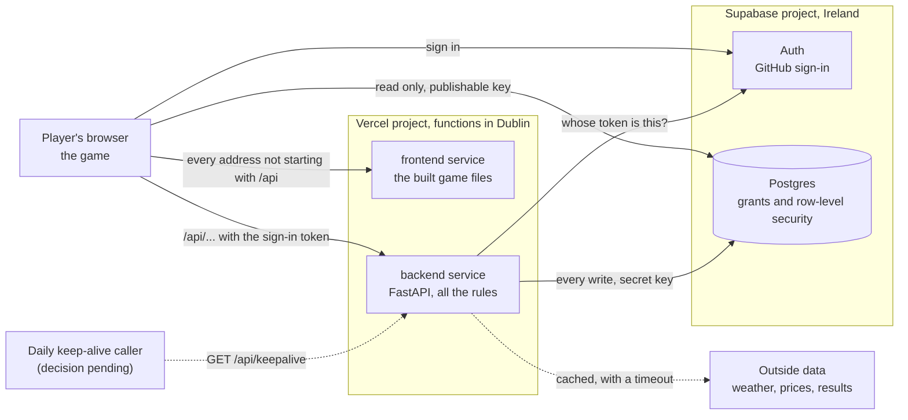

# Architecture

> **What this file is:** the big picture on one page: the parts of The Great Plot Twist, how they talk, who may do what, where each secret lives, the path of one request, the three environments and the hosting facts.
>
> **Who uses it:** every teammate and coding agent, before the first task and whenever you wonder where something belongs.

The details live elsewhere. One-time account setup is in [SETUP.md](SETUP.md). How we write code, and every command, is in [ENGINEERING.md](ENGINEERING.md). The exact shapes of routes, events and tables are in [INTERFACES.md](INTERFACES.md). The choices behind this page are in the [decision log](DECISIONS.md): D002 (hosting), D003 (rules on the server), D004 (the wallet) and D012 (crews and seats).

## 1. The parts

| Part | What it is | Where it lives |
|---|---|---|
| The game | The browser client: a top-down 2D world drawn with Three.js and built with Vite, in plain JavaScript. It shows the world and sends what the player wants to do. Its art style is decision D005, written by the graphics package (G1). | `frontend/`, added by G1. It may be missing on your branch. |
| The API | The Python server (FastAPI). Every game rule lives here, tested with pytest. | `backend/main.py` (the entry Vercel starts) and `backend/server/` |
| The database | Supabase: Postgres with row-level security, sign-in with GitHub (Supabase Auth), and Realtime (not used yet). | `supabase/migrations/`. How to apply it: [supabase/README.md](../supabase/README.md) |
| Outside data | Services we read but do not own, such as weather, prices and match results. Only the server calls them, through one adapter file each, with a cache, a timeout and a recorded fallback. | `backend/server/adapters/` (the pattern, with a worked example) and `backend/server/weather/` (the live weather from Open-Meteo, the first real source, wired into the game) |
| Hosting | One Vercel project with two Vercel Services, `frontend/` and `backend/`. | `vercel.json` |

## 2. The picture

Read it from the left. The browser loads the game from the frontend service and sends every action to the backend service. Both sit behind one web address: the rewrite in `vercel.json` sends every address that starts with `/api/` to the backend and everything else to the frontend. The browser talks to Supabase directly only to sign in and to read what row-level security allows. Dotted lines are not proven or not built: only some of the outside data is wired in so far (the live weather from Open-Meteo, `GET /api/weather`, and the Island Exchange prices from Binance, `GET /api/market`), and nothing calls the keep-alive route every day yet. Who will call it is an open decision for Nils. The box sits outside the Vercel project on purpose, because Vercel Cron cannot be used with our setup (see "The 7-day pause and the keep-alive" below).

## 3. Who may do what

Anyone can open the browser's developer tools, change the game's code and send their own requests. So the line we trust runs between the browser and our server.

- **The browser (not trusted).** It shows the game, signs in with GitHub, reads the rows that row-level security allows (every profile and wallet reason, plus its own save, wallet, ledger rows and crews) and sends intents to `/api`. It never decides money or progress, never writes a table and never holds a secret.
- **Our server (trusted).** It checks who is asking (the sign-in token), checks every input, applies the rules and does every write with the secret key. Coins move only through one database function. The player id always comes from the verified sign-in, never from the request.
- **The database (the last guard).** Every table has two locks: a grant (may this role use the table at all?) and row-level security (which rows?). Its own rules, such as "a balance is never below 0", hold even if the Python code has a bug. The full matrix is in [supabase/README.md](../supabase/README.md#who-may-do-what).

### Where each secret lives

Two values are not secret: the Supabase project URL and the publishable key. They may reach the browser, as `VITE_SUPABASE_URL` and `VITE_SUPABASE_PUBLISHABLE_KEY`, because the two locks protect every table.

| Secret | What it opens | Where it lives |
|---|---|---|
| `SUPABASE_SECRET_KEY` | Every table, skipping row-level security | Vercel environment variables, and your private `.env` |
| `CRON_SECRET` | The keep-alive route | Vercel environment variables, and later also the setting of whatever calls the route once a day (an open decision, see below). Optional in your `.env`: use a made-up value there. |
| The database password | The database itself | The Supabase dashboard and a password manager |
| The GitHub sign-in client secret | Our GitHub sign-in app | The Supabase dashboard (and GitHub's page for the app) |
| Later keys: `MARKET_DATA_API_KEY`, `SPORTS_API_KEY`, `LLM_API_KEY` | Outside services | Vercel environment variables, once their feature is built |

A secret never goes into Git, a `VITE_` variable, browser code, a log, a screenshot, a chat or a coding agent prompt. The full list of checks is the safety checklist in [ENGINEERING.md, section 6](ENGINEERING.md#6-safety-checklist).

## 4. The path of one request

Example: a player builds on their home islet, which costs coins. The route `POST /api/islet/build` is planned (package L2). Every other step exists today.

1. **Browser.** The player clicks Build. The game makes an `actionUid` for this one click and sends `POST /api/islet/build` with a JSON body and the header `Authorization: Bearer <token>`. The token comes from the GitHub sign-in through Supabase.
2. **Vercel.** The address starts with `/api/`, so the rewrite hands the request, unchanged, to the backend service.
3. **Who is asking?** FastAPI finds the route. Its `PlayerDep` asks Supabase Auth whose token this is and remembers the answer for 60 seconds. No token, or a bad one: `401`, and nothing else happens.
4. **Does the request fit?** A Pydantic model checks the body. A wrong shape: `422`.
5. **The rules.** A plain Python function decides: is the plot free, is the building type known, what does it cost? A refusal changes nothing.
6. **The coins.** `apply_transaction` in `backend/server/wallet.py` checks the amount and the reason, then calls the database function `apply_wallet_transaction` with the secret key. In one step the database checks the reason and its direction, takes the coins only if the balance stays at 0 or above, and writes the ledger row. The `actionUid` goes in as the `ref`, so a repeated click is refused (`409 already_applied`) and nobody pays twice. Too few coins: `409 insufficient_funds`.
7. **The answer.** The server saves the building and answers with JSON, and the browser shows it. To show the new balance, the browser can read its own wallet straight from Supabase: row-level security shows it only its own row.

If something on the server's side is down, the answer is `503`. For money that means "outcome unknown": look the `ref` up in the ledger before you try again ([ENGINEERING.md, recipe 4.1](ENGINEERING.md#41-add-an-api-endpoint)).

## 5. Three environments

| | Local | Preview | Production |
|---|---|---|---|
| What it is | Your laptop | A copy Vercel builds for every pushed branch | The copy Vercel builds from `main` |
| `APP_ENV` | `local` (or empty) | `preview` | `production` |
| Address | The API at `http://127.0.0.1:8000/api/...`, the game at the address Vite prints | A preview address that asks for a Vercel login | The public production address. Use this one in class. |
| Settings come from | `.env` in the repository root, passed with `--env-file ../.env` | Vercel environment variables | Vercel environment variables |
| Database | The team's Supabase project, if your `.env` holds its values. With empty values the API still starts, and the routes that need Supabase answer `503`. | The team's Supabase project | The team's Supabase project |
| `/api/docs`, the list of routes | yes | yes | no |
| Daily keep-alive call | no | no | not yet: the route exists, but nothing calls it once a day. Who will is an open decision (see "The 7-day pause and the keep-alive" below). `vercel.json` holds no cron entry, and must never get one. |

On your laptop the game and the API are two programs on two ports. On Vercel they share one address. The commands are in [ENGINEERING.md, section 3](ENGINEERING.md#3-commands), including the small Vite setting that package G1 still has to add so the game can reach the API locally.

There is one Supabase project, and preview and production both use it ([SETUP.md](SETUP.md), Step 4, gives both the same values). Whatever you create on a preview lands in the same database as production.

## 6. Hosting facts

Settled with Nils on 5 Nov 2026 (D002) and checked against the official docs the same day.

- **Vercel Hobby** (free, for non-commercial use only): one project with two Vercel Services, a Beta feature available on every plan. Functions run in one region, Dublin (`dub1`). It is set in the dashboard (Settings > Functions), because new projects start in Washington (`iad1`).
- **Supabase Free:** one project in West EU (Ireland), `eu-west-1`, next to the functions. Project settings: Data API on; "Automatically expose new tables" off, so every table and function needs explicit grants; "Enable automatic RLS" on; sign-in with GitHub only (email sign-in off); no Supabase GitHub integration.
- **Portable on purpose.** The game is a static site and the API is a plain FastAPI app. If the course publishes deployment rules later, moving costs little.

Free-tier limits that matter to us:

| Service | Limit | What it means for us |
|---|---|---|
| Vercel | 100 deployments a day, one build at a time | Every pushed branch builds a preview. A busy afternoon can get close. |
| Vercel | A function runs for at most 300 seconds | Fine for requests. No long loops and no long-lived connections. |
| Vercel | Each month: 1,000,000 function calls and 100 GB of data to visitors | Never leave a loop polling the API. |
| Vercel | Going over the free usage pauses the project for up to 30 days | Nothing is billed, it just stops. A runaway loop before the demo is the risk. |
| Vercel | Cron jobs (tasks that run on a timer) run at most once a day, accurate to the hour, on production only | We cannot use them together with Services: a `crons` entry in `vercel.json` broke our deploys (see the keep-alive below). Nothing runs on a timer inside Vercel, so live prices and scores are fetched when a player asks, through the cached adapters. |
| Supabase | 2 active free projects per person who is Owner or Administrator | Teammates are invited as Developer. |
| Supabase | A project pauses after 7 days of low activity | See the keep-alive below. |
| Supabase | Realtime: 200 connections, 100 messages a second, 2 million a month, and every delivered copy counts | Small rooms and few updates. The budget is in [INTERFACES.md](INTERFACES.md#7-realtime-budget). |
| Supabase | Sign-in limits count per IP address (for example 30 sign-ins per 5 minutes). The built-in mailer sends 2 emails an hour, only to team members. | A class on one Wi-Fi shares one address. We use GitHub sign-in only. |

### The 7-day pause and the keep-alive

A free Supabase project pauses after 7 days of low activity. Waking it takes a few minutes in the dashboard, and a paused project can be restored for up to a year.

- **Built:** `GET /api/keepalive` reads one row from each of three tables (`profiles`, `wallet_reasons` and `crews`), which counts as database activity. It answers only a caller that sends `Authorization: Bearer <CRON_SECRET>` ([INTERFACES.md](INTERFACES.md#get-apikeepalive)). The setting keeps the name `CRON_SECRET` from the time we planned to use Vercel Cron. Whatever calls the route sends that value.
- **Found on 5 Nov 2026: a cron entry breaks our deploys.** A cron job is a task that runs on a timer. We added one to `vercel.json`, a `crons` entry that called `/api/keepalive` once a day. Production then stayed on `589baea` (the S1 merge) and did not pick up the next two merges, `3e80605` (live weather) and `c8bac2b` (the backbone check, which added the entry). Commit `409316e` took the entry out, and the next production deploy went live within about 8 minutes: `/api/weather` answered 200, `/api/me` answered 401 without a token (correct) and `/auth-check.html` answered 200. So a `crons` entry in `vercel.json` together with Vercel Services breaks the deploy on our Hobby project. We cannot see the failed deploy from outside, because Vercel keeps serving the last good deploy. **Never add `crons` back to `vercel.json` while we use Services.**
- **Open decision for Nils: what calls the route once a day.** The route stays, with its secret. Nothing calls it yet. The options:
  - **a.** A scheduled GitHub Actions workflow in this public repository. It is free on public repositories, but Nils' rule is to ask before any GitHub Actions run, and GitHub turns scheduled workflows off after 60 days without activity in the repository.
  - **b.** A free outside scheduler or uptime monitor that calls the route with the secret. It needs an account that Nils creates.
  - **c.** Supabase Cron, if it is on the free plan and if its activity counts against the pause. We have not checked either.
- **Until it is decided:** we rely on the team's normal use of the project, which counts as activity, and on the manual check in the next point.
- **Always in demo week:** open the Supabase dashboard yourself, and check the day before the demo that the project is active. Supabase says a few requests a day usually keep a project awake, but it promises nothing. If the demo is on Fri 4 Dec, it comes 11 days after the submission on Mon 23 Nov, which is longer than the 7 days.
