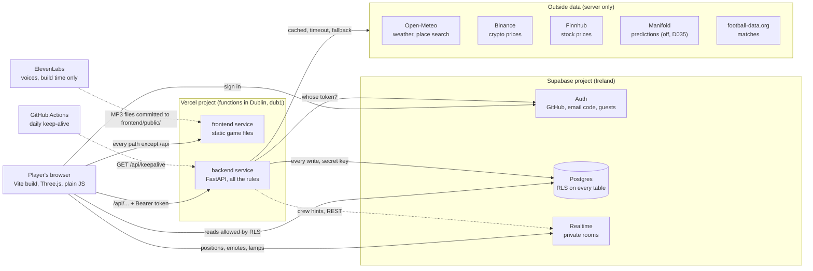
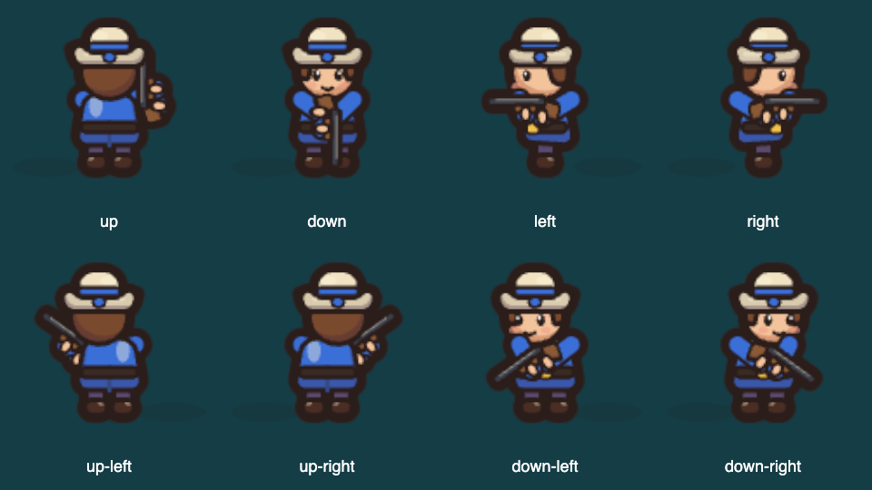

# Repository walkthrough

> **What this file is:** the sheet every member uses to answer the staff's walkthrough questions
> (task A1 in [FINAL-ROADMAP.md](FINAL-ROADMAP.md)): how each part is built, why, its limits and
> how it could change. Every statement points to the file that proves it. The test side is in
> [TEST-MAP.md](TEST-MAP.md).
>
> **Status:** started on Wed 11 Nov 2026 from `main` at `b0b6fd3`; parts 8 and 11 to 14 rewritten for
> the multiplayer tower defense from `main` at `e9cbf5d` (Wed 11 Nov, evening). The Harbor and look-and-feel
> pages (part 15) are frames: the lane's members write them.
> Parts 16 to 28 (Fri 13 Nov, from `main` at `6c9ffb3`) cover the v3 game: rooms, the shared simulation,
> captain health, the campaign, research, tower tiers, tear-down, house roles, the captain tree, wave events,
> the narrator, the cartoon art and the database. Each ends with the tests that cover it and likely questions.
> Where a v3 part contradicts parts 8 to 14, the v3 part is right (see the list at the end).

## Overview

The Great Plot Twist is a browser game. The browser draws a pixel world (the Saltreach Isles) with Three.js and sends what the player wants to do to our Python API. The API is FastAPI. It checks who is asking, applies every rule and writes to a Supabase Postgres database with a secret key. Vercel hosts both parts under one address: `/api/...` goes to the API, everything else to the static game ([vercel.json](../vercel.json)). Supabase also handles sign-in (GitHub, email code, guests) and the live rooms where players see each other move. The API reads real data from five outside providers. On 10 Nov the team dropped the 2-hour mystery ([D031](DECISIONS.md)). Since 11 Nov the game is a multiplayer pixel-art tower defense: build and upgrade towers on your own island, fight pirate waves up to wave 100 with up to three friends, trade at the Harbor, and fight the armada together at Pirate Point ([TOWER-DEFENSE.md](TOWER-DEFENSE.md), [D036](DECISIONS.md)).

## If they ask about X, read section Y

| They ask about | Read |
|---|---|
| The game in the browser, Three.js, art, loading speed | [1. The browser game](#1-the-browser-game) |
| FastAPI, routes, flags, errors, rate limits | [2. The Python API](#2-the-python-api) |
| Where data is stored, tables, RLS, coins | [3. Data and database](#3-data-and-database) and [Q1](#q1-where-is-the-data-stored) |
| Login, guests, the class code | [4. Sign-in](#4-sign-in) |
| Multiplayer, seeing other players | [5. Live multiplayer](#5-live-multiplayer) |
| An outside API is down | [6. External data](#6-external-data-and-what-happens-when-a-provider-is-down) and [Q3](#q3-what-happens-if-an-external-api-is-unavailable) |
| The class demo, QR, lamps, duel | [7. The class demo](#7-the-class-demo) |
| Islands, prices, unlocks, cheating on loot | [8. Islands, tower defense and the economy](#8-islands-tower-defense-and-the-economy-server) |
| Hosting, deploys, monitoring | [9. Deployment and operations](#9-deployment-and-operations) |
| Secrets, attacks, dependencies | [10. Security](#10-security) |
| The waves, towers, balance, determinism | [11. The tower defense in the browser](#11-the-tower-defense-in-the-browser) |
| How 4 players see the same battle | [12. Same battle for four players](#12-how-four-players-see-the-same-battle) |
| Inviting a friend, guests on an island | [13. The friend invite](#13-the-friend-invite-and-guest-admission) |
| Why the pixel art is sharp | [14. Clean pixel rendering](#14-clean-pixel-rendering) |
| Harbor stalls, the HUD | [15. Lane pages still to write](#15-lane-pages-still-to-write-the-harbor-and-the-look-and-feel) |
| Games, the lobby, 10 players, one island | [16. Rooms](#16-rooms-games-the-lobby-and-ten-players) |
| Why all screens show the same battle | [17. Simulation and sync](#17-the-same-battle-on-every-screen-the-simulation-sync-and-live-rules) |
| A captain falls, help-up for coins | [18. Captain health](#18-captain-health-falling-and-help-up) |
| What opens after which wave, the Harbor gate, the wreck | [19. The campaign](#19-the-campaign-unlocks-the-harbor-gate-and-the-wreck) |
| The Tech hub and team choices | [20. Tech hub](#20-the-tech-hub-research-tiers-and-team-choices) |
| Tower levels 4 and 5, waves 30 to 100 | [21. Tiers and the late game](#21-tower-levels-4-and-5-and-the-late-game) |
| Tearing a building down, refunds | [22. Tear down](#22-tearing-a-building-down-and-the-refunds) |
| Barracks, Tavern, Workshop | [23. House roles](#23-house-roles) |
| Captain skills, roles, respec | [24. Captain tree](#24-the-captain-tree-roles-and-respec) |
| Wave events, boss finishers | [25. Events and finishers](#25-wave-events-and-boss-finishers) |
| The voice, lines, captions | [26. The narrator](#26-the-narrator-lines-the-voice-pipeline-and-captions) |
| The cartoon art | [27. Cartoon art](#27-the-cartoon-art-drawn-in-code) |
| Money functions, security invoker, migrations, md5, RLS | [28. Database and server in v3](#28-the-database-and-the-server-in-v3) |
| Captain shooting angles, arms and body/gun overlap | [30. Shooting direction](#30-captain-shooting-direction--ianno-hollensteiner-t27) |
| Tests | [Q2](#q2-what-do-the-tests-cover-and-what-do-they-not-cover) and [TEST-MAP.md](TEST-MAP.md) |

## 1. The browser game

### What it does
Shows the title (Play, Join, Settings), the pixel islands, the sea chart and sailing, the HUD and the panels: the Harbor cards (market stall, match board, weather board), the Home islet build panel, account, settings. It plays voiced cutscenes and procedural sound. It never decides coins or progress: it sends intents.

### Where it lives
- Entry: [frontend/index.html](../frontend/index.html), [frontend/src/main.js](../frontend/src/main.js) (title), [frontend/src/game.js](../frontend/src/game.js) (the world, imports Three.js).
- World and places: [frontend/src/world/](../frontend/src/world/), place ids in [world/places/registry.js](../frontend/src/world/places/registry.js) (`home_islet`, `saltreach_harbor`, `lighthouse_isle`).
- Panels: [frontend/src/screens/](../frontend/src/screens/); shared UI kit: [frontend/src/ui/kit/](../frontend/src/ui/kit/).
- Talking to the API: [frontend/src/online/api.js](../frontend/src/online/api.js); fake vs. real adapter: [frontend/src/adapter/select.js](../frontend/src/adapter/select.js).
- Art: generated by Pillow scripts in [frontend/scripts/pixel_art/](../frontend/scripts/pixel_art/), credited in [frontend/ASSETS.md](../frontend/ASSETS.md). Build config: [frontend/vite.config.js](../frontend/vite.config.js).

### Why it was built this way
- Vite builds a plain static site, which Vercel serves for free and which moves easily ([D002](DECISIONS.md)).
- Plain JavaScript, two runtime packages only: `three` and `@supabase/supabase-js`, both pinned exactly ([frontend/package.json](../frontend/package.json)).
- Three.js draws the top-down 2D world on the GPU; the art is original, so no licence risk ([D005, D028](DECISIONS.md)).
- Lazy loading: `main.js` paints the title first and loads the world with `import()` after the first paint ([shell/world-loader.js](../frontend/src/shell/world-loader.js)). Audio loads on the first tap ([audio/lazy.js](../frontend/src/audio/lazy.js)), the online adapter on demand ([adapter/lazy-online.js](../frontend/src/adapter/lazy-online.js)). Phones on class Wi-Fi see the title fast.
- Budgets are enforced by [scripts/check-loading.js](../frontend/scripts/check-loading.js): cold title JavaScript at most 21,080 bytes, cold CSS under 12 kB, title image at most 350 kB.

### Limits
- The browser is not trusted: anyone can change its code. That is why rules live on the server ([D003](DECISIONS.md)).
- Needs WebGL. Budgets are measured by a script on a built copy, not on real phones.
- The real-browser checks need an installed Chrome and run by hand, not in CI (part 9, [TEST-MAP.md](TEST-MAP.md)).
- Leftovers from the mystery remain in places, for example the old islet panel still uses `/api/islet`.

### How it could change
TypeScript for the shared contracts; split large files; a service worker for offline play; the pirate, island and Harbor folders (parts 11 to 15) plug into the same event bus ([core/events.js](../frontend/src/core/events.js)).

## 2. The Python API

### What it does
Every rule and every write. It checks the sign-in token, validates the input, applies the rule, calls the database with the secret key and answers JSON.

### Where it lives
- Entry for Vercel: [backend/main.py](../backend/main.py) builds `app = create_app()`.
- [backend/server/app.py](../backend/server/app.py): creates the app, plugs in 30 route modules from [backend/server/routes/](../backend/server/routes/) (69 route handlers), the budgets and the error handlers.
- Feature folders: `island/`, `market/`, `predictions/`, `sports/`, `weather/`, `duels/`, `lock/`, `demo/`, `game/` (case and islet) under [backend/server/](../backend/server/).
- Settings: [settings.py](../backend/server/settings.py) is the only file that reads environment variables. Flags: [flags.py](../backend/server/flags.py). Errors: [errors.py](../backend/server/errors.py). Default cache header and safe logging: [request_policy.py](../backend/server/request_policy.py).
- Server-only content (prices, questions, recorded fallbacks): [backend/content/](../backend/content/).

### Why it was built this way
- FastAPI is plain Python, like the course, and its Pydantic models reject a wrong body with `422` before our code runs. pytest tests it without a browser ([D002, D003](DECISIONS.md)).
- `create_app()` takes every service as an argument, so tests pass fakes and never touch the network or the real environment ([app.py](../backend/server/app.py) docstring).
- Feature flags: twelve names in `FLAG_NAMES`, all off unless `FEATURE_FLAGS` lists them; a typo stops the server at start ([flags.py](../backend/server/flags.py)). A route behind an off flag answers `404 feature_off` (for example [routes/island.py](../backend/server/routes/island.py)).
- One error shape everywhere: `{"error": {"code": "...", "message": "..."}}`, never a stack trace ([errors.py](../backend/server/errors.py)).
- Rate limits per player: island builds 30 a minute, visits 30, bell/join/finish 20, wave reads 30 ([app.py](../backend/server/app.py)); lock 30 a minute, place search 10, class-code joins 10 per 10 minutes per player and per address ([lock/limits.py](../backend/server/lock/limits.py)). Over the limit: `429` with `Retry-After`.
- Every answer defaults to `Cache-Control: private, no-store`, and logs hold the route template, status and time only, never raw paths ([request_policy.py](../backend/server/request_policy.py)).

### Limits
- Budgets and caches live in memory, per server instance. Vercel may run several instances, so a limit holds per instance only ([adapters/base.py](../backend/server/adapters/base.py)).
- Every action is a round trip; nothing runs on a timer inside Vercel ([ARCHITECTURE.md](ARCHITECTURE.md), hosting facts).
- The mystery's case code (`game/case_*.py`, `routes/case.py`, `board.py`, `finale.py`, `crews.py`, `save.py`, `intro.py`, `world.py`, `host_case.py`) is still mounted in `app.py`. The browser no longer calls it and the `case` flag is off by default; it is dead weight to remove ([D031](DECISIONS.md)).
- `/api/docs` is served in local and preview only, not in production ([app.py](../backend/server/app.py)).

### How it could change
Delete the case code (task C1); move the budgets into the database or a shared store so they hold across instances; add OpenAPI-generated client types for the browser.

## 3. Data and database

### What it does
Stores players, profiles, wallets, the coin ledger, buildings, islands, waves, stakes, duels and demo admissions. It is the last guard: its own rules hold even if the Python has a bug.

### Where it lives
- 24 migrations in [supabase/migrations/](../supabase/migrations/), applied in order; how to apply them and the full access matrix: [supabase/README.md](../supabase/README.md).
- The wallet: [backend/server/wallet.py](../backend/server/wallet.py) and the SQL function `apply_wallet_transaction` (foundation migration). The server's database client: [supabase_admin.py](../backend/server/supabase_admin.py).
- Table list and columns: [INTERFACES.md, section 4](INTERFACES.md) and [DATA-INVENTORY.md](DATA-INVENTORY.md).

### Why it was built this way
- Supabase gives Postgres, Auth and Realtime in one free project in Ireland, next to the Dublin functions ([D002](DECISIONS.md)).
- Two locks on every table: a grant and row-level security. All 53 tables the migrations create have `enable row level security`. Tables only the server uses (islands, wave_runs, wave_participants, pirate_point_buildings, demo_guests, ...) have RLS on and no browser policy ([20261110010000_islands_and_waves.sql](../supabase/migrations/20261110010000_islands_and_waves.sql) header).
- Server-only functions: the money and game functions are granted to `service_role` only, for example `island_open`, `wave_start`, `wave_finish` (same migration).
- One ledger: coins change only through `apply_wallet_transaction`, which checks the reason and its direction (`earn`, `spend`, `either`), keeps the balance at 0 or above and writes the ledger row in one step. Every change needs a `ref`, and a repeated `ref` is refused, so a double click never pays twice ([D004](DECISIONS.md), [wallet.py](../backend/server/wallet.py)).
- Play money only: no purchase, no cash-out, no prizes. That keeps us away from gambling rules and inside Supabase's and Vercel Hobby's terms ([D004](DECISIONS.md), [PRIVACY.md](PRIVACY.md)).

### Limits
- One Supabase project serves preview and production: a test on a preview writes to the real database ([ARCHITECTURE.md](ARCHITECTURE.md), section 5).
- A free project pauses after 7 days of low activity; see the keep-alive in part 9.
- A migration is never edited after it is applied; fixes are new files. Re-applying an old migration alone would restore an unguarded policy ([D030](DECISIONS.md) limits).
- The case tables stay in the database unused ([PITCH.md](PITCH.md), "What we cut").
- A `503` from a money call means "outcome unknown": look up the `ref` in the ledger before retrying ([ARCHITECTURE.md](ARCHITECTURE.md), section 4).

### How it could change
A second Supabase project for previews; a migration that drops the case tables; database-side rate limits.

## 4. Sign-in

### What it does
Three ways in: GitHub (OAuth with PKCE), a 6-digit email code (Supabase email OTP), and guests (Supabase anonymous users) who type or scan the current class code.

### Where it lives
- Browser: [frontend/src/online/auth.js](../frontend/src/online/auth.js), [session.js](../frontend/src/online/session.js), the account screen [frontend/src/screens/account/](../frontend/src/screens/account/).
- Server: [backend/server/auth.py](../backend/server/auth.py) (token check), [sign_in_code.py](../backend/server/sign_in_code.py) (PKCE exchange), [demo/gate.py](../backend/server/demo/gate.py) (guest gate), [routes/demo.py](../backend/server/routes/demo.py) (`POST /api/demo/join`).
- Database guard: [20261109020000_class_code.sql](../supabase/migrations/20261109020000_class_code.sql).
- Which providers the browser offers: `AUTH_PROVIDERS` in [settings.py](../backend/server/settings.py), shown by `GET /api/config`.

### Why it was built this way
- The server asks Supabase "whose token is this?" and caches the answer 60 seconds by a SHA-256 hash of the token, never the token itself ([auth.py](../backend/server/auth.py)). The player id always comes from the verified token, never from the request.
- A QR join must take seconds, so guests need no account ([D029](DECISIONS.md)).
- The class-code gate: anyone can create an anonymous user with the public key, so the QR is not a lock. The locks are (1) the server gate: a guest not in `demo_guests` gets `403 demo_closed` on every gated route, and (2) the guest guard in the policies: every browser and Realtime policy adds `(not jwt_is_anonymous() or is_admitted_guest())` ([D030](DECISIONS.md), [SECURITY.md](SECURITY.md)).
- The join compares the code in constant time; 5 symbols from a 31-letter alphabet give about 28.6 million codes, and the budget makes guessing slow ([D030](DECISIONS.md)).

### Limits
- The join budget is per server instance ([D030](DECISIONS.md)).
- Email sign-in needs a mail service set up in Supabase (Brevo SMTP, [OPEN-TODOS.md](OPEN-TODOS.md) 4b); without it email stays hidden.
- A deleted or signed-out user may still pass for up to 60 seconds on one instance ([auth.py](../backend/server/auth.py)).
- Supabase's sign-in limits count per IP address, and a whole class shares one Wi-Fi address ([ARCHITECTURE.md](ARCHITECTURE.md), free-tier limits).

### How it could change
Google or university SSO as another provider; per-lecture expiry of the class code; a lock-out counter in the database instead of memory.

## 5. Live multiplayer

### What it does
Players in the same place see each other's captains move and send preset emotes. In the class harbor up to 40 others are drawn; the lamps and duel invitations travel in the same room.

### Where it lives
- [frontend/src/online/realtime.js](../frontend/src/online/realtime.js) and its parts [frontend/src/net/live-*.js](../frontend/src/net/) (rules in [live-rules.js](../frontend/src/net/live-rules.js)).
- Access rules: [20261106050000_live_presence.sql](../supabase/migrations/20261106050000_live_presence.sql) plus the guest guard of the class-code migration.
- Server hints to a crew: [backend/server/crew_broadcast.py](../backend/server/crew_broadcast.py) (one REST call, no socket).
- Contract and budget: [INTERFACES.md, section 7](INTERFACES.md#7-realtime-budget); decision [D023](DECISIONS.md).

### Why it was built this way
- Supabase Realtime comes with the database and costs nothing on the free plan. Rooms are private: public access is off, so the policies on `realtime.messages` decide who may join ([ARCHITECTURE.md](ARCHITECTURE.md), hosting facts).
- Rooms are named `live:world` and `live:place:<place>:<room>`; the class demo uses `live:place:class_harbor:1` ([live-rules.js](../frontend/src/net/live-rules.js)).
- The free plan allows 100 messages a second for the project, so each client sends at most 2 position updates a second and slows down when the room is busy ([live-rules.js](../frontend/src/net/live-rules.js), `MIN_GAP_MS`, `LOAD_LIMIT`).
- **What is trusted and what is display-only:** positions, places, emotes and lamp states are only for showing. A modified browser can claim any position and change no game state. Coins, duels, the lock and waves are decided by the API ([ARCHITECTURE.md](ARCHITECTURE.md), section 3).

### Limits
- The browser starts presence only when `/api/config` says the flag `live_presence` is on ([online/adapter/presence.js](../frontend/src/online/adapter/presence.js)).
- About 66 players fit in the 200 free connections, and 2 million messages cover about 8 class sessions ([ARCHITECTURE.md](ARCHITECTURE.md)).
- No authoritative server state for positions: two phones can briefly disagree.

### How it could change
The pirate waves already reuse these rooms (part 12); a paid plan would raise the limits.

## 6. External data and what happens when a provider is down

### What it does
Real weather, crypto and stock prices, prediction questions and football results make the world "live". Only the server calls providers; the CSP lets the browser talk to our origin and Supabase only.

### Where it lives
- The shared pattern: [backend/server/adapters/base.py](../backend/server/adapters/base.py) (`CachedSource`: fresh cache → live call → stale value → recorded fallback → `503`).
- Weather: [weather/source.py](../backend/server/weather/source.py), [weather/open_meteo.py](../backend/server/weather/open_meteo.py), recording [backend/content/weather/recorded-fallback.json](../backend/content/weather/recorded-fallback.json).
- Market: [market/feed.py](../backend/server/market/feed.py), [market/binance.py](../backend/server/market/binance.py), [market/stock_finnhub.py](../backend/server/market/stock_finnhub.py), [market/states.py](../backend/server/market/states.py), [market/replay.py](../backend/server/market/replay.py).
- Predictions: [predictions/source.py](../backend/server/predictions/source.py), [predictions/manifold.py](../backend/server/predictions/manifold.py), recordings in [backend/content/predictions/recorded/](../backend/content/predictions/recorded/).
- Sports: [sports/source.py](../backend/server/sports/source.py), [sports/recorded.py](../backend/server/sports/recorded.py); decision [D033](DECISIONS.md).
- Keeper's Lock weather: [lock/weather.py](../backend/server/lock/weather.py); wave weather: [island/wave_weather.py](../backend/server/island/wave_weather.py).

### Why it was built this way
One adapter per provider, with a cache, a timeout (3 s; 5 s for football) and a fallback rule, so a slow provider never blocks the game and many players cause one outside call ([adapters/base.py](../backend/server/adapters/base.py)).

| Provider | Normal | When it is down |
|---|---|---|
| Open-Meteo (weather) | 10-minute cache, 3 s timeout | Last good answer ("stale"), then the recorded real answer ("fallback"); waits 10 minutes before asking again ([weather/source.py](../backend/server/weather/source.py)) |
| Open-Meteo (Keeper's Lock) | Per rounded place, 10 minutes | A reading up to 6 hours old, else the lock asks its riddle ([lock/weather.py](../backend/server/lock/weather.py)) |
| Open-Meteo (wave weather) | The bell-ringer's area | Falls through to the default place, then "calm"; the weather never stops a wave ([island/wave_weather.py](../backend/server/island/wave_weather.py)) |
| Binance (crypto) | Board accepts prices up to 60 s, a trade under 5 s | Old prices stay, marked "stale", and nobody can trade on them; the recorded replay never stands in live, only in demo mode ([market/feed.py](../backend/server/market/feed.py), [market/replay.py](../backend/server/market/replay.py)) |
| Finnhub (stocks) | One call per symbol, within a call budget | Same as Binance: last price, stale, no trading; a closed market shows "closed" with its last price ([market/states.py](../backend/server/market/states.py)) |
| Manifold (predictions; the game no longer calls it since 11 Nov, D035) | 2-minute cache | Stale answer, then the recording; nobody may stake on an answer older than 15 minutes ([predictions/source.py](../backend/server/predictions/source.py)) |
| football-data.org (sports) | One request for PL, PPL and CL, 60 s cache, 10 calls a minute | `503 sports_unavailable`; there is no stale or recorded stand-in in live mode. Recorded matches exist only in demo mode and never accept stakes ([sports/source.py](../backend/server/sports/source.py), [SECURITY.md](SECURITY.md)) |

### Limits
- **Finnhub currently rejects the key:** every stock request answered HTTP 401 in the live log on 10 Nov, so the stocks show no fresh price until the owner re-enters the key ([OPEN-TODOS.md](OPEN-TODOS.md) 4c).
- The fortune teller was removed from the game on 11 Nov at the owner's request (no prediction market, [D035](DECISIONS.md)); its backend code stays, switched off, for a later cleanup.
- Football shows no matches during the international break ([OPEN-TODOS.md](OPEN-TODOS.md), section 7).
- Binance can refuse some countries (HTTP 451) ([market/binance.py](../backend/server/market/binance.py)). Caches are per instance.

### How it could change
A shared cache (for example a database table) so all instances share one call; a recorded football fallback that is labelled and stake-free in live mode too; more questions.

## 7. The class demo

### What it does
The presenter shows a QR on the projector; ~30 phones join one shared class harbor in seconds. A quest strip asks for three things: wave to a captain, duel a captain, open the Keeper's Lock (a question about the real sky) ([quests.js](../frontend/src/class-demo/quests.js)). The finale: each lamp is lit by holding it for 2 seconds and burns for 20; when all three burn at once, the lighthouse relights.

### Where it lives
- [frontend/src/class-demo/](../frontend/src/class-demo/): `index.js` (wiring), `projector.js` (QR panel, host only, key **J**), `quests.js`, `duel-shortcut.js`, `lock-screen.js`, `lamps.js` and `lamp-sync.js`, `rehearsal.js` (`?demo=1&captains=40`).
- Server: [routes/demo.py](../backend/server/routes/demo.py), [routes/lock.py](../backend/server/routes/lock.py) and [lock/](../backend/server/lock/), duels in [duels/](../backend/server/duels/) (decision D026).
- Decisions [D029, D030](DECISIONS.md); host steps in [OPEN-TODOS.md](OPEN-TODOS.md), section 5.

### Why it was built this way
- Two players used to need 45 to 50 clicks and a GitHub account; the QR join needs none ([D029](DECISIONS.md)).
- The duel and the lock are decided by the server ([duels/rules.py](../backend/server/duels/rules.py), [routes/lock.py](../backend/server/routes/lock.py)). The shortcut duel has stake 0 ([duel-shortcut.js](../frontend/src/class-demo/duel-shortcut.js)).
- The lamps are a broadcast-only show: no table, no server; messages carry ages, not clock times, because phones have different clocks ([lamp-sync.js](../frontend/src/class-demo/lamp-sync.js)).
- The lock must never block the demo: cache, then riddle, then a hint path ([D029](DECISIONS.md)).

### Limits
- Since the lamps are display-only, a modified browser can fake a relight; it wins nothing.
- 40 real phones on one Wi-Fi have not been tested; the rehearsal simulates captains on one laptop.
- The lamps now also end the Pirate Point battle ([pirate-point.js](../frontend/src/pirates/pirate-point.js)); with four players and the lamps it is reviewed but not in `test:mp`.

### How it could change
A host-side "reset lamps" control.

## 8. Islands, tower defense and the economy (server)

### What it does
Each player owns an island with a code (`ISLE-` + 5 symbols) and 16 build spots. With coins they build and upgrade walls, cannons or mortars, a watchtower and houses, hire crew (gunner, carpenter, lookout) and level up their own captain. They ring a bell to start a wave (up to wave 100, a boss warship every 5th wave) and get loot for surviving. Friends on the island build there with their own coins (co-op). Pirate Point has ten shared spots that anyone can build. The rules are in [TOWER-DEFENSE.md](TOWER-DEFENSE.md); decisions [D032](DECISIONS.md) and [D036](DECISIONS.md).

### Where it lives
- [backend/server/island/](../backend/server/island/): `service.py` (look, build, upgrade, hire, captain, visit, invite), `rules.py` (what each spot shows, what may be built or upgraded, the unlocks), `catalogue.py` (loads the numbers), `pirate_point.py`, `waves.py` (start, join, current, finish), `store.py` (reads and the database functions), `codes.py`, `wave_weather.py`.
- Routes: [routes/island.py](../backend/server/routes/island.py), [routes/pirate_point.py](../backend/server/routes/pirate_point.py), [routes/waves.py](../backend/server/routes/waves.py).
- Every number: [backend/content/islands.json](../backend/content/islands.json): spots, prices per level, crew, captain levels, unlocks, starting coins (100), loot and wave timing. It is never served as a file; the browser gets the prices inside `GET /api/island`.
- Migrations: [20261110010000_islands_and_waves.sql](../supabase/migrations/20261110010000_islands_and_waves.sql) (`islands`, `wave_runs`), [20261110020000_wave_crews.sql](../supabase/migrations/20261110020000_wave_crews.sql) (`wave_participants`), [20261111030000_tower_defense.sql](../supabase/migrations/20261111030000_tower_defense.sql) (levels, crew, captain, `pirate_point_buildings`, the restart rule).

### Why it was built this way
- **Prices live on the server.** A build sends only `{spot, kind, actionUid, code?}` ([routes/island.py](../backend/server/routes/island.py)). The server reads the price from `islands.json` and passes it to one atomic database function per action (`island_build`, `island_upgrade`, `island_hire`, `island_captain`, `pp_build`, `pp_upgrade`). The function locks the wallet, then the row, and checks the maximum level and the unlocked level again ([tower_defense migration](../supabase/migrations/20261111030000_tower_defense.sql), rules 3 and 4).
- **Every click is safe to repeat.** The ledger row is the record: refs `island:<uid>`, `upgrade:<uid>`, `crew:<uid>`, `captain:<uid>`, `pp:<uid>`. A repeat answers `repeat: true` and pays nothing (same migration, rule 2).
- **Unlocks are enforced by the server.** A locked level or kind answers `409 locked` ("Unlocks after wave N"). Unlocks follow the best wave the player **won** anywhere, `islands.won_wave_best`, so friends who fight together unlock together ([D036](DECISIONS.md), [island/rules.py](../backend/server/island/rules.py)).
- **Co-op without new money paths.** A visitor's build passes `code: "ISLE-…"`; the caller pays with their own coins and their own unlocks, and the building belongs to the island. Crew and the captain stay personal ([TOWER-DEFENSE.md](TOWER-DEFENSE.md), section 6).
- **Loot caps.** A survived island wave pays at most 10 + 5 × wave + 5 × house levels, twice on a boss wave; Pirate Point pays 20 + 5 × wave; a lost or expired wave pays 0 (reason `pirate_loot`, one ref per wave and player) ([islands.json](../backend/content/islands.json) `loot`, [island/waves.py](../backend/server/island/waves.py)).
- **Timing.** 10 s countdown, a finish earlier than 15 s is refused with `409 wave_too_early` (the browser tries again), a wave expires after 900 s, the highest wave is 100, one running wave per island. After a lost wave the next bell rings the best wave minus 2, at least 1 ([islands.json](../backend/content/islands.json) `waves`).
- **A safe deploy.** `wave_finish()` got a new 11-argument version next to the old 8-argument one, so the server from before the migration kept working until the new code was deployed ([D036](DECISIONS.md)).

### What the browser is trusted for
Only its claim `survived` and `shipsSunk` (a whole number from 0 to 1000) in `POST /api/waves/finish` ([routes/waves.py](../backend/server/routes/waves.py), `MAX_SHIPS_SUNK`). The server cannot prove it. The loot cap, the 15-second minimum, one wave at a time per island and the wave budget (20 calls a minute per player, [app.py](../backend/server/app.py)) bound what a cheat can earn to small play-money amounts ([D032](DECISIONS.md)).

### Limits
- The server trusts the reported survival within the loot caps. A modified browser can claim every wave; it still waits at least 15 s per wave and earns at most the cap.
- The flagship and the three lamps are decided in the browsers; the server only flags the wave (`flagship: true`).
- The weather follows whoever rings the bell, because the server stores no place ([D032](DECISIONS.md)).
- The budgets live in memory per server instance (part 2).
- The numbers exist in more than one place: `islands.json` (the rule), the tower stats in the simulation's `CONFIG` ([frontend/src/pirates/sim.js](../frontend/src/pirates/sim.js)), the dev fake's copy of the prices ([frontend/src/pirates/fake-api.js](../frontend/src/pirates/fake-api.js)) and the docs. The `about` line of `islands.json` says they change together, by pull request.

### How it could change
Replay the seeded simulation on the server to check `survived` (the simulation is pure JavaScript, so it could run in a Node function); a weekly leaderboard of best waves (task T7 in [OPEN-TODOS.md](OPEN-TODOS.md)); a new tower kind needs `islands.json`, the simulation's `CONFIG`, a sprite and a new migration for the spot check rule.

## 9. Deployment and operations

### What it does
Builds and serves the game and the API from `main`; keeps the database awake; lets the host check the live site before class.

### Where it lives
- [vercel.json](../vercel.json): two Vercel Services (`frontend` with Vite, `backend` with `main:app`), the `/api/:path*` rewrite, region `dub1`, and the security headers.
- Keep-alive: [.github/workflows/keepalive.yml](../.github/workflows/keepalive.yml) calls `GET /api/keepalive` daily at 06:17 UTC; the route: [routes/keepalive.py](../backend/server/routes/keepalive.py).
- Smoke test: [scripts/smoke-live.sh](../scripts/smoke-live.sh) and [scripts/smoke-live.mjs](../scripts/smoke-live.mjs); runbook [RUNBOOK.md](RUNBOOK.md).
- Host console: [frontend/host.html](../frontend/host.html), [frontend/src/host/](../frontend/src/host/), [routes/host_console.py](../backend/server/routes/host_console.py); guide [HOST-CONSOLE.md](HOST-CONSOLE.md).

### Why it was built this way
- One address for the game and the API means no cross-origin setup ([D002](DECISIONS.md)).
- Functions in Dublin sit next to the Supabase project in Ireland.
- CSP in `vercel.json`: scripts, styles and images only from our origin; connections only to our origin and our Supabase project; no framing. Also `nosniff`, a referrer policy, a permissions policy that blocks camera, microphone and location, and `X-Frame-Options: DENY`.
- A `crons` entry in `vercel.json` broke our deploys on 5 Nov, so the keep-alive runs from GitHub Actions instead ([ARCHITECTURE.md](ARCHITECTURE.md), keep-alive).
- The smoke test runs signed out: home page and headers, `/api/health`, `/api/config` flags, a `401` with `no-store` on a private route, the build stamp, and a spoiler scan of the bundle ([smoke-live.mjs](../scripts/smoke-live.mjs)).

### Limits
- Vercel Hobby limits: 100 deploys a day, 300 s per function, 1 million calls a month; going over pauses the project ([ARCHITECTURE.md](ARCHITECTURE.md)).
- The only GitHub Actions workflow is the keep-alive: no CI runs the tests; each PR reports its own results.
- The smoke test does not check the database, sign-in or Realtime ("database readiness is not checked").
- We cannot see Vercel's environment variables from the repository, so which flags are on live is checked through `/api/config`, not the code.

### How it could change
A CI workflow that runs `pytest`, `npm test` and `npm run build` on every PR; separate preview database; uptime alerts.

## 10. Security

### What it does
Keeps secrets out of the browser and the repository, lets only the server write, and limits abuse.

### Where it lives
[SECURITY.md](SECURITY.md), [THREAT-MODEL.md](THREAT-MODEL.md), [.env.example](../.env.example), [settings.py](../backend/server/settings.py), [.gitignore](../.gitignore), [scripts/audit/](../scripts/audit/), [scripts/check-diff-secrets.py](../scripts/check-diff-secrets.py).

### Why it was built this way
- **Secrets:** `SUPABASE_SECRET_KEY`, `CRON_SECRET`, `STOCK_API_KEY` and `SPORTS_API_KEY` live only in Vercel settings and a private `.env` (ignored by Git). They are `SecretStr` in Python, so they print as `**********` ([settings.py](../backend/server/settings.py)). Only `VITE_` values reach the browser, and those are public by design. The ElevenLabs key is read from a private file only when the voice script runs ([scripts/voice/generate.py](../scripts/voice/generate.py)).
- **RLS and grants** on all 53 tables, money functions for `service_role` only (part 3).
- **Guest guard** in every browser and Realtime policy (part 4).
- **Input validation:** Pydantic models (`422`), plus rule checks such as "is the kind allowed on this spot" ([island/rules.py](../backend/server/island/rules.py)); tokens are bounded before any upstream call ([THREAT-MODEL.md](THREAT-MODEL.md)).
- **Rate limits** per player and per address (part 2).
- **Dependencies:** 2 runtime npm packages, pinned exactly; lockfiles `frontend/package-lock.json` and `backend/uv.lock`. `npm audit` reported 0 vulnerabilities on 11 Nov 2026; the recorded audit of 6 Nov is in [scripts/audit/npm-audit.json](../scripts/audit/npm-audit.json).

### Limits
- `backend/pyproject.toml` still uses `>=` ranges and `playwright-core` (dev only) uses `^`; `uv.lock` and `package-lock.json` fix the installed versions. Task E2 pins them exactly.
- Rate limits are per instance; one shared Supabase project for preview and production.
- [THREAT-MODEL.md](THREAT-MODEL.md) is a review of 6 Nov: its route inventory (55 pairs) predates the island, wave and class-code routes (69 handlers today).

### How it could change
Pin Python exactly (E2); remove the case routes (C1) to shrink the attack surface; a CI secret scan.

## 11. The tower defense in the browser

### What it does
Runs and draws each wave: pirate ships sail in on up to three sea lanes, cannons fire on their own, mortars hit an area, walls hold the shore, crew help, and every captain fires a musket (click or tap a ship, or press F). Every 5th wave brings a warship. After a won wave a 15-second break shows a big **Next wave** button; with **Auto next wave** on, the next wave starts by itself. A lost wave ends the run.

### Where it lives
- [frontend/src/pirates/](../frontend/src/pirates/): `sim.js` (the simulation and every balance number in `CONFIG`), `controller.js` (one wave from the bell to the loot, the break, the musket), `render.js` (ships, shots, fog), `hud.js`, `interact.js`, `pirate-point.js` (the armada and the lamps), `game-wiring.js` (the wiring into the running game), `fake-api.js` (`?islands=fake`), `index.js` (`mountPirates`).
- The island side: [frontend/src/island/](../frontend/src/island/): `index.js` (cards and the Menu entries Play with a friend, Crew, Captain), `spots.js` (the 16 spots, the bell, the cabin), `td-rules.js`, `wave-flow.js` and `wave-hooks.js` (start, join, finish routes), `api.js`, `mode.js`.
- The contract: [TOWER-DEFENSE.md](TOWER-DEFENSE.md), section 8.

### Why it was built this way
- **Deterministic.** The simulation uses a seeded random generator (mulberry32), a fixed 50 ms tick, and no `Math.random`, clock, DOM or Three.js. The whole fleet is planned up front, so the random sequence never depends on frame timing ([sim.js](../frontend/src/pirates/sim.js), header and `createWave`).
- **Why deterministic:** the server hands out only a seed, the wave number, the weather and `startsAt`. Every browser then computes the same battle by itself. We need no server game loop, which Vercel's short functions could not run anyway (part 2, "nothing runs on a timer inside Vercel"), and only a few small inputs travel between players (part 12).
- **One place for balance.** `CONFIG` holds every number: towers per level, crew, the captain's musket, the ships and the difficulty curve to wave 100. The balance tests play real waves against it: one level-1 cannon wins wave 1; the wave 5 boss needs 3 level-2 cannons and 2 walls; wave 10 needs about five upgraded towers with a mortar; nothing below wave 30 is impossible with a full island ([tests/pirates/td-sim.test.js](../frontend/tests/pirates/td-sim.test.js)).
- **Bad input is ignored.** A shot at an unknown ship, from out of range or before the reload is over does nothing (same test file, "captain musket").

### Limits
- The server trusts the reported survival within the loot caps (part 8). Nothing replays the wave on the server.
- Tower stats live only in the browser's `CONFIG`; the server checks prices, levels and unlocks, not what a tower does.
- A wave runs on the player's device. A slow phone catches up by running several ticks in one step, at most 30 simulated seconds per step (`CONFIG.maxStep`).
- The pirates sail off after 150 s (`CONFIG.maxTime`), so a long wave always ends.

### How it could change
A new tower or ship type (tasks T1 and T2 in [OPEN-TODOS.md](OPEN-TODOS.md)): stats in `CONFIG`, a sprite, a build-card line, a balance test. A balance pass (T3) only changes `CONFIG` and keeps the balance tests green.

## 12. How four players see the same battle

### What it does
Up to four players on one island, and everyone at Pirate Point, fight the same wave: the same ships at the same tick, every shot and repair on every screen.

### Where it lives
[frontend/src/pirates/sync.js](../frontend/src/pirates/sync.js) (the rules), [room.js](../frontend/src/pirates/room.js) (room wrappers), [game-wiring.js](../frontend/src/pirates/game-wiring.js) (rooms, joins, co-op refresh), [frontend/src/net/live-rules.js](../frontend/src/net/live-rules.js) (`WAVE_EVENTS` and the message check), and the Realtime rooms of part 5.

### Why it was built this way
- **Rooms.** One Supabase Realtime broadcast room per island, `live:place:isle_<code>:1`, and one for Pirate Point, `live:place:pirate_point:1`. The wave events are `wave_start`, `cannon_shot`, `wall_repair`, `lamps_lit`, `lamp`, `captain_shot` and `island_changed`; every arriving message must pass a field check, or it is dropped ([live-rules.js](../frontend/src/net/live-rules.js)).
- **Same clock.** Tick *k* covers server time `startsAt + k × 50 ms`, so every client counts the same ticks ([sync.js](../frontend/src/pirates/sync.js)).
- **Target-tick inputs.** A shot, a repair or the lamps are never applied at once. Each is stamped with a target tick 4 ticks (200 ms) ahead (`INPUT_LEAD_TICKS`), applied locally at that tick and broadcast with it. Inputs of one tick run in a fixed order (by sender, then sequence number), so the order of arrival does not matter.
- **Re-sent `wave_start`.** The bell-ringer sends `wave_start` into the room, and again after 2 and 6 s, for a friend whose room was still joining. A friend who lands while a wave runs joins it, once per landing ([game-wiring.js](../frontend/src/pirates/game-wiring.js)).
- **Single-flight join.** Only one join request runs at a time, however many `wave_start` messages arrive, because wave reads have a budget of 30 a minute ([game-wiring.js](../frontend/src/pirates/game-wiring.js), the `joining` guard; [app.py](../backend/server/app.py)). A "Next wave" that finds the other captain's wave running joins it, so two clicks at once end in one wave.
- **Co-op builds.** Every build or upgrade sends `island_changed` with the spot; every other defender reads the island again within about a second. The island is read once more before a wave starts, so a friend's new wall is in it ([tests/pirates/multiplayer.test.js](../frontend/tests/pirates/multiplayer.test.js)).
- **Why this way:** Realtime comes free with Supabase and already carries positions; sending a few inputs is far cheaper than sending ship states, and the free plan allows 100 messages a second for the whole project (part 5).

### Limits
- **Late packets drift.** A message that arrives after its tick (a slow phone, a lost packet, a friend who joined mid-wave and missed earlier shots) is applied at the next tick instead. That client's wave can drift a little: a ship sinks a moment later, or one shot more or less. Nothing repairs it afterwards ([sync.js](../frontend/src/pirates/sync.js), header).
- **No server authority over ship positions.** Each browser is its own judge, and each player finishes for themselves; the caps keep a drifted result from paying more than an honest one (part 8).
- "Up to four" is a design number (`MAX_PLAYERS` in `sync.js`, "Send this link to up to 3 friends" on the invite card); nothing refuses a fifth player.
- A refused live room is not retried; a page reload fixes it. Pirate Point with four players and the lamps is not yet in `test:mp` ([OPEN-TODOS.md](OPEN-TODOS.md), section 7).

### How it could change
Clients compare a hash of the state every few seconds and show a warning on drift; one player (the host) sends periodic snapshots; or the server replays the inputs.

## 13. The friend invite and guest admission

### What it does
Menu → **Play with a friend** shows a link `…/?visit=ISLE-XXXXX` and a QR. The friend opens it, presses **Join** (as a guest, or signs in with GitHub) and lands on the island.

### Where it lives
- Browser: [frontend/src/shell/invite.js](../frontend/src/shell/invite.js) (the landing screen), [frontend/src/island/codes.js](../frontend/src/island/codes.js) (the code, kept in `sessionStorage`), [island/card-model.js](../frontend/src/island/card-model.js) (`inviteModel`).
- Server: `POST /api/island/invite/join` in [routes/island.py](../backend/server/routes/island.py), `invite()` in [island/service.py](../backend/server/island/service.py), the guest gate in [demo/gate.py](../backend/server/demo/gate.py).
- Database guard: [20261109020000_class_code.sql](../supabase/migrations/20261109020000_class_code.sql).

### Why it was built this way
- **An island code admits a guest like the class code.** The route records the anonymous guest in `demo_guests` with the same admission as `POST /api/demo/join`. From then on the server's guest gate lets them through, and so does the guest guard in every browser and Realtime policy, `(not jwt_is_anonymous() or is_admitted_guest())` (part 4, [D030](DECISIONS.md), [D036](DECISIONS.md)). No new security path was needed.
- The route checks the login itself, without the gate, because a guest comes here to get through it. Only the one typed code is looked up, so nothing about other codes leaks.
- Guessing is slow: 10 tries in 10 minutes per player and per address, like the class code ([app.py](../backend/server/app.py) `invite_budget`, [routes/demo.py](../backend/server/routes/demo.py)). A guest gets `403 demo_closed` while the `demo` flag is off.

### Limits
- The island code is not a secret: anyone with the link can join, fight and build there with their own coins. They cannot spend the owner's coins. There is no kick or revoke.
- The budget is per server instance (part 2).

### How it could change
A new island code on request (like **New class code**), an owner's "let them in?" prompt, and a kick button.

## 14. Clean pixel rendering

### What it does
Every art pixel is the same sharp square on every screen: 1280 × 720, 1080p, retina and phones, standing still or moving.

### Where it lives
[frontend/src/core/renderer.js](../frontend/src/core/renderer.js), [frontend/src/pixel/display.js](../frontend/src/pixel/display.js) (`nativeViewport`, `pixelStep`, `pixelZoom`), [frontend/src/player/camera.js](../frontend/src/player/camera.js).

### Why it was built this way
- **Integer scaling.** The world draws 1:1 at 16 native pixels per world unit into a small buffer, without antialiasing. The browser magnifies it by a whole number of device pixels (`image-rendering: pixelated`) ([renderer.js](../frontend/src/core/renderer.js), header). With a fractional scale some art pixels would be one screen pixel wider than others.
- **Snapped camera.** The follow stays continuous, so small movements add up, but the drawn camera sits on whole native pixels (`snap`: 1/16 of a unit) and its zoom moves in whole device-pixel steps ([camera.js](../frontend/src/player/camera.js)). Without the snap the art shimmers while the camera moves.

### Limits
- Because the scale moves in whole steps, the visible part of the world changes in steps when the window is resized.
- On a slow device the frame budget lowers the density of the buffer ([display.js](../frontend/src/pixel/display.js), `createFrameBudget`).
- Checked in headless Chrome by `npm run test:art` ([scripts/check-pixel.js](../frontend/scripts/check-pixel.js)), not on real phones.

### How it could change
A sharper scaling mode for very large screens, or a setting for a fixed scale.

## 15. Lane pages still to write: the Harbor and the look and feel

These frames are **to be written by the lane's members** (what, where, why, limits, how it could change).

### Lane H: Harbor and coins
- **Where it lives:** [frontend/src/harbor/](../frontend/src/harbor/) (the market stall, the match board, the weather board, the overview), [frontend/src/lib/coins.js](../frontend/src/lib/coins.js), the server parts in part 6 and [D034](DECISIONS.md).
- **Known facts:** whole coins; stakes of 5, 10 or 25; the market stall is "Up or down in 5 minutes?" with 2 × stake for a right call ([D034](DECISIONS.md)); no prediction market ([D035](DECISIONS.md)).
- **T26 verification:** the existing Harbor card tests passed locally; see [the recorded evidence](handoff/T26-weather-board.md).

### T26: opening weather from the island Harbor (Ianno Hollensteiner)

- **What and where:** after wave 4, [harborModel](../frontend/src/island/card-model.js) lists Weather board alongside the market and match boards. [game.js](../frontend/src/game.js) routes that selection to the existing [Harbor host](../frontend/src/harbor/host.js). The island closes its card before opening the weather dialog.
- **Why:** reuse the [weather card](../frontend/src/harbor/overview.js) and the reading already fetched by [net/weather.js](../frontend/src/net/weather.js), rather than add a second request or another weather screen. [island.css](../frontend/src/island/island.css) stacks stall text and buttons in the narrow docked Harbor.
- **Data and authority:** [weather-model.js](../frontend/src/harbor/weather-model.js) formats the latest reading, storm/fog effects, stale notice and calm fallback. This change only opens a display; it does not start waves or decide their weather. The server still supplies wave conditions. No new storage or database write is added.
- **Limits:** the card reads weather when opened; it does not refresh while open. Its latest reading can differ from conditions fixed for a running wave. Local fakes do not prove a live provider, physical phone or deployed account works.
- **How it could change:** subscribe the open card to weather updates if players need it; keep one fetcher and one weather renderer.
- **Tests:** [weather-board.test.js](../frontend/tests/island/weather-board.test.js) checks the unlock, one dialog, focus, Escape, cleanup and storm/stale/missing readings; [check-island-weather.js](../frontend/scripts/check-island-weather.js) exercises the running game's wiring at both required sizes. See [T26 evidence](handoff/T26-weather-board.md).

### Lane U: Look and feel
- **Where it lives:** [frontend/src/ui/](../frontend/src/ui/), [frontend/src/ui/kit/](../frontend/src/ui/kit/), [frontend/src/front-door/](../frontend/src/front-door/).
- **Known facts:** cold CSS under 12 kB (part 1); one Join field takes `ISLE-…` and `HARBOR-…` codes.

## 16. Rooms: games, the lobby and ten players

### What it does
Play opens a card with three choices: **Create a game**, **Join a game** (a code or a `?game=ISLE-XXXXX` link) and **Continue** (your games, newest first, with the wave reached). A lobby then opens over the island: the code, a link and a QR, who is online, and **Start**. Up to 10 players share one island. Each keeps their own coins.

### Where it lives
- Browser: [front-door/games.js](../frontend/src/front-door/games.js) (the card), [island/game-room.js](../frontend/src/island/game-room.js) (`createGameRoom`: who is online, Start, Pause), [island/lobby.js](../frontend/src/island/lobby.js) (`canControl`, `lobbyModel`, `captainColours`, `MAX_PLAYERS = 10`, `HOST_AWAY_MS = 60000`), [island/one-island.js](../frontend/src/island/one-island.js) (the sea chart leaves the Menu).
- Server: [routes/games.py](../backend/server/routes/games.py) (five routes) and [island/games.py](../backend/server/island/games.py).
- Database: [20261112040000_game_rooms.sql](../supabase/migrations/20261112040000_game_rooms.sql): table `island_members`, functions `game_join`, `game_leave`, `game_list`, `game_members`.
- Room messages `game_hello` and `game_state`: [net/live-rules.js](../frontend/src/net/live-rules.js).

### How it works
1. **Create:** `POST /api/games` returns the game you already host, or makes your island with a new code the first time.
2. **Join:** `POST /api/games/join {code, actionUid}`. The route spends a rate-limit budget, then calls `game_join()`. That function locks the island row, counts the active members (the host included) and refuses `game_full` at 10. A guest (anonymous sign-in) is admitted like with the class code, but only after the game accepted them.
3. **Lobby:** `GET /api/games/{code}` lists the members, host first. A non-member gets `403 not_member`. Who is online is not stored. It comes from the presence of the island's Realtime room, `live:place:isle_<code>:1`.
4. **Start and Pause:** small room messages, `game_state {who, started, paused, first}`. The host may press them, or any member once the host has been away 60 seconds. A friend who arrives late gets the state as an answer to their `game_hello`.
5. **Afterwards:** build, upgrade, the bell and joining a wave on that island all answer `403 not_member` to a player who is not in the game.

### Why it was built this way
- **A game is an island.** Every player already had one island row. That row is now the game they host, and its code is the game's code. Nothing moved: old progress became each player's first game, and a backfill made earlier friends members ([GAME-V3.md §2.1](GAME-V3.md), migration header).
- **The limit of 10 is in SQL, under a lock.** Two joins at the same moment cannot both pass the limit, because the second waits for the first ([migration](../supabase/migrations/20261112040000_game_rooms.sql), rule 2). A rule in Python alone could not promise that.
- **Names never travel in room messages,** only player ids. Names come from the lobby answer, so a modified browser cannot show a false name to others ([game-room.js](../frontend/src/island/game-room.js) header).
- **The old travel code stayed.** The flag `one_island` (on by default in code) hides the sea chart. `/api/config` or `?oneisland=0` brings it back, so the class demo and the old paths still work ([one-island.js](../frontend/src/island/one-island.js)).
- **Ten players cost more messages.** A room of n players causes n × (n − 1) deliveries per round, so `waveGapMs(n)` slows the send rate: 200 ms up to 4 players, 1 s at 10 ([live-rules.js](../frontend/src/net/live-rules.js), `WAVE_ROOM_BUDGET = 90`).
- The commit trail: `af43af8` (games are islands), `f7fc6f1` (the front door and lobby), `1f74b3f` (a full game admits no guest). There is no `D` number for v3 in [DECISIONS.md](DECISIONS.md), which stops at D036. The decisions are in [GAME-V3.md](GAME-V3.md).

### Limits
- Every player has exactly one island, so every player hosts at most one game. A second game of your own would need islands keyed by game ([GAME-V3.md §2.1](GAME-V3.md)).
- The host cannot leave (`409 host_cannot_leave`). There is no kick button.
- Start and Pause are display and pacing only. The server does not know about Pause ([game-room.js](../frontend/src/island/game-room.js) header).
- The Realtime rule for `live:place:...` rooms is by place name, not by game membership ([live_presence.sql](../supabase/migrations/20261106050000_live_presence.sql)). Membership is enforced on the server's routes, which hold the money and the progress. I did not find a membership check at room level.
- The online list can be wrong for a moment: it is presence, or a 20-second heartbeat when there is no live presence (`?islands=fake`).

### What the tests cover and miss
- Backend: [test_games_routes.py](../backend/server/tests/test_games_routes.py) (21 tests: create once, ten players and the eleventh refused, a guest turned away by a full game is not admitted, the budgets, leave and re-join, the lobby for members only). SQL on a scratch Postgres: [island_sql/test_game_rooms_sql.py](../backend/server/tests/island_sql/test_game_rooms_sql.py) (8 tests, including "ten players and the eleventh is refused" and "no browser role gets anything").
- Frontend: [island/games.test.js](../frontend/tests/island/games.test.js) (13), [island/invite.test.js](../frontend/tests/island/invite.test.js), [island/one-island.test.js](../frontend/tests/island/one-island.test.js), [pirates/ten-players.test.js](../frontend/tests/pirates/ten-players.test.js) (ten senders keep one order and stay inside the send budget), [live-rules.test.js](../frontend/tests/live-rules.test.js). `npm run test:mp` plays the lobby and a Pause with browser pages.
- **Not covered:** ten real devices (`test:mp` uses at most four pages and a BroadcastChannel stand-in for Realtime), the real Realtime service, two real people joining the last seat at once over the network. The 10-player limit is tested at the SQL and route level only.

### How it could change
A games table so one player can host several games; a kick button and a new code on request; a Realtime policy that checks membership.

### Likely questions
1. **How do you stop an 11th player?** `game_join()` locks the island row, counts active members and refuses `game_full` at 10. The server passes the maximum. A test joins ten and refuses the eleventh.
2. **Where is a game stored?** There is no games table. A game is the host's row in `islands`. Members are rows in `island_members`.
3. **Who may press Start?** The host, or any member after the host was away 60 seconds. It is only a room message: nothing on the server depends on it.

## 17. The same battle on every screen: the simulation, sync and live rules

### What it does
Up to 10 players on one island watch the same pirates at the same moment. Every shot, repair and rebuild from any player appears on every screen, and the fight comes out the same.

### Where it lives
- [pirates/sim.js](../frontend/src/pirates/sim.js): the simulation and `CONFIG`, every balance number (1,367 lines).
- [pirates/sync.js](../frontend/src/pirates/sync.js): `toMessage`, `readMessage`, `createInputSchedule`, `INPUT_LEAD_TICKS = 4`, `MAX_PLAYERS = 10`.
- [net/live-rules.js](../frontend/src/net/live-rules.js): `WAVE_EVENTS` (14 message kinds), `readWaveMessage`, `waveGapMs`, the room names.
- [pirates/room.js](../frontend/src/pirates/room.js): `createRoomProxy` and `createLocalRoom` (the stand-in room for tests and `?islands=fake`).
- [pirates/controller.js](../frontend/src/pirates/controller.js) runs one wave. [pirates/game-wiring.js](../frontend/src/pirates/game-wiring.js) joins rooms and waves. Server side: [island/waves.py](../backend/server/island/waves.py).

### How it works
1. A player rings the bell. `POST /api/waves/start` makes a row in `wave_runs` with a random 31-bit seed (`secrets.randbelow`), the wave number, the weather and `startsAt`.
2. Every defender gets the same seed and `startsAt` (by `POST /api/waves/join` or `GET /api/waves/current`). Each browser estimates the gap between its own clock and the server's from the answer (`offset` in [controller.js](../frontend/src/pirates/controller.js)).
3. Tick k is the moment `startsAt + k × 50 ms`. The simulation uses a seeded generator (mulberry32) and no clock, so the same seed and the same inputs give the same wave.
4. A manual input (a shot, a repair, the cutlass, a revive) is stamped with a target tick 4 ticks (200 ms) ahead. The sender applies it locally at that tick and sends it to the room with the tick.
5. A receiver checks the message (`readWaveMessage` in `live-rules.js`, then `readMessage` in `sync.js`), puts it in a schedule and runs it at that tick. Inputs of one tick run in a fixed order: by sender, then by sequence number. So the order of arrival does not matter.
6. Each player finishes their own part with `POST /api/waves/finish`. The server pays loot within its caps (part 8).

### Why it was built this way
- **Why not a server loop?** Vercel runs short functions, not a game loop (part 2). A deterministic sim needs only a seed and a few small inputs ([sim.js](../frontend/src/pirates/sim.js) header).
- **Why a lead of 4 ticks?** A message needs time to travel. If everyone applies an input a little later, at a tick that all can reach, they all apply it at the same tick.
- **Why check in two places?** `sync.js` is the game's rule: shape, ranges, and that an input acts only for its own `by` (a shot fires the sender's gun, not another's). `live-rules.js` is the room's rule: which kinds may travel at all, how big a message may be and how often one captain may send (one per kind every 150 ms). A message must pass both before it can change a wave.
- **Why few messages?** The free plan allows 100 messages a second for the whole project (part 5). Sending inputs is far cheaper than sending ship states. In a full room each player sends at most once a second (`waveGapMs`).
- Commit trail: `c16979e` (health in the sim), `120706a` (finisher input messages), `git log --oneline -- frontend/src/pirates/sync.js`.

### Limits
- **Late packets drift.** A message that misses its tick is applied at the receiver's next tick. That screen can drift a little: a ship sinks a moment later. Nothing repairs it. The server caps loot, so drift never pays more than an honest wave ([sync.js](../frontend/src/pirates/sync.js) header).
- No screen is the authority. There is no hash check between screens. A modified browser can send well-formed but dishonest inputs; the sim ignores a shot from out of range or before the reload (part 11).
- `by` is a field inside the message. I found no check that it equals the id of the room member who sent it ([wave-rooms.js](../frontend/src/net/wave-rooms.js) hands `data` on as it is). So a modified browser might send an input in another player's name. That changes what other screens draw, not coins or loot, which the server pays per signed-in player. I did not audit every input kind for abuse.
- `MAX_PLAYERS = 10` in `sync.js` is a design number. The database refuses an 11th member (page 16). The wave room itself has no member list.
- Part 12 of this sheet was written for four players and its timings (10 s countdown, 15 s minimum) changed: [islands.json](../backend/content/islands.json) now says 5 and 10.

### What the tests cover and miss
- [pirates/sim.test.js](../frontend/tests/pirates/sim.test.js) (10: same seed and inputs give the same wave at any frame rate), [pirates/td-sim.test.js](../frontend/tests/pirates/td-sim.test.js) (15), [pirates/multiplayer.test.js](../frontend/tests/pirates/multiplayer.test.js) (17), [pirates/ten-players.test.js](../frontend/tests/pirates/ten-players.test.js) (4), [live-rules.test.js](../frontend/tests/live-rules.test.js) (43), [pirates/controller.test.js](../frontend/tests/pirates/controller.test.js), [pirates/td-flow.test.js](../frontend/tests/pirates/td-flow.test.js).
- `npm run test:mp` ([check-multiplayer.js](../frontend/scripts/check-multiplayer.js)) runs two then four browser pages. It asserts that at least 90% of the samples show the same ships on both pages, with the worst gap at most 1. It does not assert exact equality.
- **Not covered:** the real Supabase Realtime, 10 devices, slow phones, how far a screen drifts after a lost packet.

### How it could change
Screens compare a hash of the state every few seconds and warn on drift; the host sends snapshots; the server replays the inputs to check a result.

### Likely questions
1. **Why does everyone see the same fight?** Same seed, same start time, same 50 ms ticks, and inputs applied at an agreed tick in a fixed order.
2. **What if a message arrives late?** It runs at the next tick on that screen. That screen may drift. Nothing repairs it, and the loot caps keep it harmless.
3. **Can a player send an input in someone else's name?** The message carries its own `by` field. I found no check that it matches the room member who sent it, so on the screens it might work. It cannot change coins or loot, because the server pays each signed-in player separately. This is a known gap, not a tested guarantee.

## 18. Captain health, falling and help-up

### What it does
Every captain has 100 hit points. Pirates who come ashore attack the nearest captain. At 0 hp the captain falls and cannot act. A teammate who stands next to them and holds E for 2 seconds helps them up and pays 20 + 5 × the wave number in coins. If every captain is down, the wave is lost.

### Where it lives
- Simulation: `CONFIG.health` and the captain code in [pirates/sim.js](../frontend/src/pirates/sim.js).
- Controller: [pirates/controller.js](../frontend/src/pirates/controller.js) (`MOVE_EVERY_MS`, the E hold, `reviveCaptain`); look: [pirates/figures.js](../frontend/src/pirates/figures.js), the `captain-down-N` drawings in [art/people.js](../frontend/src/art/people.js).
- Server: `POST /api/waves/revive` in [routes/waves.py](../backend/server/routes/waves.py); price in [islands.json](../backend/content/islands.json) `revive`.
- Database: [20261112050000_captain_revive.sql](../supabase/migrations/20261112050000_captain_revive.sql): table `captain_revives`, function `wave_revive()`, wallet reason `captain_revive`.

### How it works
1. Each controller sends `captain_move {x, z}` to the room every 0.5 s while moving, and at least every 3 s. Its first position puts the captain in the wave with 100 hp. 8 s of silence takes them out.
2. A boarder within 3 units of a standing captain goes for the nearest one: at most 3 boarders on one captain, 4 hp a second (more from wave 10 on). Every screen computes this from the same inputs.
3. At 0 hp the captain falls, on every screen, at the same tick (`downAt`).
4. A teammate within 2.2 units holds E. After 2 s the browser calls `POST /api/waves/revive {waveId, fallen, downAt, actionUid}`.
5. `wave_revive()` locks the wallet first, checks that the payer is in the wave and in the game, takes the price from the wave's own number, writes the ledger row (`revive:<actionUid>`) and a row in `captain_revives`. Then the browser sends `captain_revive` to the room and every sim stands the captain up with 50% hp.
6. A captain who is not helped up stands up at the next break. If all captains on the island are down the wave ends with `captains_fallen`.

### Why it was built this way
- **Falling is sim state, payment is server state.** Falls happen in every browser from the same inputs, so no server loop is needed. Only the coins need the database.
- **One fall is paid once.** Two teammates may finish the hold together. They hold different wallets, so the wallet lock does not order them. A unique index on `(wave_id, fallen, down_at)` does: the first pays, the second gets `409 already_up` and pays nothing ([migration](../supabase/migrations/20261112050000_captain_revive.sql), rule 6). `downAt` is the same on every screen because the sim is deterministic.
- **The browser never sets the price.** The route sends the base and the per-wave number from `islands.json`; the database reads the wave number itself. A test keeps `islands.json` and `CONFIG.health.revive` equal.
- Commit trail: `c16979e`, `6ac309b` (the route and function), `abab214` (the double-payment fix).

### Limits
- The server cannot see where captains stand or whether a fall happened. `fallen` and `downAt` come from the browser. The server only makes sure that one fall is paid once and that the payer is in the wave ([migration](../supabase/migrations/20261112090000_house_roles.sql), "why it is island-wide"). A cheat can only waste its own coins.
- If the browsers drift (page 17), they may disagree for a moment about who is down.
- Balance was measured on a headless model with 8 seeds, not by many human players ([GAME-V3.md §3](GAME-V3.md)).

### What the tests cover and miss
- [pirates/health.test.js](../frontend/tests/pirates/health.test.js) (21: falling, the hold, the numbers, balance on 8 seeds), [pirates/boarding.test.js](../frontend/tests/pirates/boarding.test.js) (17), [pirates/figures.test.js](../frontend/tests/pirates/figures.test.js), [pirates/poses.test.js](../frontend/tests/pirates/poses.test.js).
- [test_wave_revive_routes.py](../backend/server/tests/test_wave_revive_routes.py) (11: the price, a repeat, a second helper pays nothing, only a member revives, outcome unknown when the database is away). [island_sql/test_captain_revive_sql.py](../backend/server/tests/island_sql/test_captain_revive_sql.py) (9, including "two helpers of one fall: the first pays, the second is already up").
- `test:mp`: a fall and a revive at the same tick on both pages, a short hold pays nothing ([GAME-V3.md §3](GAME-V3.md)).
- **Not covered:** real players' behaviour, a fall on a phone with a slow connection, whether the 2 second hold feels right.

### How it could change
The server could check closeness if the sim ran there. A "carry" move or a medic item. Balance changes touch `CONFIG.health` and `islands.json` together.

### Likely questions
1. **Can I be charged twice for one revive?** No. The ledger ref `revive:<actionUid>` repeats safely and the unique index pays one fall once.
2. **Can a cheater revive for free?** No. The wallet is charged first. A cheater can only send a false `downAt` and pay for nothing.
3. **Why is the sim not on the server?** Short functions, no timers (part 2). The deterministic sim lets every browser compute the fall itself.

## 19. The campaign: unlocks, the Harbor gate and the wreck

### What it does
Nothing is open at the start but walls, cannons and the captain's musket. Winning waves opens things in steps: houses after wave 1, the mortar after 2, the watchtower after 3, the Harbor market stall after 4, a wreck on the beach after 6, the football board after 7, the Tech hub after 8, then tower tiers at 12, 15 and 20. Locked things stay visible with "Opens after wave N". The narrator announces each step.

### Where it lives
- The table: [backend/content/campaign.json](../backend/content/campaign.json), with a browser copy [frontend/src/campaign/campaign.json](../frontend/src/campaign/campaign.json) and [campaign/index.js](../frontend/src/campaign/index.js).
- Server: [island/catalogue.py](../backend/server/island/catalogue.py) (reads the table), [island/rules.py](../backend/server/island/rules.py) (`check_build`, `check_upgrade`, `unlock_wave_of`), `repair_wreck()` in [island/service.py](../backend/server/island/service.py), the Harbor gate `check_harbor_open` in [routes/market_calls.py](../backend/server/routes/market_calls.py).
- Wreck numbers: `wreck` in [islands.json](../backend/content/islands.json): goal 500, gifts 25 and 100.
- Database: [20261112060000_tech_hub.sql](../supabase/migrations/20261112060000_tech_hub.sql): column `islands.wreck_paid`, function `island_wreck_repair()`, wallet reason `wreck_repair`.

### How it works
1. `campaign.json` lists `steps: [{wave, opens: [ids], title, line}]`. Ids look like `cannon:2`, `crew:gunner`, `harbor`, `wreck`, `tech_hub`.
2. What a player may build follows the best wave won **on that island** (`islands.wave_best`). Things that belong to the player (captain levels, crew, the weapon shop) use the player's own best (`max(wave_best, won_wave_best)`).
3. A locked action answers `409 locked` "Opens after wave N." from the server. `GET /api/island` carries `campaign` with `wave`, `open`, `locked` and the wreck state, so the browser can show locks.
4. After a won wave the island is read again. If its best wave went up, the browser emits `campaign_unlocked`, shows a toast and the narrator plays that step's line once per game.
5. **The Harbor gate:** `POST /api/market/calls` answers `409 harbor_closed` until one of the games the player is in has won wave 4. A player with no island game (the class demo) keeps the stall.
6. **The wreck:** after wave 6 any member pays 25 or 100 coins with `POST /api/island/wreck`. The function locks the wallet, then the island row, and never lets `wreck_paid` pass 500.

### Why it was built this way
- **One table for server and browser.** The server enforces, the browser only shows. A test keeps the two copies equal. I checked on 13 Nov that they are equal now.
- **The gate is on the server too.** Hiding a button would not stop a modified browser, so betting is refused by the route ([test_harbor_campaign.py](../backend/server/tests/test_harbor_campaign.py)).
- **Unlocks teach.** Waves 1 to 5 introduce one thing at a time, and the narrator says it. That was the owner's brief ([GAME-V3.md §4](GAME-V3.md)).
- Commit trail: `caf5f51` (the island shows the campaign), `aafa478` (tier lines).

### Limits
- The step at wave 10, "the repaired ship", is marked `later: true`. Sailing out to sea is **not built**. A full wreck only shows "Repaired, sailing opens later".
- The server believes the best wave that its own wave rows record. That in turn rests on the browser's `survived` claim, bounded by loot caps (part 8).
- The browser copy of the table can differ if someone edits one file only. The test catches it only when the tests are run.
- The Harbor gate applies only while the `islands` flag is on.

### What the tests cover and miss
- [campaign/campaign.test.js](../frontend/tests/campaign/campaign.test.js) (11: the two copies equal, ids, order). [test_harbor_campaign.py](../backend/server/tests/test_harbor_campaign.py) (4: closed before wave 4, open after, class demo keeps the stall, flag off). [test_tech_hub_routes.py](../backend/server/tests/test_tech_hub_routes.py) (13, wreck included). [island_sql/test_tech_hub_sql.py](../backend/server/tests/island_sql/test_tech_hub_sql.py) (8, the wreck never passes the goal).
- [island/spots.js](../frontend/src/island/spots.js) tests: [island/spots.test.js](../frontend/tests/island/spots.test.js).
- **Not covered:** the look of locked sites on a phone, whether the pace of unlocks feels right, the ship at wave 10 (not built).

### How it could change
The ship and sailing (lane S in [GAME-V3.md §9](GAME-V3.md)); more steps by editing the table only.

### Likely questions
1. **How do you stop betting before wave 4?** The route `POST /api/market/calls` returns `409 harbor_closed` until one of the player's games has won wave 4.
2. **Where is "what opens when" stored?** In `campaign.json`. The server reads it, the browser has an equal copy and a test compares them.
3. **Is the wreck finished?** The repair is. Sailing out is not built yet.

## 20. The Tech hub: research tiers and team choices

### What it does
After wave 8 a Tech hub opens. The crew researches each tower kind in three tiers. Tier 1 opens the kind's skills (each tower picks one). Tier 2 (after wave 15) gives every tower of the kind a bonus, and tier 3 (after wave 25) a capstone skill. At tiers 2 and 3 the island picks **one of two** options. The other closes, unless the crew pays again to change.

### Where it lives
- Data: `research` in [islands.json](../backend/content/islands.json) (prices, option ids), [campaign/tech.js](../frontend/src/campaign/tech.js) (the same ids in the browser), steps `tech_hub`, `research_2`, `research_3` in [campaign.json](../backend/content/campaign.json).
- Server: [routes/island.py](../backend/server/routes/island.py) (`POST /api/island/research`, `POST /api/island/tower-skill`), [island/service.py](../backend/server/island/service.py) (`research()`).
- Browser: the docked card in [island/card-model.js](../frontend/src/island/card-model.js) and [island/ui.js](../frontend/src/island/ui.js); effects in `CONFIG.specs` and `CONFIG.research` in [sim.js](../frontend/src/pirates/sim.js).
- Database: [20261112060000_tech_hub.sql](../supabase/migrations/20261112060000_tech_hub.sql) (table `island_research`, `island_research()`, `island_specialise()`), [20261112100000_research_tiers.sql](../supabase/migrations/20261112100000_research_tiers.sql) (tiers and choices), [20261113010000_respec_and_wave_guards.sql](../supabase/migrations/20261113010000_respec_and_wave_guards.sql) (no research during a wave).

### How it works
1. A member sends `POST /api/island/research {branch, actionUid, tier?, choice?, change?, code?}`. One tier per call.
2. The server checks membership, picks the price from `islands.json` (tier 1: 180 for cannon, 220 mortar, 120 wall, 160 watchtower; tier 2 is twice that, tier 3 three and a half times) and the unlock wave from `campaign.json`.
3. `island_research()` locks the wallet, then the island row, then the research row. It refuses `locked`, `needs_tier`, `known`, `closed`, `top_tier` and, since migration 20261113010000, `wave_running`.
4. Every screen reads the island again after the room message `island_changed`. The sim reads tier 2 from the island's research and a capstone from the tower's skill, so all screens fight with the same towers.
5. A tower picks its skill for free with `POST /api/island/tower-skill {spot, spec}`. A capstone is allowed only if the island chose it at tier 3.

### Why it was built this way
- **Team choices, not a solo tree.** The owner wanted the crew to decide together: one of two per tier, and changing costs the price again ([GAME-V3.md §5.1](GAME-V3.md)).
- **No research during a wave.** A tier-3 change takes the old capstone off every tower, and a running wave reads the towers. So the function refuses `wave_running`. The test is the same one the tear-down uses (T24, migration header).
- **The database recreates `island_research()` without editing old files.** An applied migration is never edited, so each step is a new file that starts from the latest version. The `10…` file's header says it builds on the house roles file, not on the older tech hub file.
- Commit trail: `cfc4caa` (docked cards and tiers), `c94f554` (T23 and T24).

### Limits
- Prices and ids exist in four places: `islands.json`, `tech.js`, the SQL check rules and the sim's `CONFIG`. Tests compare them, but a change needs all four.
- Balance was tested on a headless model: tiers add about one tower level from wave 50 on ([GAME-V3.md §5.1](GAME-V3.md)). It has not been tuned by many real games.
- Research is per island, paid by anyone. One player can pay for the whole crew's choice; there is no vote.

### What the tests cover and miss
- [test_tech_hub_routes.py](../backend/server/tests/test_tech_hub_routes.py) (13), [test_research_tiers_routes.py](../backend/server/tests/test_research_tiers_routes.py) (8: the tier prices, the closed option, one tier at a time, `wave_running`). SQL: [island_sql/test_tech_hub_sql.py](../backend/server/tests/island_sql/test_tech_hub_sql.py) (8), [test_research_tiers_sql.py](../backend/server/tests/island_sql/test_research_tiers_sql.py) (9), [test_respec_and_wave_guards_sql.py](../backend/server/tests/island_sql/test_respec_and_wave_guards_sql.py) (6).
- [pirates/research-tiers.test.js](../frontend/tests/pirates/research-tiers.test.js) (11, balance), [pirates/campaign-scaling.test.js](../frontend/tests/pirates/campaign-scaling.test.js) (skills in the sim). `test:mp` step 2e: a tier on one page and a capstone on the other give the same towers.
- **Not covered:** whether players understand the choice, a vote, the tier-3 change during a lost connection.

### How it could change
A vote before a choice; more branches; a cheaper change inside a short window.

### Likely questions
1. **Can two players pick different tier-2 options?** No. The island holds one choice per tier. The database refuses the other as `closed`.
2. **Why can't I change research during a wave?** A change can take a capstone off a tower while the wave reads it. The database refuses `wave_running`.
3. **Who pays?** Whoever clicks, from their own wallet. A double click pays once because of the ledger ref `research:<uid>`.

## 21. Tower levels 4 and 5 and the late game

### What it does
Cannons, mortars, walls and the watchtower go up to level 4 and 5 (the watchtower to level 3 first). They open in steps: wave 12, 15 and 20. After wave 30 the pirates get much tougher, with new kinds (raiders, brutes, ironclads, dreadnoughts) and at wave 100 the pirate captain's own ship. Waves 1 to 29 are unchanged.

### Where it lives
- Prices: `kinds[].prices` in [islands.json](../backend/content/islands.json) (five per tower kind). Unlock waves: `cannon:4`, `tier_12` ... in [campaign.json](../backend/content/campaign.json).
- Stats and the difficulty curve: `CONFIG.levels`, `CONFIG.tiers` and `curve.hpSteps` in [pirates/sim.js](../frontend/src/pirates/sim.js); `threatOf(wave)`.
- Cards: [island/td-rules.js](../frontend/src/island/td-rules.js). Drawings for levels 4 and 5: [art/island.js](../frontend/src/art/island.js).
- Server: `check_upgrade` in [island/rules.py](../backend/server/island/rules.py); loot in [island/waves.py](../backend/server/island/waves.py).
- Database: [20261112070000_tower_tiers.sql](../supabase/migrations/20261112070000_tower_tiers.sql).

### How it works
1. The upgrade card sends `POST /api/island/upgrade`. The server reads the price list for the kind and the highest level the island's best wave allows, and passes both to `island_upgrade()`.
2. `island_upgrade()` locks the wallet, then the building row. It refuses `max_level` (above the length of the price list) and `locked` (above the unlocked level). Then it charges the price and raises the level.
3. The sim reads the level of each building and takes its stats from `CONFIG.levels`.
4. From wave 30 the ships' and boarders' hit points grow 28% a wave up to wave 50 (about × 2.8 at wave 30 and × 8.4 at wave 50), then stay. The hits grow slower. Loot grows slower too: 25 + 10 × wave up to wave 30, then +4 a wave (325 at wave 30, 605 at wave 100).

### Why it was built this way
- **The migration only widens limits.** The level check goes from 1 to 3 to 1 to 5, and the two upgrade functions accept a price list of up to 5. The functions are otherwise the old ones word for word, and a test checks it ([test_tower_tiers_match_migration.py](../backend/server/tests/test_tower_tiers_match_migration.py)).
- **The server still holds prices and waves.** The database only compares what the server sends (migration header, NOTES).
- **Tiers at 12, 15 and 20, not 4 at 12 and 5 at 20.** Raiders at 12 are answered by cannons, tougher bosses at 15 by mortars, and spreading the cost over three steps matches the loot, so each tier wave gives something to buy ([GAME-V3.md §4.1](GAME-V3.md)).
- **Loot grows slower than the ships.** Otherwise coins would pile up and tiers would not matter. From wave 50 the revive price is the main coin sink (page 18).

### Limits
- Wave 30 to 100 balance comes from a headless model, not from many human games. The model shows: a full level-5 island with research and ten captains wins wave 100 with about a third of the heart left; six captains lose it ([GAME-V3.md §4.1](GAME-V3.md), `tests/pirates/late-game.test.js`). Real players also revive and move, which the model does not do. The numbers are a floor, and T3 in [OPEN-TODOS.md](OPEN-TODOS.md) is the open balance task.
- Stats exist in the sim, the cards and the docs. The server does not know what a tower does.
- Levels are per spot. A player with a different best wave sees different locks, so friends in one game share the island's best wave, not their own.

### What the tests cover and miss
- [island/tiers.test.js](../frontend/tests/island/tiers.test.js) (9: prices equal in `islands.json` and on the cards, unlock waves, loot stays in check, level art), [pirates/campaign-scaling.test.js](../frontend/tests/pirates/campaign-scaling.test.js) (11: the curve never goes down, every tier shows up, every wave 1 to 100 runs to its end), [pirates/late-game.test.js](../frontend/tests/pirates/late-game.test.js) (4: waves 30, 50, 70 and 100 with different crews).
- [test_tower_tiers_match_migration.py](../backend/server/tests/test_tower_tiers_match_migration.py) (4), [island_sql/test_tower_tiers_sql.py](../backend/server/tests/island_sql/test_tower_tiers_sql.py) (6).
- **Not covered:** human play in waves 30 to 100, whether the late waves feel fair, phones at 40+ ships (the capture script measured frame rate, I did not rerun it).

### How it could change
A balance pass only edits `CONFIG` and `islands.json`. New tower kinds need a sprite, the sim's `CONFIG`, `islands.json` and a migration for the spot rule (T1 in [OPEN-TODOS.md](OPEN-TODOS.md)).

### Likely questions
1. **Why does the database allow level 5?** Its check rule says 1 to 5. The server decides which level is open. The database refuses only what no server should send.
2. **How do you know wave 100 is winnable?** A model with ten captains wins it with some heart left. No human crew has been measured.
3. **Why do prices differ from loot growth?** Loot grows slower on purpose, so tiers stay worth buying and the revive price is a coin sink.

## 22. Tearing a building down and the refunds

### What it does
Between waves any member can tear down a wall, cannon, mortar, watchtower or house. Every player who paid for it gets back **half of what they themselves paid**, rounded down. A confirmation shows each refund first. The spot is empty again on every screen.

### Where it lives
- Browser: the **Tear down** button and confirmation in [island/card-model.js](../frontend/src/island/card-model.js) and [island/ui.js](../frontend/src/island/ui.js).
- Server: `demolish()` and `demolish_quote()` in [island/service.py](../backend/server/island/service.py); routes `GET` and `POST /api/island/demolish` in [routes/island.py](../backend/server/routes/island.py).
- Database: [20261112080000_demolish.sql](../supabase/migrations/20261112080000_demolish.sql): tables `building_payments`, `building_demolitions`; functions `island_refund_split()`, `island_demolish_quote()`, `island_demolish()`; wallet reason `building_refund`.

### How it works
1. The card asks `GET /api/island/demolish?spot=&code=` for a quote. It changes nothing.
2. The player confirms. The browser sends `POST /api/island/demolish {spot, actionUid, code?}`.
3. `island_demolish()` locks the **wallets** of every payer and the host in player id order, then the island row, then the building row. It refuses while a wave runs (`wave_running`) and for protected things (`protected`).
4. For each payer it pays half of their own payments, with ledger ref `demolish:<actionUid>`, deletes the building and marks the payment rows as refunded, all in one step.
5. The room message `island_changed` makes every screen read the island again.

### Why it was built this way
- **Why a payments table?** The ledger says only "building_purchase, upgrade:<uid>". It does not say which building a payment bought, and a spot can hold several buildings over time. So `island_build()` and `island_upgrade()` now write one `building_payments` row per paid level, tied to that building's `ref` ([migration header](../supabase/migrations/20261112080000_demolish.sql)).
- **Legacy buildings.** A level without a payment row counts as paid by the host at its catalogue price. So a legacy level-3 cannon returns the host 105 coins ([GAME-V3.md §4.2](GAME-V3.md)).
- **Lock order.** Wallets first, in player id order, so two tear-downs never wait on each other in a circle. A payer who paid between the first read and the lock makes the click answer `busy`; the next click works.
- **Never during a wave.** The wave's sim reads the buildings at the start and must never see one vanish.
- **A review changed it.** The migration review (commit `59508cb`) added price checks and "membership after the lock", with SQL tests for a member who left while the click waited.

### Limits
- Half is lost on purpose, so tear-down is not a free move.
- A payer whose account was deleted gets nothing, and the coins go to nobody.
- The heart (the cabin), the harbor bell, the Harbor, the Tech hub, the wreck, the home islet's buildings and Pirate Point's buildings can never be torn down.
- A refund goes by the payment rows. Payments made before the migration are not tracked per person; the host gets those.

### What the tests cover and miss
- [test_demolish_routes.py](../backend/server/tests/test_demolish_routes.py) (7), [test_demolish_matches_migration.py](../backend/server/tests/test_demolish_matches_migration.py) (7: the changed functions are the old ones plus the one insert). SQL: [island_sql/test_demolish_sql.py](../backend/server/tests/island_sql/test_demolish_sql.py) (12: two payers each get half, legacy buildings, a repeat pays nothing twice, no tear-down during a wave, protected buildings, and two tests with real concurrent connections).
- [island/demolish.test.js](../frontend/tests/island/demolish.test.js) (16), [island/demolish-dom.test.js](../frontend/tests/island/demolish-dom.test.js). `test:mp`: the owner tears down a wall both paid for and the friend sees the empty spot and his refund.
- **Not covered:** many players tearing down at the same moment over the network (only two connections in SQL), a phone's confirm card.

### How it could change
An undo within a few seconds; a different refund share by changing the server's split function; Pirate Point buildings.

### Likely questions
1. **Why not give the builder all coins back?** Half is the owner's decision (12 Nov), so a tear-down has a cost.
2. **What if two players tear down together?** The wallets are locked in id order and the building row is locked. The second click finds no building.
3. **How do you know who paid?** `building_payments` has one row per paid level, tied to the building's ref.

## 23. House roles

### What it does
A house adds loot after every won wave. From level 2 it also picks one **role**, free and changeable between waves: **Barracks** (militia fight pirates who come ashore), **Tavern** (captains nearby heal, and helping a fallen captain up costs 25% less on the island) or **Workshop** (walls nearby repair faster, are rebuilt sooner and mend themselves). A house has three levels (50, 100 and 200 coins, level 3 after wave 5).

### Where it lives
- Browser: [campaign/houses.js](../frontend/src/campaign/houses.js) (ids, lines, reach), `CONFIG.houses` in [pirates/sim.js](../frontend/src/pirates/sim.js), looks in [art/island.js](../frontend/src/art/island.js), militia in [art/people.js](../frontend/src/art/people.js), the card in [island/card-model.js](../frontend/src/island/card-model.js).
- Server: `POST /api/island/tower-skill {spot, spec}` in [routes/island.py](../backend/server/routes/island.py) takes `barracks`, `tavern` or `workshop` for a house. `revive.tavernPercent` in [islands.json](../backend/content/islands.json).
- Database: [20261112090000_house_roles.sql](../supabase/migrations/20261112090000_house_roles.sql): the check rule `islet_buildings_spec_fits_kind`, `island_specialise()`, `wave_revive()`.

### How it works
1. The house card sends the role. The server refuses `409 house_level` below level 2 and `422 wrong_kind` for a wall.
2. `island_specialise()` stores the role as the building's `spec`. A house keeps its role when it goes to level 3.
3. Every screen reads the island again and the sim reads the role from the spot. Barracks: 1 militia at level 2, 2 tougher at level 3, at most 3 on the island. Tavern: 2 hp a second within reach, at most 3 together. Workshop: 30% faster repairs and rebuilds, at most +50% and −45% with two.
4. `wave_revive()` takes 25% off, rounded down, when the island has a house of level 2 or more with the role `tavern`.

### Why it was built this way
- **Same mechanism as tower skills,** so no new tables. A role is one more value in `spec`.
- **The Tavern discount is island-wide.** The server never knows where a captain stands, so it cannot check "near the Tavern". It checks the island's buildings instead ([migration header](../supabase/migrations/20261112090000_house_roles.sql), "why it is island-wide").
- **The Workshop has no coin discount.** Repairs and rebuilds cost no coins in this game, so there is nothing on the server to cut. The Workshop's 30% is time, in the sim only.
- **The word-for-word rule.** The migration says its two recreated functions equal the earlier ones except marked lines. A test checks it ([test_house_roles_match_migration.py](../backend/server/tests/test_house_roles_match_migration.py)).
- The role file was merged with the research tiers; commit `23534ea` fixed a name clash (`ROLES` exists for houses and for captains, so one is aliased).

### Limits
- Militia, healing and mending happen only in the browsers' sim, from the stored role. The server never checks them.
- Balance was measured without captains on 8 seeds: the Barracks is the role that changes the heart without players. The other two help players who stand near them ([GAME-V3.md §5.2](GAME-V3.md)).
- Two houses of the same role do not stack without limit (caps listed above).

### What the tests cover and miss
- [pirates/houses.test.js](../frontend/tests/pirates/houses.test.js) (18: militia, healing, repair speed, stacking caps, balance), [test_house_roles_routes.py](../backend/server/tests/test_house_roles_routes.py) (9), [test_house_roles_match_migration.py](../backend/server/tests/test_house_roles_match_migration.py) (6), [island_sql/test_house_roles_sql.py](../backend/server/tests/island_sql/test_house_roles_sql.py) (8). `test:mp`: a Barracks' militia acts the same on both pages and a role set on one page shows on the other.
- **Not covered:** how the roles feel in real play, militia path-finding on a crowded beach.

### How it could change
A fourth role; a Workshop with a coin price once repairs cost coins; roles by house level.

### Likely questions
1. **How do you check "near a Tavern" on the server?** We do not. The discount is for the whole island, because the server cannot see positions.
2. **Where is a role stored?** In `islet_buildings.spec` of that house.
3. **Can a wall take a house role?** No. A check rule allows only the pairs of the same kind.

## 24. The captain tree, roles and respec

### What it does
Each captain has three skill branches (Marksman, Brawler, Shipwright) with five tiers. Tiers 2 and 4 are forks: pick one of two, and the other closes. From captain level 3 a captain picks a **role** once: **Medic**, **Engineer** or **Gunner**. A role opens the capstone of one branch. A **respec** clears all skills and the role for 100 coins × the captain's level.

### Where it lives
- Data: `captainSkills` in [islands.json](../backend/content/islands.json) (21 skills, costs, `needs`, `excludes`, roles) and [pirates/captain-ids.js](../frontend/src/pirates/captain-ids.js) (the same, in the browser); effects in [pirates/captain-stats.js](../frontend/src/pirates/captain-stats.js).
- Server: `POST /api/island/skill`, `/role`, `/respec` in [routes/island.py](../backend/server/routes/island.py); `respec()` in [island/service.py](../backend/server/island/service.py).
- Database: [20261112120000_captain_tree.sql](../supabase/migrations/20261112120000_captain_tree.sql) (`islands.captain_role`, `island_learn_skill()`, `island_pick_role()`, `island_respec()`) and [20261113010000_respec_and_wave_guards.sql](../supabase/migrations/20261113010000_respec_and_wave_guards.sql) (`island_respec_at_level()`).

### How it works
1. Skill points come from won waves: one per two waves, from the player's own best wave. A full branch costs 13 points.
2. `island_learn_skill()` checks, in this order: `known`, `closed` (the twin is learnt), `locked` (needs any skill of the tier above), `wrong_role` (a capstone needs its role), `no_points`.
3. `island_pick_role()` sets the role once, from captain level 3.
4. A respec calls `island_respec_at_level()` with the price **per level**. The function locks the wallet and the island row, reads the captain level there, and charges `per level × level`. It refuses `wave_running`.
5. The skill list, including the role, travels in every room message that carries a captain's action (shot, strike, repair, rebuild, revive), so every screen computes the same damage, wall hp and revive hp.

### Why it was built this way
- **Roles make the crew split the work.** The owner said "the team has to decide who does what" ([migration header](../supabase/migrations/20261112120000_captain_tree.sql)). Forks and roles force a choice that is costly to undo.
- **Respec price under the lock (T23).** The first version let the Python server compute the price before locking. A captain upgrade at the same moment could charge the old price. So migration `20261113010000` adds a new function that takes the price per level. The applied `120000` file was **not edited**; the old function is dropped by the new file (commit `7537210`).
- **No respec during a wave (T24).** A respec clears skills that a running wave reads.
- **Two copies of the tree.** The server has `islands.json`, the browser `captain-ids.js`; a test compares them with the SQL check rule's list ([GAME-V3.md §5.3](GAME-V3.md)).

### Limits
- Roles and skills are per captain, not per game. A new member starts from zero.
- The sim trusts the skills a message carries, so a modified browser could claim skills it does not own. The server stores the real ones and uses them for prices, but other screens draw what the message says. I did not check whether the receiver compares them with the lobby's data.
- The Engineer's 10% discount is server-side (it changes prices). The Medic's and the Gunner's effects exist only in the sim.
- The Gunner capstone and the other roles are balanced on a headless model.

### What the tests cover and miss
- [test_captain_tree_routes.py](../backend/server/tests/test_captain_tree_routes.py) (9: five tiers and two forks per branch, a fork closes its twin, role rules, the respec price, the Engineer discount), [island_sql/test_captain_tree_sql.py](../backend/server/tests/island_sql/test_captain_tree_sql.py) (6), [island_sql/test_respec_and_wave_guards_sql.py](../backend/server/tests/island_sql/test_respec_and_wave_guards_sql.py) (6), [test_respec_wave_guards_match_migration.py](../backend/server/tests/test_respec_wave_guards_match_migration.py) (6).
- [pirates/captain-stats.test.js](../frontend/tests/pirates/captain-stats.test.js) (16: the two tree copies equal, effects), [island/captain-tree.test.js](../frontend/tests/island/captain-tree.test.js) (7), [island/captain-card.test.js](../frontend/tests/island/captain-card.test.js).
- **Not covered:** a real crew picking roles, a respec while a friend plays on the same account, the layout of the tree on a phone.

### How it could change
More roles; a role change without a respec; a free first respec.

### Likely questions
1. **Why is the respec price worked out in the database?** So an upgrade at the same moment cannot change what is charged. The function reads the level after it has locked the island row.
2. **Why did you add a new function instead of fixing the old one?** An applied migration is never edited. The new file drops the old function and adds `island_respec_at_level()`.
3. **How do the roles change the fight?** Medic: help-up in 1.2 s and 75% hp. Engineer: walls get 25% more hp and building prices drop 10%. Gunner: 20% more damage, faster reload.

## 25. Wave events and boss finishers

### What it does
From wave 3 every wave brings one **event** that changes how it plays: a fog bank, a storm, a night raid, a pincer, fire ships, an armada, a siege barge, a treasure galleon, smugglers or a kraken. A banner and the narrator announce it. A **boss finisher** starts when a boss ship drops below a quarter of its hull: the battle freezes and the whole crew does a short task together. Success sinks the boss and pays bonus loot.

### Where it lives
- Events: [pirates/wave-events.js](../frontend/src/pirates/wave-events.js) (`eventFor`, `createEventRules`), the table [pirates/wave-events.json](../frontend/src/pirates/wave-events.json) (a copy of [backend/content/wave_events.json](../backend/content/wave_events.json)), art [pirates/wave-events-art.js](../frontend/src/pirates/wave-events-art.js). Server: [island/wave_events.py](../backend/server/island/wave_events.py).
- Finishers: [pirates/finisher/](../frontend/src/pirates/finisher/): `rules.js` (the pure rules), `scene.js` (the screen), `input.js`. Message kind `finisher_input` in [sync.js](../frontend/src/pirates/sync.js) and [live-rules.js](../frontend/src/net/live-rules.js).
- Bonus loot: `bonuses` in `POST /api/waves/finish` ([routes/waves.py](../backend/server/routes/waves.py)).

### How it works
1. `eventFor(wave, seed)` picks the event from the wave seed with integer steps (mulberry32 and integer weights). Every browser gets the same event. No event before wave 3.
2. The server repeats the same steps in Python, so it knows which event a wave had without trusting the browser.
3. **Finisher:** a boss below 25% of its hull is held at 1 hp, the sim's clock stops and each standing captain plays the task: haul the chain (waves 5 and 10), aim the great cannon (15 to 25), board and duel (30 and up), all three for the final boss. Every 100 ms is one sample.
4. Each player sends their samples in windows (`finisher_input {from, marks}`, at most 24 marks). The score depends only on the set of samples heard, never on when they arrived. A grace time lets the last windows arrive.
5. A win sinks the boss and the battle goes on. A failure gives the boss back 15% of its hull.
6. At the end the browser sends `bonuses: ["galleon", "finisher"]`. The server adds 20 + 4 × wave (galleon, only on a wave whose seed brings it) or 15 + 3 × wave (finisher, only on a boss wave). A bonus the wave does not allow is dropped, never refused.

### Why it was built this way
- **Seed-based and deterministic,** so no server round trip and every screen agrees (page 17).
- **Order-free scoring.** Arrival time varies between phones, so the finisher counts samples, not arrival times.
- **A bonus can only fit the wave.** The server cannot see the battle, so it pays a bonus only where the wave could have had it, and at most once per finish ([wave_events.py](../backend/server/island/wave_events.py) header). No migration: the bonus rides on `p_loot_base` of `wave_finish()`.
- **Fair to small crews.** The goal grows with the captains present, a little less than in proportion, so one captain can win alone. Settings › **Easier finishers** widens the targets.
- Commit trail: `120706a` (messages and bonus), `8f4b616` (on screen), `0f7f7a6` (merge of T17 and T18).

### Limits
- A browser can claim a won finisher on any boss wave. The bonus is small (15 + 3 × wave) and capped by the wave rules.
- Late finisher windows may change a screen's result if they arrive after the grace time. Nothing repairs it.
- Event numbers (for example "towers see 65% at night") live in the sim. The server knows only the event id.
- The finisher's feel and difficulty are tuned by the agents' tests, not by many players.

### What the tests cover and miss
- [pirates/wave-events.test.js](../frontend/tests/pirates/wave-events.test.js) (18), [pirates/wave-events-controller.test.js](../frontend/tests/pirates/wave-events-controller.test.js) (4), [pirates/finisher.test.js](../frontend/tests/pirates/finisher.test.js) (14).
- [test_wave_events.py](../backend/server/tests/test_wave_events.py) (10: the two tables equal, the server picks the same event as the browser from shared samples, the 32-bit steps match JavaScript, a bonus counts only where allowed), [test_wave_routes.py](../backend/server/tests/test_wave_routes.py) (39).
- `test:mp`: wave 3's event is the same on both pages; the wave-5 finisher on four pages ([check-multiplayer.js](../frontend/scripts/check-multiplayer.js) header).
- **Not covered:** a finisher on a slow phone, touch controls on a real device, ten players in one finisher, the look of events on every screen size.

### How it could change
More events by adding a row to the table and rules in `createEventRules`. A server replay of the finisher samples.

### Likely questions
1. **How can the server know the event?** It repeats the same integer steps from the wave's seed, and a test compares it with the browser on shared samples.
2. **Why do all screens agree on the finisher result?** The score uses only the set of samples heard, and a grace time lets late windows arrive.
3. **Can I fake the bonus?** Only within what the wave allows: a galleon bonus only on a galleon wave, a finisher bonus only on a boss wave, small and once per finish.

## 26. The narrator: lines, the voice pipeline and captions

### What it does
A voiced narrator tells the story and introduces each new thing: the opening, the first waves, every unlock, a boss, a fallen captain, a lost wave, a wave event. The text always shows as a caption card with a Skip button, so it works with the sound off. There are 80 lines.

### Where it lives
- Browser: [narrator/index.js](../frontend/src/narrator/index.js) (`createNarrator`, listens to the game's bus), [narrator/logic.js](../frontend/src/narrator/logic.js) (rules, memory, queue), [narrator/card.js](../frontend/src/narrator/card.js), [narrator/lines.json](../frontend/src/narrator/lines.json) (the 80 lines).
- Audio: 80 files `narrator-<id>.mp3` and `manifest.json` in [frontend/public/audio/voice/](../frontend/public/audio/voice/); playback `playVoice` in [audio/controller.js](../frontend/src/audio/controller.js).
- Voice generation: [scripts/voice/generate.py](../scripts/voice/generate.py).

### How it works
1. A line in `lines.json` has an id, a text, a trigger (for example `wave_unlock:4`) and a priority.
2. Game parts emit events on the bus (`game_started`, `campaign_unlocked`, `wave_started_server`, `player_fell`, `heart_changed`, `wave_event_announced`, `finisher_moment`). The module header lists them all.
3. `logic.js` picks the line, checks what was already told on this island (kept in `localStorage`, up to 30 games), and puts it in a queue of at most 6. A line has a time to live, so a stale line is dropped.
4. One line at a time: the caption shows, and the mp3 is fetched and played through the game's audio. Music dips while it speaks. If the file is missing the caption stays for a reading time.
5. **Pipeline (build time only):** `python3 -I scripts/voice/generate.py --narrator` reads `lines.json`, asks ElevenLabs for the account's remaining characters, sends only what fits with a 20% margin (priority 1 first), writes the mp3 files and merges `manifest.json`. The key is read only from a private file outside the repository, never printed.

### Why it was built this way
- **Audio is generated once and committed.** The game never calls ElevenLabs while running. If the service or the key is gone, players still hear the narrator, and the game needs no secret for it.
- **Captions always show,** for sound off and for accessibility. The text is plain text, never HTML.
- **The narrator never blocks play.** Lines queue, old ones expire, and Skip hides the caption.
- **Told once per island game,** so a returning crew is not told the opening again (except the "welcome back" line).
- **Credit check before sending.** The free plan has a monthly character budget; the script never buys or changes anything on the account ([generate.py](../scripts/voice/generate.py) header).
- Commit trail: `02375eb` (narrator mode of the generator), `91cd700` (voice for the 23 newest lines).

### Limits
- I checked on 13 Nov that all 80 lines have a file in the manifest. No test keeps that true; a new line without a voice shows as a caption only.
- The audio quality, the voice and the timing of captions against speech were not checked by me. Headless Chrome has no real audio device, so no automated check hears the sound.
- Per-game memory is in the browser's `localStorage`, so a second device hears the opening again.
- The whole voice folder is 2.3 MB in the repository.

### What the tests cover and miss
- [narrator/logic.test.js](../frontend/tests/narrator/logic.test.js) (13: triggers, once-per-game memory, queue and expiry), [narrator/narrator.test.js](../frontend/tests/narrator/narrator.test.js) (10: the manifest, captions, the missing voice file), [pirates/narrator-events.test.js](../frontend/tests/pirates/narrator-events.test.js) (2).
- [scripts/voice/test_generate.py](../scripts/voice/test_generate.py) (29: dry run without key or network, a key readable by others is refused, the budget guard, short credits send the important lines first, long lines are refused, the real lines file loads). All with fake network.
- **Not covered:** real speech output, the real ElevenLabs service, whether each trigger fires in real play.

### How it could change
More languages (a text and a voice per language); lines by captain role; a check in the tests that every line has a file.

### Likely questions
1. **What if ElevenLabs is down?** The game does not call it. The mp3 files are in the repository. Only generating new lines needs it.
2. **Where is the API key?** In a private file in the home folder, mode 600, outside the repository. The script reads it only when it runs.
3. **What if a voice file is missing?** The caption shows for a reading time and the game goes on.

## 27. The cartoon art drawn in code

### What it does
All sprites of the island, people, buildings, ships and effects, and the title and cutscene pictures, are clean cartoon drawings made by code at runtime. There are no picture files for them. They stay sharp at any screen size.

### Where it lives
- [frontend/src/art/](../frontend/src/art/): `paint.js` (the drawing kit: outline, two-tone shade, shapes), `people.js` (ten captain colours, crew, boarders), `island.js` (scenery, buildings by level), `fleet.js` (ships, shots, fire; its own chunk), `ground.js`, `scenery.js`, `campaign.js`, `extras.js`, `registry.js` (which frames exist), `textures.js` (to Three.js textures), `stage.js` (title and cutscene scenes).
- Use: [world/art.js](../frontend/src/world/art.js), [pirates/render.js](../frontend/src/pirates/render.js), [title/](../frontend/src/title/), [cutscenes/](../frontend/src/cutscenes/).
- Background: [frontend/GRAPHICS.md](../frontend/GRAPHICS.md).

### How it works
1. A frame is `[width, height, anchor, draw]` in logical pixels (16 per world unit), with the same names and boxes as the old pixel atlas.
2. `paint()` draws it with Canvas 2D paths at the device's density.
3. `textures.js` turns each frame into a smooth texture (linear filter, mipmaps, premultiplied alpha), once per frame name, and caches it. Density is capped at 4 texels per logical pixel on high quality and 2 on low, and the atlas fits a memory budget of 40 MiB (high) or 12 MiB (low).
4. The ships are in their own chunk, loaded only when a wave's atlas is drawn (`framesFor` in `registry.js`).
5. `stage.js` draws full-screen scenes in layers with parallax. Still layers are painted once per size.

### Why it was built this way
- **The owner's decision on 11 Nov:** clean cartoon 2D, not pixel art ([GAME-V3.md §7](GAME-V3.md), commit `e1fcef4`).
- **Drawn in code instead of image files:** no downloads, no new packages, original designs only, and the picture stays crisp at any density. The painted title and intro images looked AI-generated (the words of T21 in [OPEN-TODOS.md](OPEN-TODOS.md)), so they were replaced (commit `1d8bdb2`).
- **Same names and anchors as before,** so the renderers kept working.
- **Ten captain colours,** by join order, so ten players never share one.

### Limits
- Part 14 of this sheet (clean pixel rendering, integer scaling, a snapped camera) describes the old pixel art. Commit `e1fcef4` replaced it with full-resolution, smooth rendering and a continuous camera. Part 14 is out of date.
- Drawing costs time on first use. I did not measure it on a phone.
- The old pixel files stay in `public/`. A test checks that the v3 screens do not load them, and the build leaves them out of `dist/`.
- Whether the art looks good is a human judgement. No test compares pictures.

### What the tests cover and miss
- [cartoon-art.test.js](../frontend/tests/cartoon-art.test.js) (4: every wave sprite has a drawing with the old box and anchor, ten captain palettes, the density fits its budget), [hires-art.test.js](../frontend/tests/hires-art.test.js) (4: more texels never move doors or collision), [v3-raster-free.test.js](../frontend/tests/v3-raster-free.test.js) (6: the title, the cutscenes and How to play ask for no painted or pixel picture), [island/world-art.test.js](../frontend/tests/island/world-art.test.js) (7).
- **Not covered:** what the art looks like (no picture comparison), memory on real phones, frame rate on a weak device.

### How it could change
New sprites by adding a frame to the right file. A picture-comparison test for key frames.

### Likely questions
1. **Why code instead of image files?** No downloads, no new packages, original designs, and it stays sharp at any size.
2. **Does the art slow loading?** The ships load in a separate chunk, and each frame is drawn once. I did not measure first-use cost on a phone.
3. **Why is part 14 wrong?** It describes the pixel pipeline. The cartoon art replaced it on 11 Nov.

## 28. The database and the server in v3

### What it does
Everything a player cannot be trusted with lives here: coins, prices, unlocks, who is in a game, who paid for what. The browser sends intents. The server checks and calls a database function. The function changes the data in one step.

### Where it lives
- Migrations: 12 files from `20261112010000` to `20261113010000` in [supabase/migrations/](../supabase/migrations/) (rooms, revive, Tech hub, tiers, tear-down, house roles, research tiers, captain tree, respec guards, inner walls, captain skills, market calls in 5 minutes). Procedure and access matrix: [supabase/README.md](../supabase/README.md), [RELEASE-CHECKLIST.md](RELEASE-CHECKLIST.md).
- Money in Python: [backend/server/wallet.py](../backend/server/wallet.py), the island and game services in [backend/server/island/](../backend/server/island/), routes in [backend/server/routes/](../backend/server/routes/).
- Money in SQL: `apply_wallet_transaction()` in [20261106000000_foundation.sql](../supabase/migrations/20261106000000_foundation.sql).

### How it works: the house style of every v3 migration
1. **Security invoker, empty search path.** `security invoker` and `set search_path = ''`, so every name inside a function is written in full and the function runs with the caller's rights. All v3 functions follow this. The 5 older `security definer` functions are in older files (foundation, accounts, followups, class code), not in v3.
2. **Run rights only for the server.** `revoke all ... from public, anon, authenticated, service_role`, then `grant execute ... to service_role`. A hosted Supabase project hands out rights by default, so they are taken back by name.
3. **Row-level security on every table, and no browser policy** on the v3 tables. A small regex script on 13 Nov found 59 tables created by the migrations and 59 with `enable row level security`.
4. **The wallet is locked first.** `select ... from wallets where player_id = ... for update` comes before anything else. Then the island row, then the rest. All money functions use the same order, so they cannot wait on each other in a circle. Tear-down locks several wallets in player id order.
5. **Coins move only through `apply_wallet_transaction()`.** It checks the reason and its direction, keeps the balance at 0 or above and writes the ledger row in one step.
6. **Idempotent by action uid.** The browser sends a fresh `actionUid` per click. The ledger ref is `<kind>:<uid>` (`upgrade:`, `research:`, `revive:`, `demolish:`, `respec:`), unique per player and reason. A repeated click answers `repeat: true` and pays nothing.
7. **Prices are arguments, not stored.** The server reads `islands.json` and passes the price. The database only compares (a bad number is `bad_*`, a server bug).
8. **Comments and verify queries.** Every migration has a header: what it does, who uses it, the rules the database keeps, what it needs, "safe to run twice", and read-only queries to check it after applying.

### How migrations are applied and checked
- By hand, one file per call, oldest first, only by the project owner. The Supabase GitHub integration is not used ([supabase/README.md](../supabase/README.md)).
- **Before the code that needs them is merged.** A merge to `main` deploys at once, and previews share the one database.
- **Each stored text is checked by md5** against the repository file, and the version is recorded ([RELEASE-CHECKLIST.md](RELEASE-CHECKLIST.md), [OPEN-TODOS.md](OPEN-TODOS.md) section 7). Locally: `md5 -q supabase/migrations/<file>.sql`. I did not run the live comparison: the exact query on the Supabase side is not in the repository, so I cannot name it.
- **An applied file is never edited.** The live text must stay byte-identical to the file. A fix is a new file, as `20261113010000` is for `20261112120000` and `20261112100000`.
- Before applying, the SQL tests apply all files twice to a throwaway Postgres.

### Why it was built this way
- **The browser is not trusted** ([D003](DECISIONS.md)). A rule in the database holds even if the Python has a bug.
- **Locks in a fixed order** prevent deadlocks, and the wallet-first rule means a repeated click finds its own ledger row before anything else changes.
- **No new browser rights.** Every v3 migration ends with "No browser role gets anything new", and a SQL test checks it for the new functions.
- **RLS is on even with no policy.** A table with RLS on and no policy is closed to browser roles. The server uses the secret key and so bypasses it by design.

### Limits
- One Supabase project serves previews and production (part 3).
- The migration history is a manual process: nothing in the repository proves what is live. I did not run the live check.
- The SQL tests need an opt-in flag, so a plain `uv run pytest` skips them.
- Realtime access is by room name, not by game membership (page 16).
- Prices are in four places (page 20). The match tests catch a drift only when the tests run.

### What the tests cover and miss
- 13 files in [island_sql/](../backend/server/tests/island_sql/), 125 tests on a real Postgres: the functions, the refusals, repeats, the lock order and, in some, two real connections. Match tests that compare Python and SQL: [test_wallet_matches_migration.py](../backend/server/tests/test_wallet_matches_migration.py) (58), [test_tower_tiers_match_migration.py](../backend/server/tests/test_tower_tiers_match_migration.py), [test_demolish_matches_migration.py](../backend/server/tests/test_demolish_matches_migration.py), [test_house_roles_match_migration.py](../backend/server/tests/test_house_roles_match_migration.py), [test_respec_wave_guards_match_migration.py](../backend/server/tests/test_respec_wave_guards_match_migration.py). Run the SQL suites with `CASE_PG_SCRATCH=1 uv run --with pgserver --with 'psycopg[binary]' pytest -q server/tests/island_sql` from `backend/`.
- **Not covered:** the live Supabase project (grants as applied, the Data API, Realtime under real tokens), the applied history, load with many players.

### How it could change
A CI job that runs the SQL suites; a check that the live md5 equals the file; a separate preview database; a policy that lets the browser read its own rows if a feature needs it.

### Likely questions
1. **Why `security invoker` and an empty `search_path`?** The function runs with the caller's rights, not the owner's, and cannot be tricked by a look-alike object in another schema.
2. **How do you stop a double click from charging twice?** Each click has an action uid. The ledger refuses a repeat of the same player, reason and ref, and the function answers the first result.
3. **How do you know the live database matches the repository?** Each applied file is checked by the md5 of its stored text against the repository file. We do not edit an applied file; a fix is a new file.

## 29. Island milestones — Ianno Hollensteiner (T5)

**What and where.** The island shows a number-only rank shield above and right of
the cabin, a captain statue after wave 25, and trees at 100%, 110% or 120% size for
zero, one or two built houses. [decorations.js](../frontend/src/island/decorations.js)
reads the viewed island’s existing campaign wave and spots.
[world.js](../frontend/src/island/world.js) calls it whenever island state changes
and disposes it when the scene ends; Pirate Point does not use these decorations.

**Why this way.** The server already saves the best wave and buildings. The browser
only turns those values into drawings; a loss or a lower next-wave number does not
change the record. On a visit, the existing island controller supplies the visited
island’s campaign. No extra request, saved value, reward or collision rule is needed.
[The existing controller](../frontend/src/island/index.js) selects that state.

**The drawing.** [milestones.js](../frontend/src/art/milestones.js) uses the same
Canvas paint kit as the island. `waveRank` chooses unranked at 0, wood at 1–9, then
bronze, silver, gold, crystal, master, champion, titan, legend and mythic at successive
ten-wave milestones, with a crowned shield at 100. The shield shows only the number.
The artwork is original; rank changes add trim, wings, gems, a halo and a crown.
Ianno chose this progression and the cabin-side location. Codex drafted the code.

**Limits and how it could change.** These are cosmetic milestones, not proof that a
player earned progress. Tree collision stays the same, and tree size follows built
house count rather than time or house level; removing a house shrinks the trees.
The record texture is replaced only when the wave changes; its old texture is
released. Scene cleanup releases both drawings and restores the original tree scales.
A future design could use different ornaments without changing saved progress.

**Tests.** [Rule tests](../frontend/tests/island/decorations.test.js) cover every rank
boundary, wave 24/25, invalid records, house removal and duplicate house ids.
[Browser component test](../frontend/tests/island/decorations-dom.test.js) exercises
recorded win events (21 → 22 → 29 → 30), Canvas/Three.js updates, another island’s
lower progress, unchanged-art reuse, fixed
collision and cleanup. [Game capture](../frontend/scripts/check-island-decorations.mjs)
checks the real local game wiring and captures both viewport sizes with a fake API.
These checks do not prove deployed multiplayer or physical-phone performance.
See [the test map](TEST-MAP.md#t5--ianno-hollensteiner--island-milestones) and
[handover](handoff/T5-island-decoration.md).

## 30. Weekly island leaderboard — Ianno Hollensteiner (T7)

**What and where.** Menu → Weekly leaderboard opens the read-only card in
[island/ui.js](../frontend/src/island/ui.js). The controller in
[island/index.js](../frontend/src/island/index.js) loads it through
[island/api.js](../frontend/src/island/api.js). The signed-in
[route](../backend/server/routes/island.py) calls
[leaderboard.weekly](../backend/server/island/leaderboard.py).

**How and why.** Completed waves already live in Supabase `wave_runs`. The server
filters successful island waves from this Monday 00:00 UTC to next Monday, reads
highest waves first, and keeps the first result for each island. Ten islands means
ten rows; three means three. Shared multiplayer results count once. A wave-45 win
followed by a restart at wave 1 still scores 45. Equal scores share rank and medal.
Only rank, the host's public captain name and wave reach the card; no invite codes,
private IDs or coins. The wooden board and parchment reuse the game's existing UI.

**Limits and change.** [Tests and evidence](handoff/T7-weekly-leaderboard.md) use
fakes, not live Supabase. The scan is bounded at 2,000 runs and returns a clear error
if it cannot finish. Concurrent deletion can shift offset pages. Solo and multiplayer
are not separated; ties at the cutoff use a stable internal order. Names may match.
A database aggregate/index could replace pagination after measuring real load.

**Walkthrough questions.** Data: existing Supabase rows, with no new writes. Tests:
weekly boundaries, repeated islands, restart preservation, ties, paging, the login
and flag gates, rendering, retries and cleanup; see [the test map](TEST-MAP.md#t7--ianno-hollensteiner--weekly-island-leaderboard).
An unavailable database produces an error and Try again; offline rehearsal explicitly
requires an online game rather than claiming fake global scores. The browser cannot
award a score or reward through this read-only endpoint.

## The three course questions

### Q1. Where is the data stored?
In one Supabase Postgres database in Ireland (`eu-west-1`), with row-level security on every table ([supabase/migrations/](../supabase/migrations/)): profiles, wallets and the coin ledger, the islands (code, best wave, next wave, crew, captain level), the buildings with their levels (`islet_buildings`), Pirate Point's buildings (`pirate_point_buildings`), the waves (`wave_runs`, `wave_participants`), market calls, match stakes, duels and demo admissions. Sign-in records are in Supabase Auth. Every price and rule number is a server file, [backend/content/islands.json](../backend/content/islands.json). A wave itself is never stored: the database keeps its seed, number, weather and result, while the ships exist only in the browsers. The browser keeps preferences, quest ticks and the "Auto next wave" switch in `localStorage`, and the sign-in session and a visited island code in `sessionStorage` ([PRIVACY.md](PRIVACY.md)). Server memory holds short caches (logins 60 s, weather 10 minutes). Live positions and shots are never stored. **Since v3:** a game is the host's island row, and who plays in it is in `island_members` ([part 16](#16-rooms-games-the-lobby-and-ten-players)); research, tear-down payments and the wreck have their own tables ([part 28](#28-the-database-and-the-server-in-v3)). The narrator's audio is 80 committed files, and what was told is kept per island in the browser's `localStorage` ([part 26](#26-the-narrator-lines-the-voice-pipeline-and-captions)).

### Q2. What do the tests cover, and what do they not cover?
They cover the rules: 188 backend test files under [backend/server/tests/](../backend/server/tests/) (wallet, islands, tower defense, waves and loot caps, the invite, market calls, sports, duels, the guest gate, adapters with fake transports and a fake clock); opt-in SQL suites that apply all migrations twice to a throwaway Postgres, including the tower-defense functions; 193 Vitest files in [frontend/tests/](../frontend/tests/), with the simulation's determinism and balance curve in [tests/pirates/](../frontend/tests/pirates/); real-browser checks in `frontend/scripts/check-*.js`, among them `npm run test:mp`, which plays a wave with two and then four browser pages; and a signed-out smoke test of the live site. The v3 parts each name their test files (parts 16 to 28), and 13 SQL files in `island_sql/` (125 tests) check the money functions on a real Postgres. They do not cover physical phones, the real Supabase Realtime between four devices, 40 real users on one Wi-Fi, Pirate Point with four players and the lamps, provider outages over hours, or whether a reported `survived` is true. Details: [TEST-MAP.md](TEST-MAP.md).

### Q3. What happens if an external API is unavailable?
The game keeps working. Every provider sits behind one server adapter with a cache and a timeout (3 seconds, 5 for football), and only the server calls it ([adapters/base.py](../backend/server/adapters/base.py)). Weather falls back to the last good answer, then a recorded real answer, and a new wave takes the default place's weather, else calm: the weather never stops a wave ([island/wave_weather.py](../backend/server/island/wave_weather.py)). Prices stay visible but marked stale, and the market stall closes that asset, so nobody profits from old prices ([D034](DECISIONS.md)). Football answers `503 sports_unavailable` and the board says so. The Keeper's Lock switches to a riddle. The tower defense itself needs no outside API. The narrator's voice comes from ElevenLabs only at build time: the audio files are committed, so a dead service changes nothing for players ([part 26](#26-the-narrator-lines-the-voice-pipeline-and-captions)). Full table in [part 6](#6-external-data-and-what-happens-when-a-provider-is-down).

## Questions we might be asked

1. **Why FastAPI and not Streamlit?** Streamlit draws its own pages on the server; we needed a JSON API behind a real-time pixel game. FastAPI is plain Python, validates input with Pydantic and runs as one Vercel function ([D002](DECISIONS.md), [app.py](../backend/server/app.py)).
2. **Why Supabase?** One free project gives Postgres, sign-in and real-time rooms, in Ireland next to our functions, with row-level security as a second lock ([D002](DECISIONS.md), [ARCHITECTURE.md](ARCHITECTURE.md)).
3. **Why validate on the server when the browser could do it?** Anyone can edit the browser's code and send their own requests. A rule in the browser is a hint; the server and the database are the rule ([D003](DECISIONS.md)).
4. **How do you stop cheating with coins?** The browser cannot write a balance. Coins move only through `apply_wallet_transaction`, prices come from `islands.json` on the server, and each change has a unique `ref`, so repeats pay nothing ([D004](DECISIONS.md), [wallet.py](../backend/server/wallet.py), part 8).
5. **How do you stop cheating with loot?** We cannot prove a wave was won: the battle runs in the browser. So the server bounds it: at most 10 + 5 × wave + 5 × house levels (twice on a boss wave), no finish before 15 s, one wave at a time per island, `shipsSunk` at most 1000, 20 wave calls a minute and one loot per wave and player. A cheat earns small play money, nothing more ([D032](DECISIONS.md), [routes/waves.py](../backend/server/routes/waves.py), part 8).
6. **How do 4 players see the same battle?** The server gives one seed and a start time; every browser runs the same deterministic simulation on the same 50 ms ticks. Shots and repairs are sent to the island's Realtime room with a target tick 200 ms ahead, so everyone applies them at the same tick. A late packet makes one screen drift a little; there is no server authority over ship positions ([sync.js](../frontend/src/pirates/sync.js), part 12).
7. **Why is the simulation in the browser and not on the server?** Vercel runs short functions, not a game loop, and a deterministic simulation lets every player compute the same wave from a seed. The price is trust: the server checks only the bounds (parts 8 and 11).
8. **Why no prediction market?** The owner decided on 11 Nov that stakes on open-ended real-world questions read as a prediction market, which the game should not be. The fortune teller left the game; the Harbor keeps one small stake each at the market stall and the match board. The backend code stays, switched off, for a later cleanup ([D035](DECISIONS.md)).
9. **Why play money?** No purchase or cash-out keeps the game clear of gambling rules and inside the free hosting terms ([D004](DECISIONS.md), [PRIVACY.md](PRIVACY.md)).
10. **How does a friend join without an account?** The invite link carries the island code. The friend signs in as an anonymous guest, and `POST /api/island/invite/join` admits them through the same `demo_guests` admission as the class code, so the guest guard in every policy lets them in (part 13).
11. **What stops a stranger from joining the class demo?** The class code. The server gate refuses a guest not in `demo_guests`, and every policy has the guest guard; a new code stops old photos of the QR ([D030](DECISIONS.md), [gate.py](../backend/server/demo/gate.py)).
12. **What if Supabase is down?** The API answers `503` (`auth_unavailable` for sign-in); a money call then means "outcome unknown" and is checked in the ledger before a retry ([auth.py](../backend/server/auth.py), [ARCHITECTURE.md](ARCHITECTURE.md)).
13. **Why does the pixel art look so sharp?** The world draws at 16 native pixels per unit and the browser magnifies it by a whole number; the camera snaps to whole pixels ([renderer.js](../frontend/src/core/renderer.js), part 14).
14. **How do you keep the free tiers from running out?** Caches per provider, slower updates in busy rooms, only inputs (not ship states) in the wave rooms, no timers inside Vercel, and a daily keep-alive ([adapters/base.py](../backend/server/adapters/base.py), [live-rules.js](../frontend/src/net/live-rules.js)).
15. **Where are the secrets?** In Vercel settings and private `.env` files only; the repository holds `.env.example` with empty values ([.env.example](../.env.example), [ARCHITECTURE.md](ARCHITECTURE.md)).
16. **How do you add a new feature safely?** Behind a feature flag (off by default), with a server route, tests first and, for data, a new migration with RLS ([ENGINEERING.md](ENGINEERING.md), recipes 4.1, 4.2, 4.5). A new tower: `islands.json`, `CONFIG` in `sim.js`, a sprite and a balance test (part 11).
17. **Why is the mystery code still there?** It was removed from the browser on 10 Nov; deleting the server part and tables is a later cleanup, and the `case` flag keeps it off ([D031](DECISIONS.md)).
18. **What would you do with 3 more weeks?** Add CI for every PR, remove the case code, replay the wave simulation on the server to check `survived`, give previews their own database, and test with 40 real phones ([FINAL-ROADMAP.md](FINAL-ROADMAP.md), [contribute/IDEAS.md](contribute/IDEAS.md)).

## 30. Captain shooting direction — Ianno Hollensteiner (T27)

**What and where.** [poses.js](../frontend/src/pirates/poses.js) subtracts a shot’s
start coordinates from its target. `atan2(dz * .72, abs(dx))` gives the musket’s
angle on screen; `.72` matches [the world projection](../frontend/src/world/art.js).
A shot to the left mirrors the drawing. This supports arbitrary angles, not only
four or eight directions. Missing, nonfinite or zero-length directions start no pose.

**Why this way.** [people.js](../frontend/src/art/people.js) reuses the existing
captain body, palette and gun. The body stays upright and selects a front, back,
side or diagonal view; the musket rotates by the exact projected angle. When aiming
away from the camera, the body is painted over the gun; when aiming toward us, the
gun is in front. The resting arms are omitted, leaving two sleeves and grip
hands. A downward shot holds the grip centrally; shots away shift toward the shoulder.
[shot-art.js](../frontend/src/pirates/shot-art.js) repaints only when the angle,
color or firing phase changes. It reuses one texture/material per captain, at a
fixed density so viewport changes do not change the GPU allocation’s dimensions.

**Local and multiplayer.** [character.js](../frontend/src/player/character.js) and
[the teammate renderer](../frontend/src/world/others/index.js) use the same shot
painter and pose. The existing timer restores walking or idle after firing, and
only one body is visible. Teammate cleanup and [game cleanup](../frontend/src/game.js)
release the new material and texture. No new room payload or saved value is needed.

**Limits and how it could change.** The gun aims continuously, but the upright body
changes between directional drawings; this is not a 3D character. The existing
48 × 32 box and feet anchor stay fixed, so the gun is shortened in the aiming
pose to fit its rotation. Cutlass art, hit rules, damage and movement are unchanged.
A future body animation could smooth turns without changing the shot direction.

**Evidence and authorship.** Codex drafted the change for Ianno, who must review
and explain it. [Pose tests](../frontend/tests/pirates/poses.test.js) check the
projected barrel vector for cardinal, diagonal and intermediate targets, invalid
coordinates, color and expiry. [The browser fixture](../frontend/scripts/check-shooting-direction.js)
checks both renderers on two pages at both required sizes, one visible body,
return to idle, distinct rendered views, texture reuse and cleanup. It injects
shot events rather than proving live Supabase delivery. See
[the results and screenshots](../specs/T27-shooting-direction.md) and
[the test map](TEST-MAP.md#t27--ianno-hollensteiner--captain-shooting-direction).

## 31. Learn boss minigames with optional practice — Ianno Hollensteiner (T28)

**What and where.** [The introduction](../frontend/src/pirates/finisher/introduction.js)
explains the chain, cannon and arrow duel before a first scored encounter. It
reuses [the existing scene](../frontend/src/pirates/finisher/scene.js) and
[scoring rules](../frontend/src/pirates/finisher/rules.js). Practice and Skip
practice are separate choices; Redtide queues only unfamiliar task kinds.

**One example.** A player first meets the chain on island A. The
[guidance memory](../frontend/src/pirates/finisher/practice.js) looks up that
player/island/task combination. Practice writes into a private Map through the
same scene controls. Finish or Skip marks just that combination seen. The
[controller](../frontend/src/pirates/controller.js) sends readiness, then uses
its real recorder only after preparation. Practice cannot pay loot: no practice
samples or finish requests leave this component. A different player or island
gets its own first-time introduction.

**Why this way.** Reusing the scene avoids two versions of the controls. The
[simulation](../frontend/src/pirates/finisher/rules.js) keeps scored samples at
zero while participants prepare, with a visible 60-second limit for inactive
captains. [The new message](INTERFACES.md#t28-boss-minigame-preparation) uses the
existing room schedule. The real result remains the crew's shared result;
only guidance and practice are personal ([D038](DECISIONS.md#d038--personal-boss-practice-before-the-shared-attempt--2026-11-14)).

**Limits and future changes.** The local flag is a convenience, not trusted
progress. [Identity wiring](../frontend/src/pirates/game-wiring.js) uses a token
claim only to scope this flag; server authentication and money rules are unchanged.
Another device, cleared storage or blocked storage can repeat the introduction.
The existing room's late/lost-message limitations remain; an authoritative
network barrier or account-wide guidance would need a separate design.

**Evidence and authorship.** Codex drafted this for Ianno, who still needs to test,
explain and review it. See [the test map](TEST-MAP.md#t28--ianno-hollensteiner--boss-minigame-practice)
and [screenshots, exact checks and checkpoint links](evidence/T28/README.md).
Local browser evidence does not establish live Supabase or physical-phone behavior.

## B3 — Repeatable feedback checks — Johannes Franz Lang

**What and where.** [check-feedback.mjs](../frontend/scripts/check-feedback.mjs)
opens the existing local browser helper, loops through eight cases at desktop and
phone sizes, asserts their behavior and saves pictures plus a report in a temporary
folder. [feedback-fixtures.js](../frontend/scripts/feedback-fixtures.js) supplies
controlled failures to the real cards. [qa/feedback.html](../frontend/qa/feedback.html)
is served directly by Vite for the test; it is not a production build entry.

**Why this split.** The fixture describes the inputs; the runner checks outputs.
Join call counts detect an unwanted request for bad input. Build call counts and
native disabled buttons check that rejected clicks do nothing. A second Create
attempt uses the existing fake transport and real API wrapper, proving recovery
without creating a live game. A valid cannon remains usable beside a locked mortar.

**Limits and change.** These are isolated components, not a connected game or
server-money proof. Browser dimensions are not a physical-phone test. New cases
can extend the list and fixture; do not change login/APIs to make a test pass.
[Command, case table and negative control](evidence/B3-repeatable/README.md).
[Next proposals](handoff/B3-next-proposals.md) are for review, not new claims.

## Where older docs differ from the code

Read the code when these disagree. Noted on 11 Nov; not yet fixed.

- [ARCHITECTURE.md](ARCHITECTURE.md) still says GitHub is the only sign-in and that `frontend/` may be missing; email codes and guests exist now ([settings.py](../backend/server/settings.py)).
- [ENGINEERING.md](ENGINEERING.md), section 3, lists the Vite `/api` proxy as a follow-up; it is already in [vite.config.js](../frontend/vite.config.js).
- [PRIVACY.md](PRIVACY.md) still mentions playing "the opening story" and the shared mystery, which left the game ([D031](DECISIONS.md)).
- [THREAT-MODEL.md](THREAT-MODEL.md) counts 55 routes; the route modules declare more today.
- [PITCH.md](PITCH.md) still lists houses and a sawmill that earn coins and timber; in the game a house adds loot per won wave and there is no sawmill ([TOWER-DEFENSE.md](TOWER-DEFENSE.md), section 2).
- The header of [pirate-point.js](../frontend/src/pirates/pirate-point.js) still speaks of fixed shared defenses; the code uses the buildings players built there (`GET /api/pirate-point`) and the fixed ones only while nothing is built.
- Parts 8 to 14 were written on 11 Nov for the first tower defense. For v3 (noted on 13 Nov):
  - Part 12 says up to four players; v3 allows 10 ([part 16](#16-rooms-games-the-lobby-and-ten-players)).
  - Part 8 gives a 10 s countdown and a 15 s minimum wave time; [islands.json](../backend/content/islands.json) now says 5 and 10.
  - Part 14 describes integer pixel scaling and a snapped camera; the cartoon art replaced them with smooth full-resolution rendering ([part 27](#27-the-cartoon-art-drawn-in-code)).
  - Part 3 and part 10 say 53 tables; a regex over the migrations finds 59, all with row-level security.
  - Part 8 lists unlocks by the player's best wave; in v3 what may be built follows the island's best wave ([part 19](#19-the-campaign-unlocks-the-harbor-gate-and-the-wreck)).
