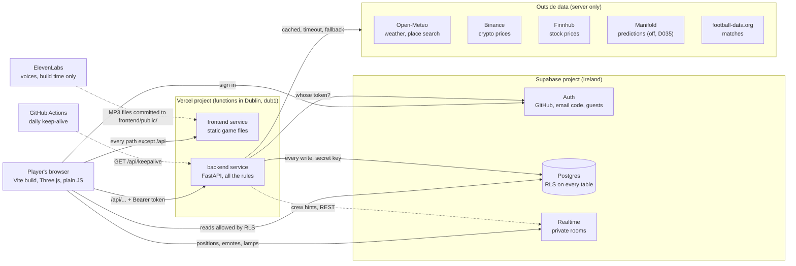

# Repository walkthrough

> **What this file is:** the sheet every member uses to answer the staff's walkthrough questions
> (task A1 in [FINAL-ROADMAP.md](FINAL-ROADMAP.md)): how each part is built, why, its limits and
> how it could change. Every statement points to the file that proves it. The test side is in
> [TEST-MAP.md](TEST-MAP.md).
>
> **Status:** started on Wed 11 Nov 2026 from `main` at `b0b6fd3`. Parts 1 to 10 are written. The
> lane pages P, H and U (part 11) are frames: the lane's members write them.

## Overview

The Great Plot Twist is a browser game. The browser draws a pixel world (the Saltreach Isles) with Three.js and sends what the player wants to do to our Python API. The API is FastAPI. It checks who is asking, applies every rule and writes to a Supabase Postgres database with a secret key. Vercel hosts both parts under one address: `/api/...` goes to the API, everything else to the static game ([vercel.json](../vercel.json)). Supabase also handles sign-in (GitHub, email code, guests) and the live rooms where players see each other move. The API reads real data from five outside providers. On 10 Nov the team dropped the 2-hour mystery ([D031](DECISIONS.md)) and started the new core: your island, the Harbor and the pirate waves ([PITCH.md](PITCH.md)). The island and wave server exists behind a flag; the pirate screens are being built in lanes P, H and U ([BUILD-PLAN.md](BUILD-PLAN.md)).

## If they ask about X, read section Y

| They ask about | Read |
|---|---|
| The game in the browser, Three.js, art, loading speed | [1. The browser game](#1-the-browser-game) |
| FastAPI, routes, flags, errors, rate limits | [2. The Python API](#2-the-python-api) |
| Where data is stored, tables, RLS, coins | [3. Data and database](#3-data-and-database) and [Q1](#q1-where-is-the-data-stored) |
| Login, guests, the class code | [4. Sign-in](#4-sign-in) |
| Multiplayer, seeing other players | [5. Live multiplayer](#5-live-multiplayer) |
| An outside API is down | [6. External data](#6-external-data-and-what-happens-when-a-provider-is-down) and [Q3](#q3-what-happens-if-an-external-api-is-unavailable) |
| The class demo, QR, lamps, duel | [7. The class demo](#7-the-class-demo) |
| Islands, pirate waves, cheating on loot | [8. Islands and pirate waves server](#8-islands-and-pirate-waves-server) |
| Hosting, deploys, monitoring | [9. Deployment and operations](#9-deployment-and-operations) |
| Secrets, attacks, dependencies | [10. Security](#10-security) |
| Pirates, Harbor stalls, the new HUD | [11. Lanes P, H and U](#11-lanes-p-h-and-u-being-built) |
| Tests | [Q2](#q2-what-do-the-tests-cover-and-what-do-they-not-cover) and [TEST-MAP.md](TEST-MAP.md) |

## 1. The browser game

### What it does
Shows the title (Play, Join, Settings), the pixel islands, the sea chart and sailing, the HUD and the panels: the Harbor cards (market stall, match board, weather board), the Home islet build panel, account, settings. It plays voiced cutscenes and procedural sound. It never decides coins or progress: it sends intents.

### Where it lives
- Entry: [frontend/index.html](../frontend/index.html), [frontend/src/main.js](../frontend/src/main.js) (title), [frontend/src/game.js](../frontend/src/game.js) (the world, imports Three.js).
- World and places: [frontend/src/world/](../frontend/src/world/), place ids in [world/places/registry.js](../frontend/src/world/places/registry.js) (`home_islet`, `saltreach_harbor`, `lighthouse_isle`).
- Panels: [frontend/src/screens/](../frontend/src/screens/); shared UI kit: [frontend/src/ui/kit/](../frontend/src/ui/kit/).
- Talking to the API: [frontend/src/online/api.js](../frontend/src/online/api.js); fake vs. real adapter: [frontend/src/adapter/select.js](../frontend/src/adapter/select.js).
- Art: generated by Pillow scripts in [frontend/scripts/pixel_art/](../frontend/scripts/pixel_art/), credited in [frontend/ASSETS.md](../frontend/ASSETS.md). Build config: [frontend/vite.config.js](../frontend/vite.config.js).

### Why it was built this way
- Vite builds a plain static site, which Vercel serves for free and which moves easily ([D002](DECISIONS.md)).
- Plain JavaScript, two runtime packages only: `three` and `@supabase/supabase-js`, both pinned exactly ([frontend/package.json](../frontend/package.json)).
- Three.js draws the top-down 2D world on the GPU; the art is original, so no licence risk ([D005, D028](DECISIONS.md)).
- Lazy loading: `main.js` paints the title first and loads the world with `import()` after the first paint ([shell/world-loader.js](../frontend/src/shell/world-loader.js)). Audio loads on the first tap ([audio/lazy.js](../frontend/src/audio/lazy.js)), the online adapter on demand ([adapter/lazy-online.js](../frontend/src/adapter/lazy-online.js)). Phones on class Wi-Fi see the title fast.
- Budgets are enforced by [scripts/check-loading.js](../frontend/scripts/check-loading.js): cold title JavaScript at most 21,080 bytes, cold CSS under 12 kB, title image at most 350 kB.

### Limits
- The browser is not trusted: anyone can change its code. That is why rules live on the server ([D003](DECISIONS.md)).
- Needs WebGL. Budgets are measured by a script on a built copy, not on real phones.
- The real-browser checks need an installed Chrome and run by hand, not in CI (part 9, [TEST-MAP.md](TEST-MAP.md)).
- Leftovers from the mystery remain in places, for example the old islet panel still uses `/api/islet`.

### How it could change
TypeScript for the shared contracts; split large files; a service worker for offline play; the new pirate and Harbor folders from part 11 plug into the same event bus ([core/events.js](../frontend/src/core/events.js)).

## 2. The Python API

### What it does
Every rule and every write. It checks the sign-in token, validates the input, applies the rule, calls the database with the secret key and answers JSON.

### Where it lives
- Entry for Vercel: [backend/main.py](../backend/main.py) builds `app = create_app()`.
- [backend/server/app.py](../backend/server/app.py): creates the app, plugs in 30 route modules from [backend/server/routes/](../backend/server/routes/) (69 route handlers), the budgets and the error handlers.
- Feature folders: `island/`, `market/`, `predictions/`, `sports/`, `weather/`, `duels/`, `lock/`, `demo/`, `game/` (case and islet) under [backend/server/](../backend/server/).
- Settings: [settings.py](../backend/server/settings.py) is the only file that reads environment variables. Flags: [flags.py](../backend/server/flags.py). Errors: [errors.py](../backend/server/errors.py). Default cache header and safe logging: [request_policy.py](../backend/server/request_policy.py).
- Server-only content (prices, questions, recorded fallbacks): [backend/content/](../backend/content/).

### Why it was built this way
- FastAPI is plain Python, like the course, and its Pydantic models reject a wrong body with `422` before our code runs. pytest tests it without a browser ([D002, D003](DECISIONS.md)).
- `create_app()` takes every service as an argument, so tests pass fakes and never touch the network or the real environment ([app.py](../backend/server/app.py) docstring).
- Feature flags: twelve names in `FLAG_NAMES`, all off unless `FEATURE_FLAGS` lists them; a typo stops the server at start ([flags.py](../backend/server/flags.py)). A route behind an off flag answers `404 feature_off` (for example [routes/island.py](../backend/server/routes/island.py)).
- One error shape everywhere: `{"error": {"code": "...", "message": "..."}}`, never a stack trace ([errors.py](../backend/server/errors.py)).
- Rate limits per player: island builds 30 a minute, visits 30, bell/join/finish 20, wave reads 30 ([app.py](../backend/server/app.py)); lock 30 a minute, place search 10, class-code joins 10 per 10 minutes per player and per address ([lock/limits.py](../backend/server/lock/limits.py)). Over the limit: `429` with `Retry-After`.
- Every answer defaults to `Cache-Control: private, no-store`, and logs hold the route template, status and time only, never raw paths ([request_policy.py](../backend/server/request_policy.py)).

### Limits
- Budgets and caches live in memory, per server instance. Vercel may run several instances, so a limit holds per instance only ([adapters/base.py](../backend/server/adapters/base.py)).
- Every action is a round trip; nothing runs on a timer inside Vercel ([ARCHITECTURE.md](ARCHITECTURE.md), hosting facts).
- The mystery's case code (`game/case_*.py`, `routes/case.py`, `board.py`, `finale.py`, `crews.py`, `save.py`, `intro.py`, `world.py`, `host_case.py`) is still mounted in `app.py`. The browser no longer calls it and the `case` flag is off by default; it is dead weight to remove ([D031](DECISIONS.md)).
- `/api/docs` is served in local and preview only, not in production ([app.py](../backend/server/app.py)).

### How it could change
Delete the case code (task C1); move the budgets into the database or a shared store so they hold across instances; add OpenAPI-generated client types for the browser.

## 3. Data and database

### What it does
Stores players, profiles, wallets, the coin ledger, buildings, islands, waves, stakes, duels and demo admissions. It is the last guard: its own rules hold even if the Python has a bug.

### Where it lives
- 22 migrations in [supabase/migrations/](../supabase/migrations/), applied in order; how to apply them and the full access matrix: [supabase/README.md](../supabase/README.md).
- The wallet: [backend/server/wallet.py](../backend/server/wallet.py) and the SQL function `apply_wallet_transaction` (foundation migration). The server's database client: [supabase_admin.py](../backend/server/supabase_admin.py).
- Table list and columns: [INTERFACES.md, section 4](INTERFACES.md) and [DATA-INVENTORY.md](DATA-INVENTORY.md).

### Why it was built this way
- Supabase gives Postgres, Auth and Realtime in one free project in Ireland, next to the Dublin functions ([D002](DECISIONS.md)).
- Two locks on every table: a grant and row-level security. All 51 tables the migrations create have `enable row level security`. Tables only the server uses (islands, wave_runs, wave_participants, demo_guests, ...) have RLS on and no browser policy ([20261110010000_islands_and_waves.sql](../supabase/migrations/20261110010000_islands_and_waves.sql) header).
- Server-only functions: the money and game functions are granted to `service_role` only, for example `island_open`, `wave_start`, `wave_finish` (same migration).
- One ledger: coins change only through `apply_wallet_transaction`, which checks the reason and its direction (`earn`, `spend`, `either`), keeps the balance at 0 or above and writes the ledger row in one step. Every change needs a `ref`, and a repeated `ref` is refused, so a double click never pays twice ([D004](DECISIONS.md), [wallet.py](../backend/server/wallet.py)).
- Play money only: no purchase, no cash-out, no prizes. That keeps us away from gambling rules and inside Supabase's and Vercel Hobby's terms ([D004](DECISIONS.md), [PRIVACY.md](PRIVACY.md)).

### Limits
- One Supabase project serves preview and production: a test on a preview writes to the real database ([ARCHITECTURE.md](ARCHITECTURE.md), section 5).
- A free project pauses after 7 days of low activity; see the keep-alive in part 9.
- A migration is never edited after it is applied; fixes are new files. Re-applying an old migration alone would restore an unguarded policy ([D030](DECISIONS.md) limits).
- The case tables stay in the database unused ([PITCH.md](PITCH.md), "What we cut").
- A `503` from a money call means "outcome unknown": look up the `ref` in the ledger before retrying ([ARCHITECTURE.md](ARCHITECTURE.md), section 4).

### How it could change
A second Supabase project for previews; a migration that drops the case tables; database-side rate limits.

## 4. Sign-in

### What it does
Three ways in: GitHub (OAuth with PKCE), a 6-digit email code (Supabase email OTP), and guests (Supabase anonymous users) who type or scan the current class code.

### Where it lives
- Browser: [frontend/src/online/auth.js](../frontend/src/online/auth.js), [session.js](../frontend/src/online/session.js), the account screen [frontend/src/screens/account/](../frontend/src/screens/account/).
- Server: [backend/server/auth.py](../backend/server/auth.py) (token check), [sign_in_code.py](../backend/server/sign_in_code.py) (PKCE exchange), [demo/gate.py](../backend/server/demo/gate.py) (guest gate), [routes/demo.py](../backend/server/routes/demo.py) (`POST /api/demo/join`).
- Database guard: [20261109020000_class_code.sql](../supabase/migrations/20261109020000_class_code.sql).
- Which providers the browser offers: `AUTH_PROVIDERS` in [settings.py](../backend/server/settings.py), shown by `GET /api/config`.

### Why it was built this way
- The server asks Supabase "whose token is this?" and caches the answer 60 seconds by a SHA-256 hash of the token, never the token itself ([auth.py](../backend/server/auth.py)). The player id always comes from the verified token, never from the request.
- A QR join must take seconds, so guests need no account ([D029](DECISIONS.md)).
- The class-code gate: anyone can create an anonymous user with the public key, so the QR is not a lock. The locks are (1) the server gate: a guest not in `demo_guests` gets `403 demo_closed` on every gated route, and (2) the guest guard in the policies: every browser and Realtime policy adds `(not jwt_is_anonymous() or is_admitted_guest())` ([D030](DECISIONS.md), [SECURITY.md](SECURITY.md)).
- The join compares the code in constant time; 5 symbols from a 31-letter alphabet give about 28.6 million codes, and the budget makes guessing slow ([D030](DECISIONS.md)).

### Limits
- The join budget is per server instance ([D030](DECISIONS.md)).
- Email sign-in needs a mail service set up in Supabase (Brevo SMTP, [OPEN-TODOS.md](OPEN-TODOS.md) 4b); without it email stays hidden.
- A deleted or signed-out user may still pass for up to 60 seconds on one instance ([auth.py](../backend/server/auth.py)).
- Supabase's sign-in limits count per IP address, and a whole class shares one Wi-Fi address ([ARCHITECTURE.md](ARCHITECTURE.md), free-tier limits).

### How it could change
Google or university SSO as another provider; per-lecture expiry of the class code; a lock-out counter in the database instead of memory.

## 5. Live multiplayer

### What it does
Players in the same place see each other's captains move and send preset emotes. In the class harbor up to 40 others are drawn; the lamps and duel invitations travel in the same room.

### Where it lives
- [frontend/src/online/realtime.js](../frontend/src/online/realtime.js) and its parts [frontend/src/net/live-*.js](../frontend/src/net/) (rules in [live-rules.js](../frontend/src/net/live-rules.js)).
- Access rules: [20261106050000_live_presence.sql](../supabase/migrations/20261106050000_live_presence.sql) plus the guest guard of the class-code migration.
- Server hints to a crew: [backend/server/crew_broadcast.py](../backend/server/crew_broadcast.py) (one REST call, no socket).
- Contract and budget: [INTERFACES.md, section 7](INTERFACES.md#7-realtime-budget); decision [D023](DECISIONS.md).

### Why it was built this way
- Supabase Realtime comes with the database and costs nothing on the free plan. Rooms are private: public access is off, so the policies on `realtime.messages` decide who may join ([ARCHITECTURE.md](ARCHITECTURE.md), hosting facts).
- Rooms are named `live:world` and `live:place:<place>:<room>`; the class demo uses `live:place:class_harbor:1` ([live-rules.js](../frontend/src/net/live-rules.js)).
- The free plan allows 100 messages a second for the project, so each client sends at most 2 position updates a second and slows down when the room is busy ([live-rules.js](../frontend/src/net/live-rules.js), `MIN_GAP_MS`, `LOAD_LIMIT`).
- **What is trusted and what is display-only:** positions, places, emotes and lamp states are only for showing. A modified browser can claim any position and change no game state. Coins, duels, the lock and waves are decided by the API ([ARCHITECTURE.md](ARCHITECTURE.md), section 3).

### Limits
- The browser starts presence only when `/api/config` says the flag `live_presence` is on ([online/adapter/presence.js](../frontend/src/online/adapter/presence.js)).
- About 66 players fit in the 200 free connections, and 2 million messages cover about 8 class sessions ([ARCHITECTURE.md](ARCHITECTURE.md)).
- No authoritative server state for positions: two phones can briefly disagree.

### How it could change
The pirate waves will reuse these rooms for `wave_start`, `cannon_shot` and `wall_repair` broadcasts ([BUILD-PLAN.md, 3.6](BUILD-PLAN.md)); a paid plan would raise the limits.

## 6. External data and what happens when a provider is down

### What it does
Real weather, crypto and stock prices, prediction questions and football results make the world "live". Only the server calls providers; the CSP lets the browser talk to our origin and Supabase only.

### Where it lives
- The shared pattern: [backend/server/adapters/base.py](../backend/server/adapters/base.py) (`CachedSource`: fresh cache → live call → stale value → recorded fallback → `503`).
- Weather: [weather/source.py](../backend/server/weather/source.py), [weather/open_meteo.py](../backend/server/weather/open_meteo.py), recording [backend/content/weather/recorded-fallback.json](../backend/content/weather/recorded-fallback.json).
- Market: [market/feed.py](../backend/server/market/feed.py), [market/binance.py](../backend/server/market/binance.py), [market/stock_finnhub.py](../backend/server/market/stock_finnhub.py), [market/states.py](../backend/server/market/states.py), [market/replay.py](../backend/server/market/replay.py).
- Predictions: [predictions/source.py](../backend/server/predictions/source.py), [predictions/manifold.py](../backend/server/predictions/manifold.py), recordings in [backend/content/predictions/recorded/](../backend/content/predictions/recorded/).
- Sports: [sports/source.py](../backend/server/sports/source.py), [sports/recorded.py](../backend/server/sports/recorded.py); decision [D033](DECISIONS.md).
- Keeper's Lock weather: [lock/weather.py](../backend/server/lock/weather.py); wave weather: [island/wave_weather.py](../backend/server/island/wave_weather.py).

### Why it was built this way
One adapter per provider, with a cache, a timeout (3 s; 5 s for football) and a fallback rule, so a slow provider never blocks the game and many players cause one outside call ([adapters/base.py](../backend/server/adapters/base.py)).

| Provider | Normal | When it is down |
|---|---|---|
| Open-Meteo (weather) | 10-minute cache, 3 s timeout | Last good answer ("stale"), then the recorded real answer ("fallback"); waits 10 minutes before asking again ([weather/source.py](../backend/server/weather/source.py)) |
| Open-Meteo (Keeper's Lock) | Per rounded place, 10 minutes | A reading up to 6 hours old, else the lock asks its riddle ([lock/weather.py](../backend/server/lock/weather.py)) |
| Open-Meteo (wave weather) | The bell-ringer's area | Falls through to the default place, then "calm"; the weather never stops a wave ([island/wave_weather.py](../backend/server/island/wave_weather.py)) |
| Binance (crypto) | Board accepts prices up to 60 s, a trade under 5 s | Old prices stay, marked "stale", and nobody can trade on them; the recorded replay never stands in live, only in demo mode ([market/feed.py](../backend/server/market/feed.py), [market/replay.py](../backend/server/market/replay.py)) |
| Finnhub (stocks) | One call per symbol, within a call budget | Same as Binance: last price, stale, no trading; a closed market shows "closed" with its last price ([market/states.py](../backend/server/market/states.py)) |
| Manifold (predictions; the game no longer calls it since 11 Nov, D035) | 2-minute cache | Stale answer, then the recording; nobody may stake on an answer older than 15 minutes ([predictions/source.py](../backend/server/predictions/source.py)) |
| football-data.org (sports) | One request for PL, PPL and CL, 60 s cache, 10 calls a minute | `503 sports_unavailable`; there is no stale or recorded stand-in in live mode. Recorded matches exist only in demo mode and never accept stakes ([sports/source.py](../backend/server/sports/source.py), [SECURITY.md](SECURITY.md)) |

### Limits
- **Finnhub currently rejects the key:** every stock request answered HTTP 401 in the live log on 10 Nov, so the stocks show no fresh price until the owner re-enters the key ([OPEN-TODOS.md](OPEN-TODOS.md) 4c).
- The fortune teller was removed from the game on 11 Nov at the owner's request (no prediction market, [D035](DECISIONS.md)); its backend code stays, switched off, for a later cleanup.
- Football shows no matches during the international break ([OPEN-TODOS.md](OPEN-TODOS.md), section 7).
- Binance can refuse some countries (HTTP 451) ([market/binance.py](../backend/server/market/binance.py)). Caches are per instance.

### How it could change
A shared cache (for example a database table) so all instances share one call; a recorded football fallback that is labelled and stake-free in live mode too; more questions.

## 7. The class demo

### What it does
The presenter shows a QR on the projector; ~30 phones join one shared class harbor in seconds. A quest strip asks for three things: wave to a captain, duel a captain, open the Keeper's Lock (a question about the real sky) ([quests.js](../frontend/src/class-demo/quests.js)). The finale: each lamp is lit by holding it for 2 seconds and burns for 20; when all three burn at once, the lighthouse relights.

### Where it lives
- [frontend/src/class-demo/](../frontend/src/class-demo/): `index.js` (wiring), `projector.js` (QR panel, host only, key **J**), `quests.js`, `duel-shortcut.js`, `lock-screen.js`, `lamps.js` and `lamp-sync.js`, `rehearsal.js` (`?demo=1&captains=40`).
- Server: [routes/demo.py](../backend/server/routes/demo.py), [routes/lock.py](../backend/server/routes/lock.py) and [lock/](../backend/server/lock/), duels in [duels/](../backend/server/duels/) (decision D026).
- Decisions [D029, D030](DECISIONS.md); host steps in [OPEN-TODOS.md](OPEN-TODOS.md), section 5.

### Why it was built this way
- Two players used to need 45 to 50 clicks and a GitHub account; the QR join needs none ([D029](DECISIONS.md)).
- The duel and the lock are decided by the server ([duels/rules.py](../backend/server/duels/rules.py), [routes/lock.py](../backend/server/routes/lock.py)). The shortcut duel has stake 0 ([duel-shortcut.js](../frontend/src/class-demo/duel-shortcut.js)).
- The lamps are a broadcast-only show: no table, no server; messages carry ages, not clock times, because phones have different clocks ([lamp-sync.js](../frontend/src/class-demo/lamp-sync.js)).
- The lock must never block the demo: cache, then riddle, then a hint path ([D029](DECISIONS.md)).

### Limits
- Since the lamps are display-only, a modified browser can fake a relight; it wins nothing.
- 40 real phones on one Wi-Fi have not been tested; the rehearsal simulates captains on one laptop.
- The pitch's new class battle (Pirate Point with the flagship) is planned, not built in the browser (part 8 and lane P).

### How it could change
The lamps become the Pirate Point climax ([PITCH.md](PITCH.md)); a host-side "reset lamps" control.

## 8. Islands and pirate waves server

### What it does
Each player owns an island with a code (`ISLE-` + 5 symbols), builds walls, cannons, a watchtower and houses for coins, rings a bell to start a wave, and gets loot for surviving. Friends join a running wave by code; Pirate Point is a shared wave with `flagship: true`.

### Where it lives
- [backend/server/island/](../backend/server/island/): `service.py` (look, build, visit), `waves.py` (start, join, current, finish), `rules.py`, `codes.py`, `wave_weather.py`.
- Routes: [routes/island.py](../backend/server/routes/island.py), [routes/waves.py](../backend/server/routes/waves.py). Numbers: [backend/content/islands.json](../backend/content/islands.json).
- Migrations [20261110010000_islands_and_waves.sql](../supabase/migrations/20261110010000_islands_and_waves.sql) (`islands`, `wave_runs`) and [20261110020000_wave_crews.sql](../supabase/migrations/20261110020000_wave_crews.sql) (`wave_participants`).
- The fresh-start script (not a migration): [scripts/admin/fresh_start.sql](../scripts/admin/fresh_start.sql). Contract: [BUILD-PLAN.md, 3.4](BUILD-PLAN.md); decision [D032](DECISIONS.md).

### Why it was built this way
- The server decides what it can check: who, when and how much. The fight itself runs in the browsers from one seed, so friends see the same wave without a server game loop ([D032](DECISIONS.md)).
- Prices come from `islands.json`, never from the request: wall 10, cannon 30, watchtower 40, house 50; 100 starting coins once (reason `starting_coins`).
- Builds reuse the home islet's atomic `islet_build()`, so one audited money path exists for buildings ([island/service.py](../backend/server/island/service.py)).
- Loot caps: a survived island wave pays at most 10 + 5 × wave + 5 × houses, Pirate Point 20 + 5 × wave; a lost or expired wave pays 0 (reason `pirate_loot`, one ref per wave and player).
- Timing: 10 s countdown, a finish earlier than 15 s is refused, a wave expires after 900 s, the highest wave is 50, one running wave per island ([islands.json](../backend/content/islands.json)).

### What the browser is trusted for
Only its claim `survived` and `shipsSunk` in `POST /api/waves/finish`. The server cannot prove it. The loot cap, the minimum length, one wave at a time and the per-player budget (20 calls a minute) bound what a cheat can earn to small play-money amounts ([D032](DECISIONS.md)).

### Limits
- Flag `islands` is off: the routes answer `404 feature_off` until the pirate frontend is wired in ([routes/island.py](../backend/server/routes/island.py)). D032 says the owner reviews and applies the migrations; [OPEN-TODOS.md](OPEN-TODOS.md) section 7 lists the database as live.
- The flagship and the three lamps are decided in the browsers; the server only flags the wave.
- The weather follows whoever rings the bell, because the server stores no place ([D032](DECISIONS.md)).

### How it could change
A server-side replay of the seeded simulation to check `survived`; cosmetic rewards instead of coins for Pirate Point; host-console probes for the new tables ([OPEN-TODOS.md](OPEN-TODOS.md) 8).

## 9. Deployment and operations

### What it does
Builds and serves the game and the API from `main`; keeps the database awake; lets the host check the live site before class.

### Where it lives
- [vercel.json](../vercel.json): two Vercel Services (`frontend` with Vite, `backend` with `main:app`), the `/api/:path*` rewrite, region `dub1`, and the security headers.
- Keep-alive: [.github/workflows/keepalive.yml](../.github/workflows/keepalive.yml) calls `GET /api/keepalive` daily at 06:17 UTC; the route: [routes/keepalive.py](../backend/server/routes/keepalive.py).
- Smoke test: [scripts/smoke-live.sh](../scripts/smoke-live.sh) and [scripts/smoke-live.mjs](../scripts/smoke-live.mjs); runbook [RUNBOOK.md](RUNBOOK.md).
- Host console: [frontend/host.html](../frontend/host.html), [frontend/src/host/](../frontend/src/host/), [routes/host_console.py](../backend/server/routes/host_console.py); guide [HOST-CONSOLE.md](HOST-CONSOLE.md).

### Why it was built this way
- One address for the game and the API means no cross-origin setup ([D002](DECISIONS.md)).
- Functions in Dublin sit next to the Supabase project in Ireland.
- CSP in `vercel.json`: scripts, styles and images only from our origin; connections only to our origin and our Supabase project; no framing. Also `nosniff`, a referrer policy, a permissions policy that blocks camera, microphone and location, and `X-Frame-Options: DENY`.
- A `crons` entry in `vercel.json` broke our deploys on 5 Nov, so the keep-alive runs from GitHub Actions instead ([ARCHITECTURE.md](ARCHITECTURE.md), keep-alive).
- The smoke test runs signed out: home page and headers, `/api/health`, `/api/config` flags, a `401` with `no-store` on a private route, the build stamp, and a spoiler scan of the bundle ([smoke-live.mjs](../scripts/smoke-live.mjs)).

### Limits
- Vercel Hobby limits: 100 deploys a day, 300 s per function, 1 million calls a month; going over pauses the project ([ARCHITECTURE.md](ARCHITECTURE.md)).
- The only GitHub Actions workflow is the keep-alive: no CI runs the tests; each PR reports its own results.
- The smoke test does not check the database, sign-in or Realtime ("database readiness is not checked").
- We cannot see Vercel's environment variables from the repository, so which flags are on live is checked through `/api/config`, not the code.

### How it could change
A CI workflow that runs `pytest`, `npm test` and `npm run build` on every PR; separate preview database; uptime alerts.

## 10. Security

### What it does
Keeps secrets out of the browser and the repository, lets only the server write, and limits abuse.

### Where it lives
[SECURITY.md](SECURITY.md), [THREAT-MODEL.md](THREAT-MODEL.md), [.env.example](../.env.example), [settings.py](../backend/server/settings.py), [.gitignore](../.gitignore), [scripts/audit/](../scripts/audit/), [scripts/check-diff-secrets.py](../scripts/check-diff-secrets.py).

### Why it was built this way
- **Secrets:** `SUPABASE_SECRET_KEY`, `CRON_SECRET`, `STOCK_API_KEY` and `SPORTS_API_KEY` live only in Vercel settings and a private `.env` (ignored by Git). They are `SecretStr` in Python, so they print as `**********` ([settings.py](../backend/server/settings.py)). Only `VITE_` values reach the browser, and those are public by design. The ElevenLabs key is read from a private file only when the voice script runs ([scripts/voice/generate.py](../scripts/voice/generate.py)).
- **RLS and grants** on all 51 tables, money functions for `service_role` only (part 3).
- **Guest guard** in every browser and Realtime policy (part 4).
- **Input validation:** Pydantic models (`422`), plus rule checks such as "is the kind allowed on this spot" ([island/rules.py](../backend/server/island/rules.py)); tokens are bounded before any upstream call ([THREAT-MODEL.md](THREAT-MODEL.md)).
- **Rate limits** per player and per address (part 2).
- **Dependencies:** 2 runtime npm packages, pinned exactly; lockfiles `frontend/package-lock.json` and `backend/uv.lock`. `npm audit` reported 0 vulnerabilities on 11 Nov 2026; the recorded audit of 6 Nov is in [scripts/audit/npm-audit.json](../scripts/audit/npm-audit.json).

### Limits
- `backend/pyproject.toml` still uses `>=` ranges and `playwright-core` (dev only) uses `^`; `uv.lock` and `package-lock.json` fix the installed versions. Task E2 pins them exactly.
- Rate limits are per instance; one shared Supabase project for preview and production.
- [THREAT-MODEL.md](THREAT-MODEL.md) is a review of 6 Nov: its route inventory (55 pairs) predates the island, wave and class-code routes (69 handlers today).

### How it could change
Pin Python exactly (E2); remove the case routes (C1) to shrink the attack surface; a CI secret scan.

## 11. Lanes P, H and U (being built)

These frames are **to be written by the lane's members**. Each lane builds against the contracts in [BUILD-PLAN.md, section 3](BUILD-PLAN.md) and the real API of part 8. None of the folders below exists on `main` at `b0b6fd3`.

### Lane P: Pirates
- **What it does:** to be written by the lane's members (planned: the wave simulation, pirate art, waves on screen, manning a cannon, sounds).
- **Where it lives:** planned `frontend/src/pirates/` (`sim.js`, `fake-api.js`), art in `frontend/scripts/pixel_art/`.
- **Why it was built this way:** to be written by the lane's members.
- **Limits:** to be written by the lane's members.
- **How it could change:** to be written by the lane's members.
- **Contract:** `createWave({seed, wave, weather, island, defenses})` with `step`, `state`, `done`, `result`, pure and seeded (BUILD-PLAN 3.5); events `wave_started` to `wave_ended`; the API routes of 3.4.

### Lane H: Harbor and coins
- **What it does:** to be written by the lane's members (planned: `formatCoins()`, market stall, match board, weather board, stalls in the world; the fortune teller was removed on 11 Nov at the owner's request).
- **Where it lives:** planned `frontend/src/harbor/` and `frontend/src/lib/coins.js`, plus the existing [screens/market/](../frontend/src/screens/market/) and [screens/sports/](../frontend/src/screens/sports/) (screens/predictions/ was removed on 11 Nov).
- **Why it was built this way:** to be written by the lane's members.
- **Limits:** to be written by the lane's members.
- **How it could change:** to be written by the lane's members.
- **Contract:** the economy of BUILD-PLAN 3.2 (whole coins, stakes 5, 10 or 25); the `/api/market/calls`, `/api/sports`, `/api/weather` routes (no `/api/predictions` from the browser since 11 Nov); the fallbacks of part 6.

### Lane U: Look and feel
- **What it does:** to be written by the lane's members (planned: one panel style, a HUD with three things, the first 3 minutes, play with friends, toasts).
- **Where it lives:** [frontend/src/ui/](../frontend/src/ui/), [frontend/src/ui/kit/](../frontend/src/ui/kit/), the HUD and [frontend/src/front-door/](../frontend/src/front-door/).
- **Why it was built this way:** to be written by the lane's members.
- **Limits:** to be written by the lane's members (known budget: cold CSS under 12 kB, part 1).
- **How it could change:** to be written by the lane's members.
- **Contract:** island codes `ISLE-…` and class codes `HARBOR-…` in one Join field; rooms `live:place:isle_<code>:1` (BUILD-PLAN 3.3 and 3.6); the error shape of part 2.

## The three course questions

### Q1. Where is the data stored?
In one Supabase Postgres database in Ireland (`eu-west-1`): profiles, wallets, the coin ledger, buildings, islands, waves, stakes, duels and demo admissions, 51 tables with row-level security ([supabase/migrations/](../supabase/migrations/)). Sign-in records are in Supabase Auth. The browser keeps only preferences and quest ticks in `localStorage` and the sign-in session in `sessionStorage` ([PRIVACY.md](PRIVACY.md)). Server memory holds short caches (logins 60 s, weather 10 minutes). Prices, questions and recorded fallbacks are files in [backend/content/](../backend/content/). Live positions are never stored.

### Q2. What do the tests cover, and what do they not cover?
They cover the rules: 184 backend test files under [backend/server/tests/](../backend/server/tests/) (wallet, island and waves, market, predictions, sports, duels, demo gate, settings, adapters with fake transports and a fake clock), opt-in SQL suites that apply all migrations to a throwaway Postgres, 180 Vitest files in [frontend/tests/](../frontend/tests/), 39 real-browser checks in `frontend/scripts/check-*.js` and a signed-out smoke test of the live site. They do not cover physical phones, 40 real users on one Wi-Fi, provider outages over hours, the email flow with a real inbox, or the pirate frontend, which is not built yet. Details: [TEST-MAP.md](TEST-MAP.md).

### Q3. What happens if an external API is unavailable?
The game keeps working. Every provider sits behind one server adapter with a cache and a timeout (3 seconds, 5 for football), and only the server calls it ([adapters/base.py](../backend/server/adapters/base.py)). Weather falls back to the last good answer, then a recorded real answer. Prices stay visible but marked stale, and trading closes, so nobody profits from old prices. Predictions show the last answer or a recording, but stakes stop after 15 minutes. Football answers `503 sports_unavailable` and the board says so. The Keeper's Lock switches to a riddle, and a new wave takes the default place's weather, else calm. Full table in [part 6](#6-external-data-and-what-happens-when-a-provider-is-down).

## Questions we might be asked

1. **Why FastAPI and not Streamlit?** Streamlit draws its own pages on the server; we needed a JSON API behind a real-time pixel game. FastAPI is plain Python, validates input with Pydantic and runs as one Vercel function ([D002](DECISIONS.md), [app.py](../backend/server/app.py)).
2. **Why Supabase?** One free project gives Postgres, sign-in and real-time rooms, in Ireland next to our functions, with row-level security as a second lock ([D002](DECISIONS.md), [ARCHITECTURE.md](ARCHITECTURE.md)).
3. **Why validate on the server when the browser could do it?** Anyone can edit the browser's code and send their own requests. A rule in the browser is a hint; the server and the database are the rule ([D003](DECISIONS.md)).
4. **How do you stop cheating with coins?** The browser cannot write a balance. Coins move only through `apply_wallet_transaction`, prices come from server files, and each change has a unique `ref`, so repeats pay nothing ([D004](DECISIONS.md), [wallet.py](../backend/server/wallet.py)).
5. **Can a player fake surviving a wave?** Yes, the server cannot prove `survived`. The loot cap, the 15-second minimum, one wave at a time and 20 calls a minute keep the gain small ([D032](DECISIONS.md)).
6. **Why play money?** No purchase or cash-out keeps the game clear of gambling rules and inside the free hosting terms ([D004](DECISIONS.md), [PRIVACY.md](PRIVACY.md)).
7. **What stops a stranger from joining the class demo?** The class code. The server gate refuses a guest not in `demo_guests`, and every policy has the guest guard; a new code stops old photos of the QR ([D030](DECISIONS.md), [gate.py](../backend/server/demo/gate.py)).
8. **What if Supabase is down?** The API answers `503` (`auth_unavailable` for sign-in); a money call then means "outcome unknown" and is checked in the ledger before a retry ([auth.py](../backend/server/auth.py), [ARCHITECTURE.md](ARCHITECTURE.md)).
9. **Why is the mystery code still there?** It was removed from the browser on 10 Nov; deleting the server part and tables is a later cleanup, and the `case` flag keeps it off ([D031](DECISIONS.md)).
10. **How do players see each other without a server game loop?** Supabase Realtime rooms carry positions directly between browsers; they are display-only, so they need no server check ([realtime.js](../frontend/src/online/realtime.js)).
11. **How do you keep the free tiers from running out?** Caches per provider, slower updates in busy rooms, no timers inside Vercel, and a daily keep-alive ([adapters/base.py](../backend/server/adapters/base.py), [live-rules.js](../frontend/src/net/live-rules.js)).
12. **Where are the secrets?** In Vercel settings and private `.env` files only; the repository holds `.env.example` with empty values ([.env.example](../.env.example), [ARCHITECTURE.md](ARCHITECTURE.md)).
13. **How do you add a new feature safely?** Behind a feature flag (off by default), with a server route, tests first and, for data, a new migration with RLS ([ENGINEERING.md](ENGINEERING.md), recipes 4.1, 4.2, 4.5).
14. **Why is the weather from the Faroe Islands?** The default place is Torshavn because its fog and storms suit the story; it is a setting, and Lisbon is the other option ([settings.py](../backend/server/settings.py)).
15. **What would you do with 3 more weeks?** Add CI for every PR, remove the case code, replay the wave simulation on the server to check `survived`, give previews their own database, and test with 40 real phones ([FINAL-ROADMAP.md](FINAL-ROADMAP.md), [contribute/IDEAS.md](contribute/IDEAS.md)).

## Where older docs differ from the code

Read the code when these disagree. Noted on 11 Nov; not yet fixed.

- [ARCHITECTURE.md](ARCHITECTURE.md) still says GitHub is the only sign-in and that `frontend/` may be missing; email codes and guests exist now ([settings.py](../backend/server/settings.py)).
- [ENGINEERING.md](ENGINEERING.md), section 3, lists the Vite `/api` proxy as a follow-up; it is already in [vite.config.js](../frontend/vite.config.js).
- [PRIVACY.md](PRIVACY.md) still mentions playing "the opening story" and the shared mystery, which left the game ([D031](DECISIONS.md)).
- [THREAT-MODEL.md](THREAT-MODEL.md) counts 55 routes; the route modules now declare 69 handlers.
