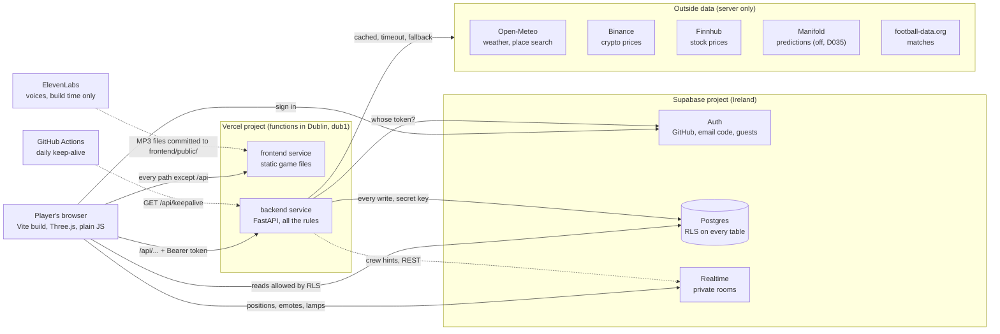

# Repository walkthrough

> **What this file is:** the sheet every member uses to answer the staff's walkthrough questions
> (task A1 in [FINAL-ROADMAP.md](FINAL-ROADMAP.md)): how each part is built, why, its limits and
> how it could change. Every statement points to the file that proves it. The test side is in
> [TEST-MAP.md](TEST-MAP.md).
>
> **Status:** started on Wed 11 Nov 2026 from `main` at `b0b6fd3`; parts 8 and 11 to 14 rewritten for
> the multiplayer tower defense from `main` at `e9cbf5d` (Wed 11 Nov, evening). The Harbor and look-and-feel
> pages (part 15) are frames: the lane's members write them.

## Overview

The Great Plot Twist is a browser game. The browser draws a pixel world (the Saltreach Isles) with Three.js and sends what the player wants to do to our Python API. The API is FastAPI. It checks who is asking, applies every rule and writes to a Supabase Postgres database with a secret key. Vercel hosts both parts under one address: `/api/...` goes to the API, everything else to the static game ([vercel.json](../vercel.json)). Supabase also handles sign-in (GitHub, email code, guests) and the live rooms where players see each other move. The API reads real data from five outside providers. On 10 Nov the team dropped the 2-hour mystery ([D031](DECISIONS.md)). Since 11 Nov the game is a multiplayer pixel-art tower defense: build and upgrade towers on your own island, fight pirate waves up to wave 100 with up to three friends, trade at the Harbor, and fight the armada together at Pirate Point ([TOWER-DEFENSE.md](TOWER-DEFENSE.md), [D036](DECISIONS.md)).

## If they ask about X, read section Y

| They ask about | Read |
|---|---|
| The game in the browser, Three.js, art, loading speed | [1. The browser game](#1-the-browser-game) |
| FastAPI, routes, flags, errors, rate limits | [2. The Python API](#2-the-python-api) |
| Where data is stored, tables, RLS, coins | [3. Data and database](#3-data-and-database) and [Q1](#q1-where-is-the-data-stored) |
| Login, guests, the class code | [4. Sign-in](#4-sign-in) |
| Multiplayer, seeing other players | [5. Live multiplayer](#5-live-multiplayer) |
| An outside API is down | [6. External data](#6-external-data-and-what-happens-when-a-provider-is-down) and [Q3](#q3-what-happens-if-an-external-api-is-unavailable) |
| The class demo, QR, lamps, duel | [7. The class demo](#7-the-class-demo) |
| Islands, prices, unlocks, cheating on loot | [8. Islands, tower defense and the economy](#8-islands-tower-defense-and-the-economy-server) |
| Hosting, deploys, monitoring | [9. Deployment and operations](#9-deployment-and-operations) |
| Secrets, attacks, dependencies | [10. Security](#10-security) |
| The waves, towers, balance, determinism | [11. The tower defense in the browser](#11-the-tower-defense-in-the-browser) |
| How 4 players see the same battle | [12. Same battle for four players](#12-how-four-players-see-the-same-battle) |
| Inviting a friend, guests on an island | [13. The friend invite](#13-the-friend-invite-and-guest-admission) |
| Why the pixel art is sharp | [14. Clean pixel rendering](#14-clean-pixel-rendering) |
| Harbor stalls, the HUD | [15. Lane pages still to write](#15-lane-pages-still-to-write-the-harbor-and-the-look-and-feel) |
| Tests | [Q2](#q2-what-do-the-tests-cover-and-what-do-they-not-cover) and [TEST-MAP.md](TEST-MAP.md) |

## 1. The browser game

### What it does
Shows the title (Play, Join, Settings), the pixel islands, the sea chart and sailing, the HUD and the panels: the Harbor cards (market stall, match board, weather board), the Home islet build panel, account, settings. It plays voiced cutscenes and procedural sound. It never decides coins or progress: it sends intents.

### Where it lives
- Entry: [frontend/index.html](../frontend/index.html), [frontend/src/main.js](../frontend/src/main.js) (title), [frontend/src/game.js](../frontend/src/game.js) (the world, imports Three.js).
- World and places: [frontend/src/world/](../frontend/src/world/), place ids in [world/places/registry.js](../frontend/src/world/places/registry.js) (`home_islet`, `saltreach_harbor`, `lighthouse_isle`).
- Panels: [frontend/src/screens/](../frontend/src/screens/); shared UI kit: [frontend/src/ui/kit/](../frontend/src/ui/kit/).
- Talking to the API: [frontend/src/online/api.js](../frontend/src/online/api.js); fake vs. real adapter: [frontend/src/adapter/select.js](../frontend/src/adapter/select.js).
- Art: generated by Pillow scripts in [frontend/scripts/pixel_art/](../frontend/scripts/pixel_art/), credited in [frontend/ASSETS.md](../frontend/ASSETS.md). Build config: [frontend/vite.config.js](../frontend/vite.config.js).

### Why it was built this way
- Vite builds a plain static site, which Vercel serves for free and which moves easily ([D002](DECISIONS.md)).
- Plain JavaScript, two runtime packages only: `three` and `@supabase/supabase-js`, both pinned exactly ([frontend/package.json](../frontend/package.json)).
- Three.js draws the top-down 2D world on the GPU; the art is original, so no licence risk ([D005, D028](DECISIONS.md)).
- Lazy loading: `main.js` paints the title first and loads the world with `import()` after the first paint ([shell/world-loader.js](../frontend/src/shell/world-loader.js)). Audio loads on the first tap ([audio/lazy.js](../frontend/src/audio/lazy.js)), the online adapter on demand ([adapter/lazy-online.js](../frontend/src/adapter/lazy-online.js)). Phones on class Wi-Fi see the title fast.
- Budgets are enforced by [scripts/check-loading.js](../frontend/scripts/check-loading.js): cold title JavaScript at most 21,080 bytes, cold CSS under 12 kB, title image at most 350 kB.

### Limits
- The browser is not trusted: anyone can change its code. That is why rules live on the server ([D003](DECISIONS.md)).
- Needs WebGL. Budgets are measured by a script on a built copy, not on real phones.
- The real-browser checks need an installed Chrome and run by hand, not in CI (part 9, [TEST-MAP.md](TEST-MAP.md)).
- Leftovers from the mystery remain in places, for example the old islet panel still uses `/api/islet`.

### How it could change
TypeScript for the shared contracts; split large files; a service worker for offline play; the pirate, island and Harbor folders (parts 11 to 15) plug into the same event bus ([core/events.js](../frontend/src/core/events.js)).

## 2. The Python API

### What it does
Every rule and every write. It checks the sign-in token, validates the input, applies the rule, calls the database with the secret key and answers JSON.

### Where it lives
- Entry for Vercel: [backend/main.py](../backend/main.py) builds `app = create_app()`.
- [backend/server/app.py](../backend/server/app.py): creates the app, plugs in 30 route modules from [backend/server/routes/](../backend/server/routes/) (69 route handlers), the budgets and the error handlers.
- Feature folders: `island/`, `market/`, `predictions/`, `sports/`, `weather/`, `duels/`, `lock/`, `demo/`, `game/` (case and islet) under [backend/server/](../backend/server/).
- Settings: [settings.py](../backend/server/settings.py) is the only file that reads environment variables. Flags: [flags.py](../backend/server/flags.py). Errors: [errors.py](../backend/server/errors.py). Default cache header and safe logging: [request_policy.py](../backend/server/request_policy.py).
- Server-only content (prices, questions, recorded fallbacks): [backend/content/](../backend/content/).

### Why it was built this way
- FastAPI is plain Python, like the course, and its Pydantic models reject a wrong body with `422` before our code runs. pytest tests it without a browser ([D002, D003](DECISIONS.md)).
- `create_app()` takes every service as an argument, so tests pass fakes and never touch the network or the real environment ([app.py](../backend/server/app.py) docstring).
- Feature flags: twelve names in `FLAG_NAMES`, all off unless `FEATURE_FLAGS` lists them; a typo stops the server at start ([flags.py](../backend/server/flags.py)). A route behind an off flag answers `404 feature_off` (for example [routes/island.py](../backend/server/routes/island.py)).
- One error shape everywhere: `{"error": {"code": "...", "message": "..."}}`, never a stack trace ([errors.py](../backend/server/errors.py)).
- Rate limits per player: island builds 30 a minute, visits 30, bell/join/finish 20, wave reads 30 ([app.py](../backend/server/app.py)); lock 30 a minute, place search 10, class-code joins 10 per 10 minutes per player and per address ([lock/limits.py](../backend/server/lock/limits.py)). Over the limit: `429` with `Retry-After`.
- Every answer defaults to `Cache-Control: private, no-store`, and logs hold the route template, status and time only, never raw paths ([request_policy.py](../backend/server/request_policy.py)).

### Limits
- Budgets and caches live in memory, per server instance. Vercel may run several instances, so a limit holds per instance only ([adapters/base.py](../backend/server/adapters/base.py)).
- Every action is a round trip; nothing runs on a timer inside Vercel ([ARCHITECTURE.md](ARCHITECTURE.md), hosting facts).
- The mystery's case code (`game/case_*.py`, `routes/case.py`, `board.py`, `finale.py`, `crews.py`, `save.py`, `intro.py`, `world.py`, `host_case.py`) is still mounted in `app.py`. The browser no longer calls it and the `case` flag is off by default; it is dead weight to remove ([D031](DECISIONS.md)).
- `/api/docs` is served in local and preview only, not in production ([app.py](../backend/server/app.py)).

### How it could change
Delete the case code (task C1); move the budgets into the database or a shared store so they hold across instances; add OpenAPI-generated client types for the browser.

## 3. Data and database

### What it does
Stores players, profiles, wallets, the coin ledger, buildings, islands, waves, stakes, duels and demo admissions. It is the last guard: its own rules hold even if the Python has a bug.

### Where it lives
- 24 migrations in [supabase/migrations/](../supabase/migrations/), applied in order; how to apply them and the full access matrix: [supabase/README.md](../supabase/README.md).
- The wallet: [backend/server/wallet.py](../backend/server/wallet.py) and the SQL function `apply_wallet_transaction` (foundation migration). The server's database client: [supabase_admin.py](../backend/server/supabase_admin.py).
- Table list and columns: [INTERFACES.md, section 4](INTERFACES.md) and [DATA-INVENTORY.md](DATA-INVENTORY.md).

### Why it was built this way
- Supabase gives Postgres, Auth and Realtime in one free project in Ireland, next to the Dublin functions ([D002](DECISIONS.md)).
- Two locks on every table: a grant and row-level security. All 53 tables the migrations create have `enable row level security`. Tables only the server uses (islands, wave_runs, wave_participants, pirate_point_buildings, demo_guests, ...) have RLS on and no browser policy ([20261110010000_islands_and_waves.sql](../supabase/migrations/20261110010000_islands_and_waves.sql) header).
- Server-only functions: the money and game functions are granted to `service_role` only, for example `island_open`, `wave_start`, `wave_finish` (same migration).
- One ledger: coins change only through `apply_wallet_transaction`, which checks the reason and its direction (`earn`, `spend`, `either`), keeps the balance at 0 or above and writes the ledger row in one step. Every change needs a `ref`, and a repeated `ref` is refused, so a double click never pays twice ([D004](DECISIONS.md), [wallet.py](../backend/server/wallet.py)).
- Play money only: no purchase, no cash-out, no prizes. That keeps us away from gambling rules and inside Supabase's and Vercel Hobby's terms ([D004](DECISIONS.md), [PRIVACY.md](PRIVACY.md)).

### Limits
- One Supabase project serves preview and production: a test on a preview writes to the real database ([ARCHITECTURE.md](ARCHITECTURE.md), section 5).
- A free project pauses after 7 days of low activity; see the keep-alive in part 9.
- A migration is never edited after it is applied; fixes are new files. Re-applying an old migration alone would restore an unguarded policy ([D030](DECISIONS.md) limits).
- The case tables stay in the database unused ([PITCH.md](PITCH.md), "What we cut").
- A `503` from a money call means "outcome unknown": look up the `ref` in the ledger before retrying ([ARCHITECTURE.md](ARCHITECTURE.md), section 4).

### How it could change
A second Supabase project for previews; a migration that drops the case tables; database-side rate limits.

## 4. Sign-in

### What it does
Three ways in: GitHub (OAuth with PKCE), a 6-digit email code (Supabase email OTP), and guests (Supabase anonymous users) who type or scan the current class code.

### Where it lives
- Browser: [frontend/src/online/auth.js](../frontend/src/online/auth.js), [session.js](../frontend/src/online/session.js), the account screen [frontend/src/screens/account/](../frontend/src/screens/account/).
- Server: [backend/server/auth.py](../backend/server/auth.py) (token check), [sign_in_code.py](../backend/server/sign_in_code.py) (PKCE exchange), [demo/gate.py](../backend/server/demo/gate.py) (guest gate), [routes/demo.py](../backend/server/routes/demo.py) (`POST /api/demo/join`).
- Database guard: [20261109020000_class_code.sql](../supabase/migrations/20261109020000_class_code.sql).
- Which providers the browser offers: `AUTH_PROVIDERS` in [settings.py](../backend/server/settings.py), shown by `GET /api/config`.

### Why it was built this way
- The server asks Supabase "whose token is this?" and caches the answer 60 seconds by a SHA-256 hash of the token, never the token itself ([auth.py](../backend/server/auth.py)). The player id always comes from the verified token, never from the request.
- A QR join must take seconds, so guests need no account ([D029](DECISIONS.md)).
- The class-code gate: anyone can create an anonymous user with the public key, so the QR is not a lock. The locks are (1) the server gate: a guest not in `demo_guests` gets `403 demo_closed` on every gated route, and (2) the guest guard in the policies: every browser and Realtime policy adds `(not jwt_is_anonymous() or is_admitted_guest())` ([D030](DECISIONS.md), [SECURITY.md](SECURITY.md)).
- The join compares the code in constant time; 5 symbols from a 31-letter alphabet give about 28.6 million codes, and the budget makes guessing slow ([D030](DECISIONS.md)).

### Limits
- The join budget is per server instance ([D030](DECISIONS.md)).
- Email sign-in needs a mail service set up in Supabase (Brevo SMTP, [OPEN-TODOS.md](OPEN-TODOS.md) 4b); without it email stays hidden.
- A deleted or signed-out user may still pass for up to 60 seconds on one instance ([auth.py](../backend/server/auth.py)).
- Supabase's sign-in limits count per IP address, and a whole class shares one Wi-Fi address ([ARCHITECTURE.md](ARCHITECTURE.md), free-tier limits).

### How it could change
Google or university SSO as another provider; per-lecture expiry of the class code; a lock-out counter in the database instead of memory.

## 5. Live multiplayer

### What it does
Players in the same place see each other's captains move and send preset emotes. In the class harbor up to 40 others are drawn; the lamps and duel invitations travel in the same room.

### Where it lives
- [frontend/src/online/realtime.js](../frontend/src/online/realtime.js) and its parts [frontend/src/net/live-*.js](../frontend/src/net/) (rules in [live-rules.js](../frontend/src/net/live-rules.js)).
- Access rules: [20261106050000_live_presence.sql](../supabase/migrations/20261106050000_live_presence.sql) plus the guest guard of the class-code migration.
- Server hints to a crew: [backend/server/crew_broadcast.py](../backend/server/crew_broadcast.py) (one REST call, no socket).
- Contract and budget: [INTERFACES.md, section 7](INTERFACES.md#7-realtime-budget); decision [D023](DECISIONS.md).

### Why it was built this way
- Supabase Realtime comes with the database and costs nothing on the free plan. Rooms are private: public access is off, so the policies on `realtime.messages` decide who may join ([ARCHITECTURE.md](ARCHITECTURE.md), hosting facts).
- Rooms are named `live:world` and `live:place:<place>:<room>`; the class demo uses `live:place:class_harbor:1` ([live-rules.js](../frontend/src/net/live-rules.js)).
- The free plan allows 100 messages a second for the project, so each client sends at most 2 position updates a second and slows down when the room is busy ([live-rules.js](../frontend/src/net/live-rules.js), `MIN_GAP_MS`, `LOAD_LIMIT`).
- **What is trusted and what is display-only:** positions, places, emotes and lamp states are only for showing. A modified browser can claim any position and change no game state. Coins, duels, the lock and waves are decided by the API ([ARCHITECTURE.md](ARCHITECTURE.md), section 3).

### Limits
- The browser starts presence only when `/api/config` says the flag `live_presence` is on ([online/adapter/presence.js](../frontend/src/online/adapter/presence.js)).
- About 66 players fit in the 200 free connections, and 2 million messages cover about 8 class sessions ([ARCHITECTURE.md](ARCHITECTURE.md)).
- No authoritative server state for positions: two phones can briefly disagree.

### How it could change
The pirate waves already reuse these rooms (part 12); a paid plan would raise the limits.

## 6. External data and what happens when a provider is down

### What it does
Real weather, crypto and stock prices, prediction questions and football results make the world "live". Only the server calls providers; the CSP lets the browser talk to our origin and Supabase only.

### Where it lives
- The shared pattern: [backend/server/adapters/base.py](../backend/server/adapters/base.py) (`CachedSource`: fresh cache → live call → stale value → recorded fallback → `503`).
- Weather: [weather/source.py](../backend/server/weather/source.py), [weather/open_meteo.py](../backend/server/weather/open_meteo.py), recording [backend/content/weather/recorded-fallback.json](../backend/content/weather/recorded-fallback.json).
- Market: [market/feed.py](../backend/server/market/feed.py), [market/binance.py](../backend/server/market/binance.py), [market/stock_finnhub.py](../backend/server/market/stock_finnhub.py), [market/states.py](../backend/server/market/states.py), [market/replay.py](../backend/server/market/replay.py).
- Predictions: [predictions/source.py](../backend/server/predictions/source.py), [predictions/manifold.py](../backend/server/predictions/manifold.py), recordings in [backend/content/predictions/recorded/](../backend/content/predictions/recorded/).
- Sports: [sports/source.py](../backend/server/sports/source.py), [sports/recorded.py](../backend/server/sports/recorded.py); decision [D033](DECISIONS.md).
- Keeper's Lock weather: [lock/weather.py](../backend/server/lock/weather.py); wave weather: [island/wave_weather.py](../backend/server/island/wave_weather.py).

### Why it was built this way
One adapter per provider, with a cache, a timeout (3 s; 5 s for football) and a fallback rule, so a slow provider never blocks the game and many players cause one outside call ([adapters/base.py](../backend/server/adapters/base.py)).

| Provider | Normal | When it is down |
|---|---|---|
| Open-Meteo (weather) | 10-minute cache, 3 s timeout | Last good answer ("stale"), then the recorded real answer ("fallback"); waits 10 minutes before asking again ([weather/source.py](../backend/server/weather/source.py)) |
| Open-Meteo (Keeper's Lock) | Per rounded place, 10 minutes | A reading up to 6 hours old, else the lock asks its riddle ([lock/weather.py](../backend/server/lock/weather.py)) |
| Open-Meteo (wave weather) | The bell-ringer's area | Falls through to the default place, then "calm"; the weather never stops a wave ([island/wave_weather.py](../backend/server/island/wave_weather.py)) |
| Binance (crypto) | Board accepts prices up to 60 s, a trade under 5 s | Old prices stay, marked "stale", and nobody can trade on them; the recorded replay never stands in live, only in demo mode ([market/feed.py](../backend/server/market/feed.py), [market/replay.py](../backend/server/market/replay.py)) |
| Finnhub (stocks) | One call per symbol, within a call budget | Same as Binance: last price, stale, no trading; a closed market shows "closed" with its last price ([market/states.py](../backend/server/market/states.py)) |
| Manifold (predictions; the game no longer calls it since 11 Nov, D035) | 2-minute cache | Stale answer, then the recording; nobody may stake on an answer older than 15 minutes ([predictions/source.py](../backend/server/predictions/source.py)) |
| football-data.org (sports) | One request for PL, PPL and CL, 60 s cache, 10 calls a minute | `503 sports_unavailable`; there is no stale or recorded stand-in in live mode. Recorded matches exist only in demo mode and never accept stakes ([sports/source.py](../backend/server/sports/source.py), [SECURITY.md](SECURITY.md)) |

### Limits
- **Finnhub currently rejects the key:** every stock request answered HTTP 401 in the live log on 10 Nov, so the stocks show no fresh price until the owner re-enters the key ([OPEN-TODOS.md](OPEN-TODOS.md) 4c).
- The fortune teller was removed from the game on 11 Nov at the owner's request (no prediction market, [D035](DECISIONS.md)); its backend code stays, switched off, for a later cleanup.
- Football shows no matches during the international break ([OPEN-TODOS.md](OPEN-TODOS.md), section 7).
- Binance can refuse some countries (HTTP 451) ([market/binance.py](../backend/server/market/binance.py)). Caches are per instance.

### How it could change
A shared cache (for example a database table) so all instances share one call; a recorded football fallback that is labelled and stake-free in live mode too; more questions.

## 7. The class demo

### What it does
The presenter shows a QR on the projector; ~30 phones join one shared class harbor in seconds. A quest strip asks for three things: wave to a captain, duel a captain, open the Keeper's Lock (a question about the real sky) ([quests.js](../frontend/src/class-demo/quests.js)). The finale: each lamp is lit by holding it for 2 seconds and burns for 20; when all three burn at once, the lighthouse relights.

### Where it lives
- [frontend/src/class-demo/](../frontend/src/class-demo/): `index.js` (wiring), `projector.js` (QR panel, host only, key **J**), `quests.js`, `duel-shortcut.js`, `lock-screen.js`, `lamps.js` and `lamp-sync.js`, `rehearsal.js` (`?demo=1&captains=40`).
- Server: [routes/demo.py](../backend/server/routes/demo.py), [routes/lock.py](../backend/server/routes/lock.py) and [lock/](../backend/server/lock/), duels in [duels/](../backend/server/duels/) (decision D026).
- Decisions [D029, D030](DECISIONS.md); host steps in [OPEN-TODOS.md](OPEN-TODOS.md), section 5.

### Why it was built this way
- Two players used to need 45 to 50 clicks and a GitHub account; the QR join needs none ([D029](DECISIONS.md)).
- The duel and the lock are decided by the server ([duels/rules.py](../backend/server/duels/rules.py), [routes/lock.py](../backend/server/routes/lock.py)). The shortcut duel has stake 0 ([duel-shortcut.js](../frontend/src/class-demo/duel-shortcut.js)).
- The lamps are a broadcast-only show: no table, no server; messages carry ages, not clock times, because phones have different clocks ([lamp-sync.js](../frontend/src/class-demo/lamp-sync.js)).
- The lock must never block the demo: cache, then riddle, then a hint path ([D029](DECISIONS.md)).

### Limits
- Since the lamps are display-only, a modified browser can fake a relight; it wins nothing.
- 40 real phones on one Wi-Fi have not been tested; the rehearsal simulates captains on one laptop.
- The lamps now also end the Pirate Point battle ([pirate-point.js](../frontend/src/pirates/pirate-point.js)); with four players and the lamps it is reviewed but not in `test:mp`.

### How it could change
A host-side "reset lamps" control.

## 8. Islands, tower defense and the economy (server)

### What it does
Each player owns an island with a code (`ISLE-` + 5 symbols) and 16 build spots. With coins they build and upgrade walls, cannons or mortars, a watchtower and houses, hire crew (gunner, carpenter, lookout) and level up their own captain. They ring a bell to start a wave (up to wave 100, a boss warship every 5th wave) and get loot for surviving. Friends on the island build there with their own coins (co-op). Pirate Point has ten shared spots that anyone can build. The rules are in [TOWER-DEFENSE.md](TOWER-DEFENSE.md); decisions [D032](DECISIONS.md) and [D036](DECISIONS.md).

### Where it lives
- [backend/server/island/](../backend/server/island/): `service.py` (look, build, upgrade, hire, captain, visit, invite), `rules.py` (what each spot shows, what may be built or upgraded, the unlocks), `catalogue.py` (loads the numbers), `pirate_point.py`, `waves.py` (start, join, current, finish), `store.py` (reads and the database functions), `codes.py`, `wave_weather.py`.
- Routes: [routes/island.py](../backend/server/routes/island.py), [routes/pirate_point.py](../backend/server/routes/pirate_point.py), [routes/waves.py](../backend/server/routes/waves.py).
- Every number: [backend/content/islands.json](../backend/content/islands.json): spots, prices per level, crew, captain levels, unlocks, starting coins (100), loot and wave timing. It is never served as a file; the browser gets the prices inside `GET /api/island`.
- Migrations: [20261110010000_islands_and_waves.sql](../supabase/migrations/20261110010000_islands_and_waves.sql) (`islands`, `wave_runs`), [20261110020000_wave_crews.sql](../supabase/migrations/20261110020000_wave_crews.sql) (`wave_participants`), [20261111030000_tower_defense.sql](../supabase/migrations/20261111030000_tower_defense.sql) (levels, crew, captain, `pirate_point_buildings`, the restart rule).

### Why it was built this way
- **Prices live on the server.** A build sends only `{spot, kind, actionUid, code?}` ([routes/island.py](../backend/server/routes/island.py)). The server reads the price from `islands.json` and passes it to one atomic database function per action (`island_build`, `island_upgrade`, `island_hire`, `island_captain`, `pp_build`, `pp_upgrade`). The function locks the wallet, then the row, and checks the maximum level and the unlocked level again ([tower_defense migration](../supabase/migrations/20261111030000_tower_defense.sql), rules 3 and 4).
- **Every click is safe to repeat.** The ledger row is the record: refs `island:<uid>`, `upgrade:<uid>`, `crew:<uid>`, `captain:<uid>`, `pp:<uid>`. A repeat answers `repeat: true` and pays nothing (same migration, rule 2).
- **Unlocks are enforced by the server.** A locked level or kind answers `409 locked` ("Unlocks after wave N"). Unlocks follow the best wave the player **won** anywhere, `islands.won_wave_best`, so friends who fight together unlock together ([D036](DECISIONS.md), [island/rules.py](../backend/server/island/rules.py)).
- **Co-op without new money paths.** A visitor's build passes `code: "ISLE-…"`; the caller pays with their own coins and their own unlocks, and the building belongs to the island. Crew and the captain stay personal ([TOWER-DEFENSE.md](TOWER-DEFENSE.md), section 6).
- **Loot caps.** A survived island wave pays at most 10 + 5 × wave + 5 × house levels, twice on a boss wave; Pirate Point pays 20 + 5 × wave; a lost or expired wave pays 0 (reason `pirate_loot`, one ref per wave and player) ([islands.json](../backend/content/islands.json) `loot`, [island/waves.py](../backend/server/island/waves.py)).
- **Timing.** 10 s countdown, a finish earlier than 15 s is refused with `409 wave_too_early` (the browser tries again), a wave expires after 900 s, the highest wave is 100, one running wave per island. After a lost wave the next bell rings the best wave minus 2, at least 1 ([islands.json](../backend/content/islands.json) `waves`).
- **A safe deploy.** `wave_finish()` got a new 11-argument version next to the old 8-argument one, so the server from before the migration kept working until the new code was deployed ([D036](DECISIONS.md)).

### What the browser is trusted for
Only its claim `survived` and `shipsSunk` (a whole number from 0 to 1000) in `POST /api/waves/finish` ([routes/waves.py](../backend/server/routes/waves.py), `MAX_SHIPS_SUNK`). The server cannot prove it. The loot cap, the 15-second minimum, one wave at a time per island and the wave budget (20 calls a minute per player, [app.py](../backend/server/app.py)) bound what a cheat can earn to small play-money amounts ([D032](DECISIONS.md)).

### Limits
- The server trusts the reported survival within the loot caps. A modified browser can claim every wave; it still waits at least 15 s per wave and earns at most the cap.
- The flagship and the three lamps are decided in the browsers; the server only flags the wave (`flagship: true`).
- The weather follows whoever rings the bell, because the server stores no place ([D032](DECISIONS.md)).
- The budgets live in memory per server instance (part 2).
- The numbers exist in more than one place: `islands.json` (the rule), the tower stats in the simulation's `CONFIG` ([frontend/src/pirates/sim.js](../frontend/src/pirates/sim.js)), the dev fake's copy of the prices ([frontend/src/pirates/fake-api.js](../frontend/src/pirates/fake-api.js)) and the docs. The `about` line of `islands.json` says they change together, by pull request.

### How it could change
Replay the seeded simulation on the server to check `survived` (the simulation is pure JavaScript, so it could run in a Node function); a weekly leaderboard of best waves (task T7 in [OPEN-TODOS.md](OPEN-TODOS.md)); a new tower kind needs `islands.json`, the simulation's `CONFIG`, a sprite and a new migration for the spot check rule.

## 9. Deployment and operations

### What it does
Builds and serves the game and the API from `main`; keeps the database awake; lets the host check the live site before class.

### Where it lives
- [vercel.json](../vercel.json): two Vercel Services (`frontend` with Vite, `backend` with `main:app`), the `/api/:path*` rewrite, region `dub1`, and the security headers.
- Keep-alive: [.github/workflows/keepalive.yml](../.github/workflows/keepalive.yml) calls `GET /api/keepalive` daily at 06:17 UTC; the route: [routes/keepalive.py](../backend/server/routes/keepalive.py).
- Smoke test: [scripts/smoke-live.sh](../scripts/smoke-live.sh) and [scripts/smoke-live.mjs](../scripts/smoke-live.mjs); runbook [RUNBOOK.md](RUNBOOK.md).
- Host console: [frontend/host.html](../frontend/host.html), [frontend/src/host/](../frontend/src/host/), [routes/host_console.py](../backend/server/routes/host_console.py); guide [HOST-CONSOLE.md](HOST-CONSOLE.md).

### Why it was built this way
- One address for the game and the API means no cross-origin setup ([D002](DECISIONS.md)).
- Functions in Dublin sit next to the Supabase project in Ireland.
- CSP in `vercel.json`: scripts, styles and images only from our origin; connections only to our origin and our Supabase project; no framing. Also `nosniff`, a referrer policy, a permissions policy that blocks camera, microphone and location, and `X-Frame-Options: DENY`.
- A `crons` entry in `vercel.json` broke our deploys on 5 Nov, so the keep-alive runs from GitHub Actions instead ([ARCHITECTURE.md](ARCHITECTURE.md), keep-alive).
- The smoke test runs signed out: home page and headers, `/api/health`, `/api/config` flags, a `401` with `no-store` on a private route, the build stamp, and a spoiler scan of the bundle ([smoke-live.mjs](../scripts/smoke-live.mjs)).

### Limits
- Vercel Hobby limits: 100 deploys a day, 300 s per function, 1 million calls a month; going over pauses the project ([ARCHITECTURE.md](ARCHITECTURE.md)).
- The only GitHub Actions workflow is the keep-alive: no CI runs the tests; each PR reports its own results.
- The smoke test does not check the database, sign-in or Realtime ("database readiness is not checked").
- We cannot see Vercel's environment variables from the repository, so which flags are on live is checked through `/api/config`, not the code.

### How it could change
A CI workflow that runs `pytest`, `npm test` and `npm run build` on every PR; separate preview database; uptime alerts.

## 10. Security

### What it does
Keeps secrets out of the browser and the repository, lets only the server write, and limits abuse.

### Where it lives
[SECURITY.md](SECURITY.md), [THREAT-MODEL.md](THREAT-MODEL.md), [.env.example](../.env.example), [settings.py](../backend/server/settings.py), [.gitignore](../.gitignore), [scripts/audit/](../scripts/audit/), [scripts/check-diff-secrets.py](../scripts/check-diff-secrets.py).

### Why it was built this way
- **Secrets:** `SUPABASE_SECRET_KEY`, `CRON_SECRET`, `STOCK_API_KEY` and `SPORTS_API_KEY` live only in Vercel settings and a private `.env` (ignored by Git). They are `SecretStr` in Python, so they print as `**********` ([settings.py](../backend/server/settings.py)). Only `VITE_` values reach the browser, and those are public by design. The ElevenLabs key is read from a private file only when the voice script runs ([scripts/voice/generate.py](../scripts/voice/generate.py)).
- **RLS and grants** on all 53 tables, money functions for `service_role` only (part 3).
- **Guest guard** in every browser and Realtime policy (part 4).
- **Input validation:** Pydantic models (`422`), plus rule checks such as "is the kind allowed on this spot" ([island/rules.py](../backend/server/island/rules.py)); tokens are bounded before any upstream call ([THREAT-MODEL.md](THREAT-MODEL.md)).
- **Rate limits** per player and per address (part 2).
- **Dependencies:** 2 runtime npm packages, pinned exactly; lockfiles `frontend/package-lock.json` and `backend/uv.lock`. `npm audit` reported 0 vulnerabilities on 11 Nov 2026; the recorded audit of 6 Nov is in [scripts/audit/npm-audit.json](../scripts/audit/npm-audit.json).

### Limits
- `backend/pyproject.toml` still uses `>=` ranges and `playwright-core` (dev only) uses `^`; `uv.lock` and `package-lock.json` fix the installed versions. Task E2 pins them exactly.
- Rate limits are per instance; one shared Supabase project for preview and production.
- [THREAT-MODEL.md](THREAT-MODEL.md) is a review of 6 Nov: its route inventory (55 pairs) predates the island, wave and class-code routes (69 handlers today).

### How it could change
Pin Python exactly (E2); remove the case routes (C1) to shrink the attack surface; a CI secret scan.

## 11. The tower defense in the browser

### What it does
Runs and draws each wave: pirate ships sail in on up to three sea lanes, cannons fire on their own, mortars hit an area, walls hold the shore, crew help, and every captain fires a musket (click or tap a ship, or press F). Every 5th wave brings a warship. After a won wave a 15-second break shows a big **Next wave** button; with **Auto next wave** on, the next wave starts by itself. A lost wave ends the run.

### Where it lives
- [frontend/src/pirates/](../frontend/src/pirates/): `sim.js` (the simulation and every balance number in `CONFIG`), `controller.js` (one wave from the bell to the loot, the break, the musket), `render.js` (ships, shots, fog), `hud.js`, `interact.js`, `pirate-point.js` (the armada and the lamps), `game-wiring.js` (the wiring into the running game), `fake-api.js` (`?islands=fake`), `index.js` (`mountPirates`).
- The island side: [frontend/src/island/](../frontend/src/island/): `index.js` (cards and the Menu entries Play with a friend, Crew, Captain), `spots.js` (the 16 spots, the bell, the cabin), `td-rules.js`, `wave-flow.js` and `wave-hooks.js` (start, join, finish routes), `api.js`, `mode.js`.
- The contract: [TOWER-DEFENSE.md](TOWER-DEFENSE.md), section 8.

### Why it was built this way
- **Deterministic.** The simulation uses a seeded random generator (mulberry32), a fixed 50 ms tick, and no `Math.random`, clock, DOM or Three.js. The whole fleet is planned up front, so the random sequence never depends on frame timing ([sim.js](../frontend/src/pirates/sim.js), header and `createWave`).
- **Why deterministic:** the server hands out only a seed, the wave number, the weather and `startsAt`. Every browser then computes the same battle by itself. We need no server game loop, which Vercel's short functions could not run anyway (part 2, "nothing runs on a timer inside Vercel"), and only a few small inputs travel between players (part 12).
- **One place for balance.** `CONFIG` holds every number: towers per level, crew, the captain's musket, the ships and the difficulty curve to wave 100. The balance tests play real waves against it: one level-1 cannon wins wave 1; the wave 5 boss needs 3 level-2 cannons and 2 walls; wave 10 needs about five upgraded towers with a mortar; nothing below wave 30 is impossible with a full island ([tests/pirates/td-sim.test.js](../frontend/tests/pirates/td-sim.test.js)).
- **Bad input is ignored.** A shot at an unknown ship, from out of range or before the reload is over does nothing (same test file, "captain musket").

### Limits
- The server trusts the reported survival within the loot caps (part 8). Nothing replays the wave on the server.
- Tower stats live only in the browser's `CONFIG`; the server checks prices, levels and unlocks, not what a tower does.
- A wave runs on the player's device. A slow phone catches up by running several ticks in one step, at most 30 simulated seconds per step (`CONFIG.maxStep`).
- The pirates sail off after 150 s (`CONFIG.maxTime`), so a long wave always ends.

### How it could change
A new tower or ship type (tasks T1 and T2 in [OPEN-TODOS.md](OPEN-TODOS.md)): stats in `CONFIG`, a sprite, a build-card line, a balance test. A balance pass (T3) only changes `CONFIG` and keeps the balance tests green.

## 12. How four players see the same battle

### What it does
Up to four players on one island, and everyone at Pirate Point, fight the same wave: the same ships at the same tick, every shot and repair on every screen.

### Where it lives
[frontend/src/pirates/sync.js](../frontend/src/pirates/sync.js) (the rules), [room.js](../frontend/src/pirates/room.js) (room wrappers), [game-wiring.js](../frontend/src/pirates/game-wiring.js) (rooms, joins, co-op refresh), [frontend/src/net/live-rules.js](../frontend/src/net/live-rules.js) (`WAVE_EVENTS` and the message check), and the Realtime rooms of part 5.

### Why it was built this way
- **Rooms.** One Supabase Realtime broadcast room per island, `live:place:isle_<code>:1`, and one for Pirate Point, `live:place:pirate_point:1`. The wave events are `wave_start`, `cannon_shot`, `wall_repair`, `lamps_lit`, `lamp`, `captain_shot` and `island_changed`; every arriving message must pass a field check, or it is dropped ([live-rules.js](../frontend/src/net/live-rules.js)).
- **Same clock.** Tick *k* covers server time `startsAt + k × 50 ms`, so every client counts the same ticks ([sync.js](../frontend/src/pirates/sync.js)).
- **Target-tick inputs.** A shot, a repair or the lamps are never applied at once. Each is stamped with a target tick 4 ticks (200 ms) ahead (`INPUT_LEAD_TICKS`), applied locally at that tick and broadcast with it. Inputs of one tick run in a fixed order (by sender, then sequence number), so the order of arrival does not matter.
- **Re-sent `wave_start`.** The bell-ringer sends `wave_start` into the room, and again after 2 and 6 s, for a friend whose room was still joining. A friend who lands while a wave runs joins it, once per landing ([game-wiring.js](../frontend/src/pirates/game-wiring.js)).
- **Single-flight join.** Only one join request runs at a time, however many `wave_start` messages arrive, because wave reads have a budget of 30 a minute ([game-wiring.js](../frontend/src/pirates/game-wiring.js), the `joining` guard; [app.py](../backend/server/app.py)). A "Next wave" that finds the other captain's wave running joins it, so two clicks at once end in one wave.
- **Co-op builds.** Every build or upgrade sends `island_changed` with the spot; every other defender reads the island again within about a second. The island is read once more before a wave starts, so a friend's new wall is in it ([tests/pirates/multiplayer.test.js](../frontend/tests/pirates/multiplayer.test.js)).
- **Why this way:** Realtime comes free with Supabase and already carries positions; sending a few inputs is far cheaper than sending ship states, and the free plan allows 100 messages a second for the whole project (part 5).

### Limits
- **Late packets drift.** A message that arrives after its tick (a slow phone, a lost packet, a friend who joined mid-wave and missed earlier shots) is applied at the next tick instead. That client's wave can drift a little: a ship sinks a moment later, or one shot more or less. Nothing repairs it afterwards ([sync.js](../frontend/src/pirates/sync.js), header).
- **No server authority over ship positions.** Each browser is its own judge, and each player finishes for themselves; the caps keep a drifted result from paying more than an honest one (part 8).
- "Up to four" is a design number (`MAX_PLAYERS` in `sync.js`, "Send this link to up to 3 friends" on the invite card); nothing refuses a fifth player.
- A refused live room is not retried; a page reload fixes it. Pirate Point with four players and the lamps is not yet in `test:mp` ([OPEN-TODOS.md](OPEN-TODOS.md), section 7).

### How it could change
Clients compare a hash of the state every few seconds and show a warning on drift; one player (the host) sends periodic snapshots; or the server replays the inputs.

## 13. The friend invite and guest admission

### What it does
Menu → **Play with a friend** shows a link `…/?visit=ISLE-XXXXX` and a QR. The friend opens it, presses **Join** (as a guest, or signs in with GitHub) and lands on the island.

### Where it lives
- Browser: [frontend/src/shell/invite.js](../frontend/src/shell/invite.js) (the landing screen), [frontend/src/island/codes.js](../frontend/src/island/codes.js) (the code, kept in `sessionStorage`), [island/card-model.js](../frontend/src/island/card-model.js) (`inviteModel`).
- Server: `POST /api/island/invite/join` in [routes/island.py](../backend/server/routes/island.py), `invite()` in [island/service.py](../backend/server/island/service.py), the guest gate in [demo/gate.py](../backend/server/demo/gate.py).
- Database guard: [20261109020000_class_code.sql](../supabase/migrations/20261109020000_class_code.sql).

### Why it was built this way
- **An island code admits a guest like the class code.** The route records the anonymous guest in `demo_guests` with the same admission as `POST /api/demo/join`. From then on the server's guest gate lets them through, and so does the guest guard in every browser and Realtime policy, `(not jwt_is_anonymous() or is_admitted_guest())` (part 4, [D030](DECISIONS.md), [D036](DECISIONS.md)). No new security path was needed.
- The route checks the login itself, without the gate, because a guest comes here to get through it. Only the one typed code is looked up, so nothing about other codes leaks.
- Guessing is slow: 10 tries in 10 minutes per player and per address, like the class code ([app.py](../backend/server/app.py) `invite_budget`, [routes/demo.py](../backend/server/routes/demo.py)). A guest gets `403 demo_closed` while the `demo` flag is off.

### Limits
- The island code is not a secret: anyone with the link can join, fight and build there with their own coins. They cannot spend the owner's coins. There is no kick or revoke.
- The budget is per server instance (part 2).

### How it could change
A new island code on request (like **New class code**), an owner's "let them in?" prompt, and a kick button.

## 14. Clean pixel rendering

### What it does
Every art pixel is the same sharp square on every screen: 1280 × 720, 1080p, retina and phones, standing still or moving.

### Where it lives
[frontend/src/core/renderer.js](../frontend/src/core/renderer.js), [frontend/src/pixel/display.js](../frontend/src/pixel/display.js) (`nativeViewport`, `pixelStep`, `pixelZoom`), [frontend/src/player/camera.js](../frontend/src/player/camera.js).

### Why it was built this way
- **Integer scaling.** The world draws 1:1 at 16 native pixels per world unit into a small buffer, without antialiasing. The browser magnifies it by a whole number of device pixels (`image-rendering: pixelated`) ([renderer.js](../frontend/src/core/renderer.js), header). With a fractional scale some art pixels would be one screen pixel wider than others.
- **Snapped camera.** The follow stays continuous, so small movements add up, but the drawn camera sits on whole native pixels (`snap`: 1/16 of a unit) and its zoom moves in whole device-pixel steps ([camera.js](../frontend/src/player/camera.js)). Without the snap the art shimmers while the camera moves.

### Limits
- Because the scale moves in whole steps, the visible part of the world changes in steps when the window is resized.
- On a slow device the frame budget lowers the density of the buffer ([display.js](../frontend/src/pixel/display.js), `createFrameBudget`).
- Checked in headless Chrome by `npm run test:art` ([scripts/check-pixel.js](../frontend/scripts/check-pixel.js)), not on real phones.

### How it could change
A sharper scaling mode for very large screens, or a setting for a fixed scale.

## 15. Lane pages still to write: the Harbor and the look and feel

These frames are **to be written by the lane's members** (what, where, why, limits, how it could change).

### Lane H: Harbor and coins
- **Where it lives:** [frontend/src/harbor/](../frontend/src/harbor/) (the market stall, the match board, the weather board, the overview), [frontend/src/lib/coins.js](../frontend/src/lib/coins.js), the server parts in part 6 and [D034](DECISIONS.md).
- **Known facts:** whole coins; stakes of 5, 10 or 25; the market stall is "Up or down in 5 minutes?" with 2 × stake for a right call ([D034](DECISIONS.md)); no prediction market ([D035](DECISIONS.md)).
- **Known issue:** `tests/harbor/cards.test.js` "lists the three stalls…" fails ([OPEN-TODOS.md](OPEN-TODOS.md), section 7).

### Lane U: Look and feel
- **Where it lives:** [frontend/src/ui/](../frontend/src/ui/), [frontend/src/ui/kit/](../frontend/src/ui/kit/), [frontend/src/front-door/](../frontend/src/front-door/).
- **Known facts:** cold CSS under 12 kB (part 1); one Join field takes `ISLE-…` and `HARBOR-…` codes.

#### Johannes: nearby building interactions (T19)

**What I built.** Building clicks now follow the same reach rule as E. A distant click shows
"Walk closer" instead of opening a card. E and the phone Use button still work nearby. When the
wave reports a combat/revive action, its own action button takes priority; a fallen local captain
cannot click a building ([game.js](../frontend/src/game.js), [island/world.js](../frontend/src/island/world.js)).

**Where and how.** A native pointer release identifies the clicked building in
[island/world.js](../frontend/src/island/world.js). It finds that building's zone and passes the
captain's position to the existing [findZone](../frontend/src/world/zones.js) function. Only an
in-range result reaches the existing card callback. [island/index.js](../frontend/src/island/index.js)
supplies the player and the short feedback message. [game.js](../frontend/src/game.js) supplies
the active/down/action state and gives the wave's button priority over generic Use.

**Why this way.** Reusing [the existing zones](../frontend/src/island/spots.js) avoids inventing
a second distance. A nearby bell must not grant permission to click a distant cannon: the check
uses only the clicked target's zone. The existing [revival controller](../frontend/src/pirates/controller.js)
keeps its hold timing, price and server call. This change does not rewrite login, APIs or movement.

**Tests and limits.** [Pointer tests](../frontend/tests/island/nearby-interactions.test.js) cover the
centre, just inside/outside reach, height, missing position and blocked input with real browser
events. [Full-game tests](../frontend/tests/island/nearby-game.test.js) use the local fake server
and native E/phone Use. Their fallen/revive states are explicit UI fixtures; they do not prove a
live multiplayer revival or SQL payment. Existing [health tests](../frontend/tests/pirates/health.test.js)
cover the real controller's hold/cancel/payment flow with fake services. Physical devices and
real Supabase remain separate checks; see [the test-map row](TEST-MAP.md#8-lane-rows-to-be-filled-by-the-lanes-members).

**How it could change.** New buildings can reuse this rule by supplying a normal interaction zone.
A future click-to-walk feature could walk to the target before offering Use; that would be a
separate change. Browser reach is guidance, not a server-side anti-cheat guarantee.

## The three course questions

### Q1. Where is the data stored?
In one Supabase Postgres database in Ireland (`eu-west-1`), with row-level security on every table ([supabase/migrations/](../supabase/migrations/)): profiles, wallets and the coin ledger, the islands (code, best wave, next wave, crew, captain level), the buildings with their levels (`islet_buildings`), Pirate Point's buildings (`pirate_point_buildings`), the waves (`wave_runs`, `wave_participants`), market calls, match stakes, duels and demo admissions. Sign-in records are in Supabase Auth. Every price and rule number is a server file, [backend/content/islands.json](../backend/content/islands.json). A wave itself is never stored: the database keeps its seed, number, weather and result, while the ships exist only in the browsers. The browser keeps preferences, quest ticks and the "Auto next wave" switch in `localStorage`, and the sign-in session and a visited island code in `sessionStorage` ([PRIVACY.md](PRIVACY.md)). Server memory holds short caches (logins 60 s, weather 10 minutes). Live positions and shots are never stored.

### Q2. What do the tests cover, and what do they not cover?
They cover the rules: 188 backend test files under [backend/server/tests/](../backend/server/tests/) (wallet, islands, tower defense, waves and loot caps, the invite, market calls, sports, duels, the guest gate, adapters with fake transports and a fake clock); opt-in SQL suites that apply all migrations twice to a throwaway Postgres, including the tower-defense functions; 193 Vitest files in [frontend/tests/](../frontend/tests/), with the simulation's determinism and balance curve in [tests/pirates/](../frontend/tests/pirates/); real-browser checks in `frontend/scripts/check-*.js`, among them `npm run test:mp`, which plays a wave with two and then four browser pages; and a signed-out smoke test of the live site. They do not cover physical phones, the real Supabase Realtime between four devices, 40 real users on one Wi-Fi, Pirate Point with four players and the lamps, provider outages over hours, or whether a reported `survived` is true. Details: [TEST-MAP.md](TEST-MAP.md).

### Q3. What happens if an external API is unavailable?
The game keeps working. Every provider sits behind one server adapter with a cache and a timeout (3 seconds, 5 for football), and only the server calls it ([adapters/base.py](../backend/server/adapters/base.py)). Weather falls back to the last good answer, then a recorded real answer, and a new wave takes the default place's weather, else calm: the weather never stops a wave ([island/wave_weather.py](../backend/server/island/wave_weather.py)). Prices stay visible but marked stale, and the market stall closes that asset, so nobody profits from old prices ([D034](DECISIONS.md)). Football answers `503 sports_unavailable` and the board says so. The Keeper's Lock switches to a riddle. The tower defense itself needs no outside API. Full table in [part 6](#6-external-data-and-what-happens-when-a-provider-is-down).

## Questions we might be asked

1. **Why FastAPI and not Streamlit?** Streamlit draws its own pages on the server; we needed a JSON API behind a real-time pixel game. FastAPI is plain Python, validates input with Pydantic and runs as one Vercel function ([D002](DECISIONS.md), [app.py](../backend/server/app.py)).
2. **Why Supabase?** One free project gives Postgres, sign-in and real-time rooms, in Ireland next to our functions, with row-level security as a second lock ([D002](DECISIONS.md), [ARCHITECTURE.md](ARCHITECTURE.md)).
3. **Why validate on the server when the browser could do it?** Anyone can edit the browser's code and send their own requests. A rule in the browser is a hint; the server and the database are the rule ([D003](DECISIONS.md)).
4. **How do you stop cheating with coins?** The browser cannot write a balance. Coins move only through `apply_wallet_transaction`, prices come from `islands.json` on the server, and each change has a unique `ref`, so repeats pay nothing ([D004](DECISIONS.md), [wallet.py](../backend/server/wallet.py), part 8).
5. **How do you stop cheating with loot?** We cannot prove a wave was won: the battle runs in the browser. So the server bounds it: at most 10 + 5 × wave + 5 × house levels (twice on a boss wave), no finish before 15 s, one wave at a time per island, `shipsSunk` at most 1000, 20 wave calls a minute and one loot per wave and player. A cheat earns small play money, nothing more ([D032](DECISIONS.md), [routes/waves.py](../backend/server/routes/waves.py), part 8).
6. **How do 4 players see the same battle?** The server gives one seed and a start time; every browser runs the same deterministic simulation on the same 50 ms ticks. Shots and repairs are sent to the island's Realtime room with a target tick 200 ms ahead, so everyone applies them at the same tick. A late packet makes one screen drift a little; there is no server authority over ship positions ([sync.js](../frontend/src/pirates/sync.js), part 12).
7. **Why is the simulation in the browser and not on the server?** Vercel runs short functions, not a game loop, and a deterministic simulation lets every player compute the same wave from a seed. The price is trust: the server checks only the bounds (parts 8 and 11).
8. **Why no prediction market?** The owner decided on 11 Nov that stakes on open-ended real-world questions read as a prediction market, which the game should not be. The fortune teller left the game; the Harbor keeps one small stake each at the market stall and the match board. The backend code stays, switched off, for a later cleanup ([D035](DECISIONS.md)).
9. **Why play money?** No purchase or cash-out keeps the game clear of gambling rules and inside the free hosting terms ([D004](DECISIONS.md), [PRIVACY.md](PRIVACY.md)).
10. **How does a friend join without an account?** The invite link carries the island code. The friend signs in as an anonymous guest, and `POST /api/island/invite/join` admits them through the same `demo_guests` admission as the class code, so the guest guard in every policy lets them in (part 13).
11. **What stops a stranger from joining the class demo?** The class code. The server gate refuses a guest not in `demo_guests`, and every policy has the guest guard; a new code stops old photos of the QR ([D030](DECISIONS.md), [gate.py](../backend/server/demo/gate.py)).
12. **What if Supabase is down?** The API answers `503` (`auth_unavailable` for sign-in); a money call then means "outcome unknown" and is checked in the ledger before a retry ([auth.py](../backend/server/auth.py), [ARCHITECTURE.md](ARCHITECTURE.md)).
13. **Why does the pixel art look so sharp?** The world draws at 16 native pixels per unit and the browser magnifies it by a whole number; the camera snaps to whole pixels ([renderer.js](../frontend/src/core/renderer.js), part 14).
14. **How do you keep the free tiers from running out?** Caches per provider, slower updates in busy rooms, only inputs (not ship states) in the wave rooms, no timers inside Vercel, and a daily keep-alive ([adapters/base.py](../backend/server/adapters/base.py), [live-rules.js](../frontend/src/net/live-rules.js)).
15. **Where are the secrets?** In Vercel settings and private `.env` files only; the repository holds `.env.example` with empty values ([.env.example](../.env.example), [ARCHITECTURE.md](ARCHITECTURE.md)).
16. **How do you add a new feature safely?** Behind a feature flag (off by default), with a server route, tests first and, for data, a new migration with RLS ([ENGINEERING.md](ENGINEERING.md), recipes 4.1, 4.2, 4.5). A new tower: `islands.json`, `CONFIG` in `sim.js`, a sprite and a balance test (part 11).
17. **Why is the mystery code still there?** It was removed from the browser on 10 Nov; deleting the server part and tables is a later cleanup, and the `case` flag keeps it off ([D031](DECISIONS.md)).
18. **What would you do with 3 more weeks?** Add CI for every PR, remove the case code, replay the wave simulation on the server to check `survived`, give previews their own database, and test with 40 real phones ([FINAL-ROADMAP.md](FINAL-ROADMAP.md), [contribute/IDEAS.md](contribute/IDEAS.md)).

## Where older docs differ from the code

Read the code when these disagree. Noted on 11 Nov; not yet fixed.

- [ARCHITECTURE.md](ARCHITECTURE.md) still says GitHub is the only sign-in and that `frontend/` may be missing; email codes and guests exist now ([settings.py](../backend/server/settings.py)).
- [ENGINEERING.md](ENGINEERING.md), section 3, lists the Vite `/api` proxy as a follow-up; it is already in [vite.config.js](../frontend/vite.config.js).
- [PRIVACY.md](PRIVACY.md) still mentions playing "the opening story" and the shared mystery, which left the game ([D031](DECISIONS.md)).
- [THREAT-MODEL.md](THREAT-MODEL.md) counts 55 routes; the route modules declare more today.
- [PITCH.md](PITCH.md) still lists houses and a sawmill that earn coins and timber; in the game a house adds loot per won wave and there is no sawmill ([TOWER-DEFENSE.md](TOWER-DEFENSE.md), section 2).
- The header of [pirate-point.js](../frontend/src/pirates/pirate-point.js) still speaks of fixed shared defenses; the code uses the buildings players built there (`GET /api/pirate-point`) and the fixed ones only while nothing is built.
