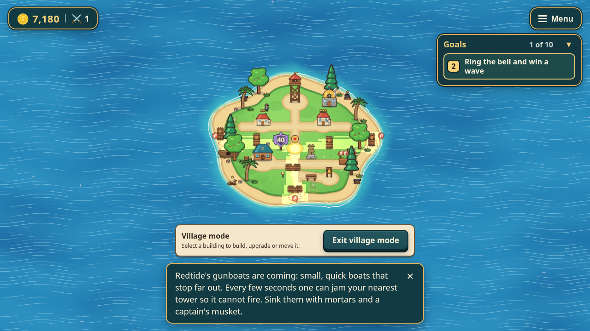
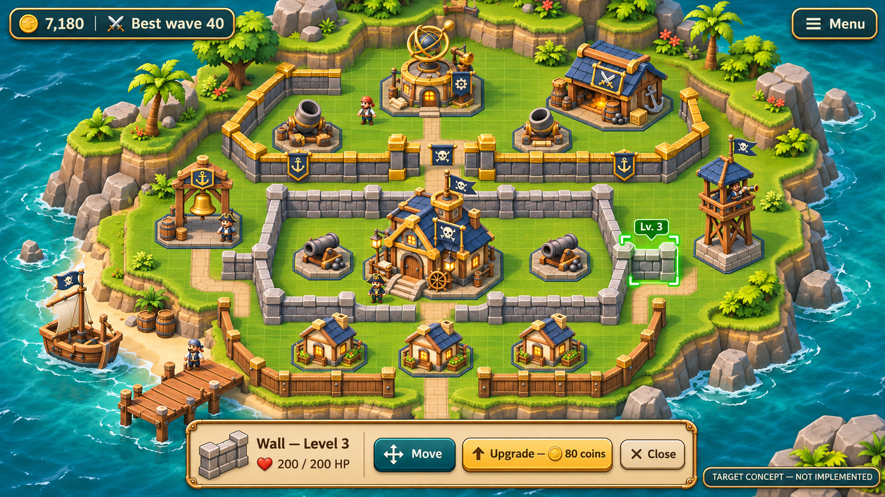

# Current game and target concept

Visual comparison for Johannes Franz Lang. These are two different evidence types, not a claim that the new style is implemented.

| Current game — actual browser capture | Target appearance — generated concept |
|---|---|
|  |  |

The left image is current source `724bbc41de5754007a9bcc27a5e84758540b540b` with local fake island data: declared progress/coins, normally built fixture structures and the existing village camera. It is not a production account. The high-quality capture uses the application's existing quality control; the renderer/transport/input report is in [COMPARISON.json](COMPARISON.json). No screenshot pixels were painted over or edited.

The right image illustrates the requested art direction and useful connected walls. It is explicitly labeled **TARGET CONCEPT — NOT IMPLEMENTED**. Segment allowance, exact cell layout and functional pier behavior are design inputs to be validated, not facts established by the illustration. Illustrated bricks are not an authoritative count of logical wall pieces.

The sample healthy level-3 wall uses the current base 200 HP and undiscounted next-level cost 80 coins at an eligible stage. Actual UI must quote current unlocks, payer modifiers, health and selected protocol; the illustration grants no upgrade or payment authority. Single-wall upgrades already exist; optional batch upgrades are separate work.

[Current phone capture, 375×812](current-game-375x812.png). There is no implemented target-phone screenshot yet; the actual phone result is a required later acceptance check.

Existing baseline checks passed **75 tests / 6 files** for placement, connections, pathing, blocking and guide behavior. The browser fixture passed both viewport checks with 0 page errors and 0 external requests, including actual Exit hit tests and long-refusal camera reflow. These results apply to existing behavior, not the proposed new free-grid or art implementation.
