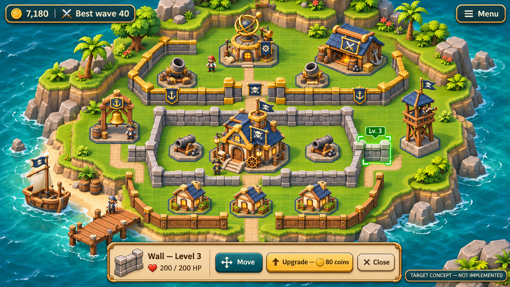

# Reference-style pirate village

Planning and visual acceptance for Johannes Franz Lang (`frcola`). Used by the visual task issues and future coding agents. Baseline inspected: `724bbc41de5754007a9bcc27a5e84758540b540b` on 17 November 2026.

This is a newly generated English target concept derived from Johannes's supplied pirate-village reference, now illustrating connected and upgradable walls. It is labeled “TARGET CONCEPT — NOT IMPLEMENTED.” It is documentation, not an application texture or a screenshot of a running feature. The exact allowance, cell layout and functional pier still require their reviewed contracts. The supplied original remains preserved in the earlier reference commit and the local source archive.

See [the current-game / target comparison](COMPARISON.md) for the actual browser baseline and screenshot provenance. The example healthy level-3 wall and eligible undiscounted level-4 upgrade use existing base values; real actions still use current authoritative quotes and state.

## What the image asks us to achieve

1. Buildings read as solid objects: visible roof, wall and plinth planes, restrained bevels, warm windows and consistent shadows.
2. A coherent maritime palette: navy roofs and cloth, warm wood, brass fittings, warm gray stone, bright grass and turquoise water.
3. A raised island: a clear grass lip, layered cliff faces, a sandy cove and broken shoreline foam rather than a flat grass oval.
4. A deliberate village composition: quiet central building space, grouped edge vegetation, legible paths and recognizable landmarks.
5. A clear building interaction: actual selected artwork, a terrain-aligned snap grid, footprint brackets, non-color validity feedback and an accessible action panel.
6. The same style during exploration, management and combat, including damaged structures, ruins, firing, repairs and mobile views.

The target is a comparable visual language and playable composition, not a promise of pixel-identical generated illustration. Similar colors alone do not satisfy the target.

## What is already implemented

The team merged the six first-wave village PRs through #202 and structure-recovery work through #203 before this audit. Existing features include village selection, overview camera fit, house-level silhouettes, wall joins between waves, a base overview, a local defense report, Move snapping/validation, and the navy/brass/parchment UI kit. These should be extended rather than recreated. Recovery's live activation is not inferred from merged source; its flag remains a separate rollout matter.

Current art is already smooth cartoon art drawn with Canvas paths, cached as textures on Three.js planes. It is not only low-resolution pixel art. `world/art.js` projects `(x,z)` to `(x,-0.72*z)`; `art/textures.js` uses unlit materials. Simply enabling lights or increasing pixel density cannot produce the reference's materials and volume.

## Technical direction and first proof

Keep the existing fixed-view 2.5D projection, gameplay coordinates and frame identity for the first attempt. Prove the target on an implementation branch with one richer cannon, a bounded grass/cliff/contact sample and the existing Move interaction in the actual game. Review captures at **1280 × 720** and **375 × 812** before converting all assets.

The first proof must compare named traits: object volume, stone/metal/wood separation, consistent light, ground contact, cliff readability, selection accuracy and phone legibility. It fails if only a large isolated asset sheet looks good while the village remains flat or unreadable.

`GAME-V3.md` section 7 currently specifies code-drawn art, no runtime image downloads and the same angle. Reuse that pipeline first. If it cannot reach the accepted quality, record an explicit art-contract revision for original authored/generated sprite assets and their loading/budget/source rules before doing bulk work. The existing renderer can display textures; this does not require a new engine or dependency. The conditional asset-route task is not automatically required or approved by this document.

## Geometry and state boundaries

- A visual roof/base can overhang a logical footprint. That must not move saved coordinates or enlarge collision, attack range or build rights.
- Walking/placement use analytic land; water currently derives its shoreline from backdrop alpha. Raised cliff artwork needs an explicit decorative-waterline versus playable-top contract.
- The stone rim mentioned by older local GRID planning is not part of this inspected main. Do not claim that cliff work already exists.
- Current home has no walkable dock rectangle. A usable new pier needs an explicit walking/building/naval/phase contract, including whether it creates a safe combat firing location. Do not draw an apparently usable off-shore route and leave it nonfunctional.
- The top-left swords number currently means captain level. The concept's “Wave 14” must use actual wave/campaign state, not relabel the captain level.
- Locked buildings, damage, zero health, gradual recovery and paid repair must remain truthful. Art does not grant buildings, money, health, land or a new headquarters progression.
- Island growth, free wall placement, catalogue purchases and highscore behavior remain in their existing base-building tasks. Visual work does not complete those features.

## Delivery and verification

The linked issue plan splits asset families, terrain and interface work into bounded tasks. Use one writer per branch in separate clones, check current claims, and coordinate shared registration, world, combat and resource hooks. Shared integration files have one active owner; building painters can work in separate family modules. Keep each implementation reviewable, around 400 changed source/test/capture lines or split it before starting.

Each visual implementation supplies before/after actual-game captures at both sizes, applicable focused behavior checks, production build, budget and text lint. Run documented browser checks when applicable and report exact outcomes. Generated concepts and controlled renderer sheets are supplementary, not proof of playable integration. Document fixture data, source commit, viewport, quality and unverified browsers/devices. New motion respects existing low-quality and reduced-motion behavior.

No new packages/services, database migration application, deployment or merge is part of this planning request. The submission schedule and feature-freeze policy are not silently changed; larger work remains an expansion backlog until the team schedules it. Normal human walkthrough, peer review and merge rules remain in force.

## Planning status

This branch contains planning documentation, a newly generated target concept and fresh actual-game baseline captures. Task creation, dependency validation and read-back evidence are recorded in the accompanying roadmap. Existing-behavior test/capture results are scoped in the comparison; no target-style application code or proof of the proposed runtime features is claimed.

[Published issue roadmap](ROADMAP.md) · [Parallel work](PARALLEL-WORK.md) · [Current-code audit](SOURCE-AUDIT.md) · [Publication/content checks](VERIFICATION.json).

All GitHub issue/PR text and shared documentation for this work must be written in English, as requested by Johannes. The supplied reference image remains the original visual source.

The complete execution plan is [ROADMAP.md](ROADMAP.md), including [WALL-ROADMAP.md](WALL-ROADMAP.md) and the [failure register](RISK-REGISTER.md). The functional wall gate and actual visual gate are separate.

[Exact executed checks and remaining evidence](CHECKS.md).
