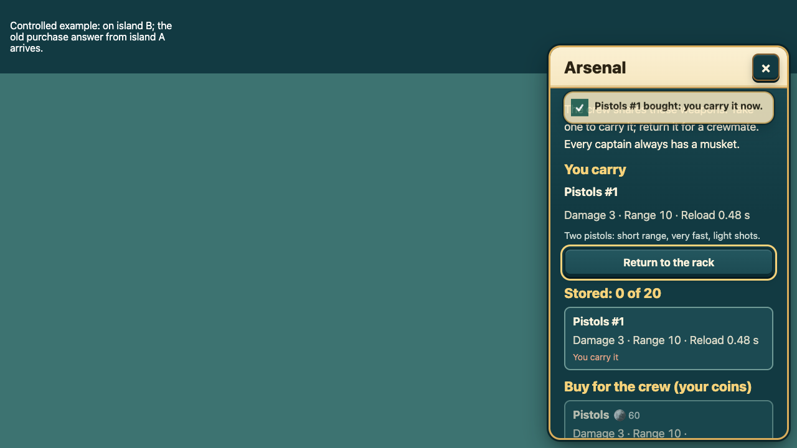
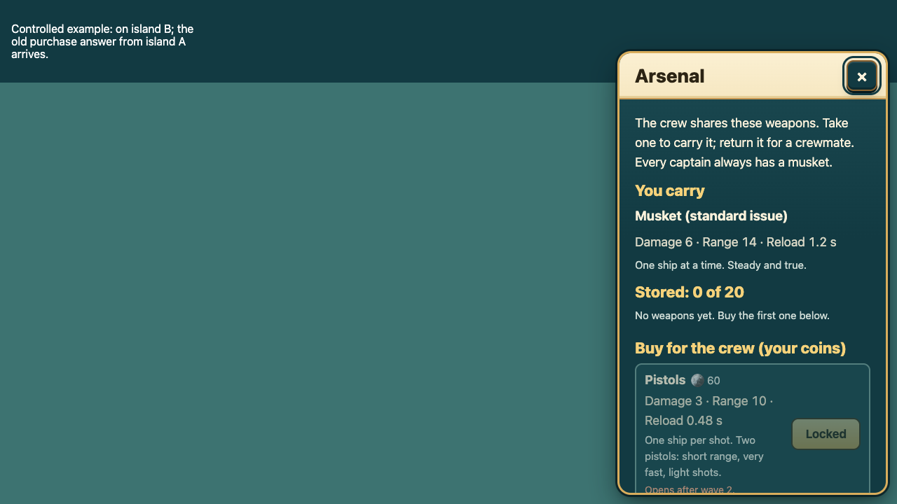
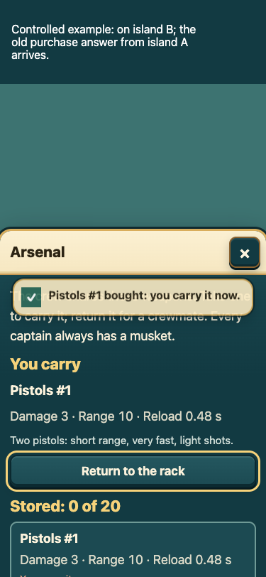
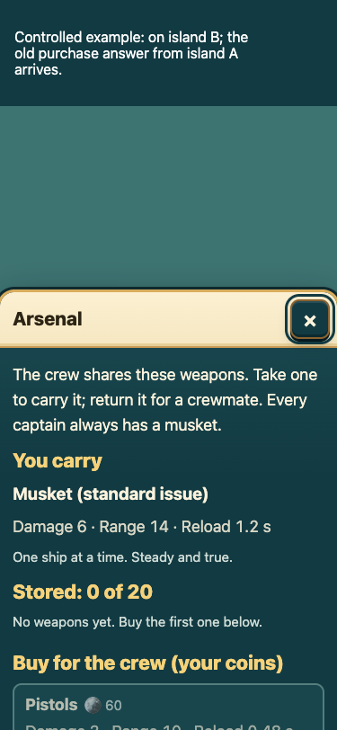

# Arsenal replies after travel: visual evidence

Controlled component fixtures, with real production controllers/renderers and the game's shared stylesheet order. No live accounts, real-player data or live writes. Before uses main `e8c61c6` for this task's production files; after uses this branch. Only those modules differ. The captions belong to the fixture, not the product.

- Before: An old island A purchase answer paints A inventory while the fixture is on B.
- After: B keeps its empty rack and standard musket; no A inventory is applied.

| Viewport | Before | After |
|---|---|---|
| 1280 x 720 |  |  |
| 375 x 812 |  |  |

[Machine-readable fixture traces](report.json). Four captures; zero page errors and zero external requests. The phone is an emulated viewport, not a physical device.

## Reproduce the behavior

`cd frontend && npx vitest run tests/island/arsenal-context.test.js` with installed Chrome (`CHROME_PATH` if needed). Eleven controlled cases cover delayed success/refusal for buy/take/return, late read success/error, travel during refusal refresh, normal delayed success and a completed fake-server purchase surviving the ignored answer. Screenshots use the same controlled reply order with real UI; the small fixture background is not a live-game screenshot.

## Limits

These are controlled controller replies. The persistent-purchase case uses the in-memory fake, not SQL or real Realtime. Returning to the same island before a reply finishes is not a new navigation-generation protocol.

## Shared accessibility limitation

`npm run test:a11y` exits 1 on unchanged main: market-placed contrast at 1280/375/320px. [Compact baseline evidence](baseline-a11y.json). No market style or accessibility test changes are included. Exact branch results: [verification](../../../specs/B3-arsenal-context.md#verification-15-nov-2026).
