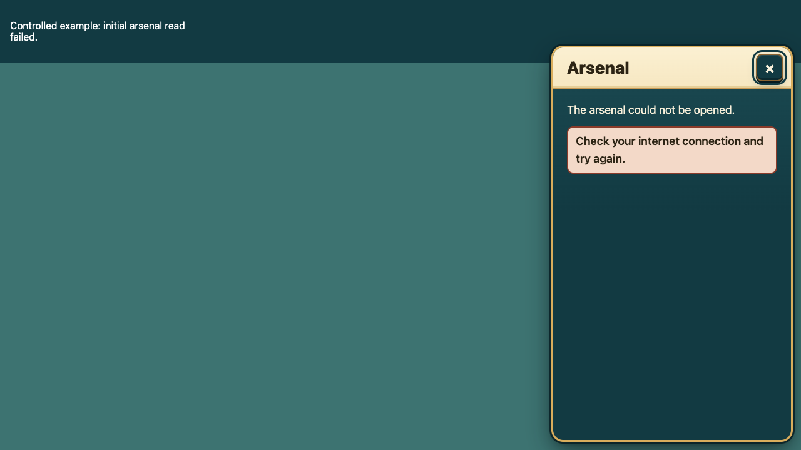
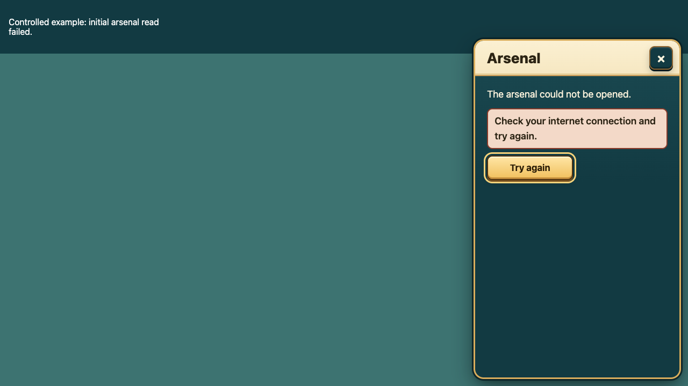
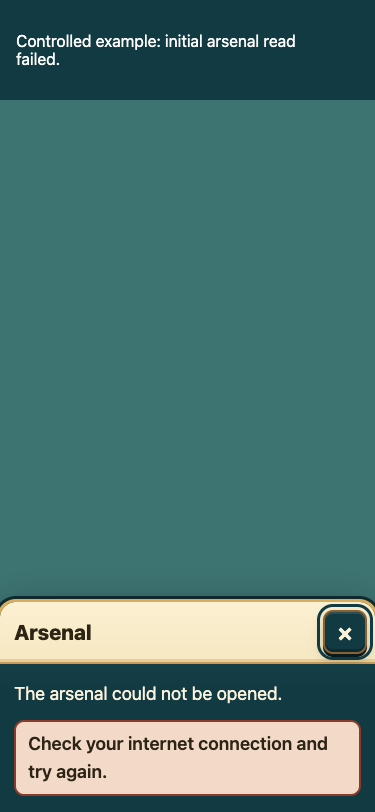
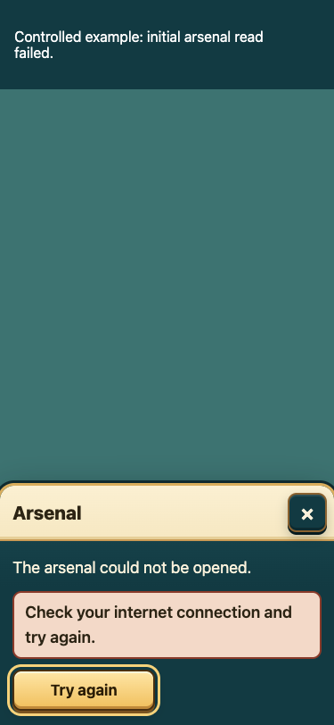

# Retrying an arsenal load: visual evidence

Controlled component fixtures, with real production controllers/renderers and the game's shared stylesheet order. No live accounts, real-player data or live writes. Before uses main `e8c61c6` for this task's production files; after uses this branch. Only those modules differ. The captions belong to the fixture, not the product.

- Before: The initial read error has no recovery button in the open card.
- After: Try again is visible and keyboard-focused below the error.

| Viewport | Before | After |
|---|---|---|
| 1280 x 720 |  |  |
| 375 x 812 |  |  |

[Machine-readable fixture traces](report.json). Four captures; zero page errors and zero external requests. The phone is an emulated viewport, not a physical device.

## Reproduce the behavior

`cd frontend && npx vitest run tests/island/arsenal-retry.test.js` with installed Chrome (`CHROME_PATH` if needed). Three native Chrome cases use the full shared stylesheet order at 1280x720 and 375x812: keyboard activation, 44px target, duplicate retry suppression, repeated failure then success, and closing before completion. Screenshots use the same controlled reply order with real UI; the small fixture background is not a live-game screenshot.

## Limits

The replies are controlled at the controller boundary. These tests do not exercise a live account, real timeout duration, physical phone or server/database rules.

## Shared accessibility limitation

`npm run test:a11y` exits 1 on unchanged main: market-placed contrast at 1280/375/320px. [Compact baseline evidence](baseline-a11y.json). No market style or accessibility test changes are included. Exact branch results: [verification](../../../specs/B3-arsenal-retry.md#verification-15-nov-2026).
