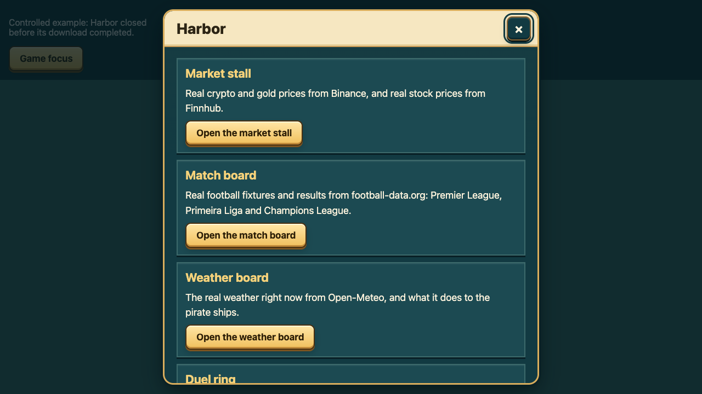
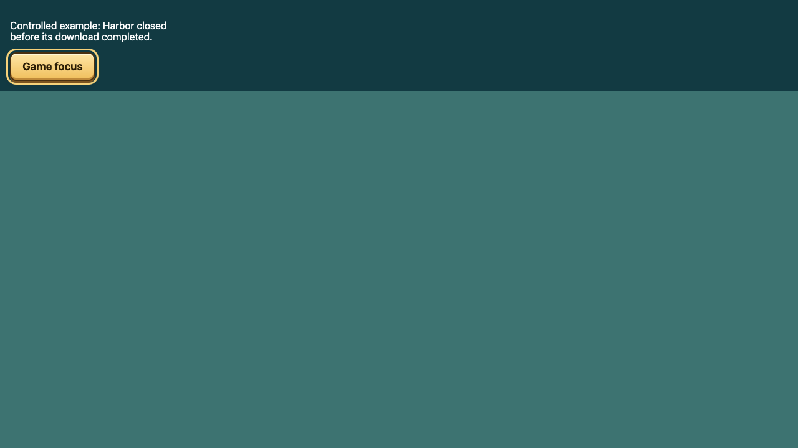
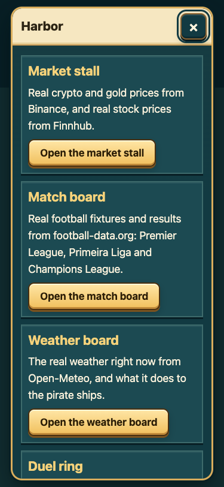
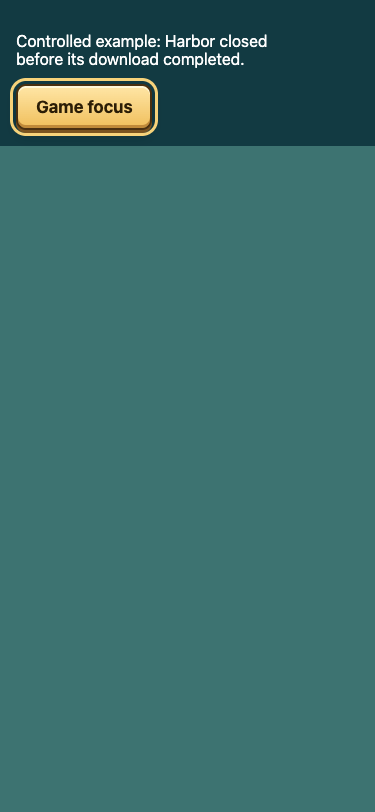

# Closing the harbor while loading: visual evidence

Controlled component fixtures, with real production controllers/renderers and the game's shared stylesheet order. No live accounts, real-player data or live writes. Before uses main `e8c61c6` for this task's production files; after uses this branch. Only those modules differ. The captions belong to the fixture, not the product.

- Before: Harbor opens after close when the controlled download finishes.
- After: The underlying fixture retains focus and no Harbor dialog opens.

| Viewport | Before | After |
|---|---|---|
| 1280 x 720 |  |  |
| 375 x 812 |  |  |

[Machine-readable fixture traces](report.json). Four captures; zero page errors and zero external requests. The phone is an emulated viewport, not a physical device.

## Reproduce the behavior

`cd frontend && npx vitest run tests/harbor/host-loading.test.js` with installed Chrome (`CHROME_PATH` if needed). Eight controlled host cases cover close/reopen, repeated opens, both view orders, load rejection/retry, obsolete failure and success/failure after disposal. Existing Harbor card browser tests exercise real rendering. Screenshots use the same controlled reply order with real UI; the small fixture background is not a live-game screenshot.

## Limits

The focused tests control module resolution and use card-factory spies. Screenshots separately use the real cards with a controlled module delay. Network throttling, physical phones and a full live journey are not claimed.

## Shared accessibility limitation

`npm run test:a11y` exits 1 on unchanged main: market-placed contrast at 1280/375/320px. [Compact baseline evidence](baseline-a11y.json). No market style or accessibility test changes are included. Exact branch results: [verification](../../../specs/B3-harbor-loading.md#verification-15-nov-2026).
