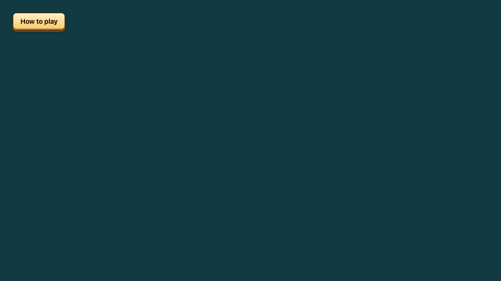
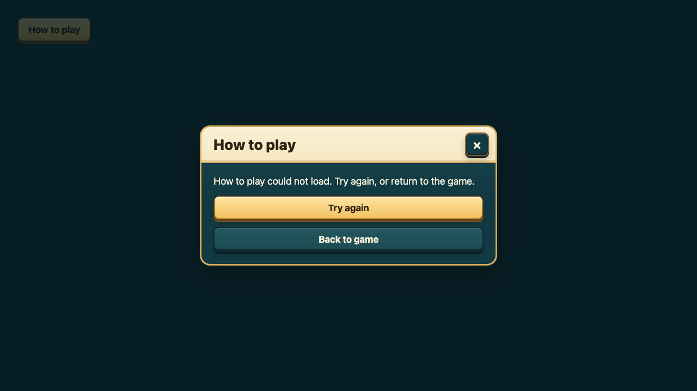
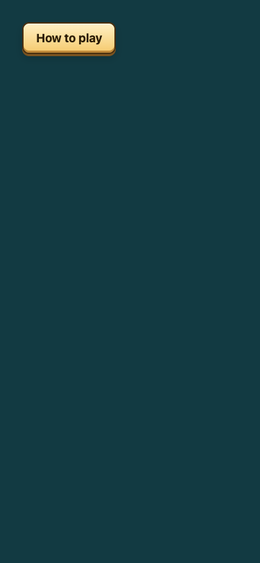
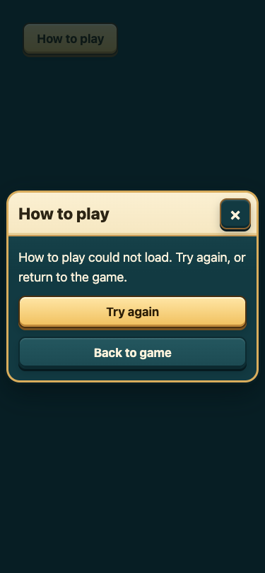

# B3 help-load evidence

Controlled Chromium component fixture using the real How to play host, shared modal and tutorial card.
The injected loader rejects once, then loads the actual card. No live API, account or game write is used.

| Size | Before failure (silent) | After failure (retry/cancel) | After retry |
|---|---|---|---|
| 1280x720 |  |  | [Help](after-retry-1280x720.png) |
| 375x812 |  |  | [Help](after-retry-375x812.png) |

Pending-load captures: [desktop before](before-loading-1280x720.png), [desktop after](after-loading-1280x720.png),
[phone before](before-loading-375x812.png), [phone after](after-loading-375x812.png).
These are component fixtures, not physical-phone, real slow-network or deployed-game evidence.
