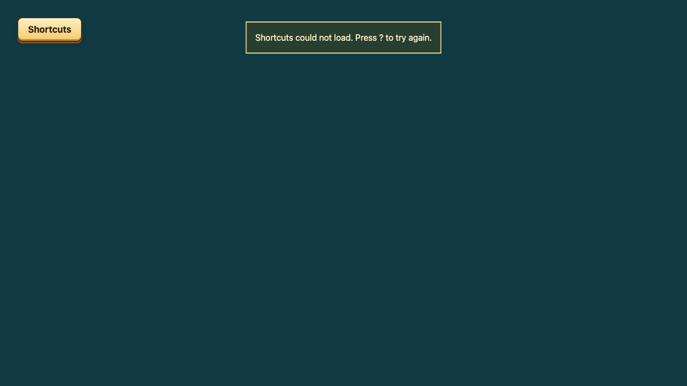
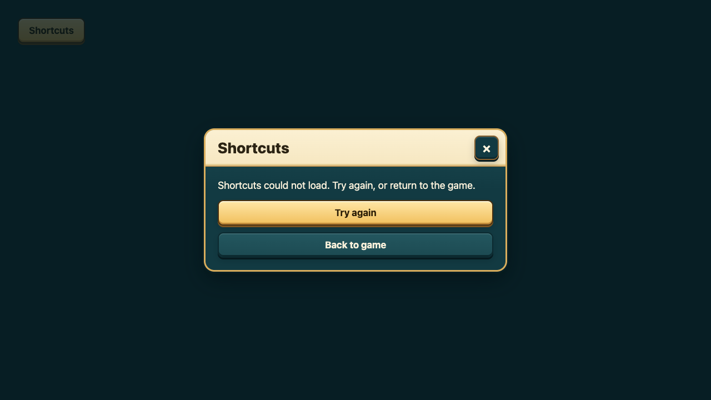
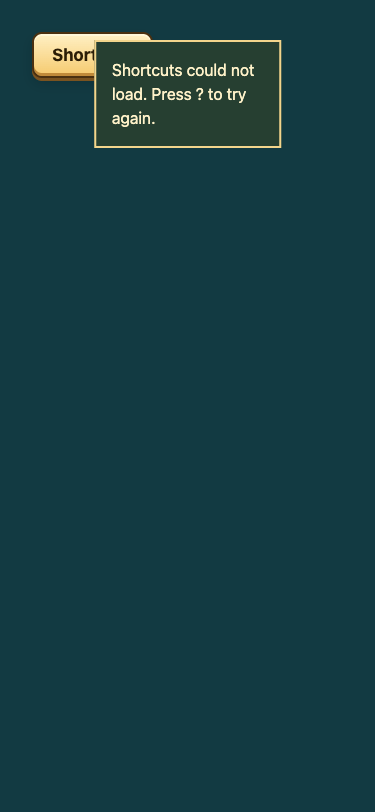
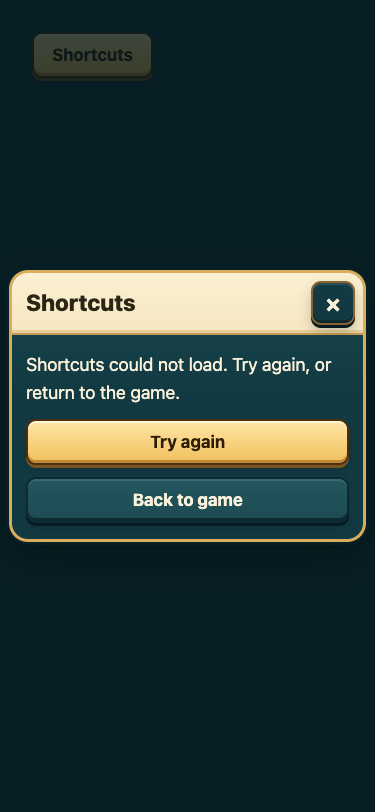

# B3 shortcuts recovery evidence

Real Chromium component fixture. The first shortcuts-module HTTP request is blocked;
Retry succeeds on its second request and opens the real overlay. No live account/API is used.

| Viewport | Before: keyboard-only instruction | After: touch-usable recovery | Retry |
|---|---|---|---|
| 1280x720 |  |  | [Opened](after-retry-1280x720.png) |
| 375x812 |  |  | [Opened](after-retry-375x812.png) |

These are isolated component fixtures, not deployed game or physical-device evidence.
