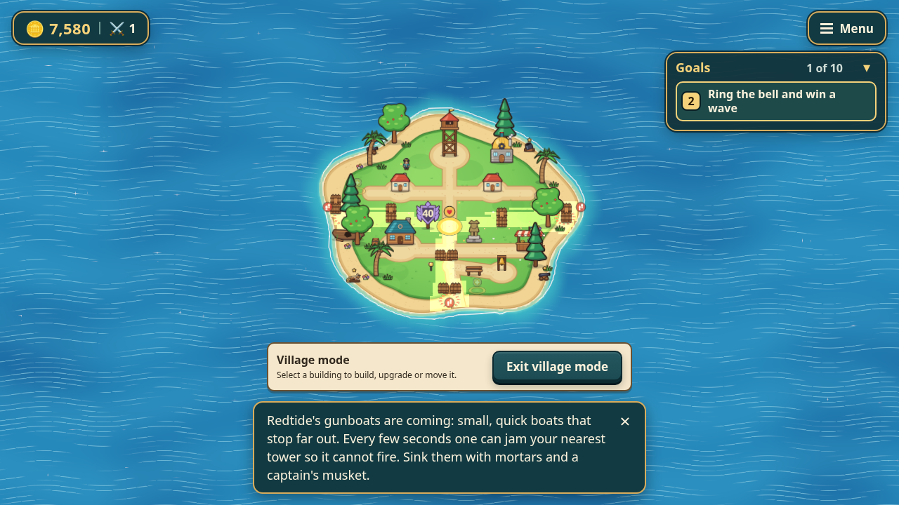
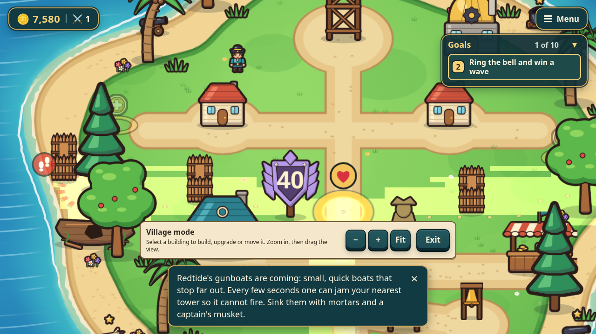
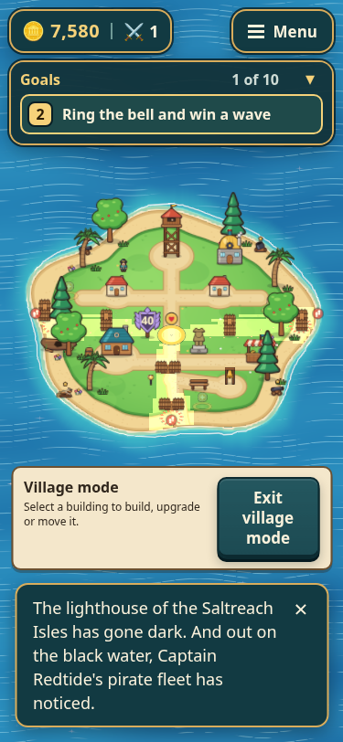
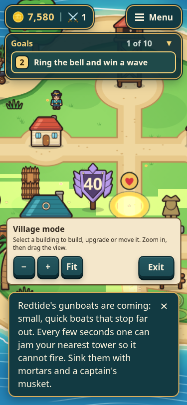

# BASE-02 working-camera evidence

Actual local game captures and interaction checks for Johannes Franz Lang's camera slice in [Draft PR #270](https://github.com/Nilsnova/The-Great-Plot-Twist/pull/270). These are running Chromium with the existing fake island API; they are not a generated target or production account.

| Size | Before: existing Fit-only management | After: real working zoom/pan controls |
|---|---|---|
| 1280×720 |  |  |
| 375×812 |  |  |

The fixture starts with 8,000 declared coins and waveBest 40, builds the current twelve walls plus seven defenses/houses using normal existing actions, and parks the captain at (-7,-11). It uses existing daytime and high-quality preferences. Screenshot pixels are not painted over. Capture-time renderer density is recorded in the JSON reports.

Before source: `724bbc41de5754007a9bcc27a5e84758540b540b`; current main `569d8fda3474cb84af36af190853d1a0e02b7abf` changes only the cleanup script from this runtime baseline. After source: `145fff66` (the evidence commit follows without changing runtime code).

Commands from the branch root:

```sh
node frontend/scripts/capture-working-village.mjs /workspace/reference-style-roadmap/baseline/frontend /workspace/village-perimeter-work/base-02/docs/evidence/BASE-02-working-camera before
node frontend/scripts/capture-working-village.mjs /workspace/village-perimeter-work/base-02/frontend /workspace/village-perimeter-work/base-02/docs/evidence/BASE-02-working-camera after
```

The after check uses actual visible Zoom buttons, canvas drag, wheel and Fit, checks unchanged captain position, at least 44×44px unobstructed camera/Exit targets, and exits management back to exploration. Both sizes record 0 page errors and 0 external requests. It preserves the normal Fit view and whole-island Move flow rather than changing saved coordinates or combat zoom.

A QA setup run initially measured a hidden asset canvas and stopped before camera assertions; the helper now explicitly measures the renderer's canvas. A second setup run waited for Fit zoom but checked center before its eased motion finished; the wait now requires both original zoom and the same center assertion. No game rule or assertion was removed to make the capture pass.

Final focused unit results: **30 tests passed / 3 files**, covering current camera/mode states plus gesture threshold, returned-origin cancellation, interruption, multi-touch, blur, teardown and bounded working zoom/pan. Text lint: **0 errors, 8 report-only findings** outside this slice.

Full suite, build, budget, accessibility/demo and integrated perimeter interactions belong to the coordinated integration lane and are not claimed here. Safari, actual touch hardware, physical phones and expanded island geometry remain unverified. The larger BASE-02 parent remains open. No merge or deployment.
