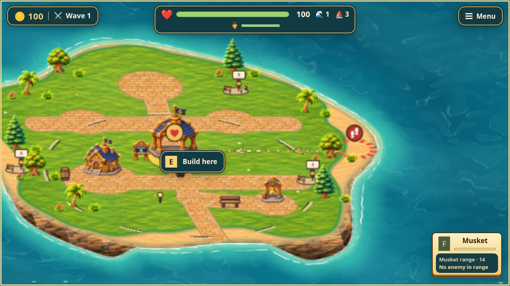
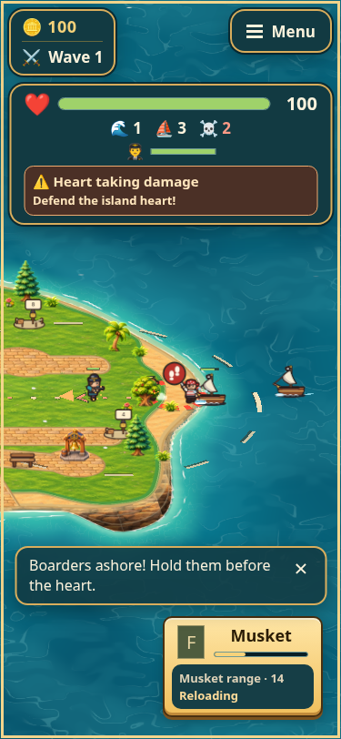

# CF1 Captain range and danger feedback

What this is: review evidence and a code walkthrough for [task #453](https://github.com/Nilsnova/The-Great-Plot-Twist/issues/453).
Who uses it: Ianno and the human peer reviewer, before publication and merge.

Branch: `feat/captain-combat-feedback`. PR: [#475](https://github.com/Nilsnova/The-Great-Plot-Twist/pull/475).
Current screenshot source: `203c696a`; runtime integration: `c03b3eb8`, with main through `db573347`.
Landscape control-column follow-up: `21440b26`; this affects neither desktop nor portrait capture dimensions.
This revision follows Ianno's request to make the parchment range slightly easier to see.
The earlier request for a quieter radius and visual-only shot confirmation still applies.
After publication, main introduced a new village projection and HUD; the task branch
was reconciled with those changes. CF1's decision is D066 (main already owns D061–D065).
The new village artwork and WebP shipping update come from main; this feature changes only combat feedback.
The original blue design and previous parchment captures remain as historical evidence.
The latest arcs have thicker warm parchment strokes with a darker backing so they remain legible over grass and paths.
Ianno reviewed runtime `79bb6762` before publication; current projection-integration changes require human peer review.
All three explain-back questions are completed. Ianno reviewed the changes and
explicitly authorized PR publication on 18 November 2026. [Task #453](https://github.com/Nilsnova/The-Great-Plot-Twist/issues/453)
tracks the published PR and its status. Independent human peer review and merge remain pending.

## What the player sees

Hover or focus the fire button, hold F, or attempt a shot to reveal the current
weapon's reach. In multiplayer each browser shows only its own captain's range,
using its own position and loadout; teammate attacks never reveal their range. Refused attempts reveal it too. The display uses twelve short parchment arcs with large gaps, following the captain,
level, weapon and range skills, then fades after 1.2 seconds plus a 0.4-second fade.
The last manual slash can briefly show cutlass reach. Bomb reach describes throw
distance; the blast and a rifle's secondary pierce can extend beyond the circle.

The fire panel explains reload, no target and out-of-range aims. Written Hit/damage
confirmation is removed from visible and spoken feedback. The existing bullets and
impact flashes show successful shots. A short brighter cap marks the true range
boundary in the last firing direction; it disappears when that attempt expires.
The cap rotates in logical world coordinates before the shared ground projection,
so it stays accurate when aiming diagonally or moving the camera.

One warning beneath the wave bar names immediate danger. An arrow beside the
captain points toward it. Captain/heart critical danger, recent heart damage,
captain attacks and pirates near the heart are prioritized. A short two-tone
sound respects effects mute/volume and is attempted once per continuous warning,
then visuals continue alone. Captain and heart episodes are tracked independently:
changing priority, critical status, wording, opening/closing menus or unmuting cannot
replay an ongoing warning. An actively observed clear ends that episode; its
return can start a new one. The existing six-second audio guard only suppresses
rapid new alerts and never schedules a repeat.
Its warning already supplies the text, so it adds no duplicate sound-caption box.
Menus, falling, finishers, countdown, catch-up, leaving and wave end clear feedback.

## Actual-game screenshots

These are Chromium 156.0.8078.79 captures of the local game, using its existing
in-memory fake server: wave 1, a level-one Musket and no built defenses. Player
position setup is scripted; attacks use native keyboard F and the real controller.
Automatic slash is disabled in this fixture so waiting for danger remains observable.
The device has completed front-door/arrival/tutorial history and tutorials are disabled
before Play, preventing unrelated queued onboarding from intercepting combat input.
The fixture hides the already-seen first-wave teaching hint. No HP, hit, victory,
clock or simulation result is forced. Screenshots compare the same setup at live
simulation times recorded in [before-report.json](before-report.json) and
[current after-report.json](visibility/after-report.json); they are not identical paused frames.
These reports also record source, browser, quality/DPR and any dirty files.

| View | Previous blue design | Current parchment design |
|---|---|---|
| Range, 1280×720 | [Previous](after-range-1280x720.png) | [Current](visibility/after-range-1280x720.png) |
| Range, 375×812 | [Previous](after-range-375x812.png) | [Current](visibility/after-range-375x812.png) |
| Shot impact, 1280×720 | — | [Current, no damage label](visibility/after-impact-1280x720.png) |
| Shot impact, 375×812 | — | [Current, no damage label](visibility/after-impact-375x812.png) |
| Danger, 1280×720 | [Previous](after-danger-1280x720.png) | [Current](visibility/after-danger-1280x720.png) |
| Danger, 375×812 | [Previous](after-danger-375x812.png) | [Current](visibility/after-danger-375x812.png) |

Original main before this feature: [desktop range](before-range-1280x720.png),
[phone range](before-range-375x812.png), [desktop danger](before-danger-1280x720.png),
[phone danger](before-danger-375x812.png). The earlier [written confirmation](after-hit-1280x720.png)
is retained only as superseded review history; it is absent from the current game.

## Code walkthrough

- `range-feedback.js` keeps short-lived firing intent and aim direction. Its radius
  always comes from the controller's existing `captainStats()`; it cannot change hits.
- `danger-feedback.js` reads raw captain/participant IDs, actual boarder targets,
  incoming ship fire and fresh damage. It chooses one warning and limits sound.
- `controller.js` records attempts at the actual attack paths, including refusals.
  The original firing and impact events still reach the renderer. Only danger
  damage notes use the fresh authoritative stream, before cosmetic suppression.
- `hud.js` displays text, reports hover/focus intent and supplies a separate polite
  range status plus an alert for danger. Repeated identical danger frames do not
  rebuild announcement text. Reduced motion preserves static text.
- `combat-overlay.js` caches four meshes. It uses the game's existing flat projection
  (`projectGround` and cached `groundShapeMatrix()`) for exact world reach, using sparse arcs and a directional cap;
  it disposes all geometry/materials on stop.
- `audio/pirates.js` plays the alert on the existing effects bus. It does not add
  another caption over the warning or change other audio preferences.

## Own-captain range in multiplayer

Ianno explicitly requires each player to see only their own captain's range. The
existing controller already creates range intent from local fire/preview input,
uses the local world player and loadout, and never takes range intent from room
messages, presence figures or the replay journal. No runtime behavior change was
needed; `a93b140f` adds regression coverage and clarifies this in the helper header.

[Focused verification](own-captain/focused-tests.txt): **31 tests pass across 6 files**.
Two connected host/visitor controllers have distinct positions and weapons: shared
shots still reach the other renderer, while range preview, origin, radius and
expiry remain private. Recovery coverage checks local participant identity,
teammate cosmetics and durable journal attacks, ignored remote presence positions,
and no fallback to a teammate when the local position is absent. Independent
read-only review found no ownership leak or blocking issue.

Two initial test-authoring runs used incorrect catalog expectations ([rifle](own-captain/initial-rifle-expectation.txt),
[bombs](own-captain/initial-bomb-expectation.txt)): level-one Long rifle is 22 and
Fire bombs is 14. Only those new expectations were corrected; combat stats did not change.

The latest screenshots remain valid because presentation and runtime behavior are
unchanged. No new build, native-browser, full-suite or live-multiplayer run is
claimed for this test/comment-only follow-up. Current human peer review remains pending.

## Range visibility follow-up

Ianno found the previous parchment arcs too faint. Runtime `203c696a` increases the
stroke width inward, lightens the parchment and strengthens its dark backing. The
outer weapon boundary, twelve short arcs, large gaps, contextual lifetime and
warning audio behavior stay the same. The short direction cap receives the same
small contrast adjustment. [Previous faint desktop](main-integration/after-range-1280x720.png)
and [phone](main-integration/after-range-375x812.png) captures remain available.

- [Focused tests](visibility/focused-tests.txt): **22 passed across 4 files** (overlay projection/radius/resources, range lifetime, renderer and native HUD).
- [Build/spoiler guard](visibility/build.txt) and [budget](visibility/budget-summary.json) pass.
- [Actual-game checks](visibility/native-feedback.txt): **14 pass**, six desktop/phone captures and no uncaught browser errors. [Report/provenance](visibility/after-report.json). Independent read-only screenshot review found the increase visible on both sizes without dominating the scene.

No new full-suite, broad overlap/accessibility/demo, physical-device or live-multiplayer run is claimed for this visual-only adjustment. Current human review remains pending.

## Verification after current-main integration

- [Projection/renderer/HUD tests](main-integration/integration-tests.txt): **89 passed across 12 files**.
- [Related CF1/projection tests](main-integration/additional-tests.txt): **72 passed across 8 files**.
- [Layout rerun](main-integration/landscape-tests.txt): **10 passed across 3 files** after compacting the danger row on short landscape displays.
- [Expanded fire-control regression](main-integration/reserved-column-tests.txt): **11 passed across 3 files**. A real toast stays at least 8px left of expanded Fire bombs feedback at 844×390; its [expected failure before the fix](main-integration/reserved-column-before.txt) is retained. Short landscape layouts reserve the fire-control column even when the range panel grows.
- [Upstream art-shipping follow-up](main-integration/art-shipping-tests.txt): **13 passed across 4 files**, including decode/shipped-output contracts and combat-overlay projection. These overlap earlier suites and are not added to their totals.
- [Actual-game checks](main-integration/native-feedback.txt): **14 checks pass**, six fresh desktop/phone captures. [Report/provenance](main-integration/after-report.json).
- [Overlap audit](main-integration/overlaps.txt): **21 state/viewport checks pass**; three first-wave-hint checks are skipped for a later wave under main's corrected hint rule. The first run found a landscape toast/action overlap, recorded [before the fix](main-integration/overlaps-before.txt); the compact warning row keeps all warning text visible, and the expanded fire-control regression additionally verifies horizontal toast separation.
- [Build/spoiler guard](main-integration/build.txt), [budget summary](main-integration/budget-summary.json) and [reviewed text](main-integration/reviewed-text.txt) pass, with **0 text errors / 8 report-only findings**.
- [Projection tests before adaptation](main-integration/projection-before.txt): three expected failures demonstrate the old hardcoded projection is rejected. Existing main renderer pooling, wall connections, projected muzzle tests and native HUD disclosures are preserved. The latest image helpers use declared returning-device history; earlier queued-onboarding failures are retained [here](main-integration/capture-setup-before.txt).

No fresh full-suite, broad accessibility/demo, live multiplayer or physical-device pass is claimed for this integration. Earlier results and limits are below. The PR is open and awaits current human peer review; it remains unmerged.

## Earlier visual and warning-audio verification

- [Once-per-warning tests](warning-audio/focused-tests.txt): **77 tests pass across 6 files**, covering sustained warnings, critical/wording changes, priority switches, independent clearing, new episodes, menu hiding, mute/unmute and wave reset. [Tests before the fix](warning-audio/tests-before.txt) record five expected failures. [Build](warning-audio/build.txt), [budget summary](warning-audio/budget-summary.json) and [reviewed text](warning-audio/reviewed-text.txt) record the audio revision. This change has no visual effect, so the existing redesign screenshots are retained.
- [Earlier range redesign suite](redesign/focused-tests.txt): **100 tests pass across 11 files**. Coverage includes genuine angular gaps, exact outer radius, diagonal/cardinal direction projection, cached resources/disposal, aim expiry, no written damage feedback, preserved firing/impact events, controller behavior, native keyboard/layout, sound and tutorial limits.
- [Native game check](redesign/native-feedback.txt): **14 checks pass**, with six current screenshots. Existing simulation HP/counters confirm attacks still work, and the fire control contains no confirmation label or damage number.
- [Overlap audit](redesign/overlaps.txt): **24 state/viewport checks pass**.
- [Build/spoiler guard](redesign/build.txt), [budget](redesign/budget.json) and [reviewed text](redesign/reviewed-text.txt) pass; text lint has **0 errors and 8 report-only findings**.
- Independent read-only review found no blocking product issue. No new full-suite or broad accessibility/demo run was performed for this presentation revision; their prior results and limits remain explicit below.

## Earlier verification and known audit limits

- [Final scoped suite](focused-tests.txt): **87 passed across 9 files**, 7.42 seconds. It covers range lifetime/equipment/skills, refusals, own-hit truth, unique target counts, danger priority/expiry/cooldown/mute, renderer pooling/disposal, controller paths, keyboard focus, reduced motion, layout and reviewed text.
- [Final follow-up run](final-regressions.txt): **14 passed across 4 files**, 27.74 seconds. This checks short tutorial copy, tutorial host, actual-game defense-report input ownership and desktop/phone nearby input with the original time limits.
- [Full run](full-tests.txt): **3,864 passed, 5 failed across 352 files**, 626.63 seconds. Three failures exposed the overly long tutorial paragraph, now shortened; two native browser cases hit their existing 20-second limits. Every failed case passes in the final follow-up run. A full clean run after these corrections was not repeated; do not report the full suite as green.
- [Build/spoiler guard](build.txt) passes; [budget](budget.json) passes; [reviewed text](reviewed-text.txt) has **0 errors and 8 report-only findings**.
- [Overlaps after](overlaps-after.txt) and [unchanged main](overlaps-before.txt): **24 checks pass** each.
- [Native feedback](native-feedback.txt): **13 checks pass**, five actual-game after captures.
- [Accessibility summary](accessibility-summary.json): **33 screens**, eight market/lobby findings, no audit exceptions. [Demo CF1](demo-after.txt) and [demo main](demo-before.txt) retain the same hidden lamp-control timeout.

Historical failed runs are retained and are not represented as passes. [Initial full run](initial-full-tests.txt), [initial caption overlaps](initial-caption-overlaps.txt), and [new caption regression before the fix](caption-regression-before.txt) show the failures that led to the scoped corrections. The test expectation for the old extra caption changed only after D066 explicitly selected the persistent warning as the accessible text.

The native feedback check passes **13 checks**, with five after screenshots;
baseline capture passes two setup/error checks and records four before screenshots.
The final overlap audit passes **24 state/viewport checks**. Initial overlap failures
caused by the extra danger caption were fixed; the original failure and the new
failing-then-passing audio regression are preserved.

The wider demo journey fails on both main and CF1 at the hidden lamp quest control;
[BASE-51 / #341](https://github.com/Nilsnova/The-Great-Plot-Twist/issues/341) already
tracks it. The wider accessibility audit checks 33 screens but reports eight
market/lobby contrast or keyboard findings. Its refresh-identity issue is tracked
by [VIS-47 / #409](https://github.com/Nilsnova/The-Great-Plot-Twist/issues/409).
CF1's focused native component checks cover accessible range text, keyboard focus,
unchanged danger announcements, reduced motion and desktop/phone text bounds.

Not verified: physical touch devices, Safari, actual screen-reader speech, live
API/database multiplayer and human playtest acceptance. No backend, database,
recovery, balance or transport rule changed. No deployment or agent merge.

## Explain-back and next step

All three questions are completed; do not restart the quiz. The walkthrough questions were:

1. If F finds no enemy in reach, why does the ring still appear, and where does its radius come from?
2. Why should the range marker move and scale with the island when the captain moves or the camera zooms?
3. How does the warning choose between captain and heart danger and avoid repeated sound spam?

The prepared [PR request](../../handoff/CF1-PR-request.md) includes these screenshots
and verification limits. Ianno explicitly confirmed publication on 18 November 2026; independent human peer review is the next step.
