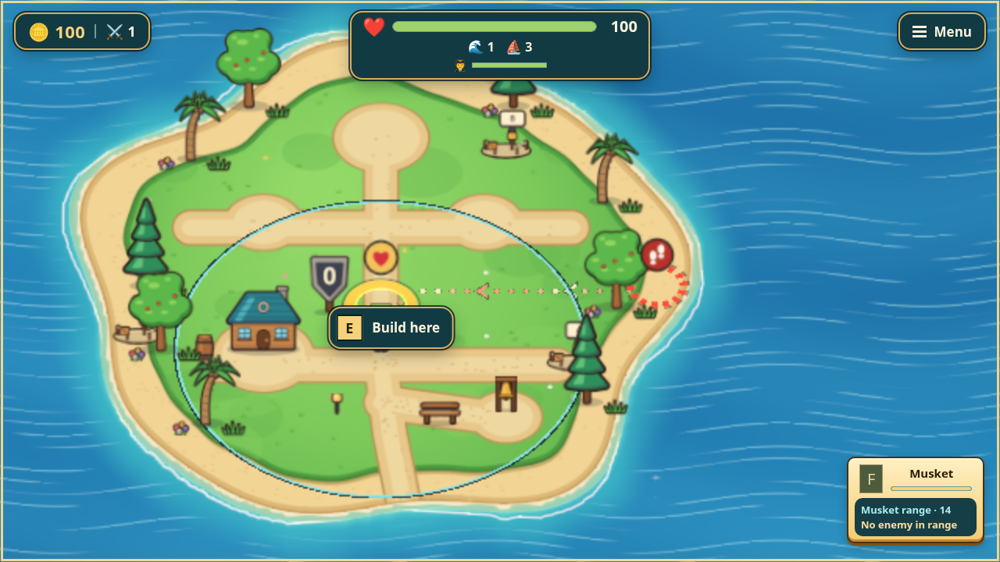
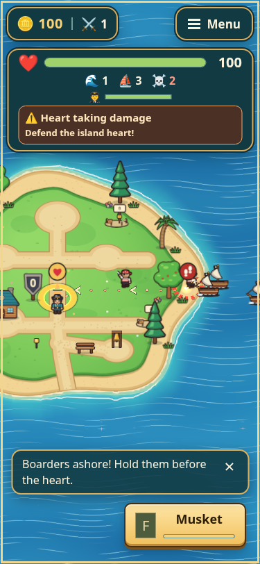

# CF1 Captain range and danger feedback

What this is: review evidence and a code walkthrough for [task #453](https://github.com/Nilsnova/The-Great-Plot-Twist/issues/453).
Who uses it: Ianno and the human peer reviewer, before publication and merge.

Branch: `feat/captain-combat-feedback`. Screenshot source: `127e7771`, based on main `48aee0e7`. Subsequent changes
shorten tutorial copy and update tests/documents; the pictured combat feedback is unchanged.
No PR has been opened; Ianno's manual review, three explain-back answers and
explicit publication confirmation are pending.

## What the player sees

Hover or focus the fire button, hold F, or attempt a shot to reveal the current
weapon's reach. Refused attempts reveal it too. The display follows the captain,
level, weapon and range skills, then fades after 1.2 seconds plus a 0.4-second fade.
The last manual slash can briefly show cutlass reach. Bomb reach describes throw
distance; the blast and a rifle's secondary pierce can extend beyond the circle.

The fire panel distinguishes a shot, reload, no target and an out-of-range aim.
Only fresh, positive own simulation damage produces the Hit confirmation.
A visible shot or an eligible target alone does not prove damage.

One warning beneath the wave bar names immediate danger. An arrow beside the
captain points toward it. Captain/heart critical danger, recent heart damage,
captain attacks and pirates near the heart are prioritized. A short two-tone
sound respects effects mute/volume and repeats at most every six seconds.
Its warning already supplies the text, so it adds no duplicate sound-caption box.
Menus, falling, finishers, countdown, catch-up, leaving and wave end clear feedback.

## Actual-game screenshots

These are Chromium 156.0.8078.79 captures of the local game, using its existing
in-memory fake server: wave 1, a level-one Musket and no built defenses. Player
position setup is scripted; attacks use native keyboard F and the real controller.
Automatic slash is disabled in this fixture so waiting for danger remains observable.
The fixture hides the already-seen first-wave teaching hint. No HP, hit, victory,
clock or simulation result is forced. Screenshots compare the same setup at live
simulation times recorded in [before-report.json](before-report.json) and
[after-report.json](after-report.json); they are not identical paused frames.
These reports also record source, browser, quality/DPR and any dirty files.

| View | Main before | CF1 after |
|---|---|---|
| Range, 1280×720 | [Before](before-range-1280x720.png) | [After](after-range-1280x720.png) |
| Range, 375×812 | [Before](before-range-375x812.png) | [After](after-range-375x812.png) |
| Danger, 1280×720 | [Before](before-danger-1280x720.png) | [After](after-danger-1280x720.png) |
| Danger, 375×812 | [Before](before-danger-375x812.png) | [After](after-danger-375x812.png) |
| Own damage | — | [Confirmed hit, 1280×720](after-hit-1280x720.png) |

## Code walkthrough

- `range-feedback.js` keeps short-lived intent and own hit messages. Its radius
  always comes from the controller's existing `captainStats()`; it cannot change hits.
- `danger-feedback.js` reads raw captain/participant IDs, actual boarder targets,
  incoming ship fire and fresh damage. It chooses one warning and limits sound.
- `controller.js` records attempts at the actual attack paths, including refusals.
  It reads authoritative damage before predicted cosmetic copies are suppressed.
  Predicted tracers and flashes cannot confirm hits or trigger danger damage notes.
- `hud.js` displays text, reports hover/focus intent and supplies a separate polite
  range status plus an alert for danger. Repeated identical danger frames do not
  rebuild announcement text. Reduced motion preserves static text.
- `combat-overlay.js` caches four meshes. It uses the game's existing flat projection
  (`y = -z × 0.72`) for exact world reach and disposes geometry/materials on stop.
- `audio/pirates.js` plays the alert on the existing effects bus. It does not add
  another caption over the warning or change other audio preferences.

## Verification

- [Final scoped suite](focused-tests.txt): **87 passed across 9 files**, 7.42 seconds. It covers range lifetime/equipment/skills, refusals, own-hit truth, unique target counts, danger priority/expiry/cooldown/mute, renderer pooling/disposal, controller paths, keyboard focus, reduced motion, layout and reviewed text.
- [Final follow-up run](final-regressions.txt): **14 passed across 4 files**, 27.74 seconds. This checks short tutorial copy, tutorial host, actual-game defense-report input ownership and desktop/phone nearby input with the original time limits.
- [Full run](full-tests.txt): **3,864 passed, 5 failed across 352 files**, 626.63 seconds. Three failures exposed the overly long tutorial paragraph, now shortened; two native browser cases hit their existing 20-second limits. Every failed case passes in the final follow-up run. A full clean run after these corrections was not repeated; do not report the full suite as green.
- [Build/spoiler guard](build.txt) passes; [budget](budget.json) passes; [reviewed text](reviewed-text.txt) has **0 errors and 8 report-only findings**.
- [Overlaps after](overlaps-after.txt) and [unchanged main](overlaps-before.txt): **24 checks pass** each.
- [Native feedback](native-feedback.txt): **13 checks pass**, five actual-game after captures.
- [Accessibility summary](accessibility-summary.json): **33 screens**, eight market/lobby findings, no audit exceptions. [Demo CF1](demo-after.txt) and [demo main](demo-before.txt) retain the same hidden lamp-control timeout.

Historical failed runs are retained and are not represented as passes. [Initial full run](initial-full-tests.txt), [initial caption overlaps](initial-caption-overlaps.txt), and [new caption regression before the fix](caption-regression-before.txt) show the failures that led to the scoped corrections. The test expectation for the old extra caption changed only after D061 explicitly selected the persistent warning as the accessible text.

The native feedback check passes **13 checks**, with five after screenshots;
baseline capture passes two setup/error checks and records four before screenshots.
The final overlap audit passes **24 state/viewport checks**. Initial overlap failures
caused by the extra danger caption were fixed; the original failure and the new
failing-then-passing audio regression are preserved.

The wider demo journey fails on both main and CF1 at the hidden lamp quest control;
[BASE-51 / #341](https://github.com/Nilsnova/The-Great-Plot-Twist/issues/341) already
tracks it. The wider accessibility audit checks 33 screens but reports eight
market/lobby contrast or keyboard findings. Its refresh-identity issue is tracked
by [VIS-47 / #409](https://github.com/Nilsnova/The-Great-Plot-Twist/issues/409).
CF1's focused native component checks cover accessible range text, keyboard focus,
unchanged danger announcements, reduced motion and desktop/phone text bounds.

Not verified: physical touch devices, Safari, actual screen-reader speech, live
API/database multiplayer and human playtest acceptance. No backend, database,
recovery, balance or transport rule changed. No deployment or agent merge.

## Explain-back and next step

Ask these one at a time; all three and manual review precede publication:

1. If F finds no enemy in reach, why does the ring still appear, and where does its radius come from?
2. Why does Hit use fresh own simulation damage rather than a tracer or an in-range target?
3. How does the warning choose between captain and heart danger and avoid repeated sound spam?

The prepared [PR request](../../handoff/CF1-PR-request.md) includes these screenshots
and verification limits. Open it only after Ianno explicitly confirms publication.
