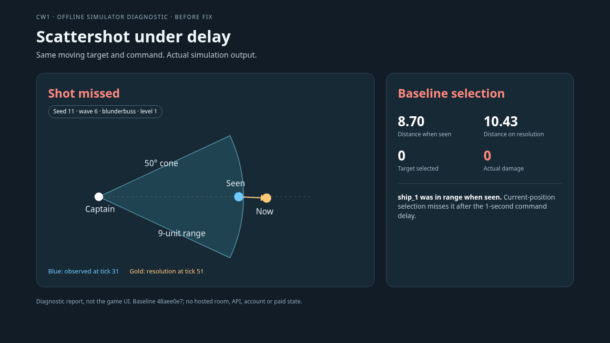
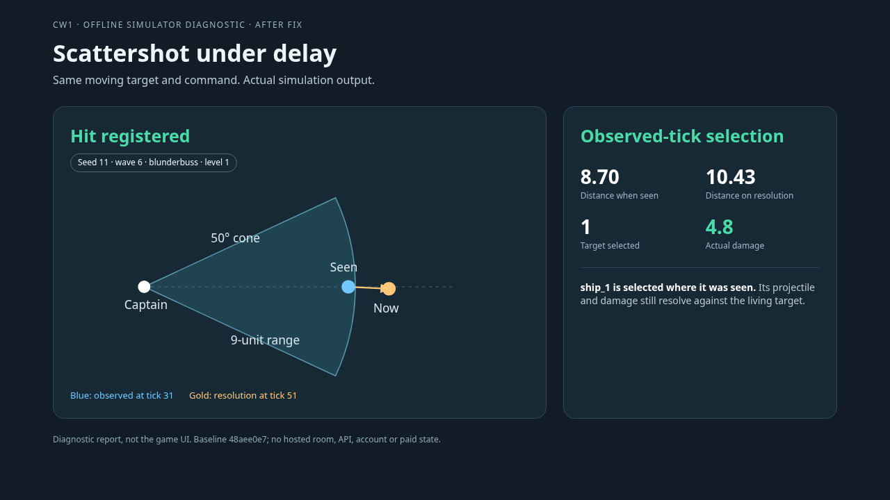

# CW1 scattershot before and after

Local evidence for [issue #458](https://github.com/Nilsnova/The-Great-Plot-Twist/issues/458)
and the [CW1 specification](../../../specs/CW1-scattershot-latency.md).
Captured on 2026-11-18 with headless Chromium at exactly 1280 × 720 and 375 × 812.

These are **simulator diagnostic reports, not screenshots of the game UI**.
The report draws geometry from actual simulator snapshots and shows the actual
selected target and resulting `ship_hit` damage. The cone is rotated onto the
report's horizontal axis for comparison; its range and angle are unchanged.

| Viewport | Before fix | After fix |
|---|---|---|
| 1280 × 720 | [Desktop before](before-desktop.png) | [Desktop after](after-desktop.png) |
| 375 × 812 | [Phone before](before-phone.png) | [Phone after](after-phone.png) |




## Reproduce

From the repository root, with the existing frontend dependencies installed:

```bash
cd frontend
CHROME_PATH=/usr/bin/chromium node scripts/capture-scattershot-latency.js
```

The [generator](../../../frontend/scripts/capture-scattershot-latency.js) reads
`sim.js` at baseline `48aee0e7b34c879968c4bc606b543f911032adfa` using `git show`,
then loads baseline and current source through separate in-memory Vite instances.
It does not edit either simulator source. Both run seed 11, wave 6, Captain level 1,
with the same blunderbuss command: target `ship_1`, observed tick 31, effective
tick 51. The existing 20 Hz tick makes that a one-second command delay.

The target was 8.70 units from the shooter when observed and 10.43 when the
command resolved, against a nine-unit range. Baseline selection produces no hit
and zero damage; the changed simulator selects the target and applies 4.8 damage.
The generator asserts identical inputs and observed/current snapshots, plus those
outcomes, before capturing all four images. It also checks the report fits each
viewport. [simulation.json](simulation.json) records the actual input, events,
snapshots and SHA-256 of each simulator source. Command output:

```text
CW1: identical input; baseline 0 damage, current 4.8 damage; four 1280×720 / 375×812 diagnostic screenshots captured.
```

## Limits

The shooter position is a deterministic simulator fixture chosen to isolate the
range boundary; this is not a playable camera position or an in-game journey.
The images demonstrate one moving-ship case. The 15 unit cases separately cover
boarders, cone angle, history bounds/fallbacks, ordering and journal replay.
No room, API, account, paid state, physical phone or deployment is exercised.
Browser network requests are blocked while the local report is captured.
