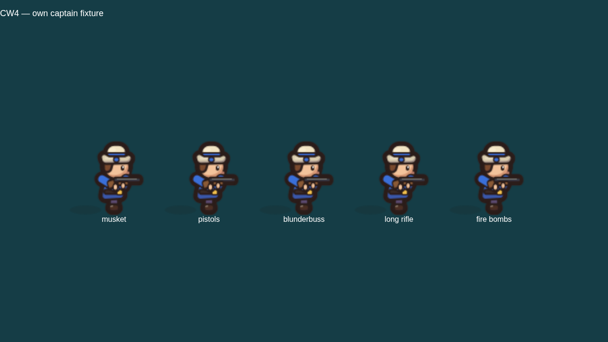
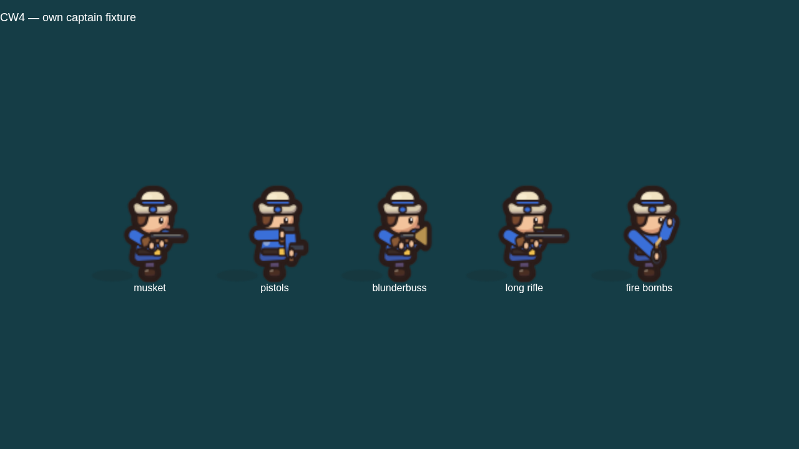
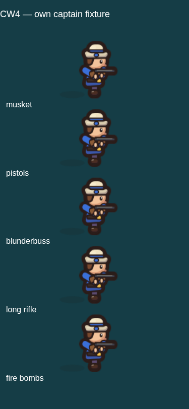
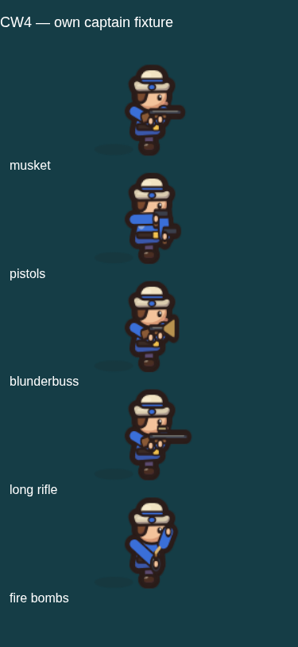
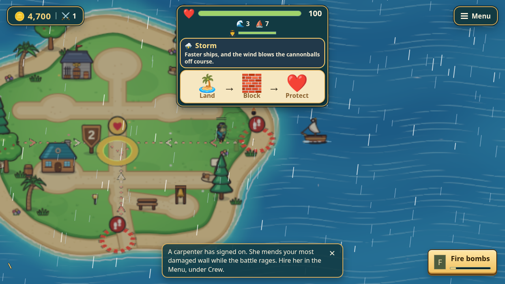
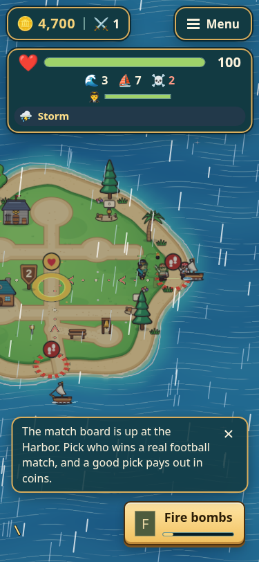
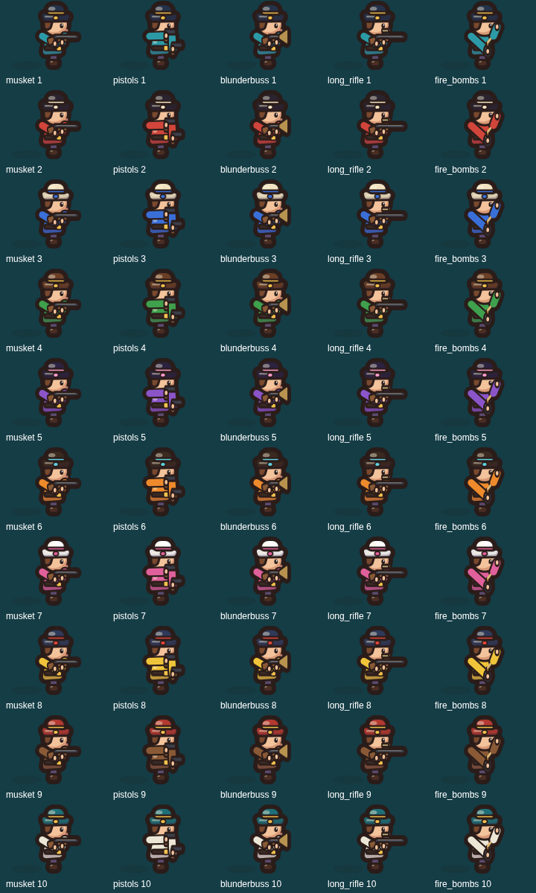

# CW4 weapon pose evidence

**Current revision:** [corrected grips, before/after phone and desktop pictures, both phases and ten directions](revision-2/README.md). The first-pass images below are preserved history and were superseded after visual rejection of the arm/hand layout at `0f6b966e`.

Captured on 18 November 2026 from base `48aee0e7` before and after CW4. The fixture uses the **real character and remote presence renderers**, controlled `captain_fired` events and local Chromium. It deliberately replaces the scene with a clear background. These images prove the drawing behavior; they are not screenshots of a complete match or a live account.

Issue: [#461](https://github.com/Nilsnova/The-Great-Plot-Twist/issues/461).

## Historical first-pass images

Desktop, before (isolated character fixture, 1280 × 720):

Desktop, after (same fixture, 1280 × 720):

Phone, before and after (same fixture, each 375 × 812):

Actual integrated fake match, carried fire bombs (synthetic local arsenal purchase and wave, no live account):

The [integrated capture script](../../../frontend/scripts/capture-weapon-match.js) checks the purchased/carried bomb, fires it through the actual controller and waits for its visible pose. Both sizes passed, with zero browser errors or external requests; [machine-readable result](match-check.json).

## Drawing checks

The existing [direction check](../../../frontend/scripts/check-shooting-direction.js) now covers five weapons, two pages (local and remote), ten exact aim angles and both required viewports. It asserts one visible captain, correct weapon frame and mirror, exact projected angle, return to walking, five different silhouettes at unchanged aim and one reused dynamic texture released on disposal. Both the before and after run passed their respective assertions.

Forty screenshots preserve the right-facing pose for every weapon, both views and both viewport sizes. Names are `<before|after>-<weapon>-<1280x720|375x812>-right-<own|remote>.png`.

| View | Before | After |
|---|---|---|
| Desktop bomb, own body | [1280 × 720](before-fire_bombs-1280x720-right-own.png) | [1280 × 720](after-fire_bombs-1280x720-right-own.png) |
| Phone bomb, own body | [375 × 812](before-fire_bombs-375x812-right-own.png) | [375 × 812](after-fire_bombs-375x812-right-own.png) |
| Desktop bomb, teammate body | [1280 × 720](before-fire_bombs-1280x720-right-remote.png) | [1280 × 720](after-fire_bombs-1280x720-right-remote.png) |
| Phone bomb, teammate body | [375 × 812](before-fire_bombs-375x812-right-remote.png) | [375 × 812](after-fire_bombs-375x812-right-remote.png) |
| Desktop pistols | [1280 × 720](before-pistols-1280x720-right-own.png) | [1280 × 720](after-pistols-1280x720-right-own.png) |
| Phone pistols | [375 × 812](before-pistols-375x812-right-own.png) | [375 × 812](after-pistols-375x812-right-own.png) |
| Desktop blunderbuss | [1280 × 720](before-blunderbuss-1280x720-right-own.png) | [1280 × 720](after-blunderbuss-1280x720-right-own.png) |
| Phone blunderbuss | [375 × 812](before-blunderbuss-375x812-right-own.png) | [375 × 812](after-blunderbuss-375x812-right-own.png) |
| Desktop rifle | [1280 × 720](before-long_rifle-1280x720-right-own.png) | [1280 × 720](after-long_rifle-1280x720-right-own.png) |
| Phone rifle | [375 × 812](before-long_rifle-375x812-right-own.png) | [375 × 812](after-long_rifle-375x812-right-own.png) |

All five procedural weapon silhouettes in all ten lobby colors:

Meaningful unit checks cover pose selection, every registered frame, expiry and bomb shell/no-flash behavior in normal and reduced motion. Build and asset budgets passed. Exact commands, results, the reproduced pre-existing demo failure and remaining checks are in the [task handoff](../../../specs/CW4-weapon-poses.md).

The 33-screen accessibility audit reports eight market/lobby findings, exactly matching unchanged main: [baseline comparison](accessibility-baseline.json). No audit errors, browser errors or external requests occurred on either version.

Limits: no production request, real match timing, authentication, live network or actual phone hardware was exercised. The small paired pistol pose remains a compact drawing at battle zoom; human review should judge its readability in a match.
