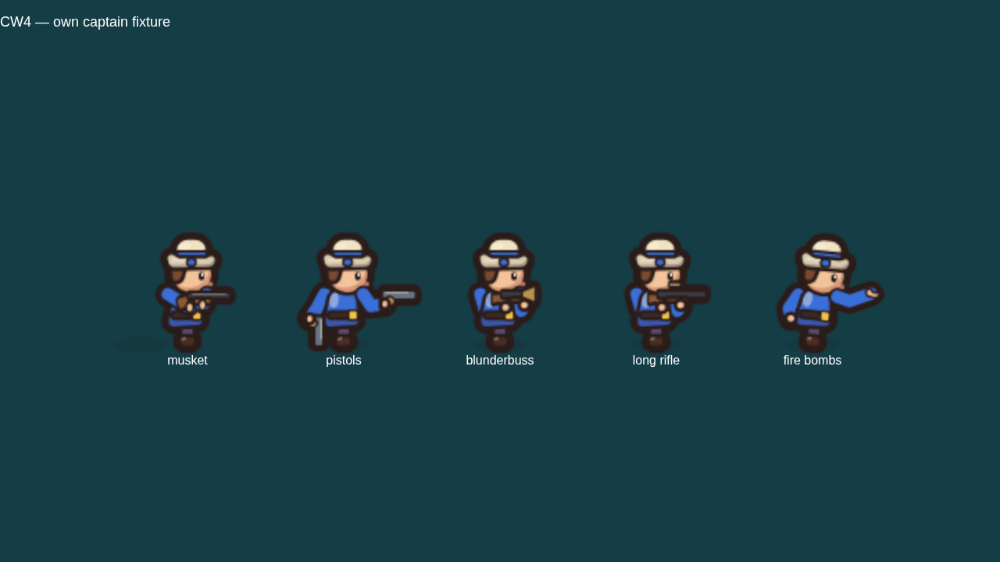
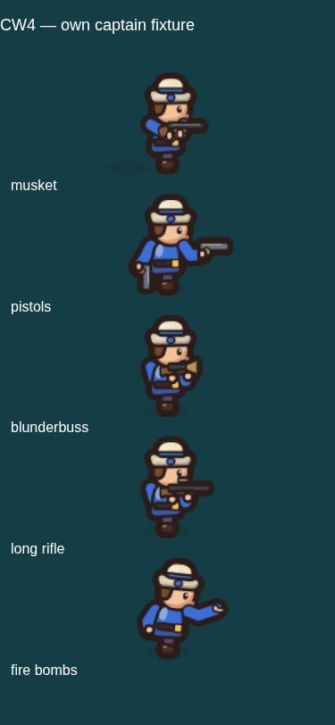
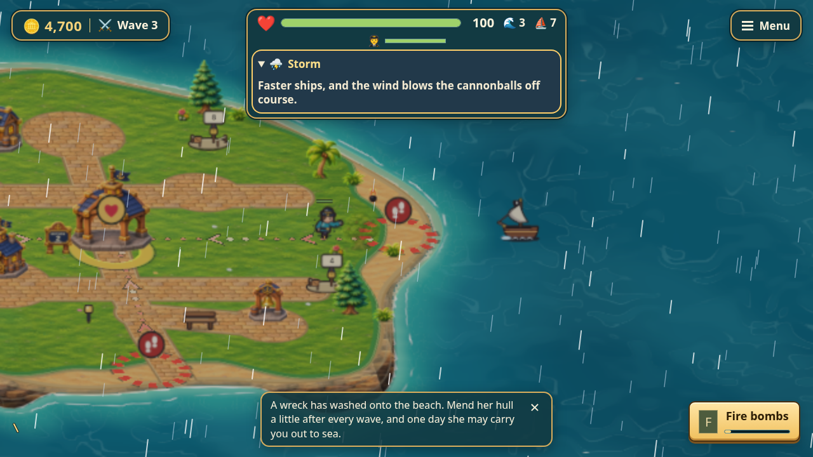
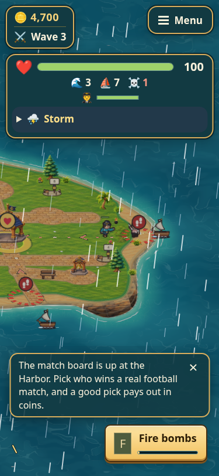

# CW4 integration with current main

Evidence for PR [#464](https://github.com/Nilsnova/The-Great-Plot-Twist/pull/464), used to review its merge-conflict resolution. All images use local synthetic fixtures; no live accounts or private player data are shown.

The merge combines approved artwork revision `15a59eae` with main `db573347`. The painter, shot texture code and approved musket fingerprint fixture remain byte-identical to the feature parent.

## Conflict resolution

- `poses.js`: retain the existing weapon kind and phase selection, using main's shared projected direction for aiming and mirroring. Ground shear can make a small positive logical X movement point left on screen.
- `render.js`: retain main's projected bomb hand offset and CW4's suppression of firearm muzzle effects for bombs. The hand offset is added after projecting the logical flight.
- `STATUS.md`: retain every published Log paragraph from both parents, in order and byte-for-byte, including main's appended entries. Keep both branches' status additions.

The browser fixture now checks main's projection and unprojects gallery positions so its labels still align. The 220 historical painter fingerprints are unchanged. Tests include all five weapon kinds in a shear-reversed direction and bomb launch/midflight positions with reduced motion both on and off.

## Current verification

Run from `frontend/` unless stated otherwise. [Structured results and hashes](checks.json).

- `npm test -- tests/pirates/poses.test.js tests/pirates/render.test.js tests/pirates/art.test.js tests/cartoon-art.test.js tests/hires-art.test.js tests/pirates/captain-stats.test.js tests/pirates/combat-projection.test.js tests/world/projection.test.js tests/pirates/figures.test.js tests/world-anchor-projection.test.js`: **10 files / 95 tests passed**, 4.69 s.
- `T27_CAPTURES=/tmp/cw4-main-merge-directions node scripts/check-shooting-direction.js`: **400 posed views and 220 exact musket pixel comparisons passed**, including own/teammate bodies, both phases, ten directions, two sizes, projected aim/mirroring, expiry and texture disposal.
- `npm run build`: **passed**; spoiler guard checked 245 text files and 12 protected lines.
- `node scripts/report-budget.js --check`: **passed**, initial JavaScript **18,959 / 21,080 bytes**, CSS **9,248 / 12,000 bytes**.
- From the repository root, `node scripts/text-lint/index.mjs --json`: **4,477 candidates / 524 files, zero errors**, eight report-only findings.
- `node scripts/capture-weapon-match.js /tmp/cw4-main-merge-match`: **passed**, integrated synthetic bomb wave at both sizes, zero browser errors or external requests; [result](match-check.json).
- Independent agent reviews found no remaining conflict-resolution defects. Diff, syntax, artwork identity and published-log preservation checks passed.

The full frontend suite, accessibility audit, demo journey and live multiplayer were not run for this integration. Earlier results in [revision 4](../revision-4/README.md) remain historical and do not describe current main. Ianno's reported human acceptance was for artwork revision `15a59eae`; this integration is separately reviewable. No PR merge into main or production deployment is performed here.

## Current screenshots

Real character fixture, desktop and phone:

Integrated synthetic match, desktop and phone:

