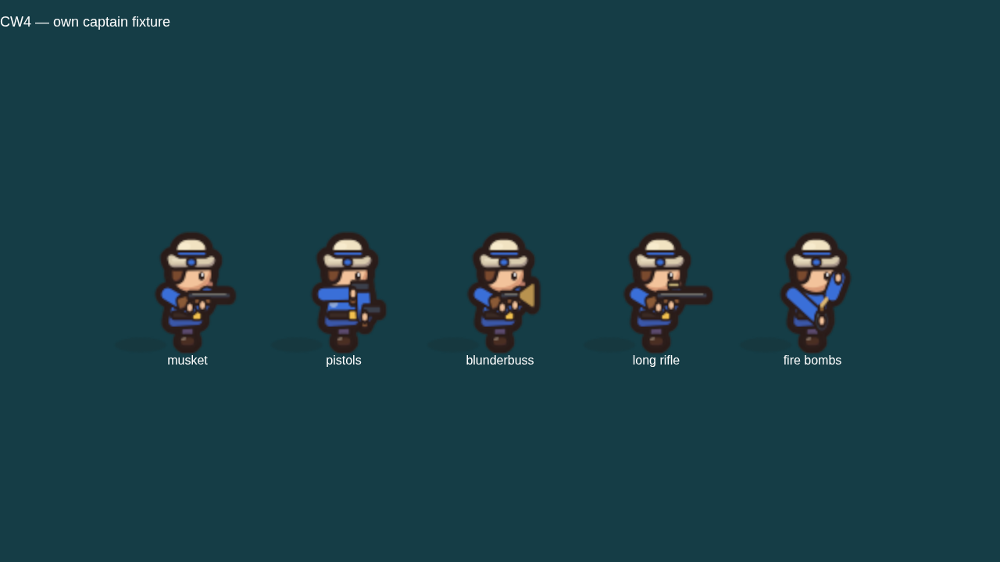
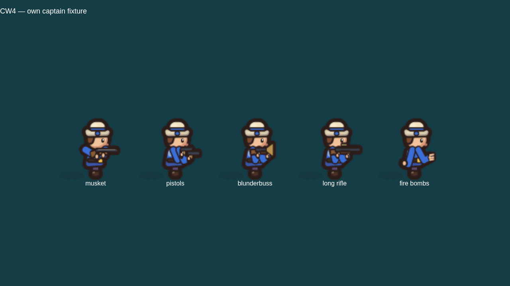
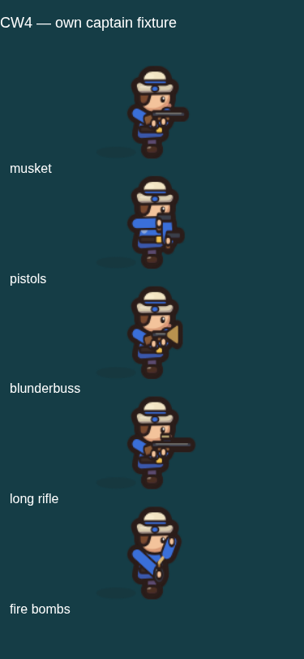
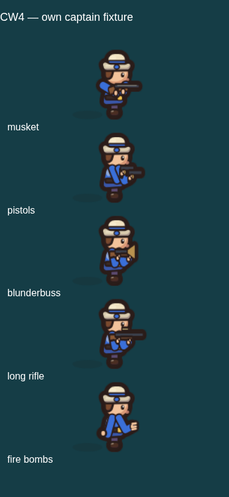
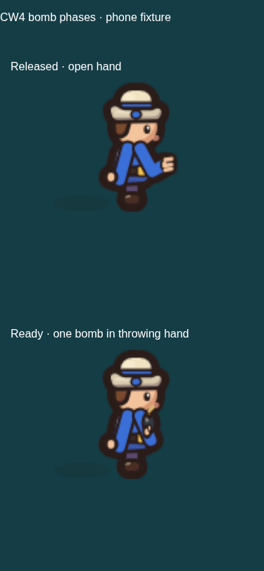
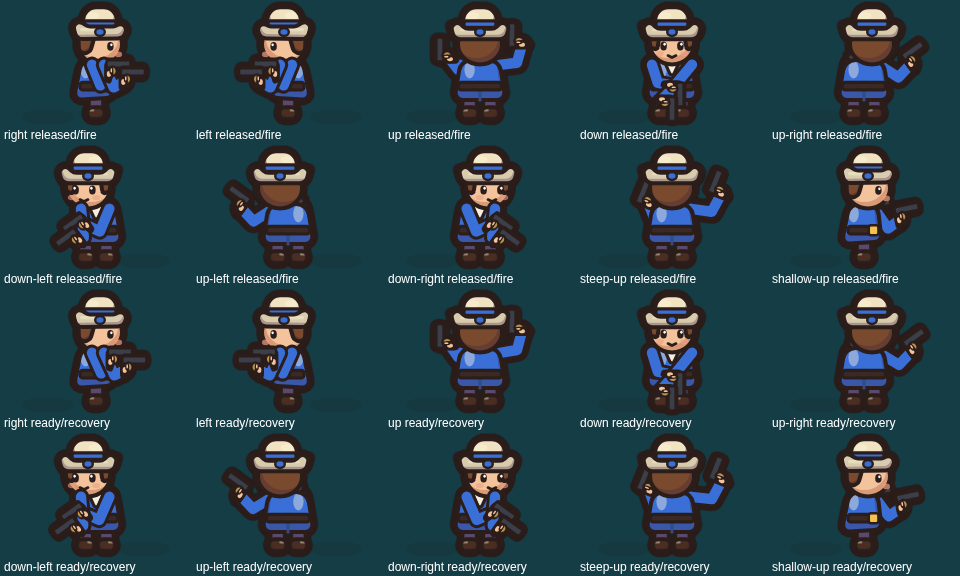
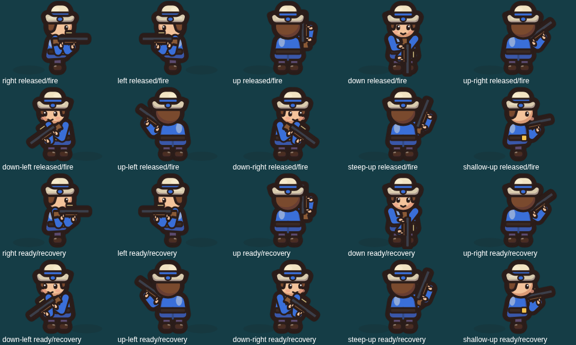
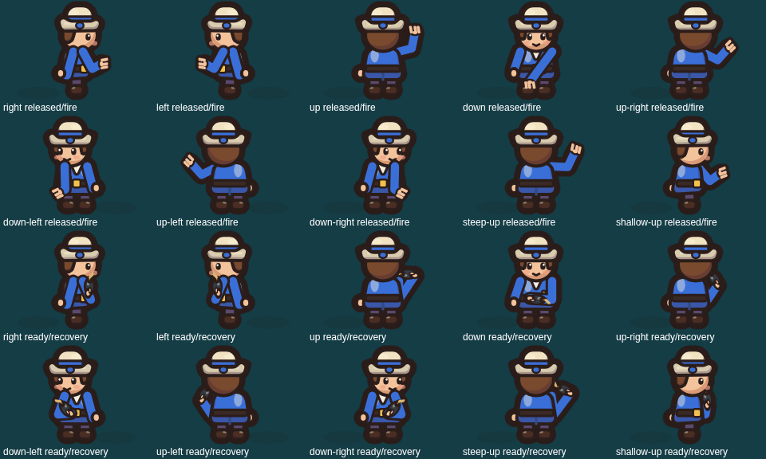
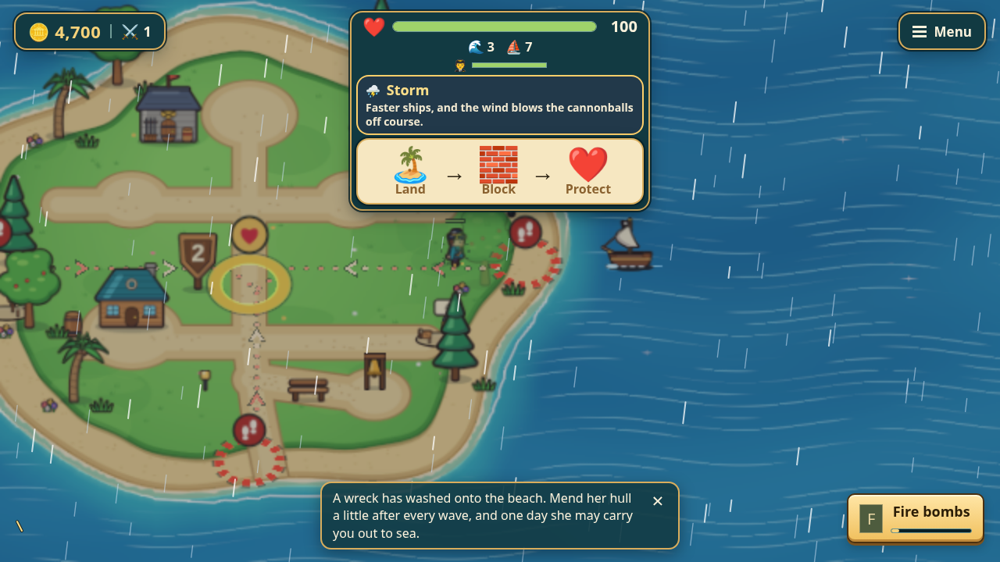
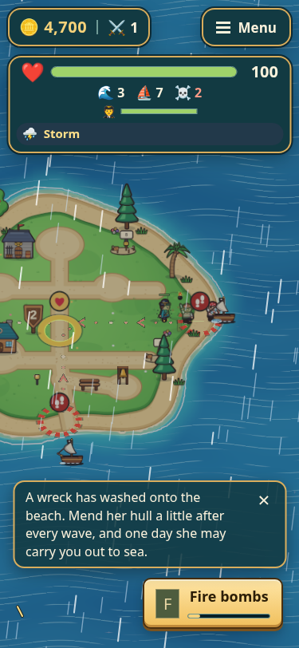

# CW4 revision 2 · Natural grips and arm bends

**Historical, superseded:** the candidate at `d35efd92` was rejected, especially its bomb gesture. Use [revision 3](../revision-3/README.md) for the current artwork and checks. All pictures and results on this page remain the original revision-2 record.

Issue [#461](https://github.com/Nilsnova/The-Great-Plot-Twist/issues/461), draft PR [#464](https://github.com/Nilsnova/The-Great-Plot-Twist/pull/464). **Before means the rejected first CW4 candidate at `0f6b966e`, not the live site.** After uses the corrected shoulder/elbow/wrist chains. All pictures use local synthetic fixtures; no live account or player data.

## Primary desktop and phone comparison

The real character renderer, five weapons, same right-facing firing phase. The musket remains unchanged.

Desktop before, 1280 × 720:

Desktop after, 1280 × 720:

Phone before and after, each 375 × 812:

## Bomb release and ready phase

The firing event has already released its projectile: the throwing hand is open and empty. The later ready frame holds one bomb in that same hand. The balancing hand is empty. This is drawing only; no charge, inventory or network state was added.

## Ten directions and both phases

Each sheet paints the real procedural weapon/captain drawing in ten directions: right, mirrored left, up, down, four diagonals, steep-up and shallow-up. The first two rows show firing/released; the last two show ready/recovery. These enlarged painter sheets expose wrist contact and away-view occlusion; the browser check separately exercises the real character and remote presence renderers at both phone and desktop sizes.

| Weapon | Rejected candidate | Corrected drawing |
|---|---|---|
| Pistols | [Before](before-pistols-directions.png) | [After](after-pistols-directions.png) |
| Blunderbuss | [Before](before-blunderbuss-directions.png) | [After](after-blunderbuss-directions.png) |
| Long rifle | [Before](before-long_rifle-directions.png) | [After](after-long_rifle-directions.png) |
| Fire bombs | [Before](before-fire_bombs-directions.png) | [After](after-fire_bombs-directions.png) |
| Approved musket | [Before](before-musket-directions.png) | [After, unchanged](after-musket-directions.png) |

## Integrated synthetic match

The existing [capture script](../../../../frontend/scripts/capture-weapon-match.js) buys fire bombs through the fake arsenal, starts the real integrated fake wave, fires through the existing controller and waits for the matching visible pose. Both viewport captures passed with zero browser errors and external requests; [result](match-check.json).

## Verification and limits

- Focused art/pose/render suite: **6 files / 63 tests passed**. Projection/grip, arm segment, support-palm, paired pistol and bomb hand-state invariants are included.
- Existing direction browser check: **passed**, five weapons × two actual `POSES` ages × own/remote bodies × ten directions × two viewport sizes. It checks matching phases, exact aim and mirror, one visible body, expiry, distinct same-angle silhouettes, reused shot texture and disposal.
- Approved musket: **220 exact RGBA matches** against [fingerprints](../../../../frontend/tests/fixtures/cw4-musket-pixels.json) recorded before revision from `0f6b966e`. Ten colors × two phases × ten representative projected directions plus static atlas fallback, density 3; Chromium 156.0.8078.79, Debian 13/Linux x86_64. These are finite raster samples, not a claim about all continuous angles or other browser rasterizers. Re-record only from that approved source commit and review the environment; never bless a new musket by regenerating from revised code.
- Current build, spoiler guard and budget gate passed: initial JavaScript **18,899 / 21,080 bytes**, CSS **9,410 / 12,000 bytes**.
- Current accessibility rerun: **33 screens, exit 1, seven findings**, all present in the preserved baseline; no new findings or audit/browser errors/external requests. The prior lobby keyboard finding did not reproduce, and no focus fix is claimed. [Comparison](accessibility-comparison.json).
- The current demo rerun stopped on the same hidden lamp quest at `check-demo-journey.js:63` as unchanged-main baseline. Coordinator text lint passed with zero errors (eight existing report-only findings). The current full frontend passed **347 files / 3,850 tests** in **542.92 s**, with frozen painter and pose-test hashes unchanged; see the [task handoff](../../../../specs/CW4-weapon-poses.md). Independent code and visual reviews found no actionable issues.

The [first-pass evidence](../README.md) is preserved history. Current pictures prove synthetic rendering and the fake wave, not production deployment, authenticated live multiplayer, physical-device use or final human approval. Drawing tests do not replace human judgment about anatomy and readability at battle zoom.
