# CW4 revision 3 · Authored throws and compact weapon poses

Issue [#461](https://github.com/Nilsnova/The-Great-Plot-Twist/issues/461), draft PR [#464](https://github.com/Nilsnova/The-Great-Plot-Twist/pull/464). **Before is the rejected revision-2 candidate at `d35efd92`, not the live site.** Its published after images are copied unchanged as this comparison's before images. [Source provenance](comparison-source.json).

All pictures use local synthetic fixtures and the existing procedural artwork. No live account or player data is shown.

## Bomb wind-up and throwing follow-through

The ready drawing holds one large round bomb behind the head. The ball stays round in screen space at every aim direction. The released drawing uses an empty rounded hand in an authored throwing gesture; it does not add a charge, inventory or network state. The far arm sits behind the coat.

Before, rejected revision-2 phone phases (375 × 812):

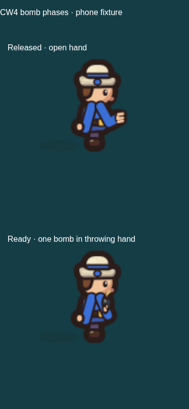

After, authored revision-3 phone phases (375 × 812):

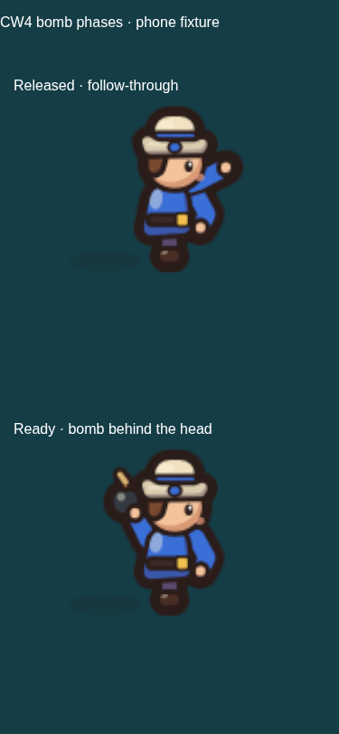

## All weapons at desktop and phone sizes

Pistols show one active gun and a second held down beside the rear hip. Firearms use compact sleeves with the musket's visual weight; the far sleeve no longer crosses the shirt. The blunderbuss has a smaller brass muzzle with a dark opening. The approved musket is unchanged.

Desktop before, 1280 × 720:

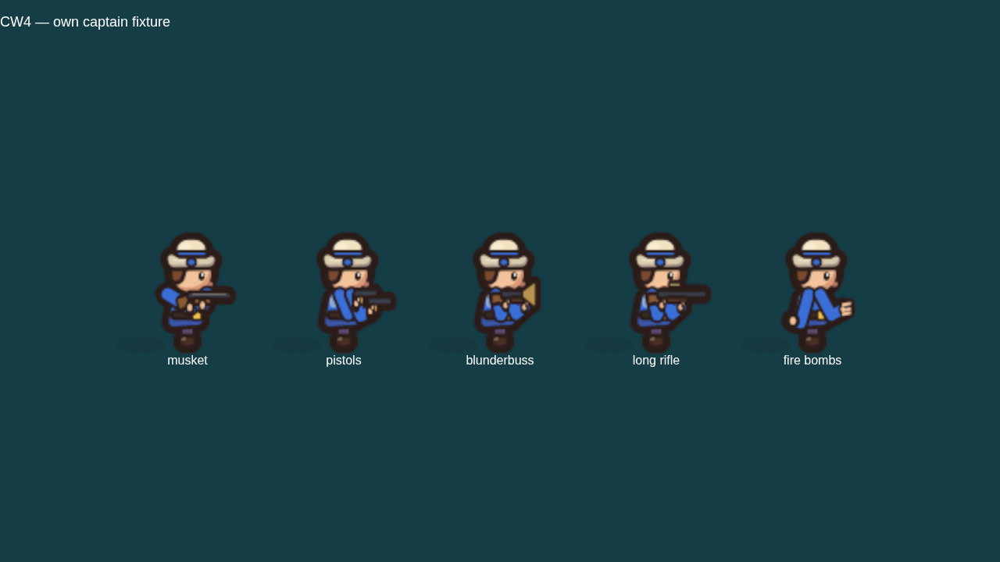

Desktop after, 1280 × 720:

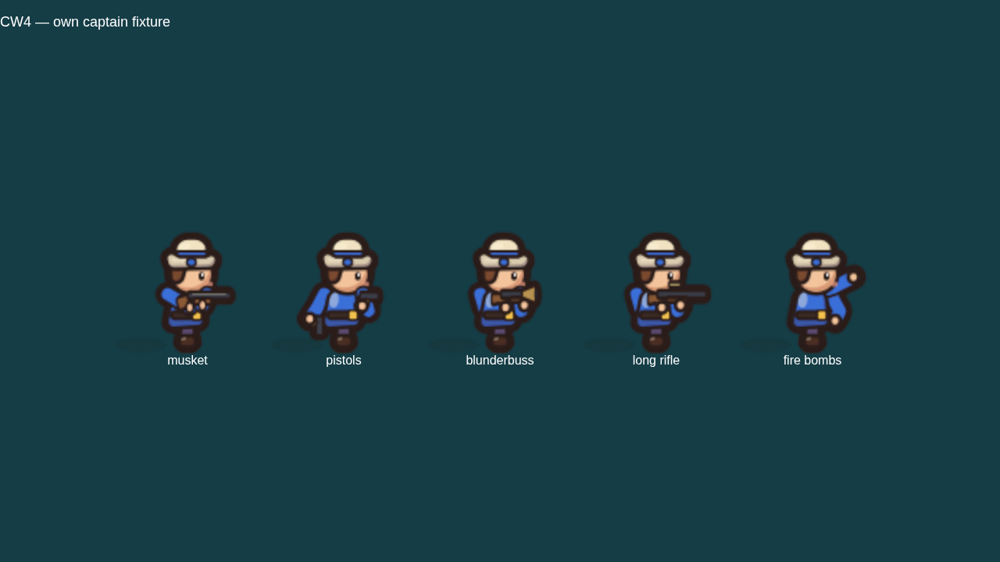

Phone before and after, each 375 × 812:

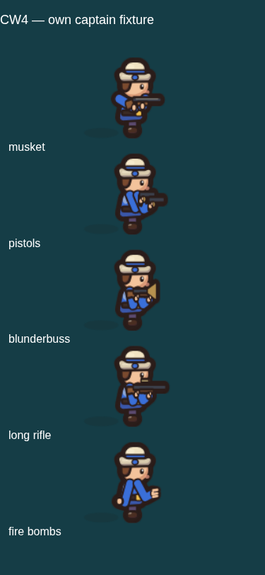
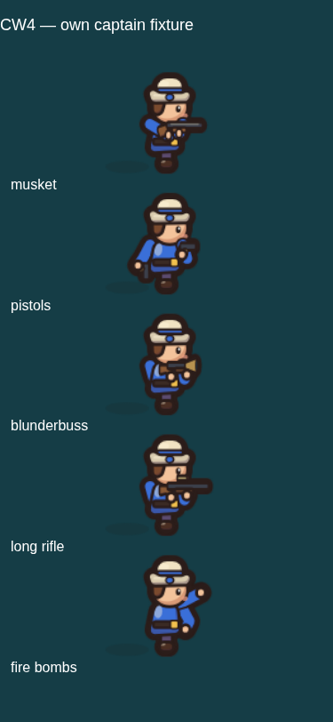

## Ten directions and both existing phases

Each enlarged painter sheet covers right, mirrored left, up, down, four diagonals, steep-up and shallow-up. The first two rows show firing/released, and the last two show ready/recovery. The browser check separately exercises the real character and teammate renderers at actual `POSES` ages and both viewport sizes.

| Weapon | Rejected d35 candidate | Revision 3 |
|---|---|---|
| Pistols | [Before](before-pistols-directions.png) | [After](after-pistols-directions.png) |
| Blunderbuss | [Before](before-blunderbuss-directions.png) | [After](after-blunderbuss-directions.png) |
| Long rifle | [Before](before-long_rifle-directions.png) | [After](after-long_rifle-directions.png) |
| Fire bombs | [Before](before-fire_bombs-directions.png) | [After](after-fire_bombs-directions.png) |
| Approved musket | [Before](before-musket-directions.png) | [After, unchanged](after-musket-directions.png) |

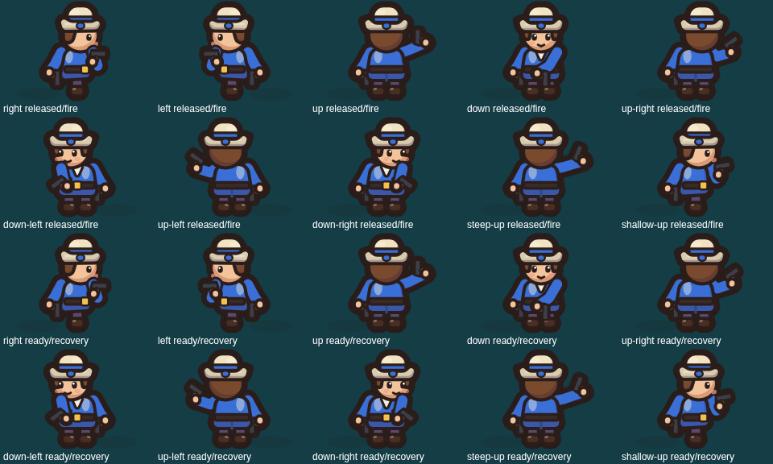
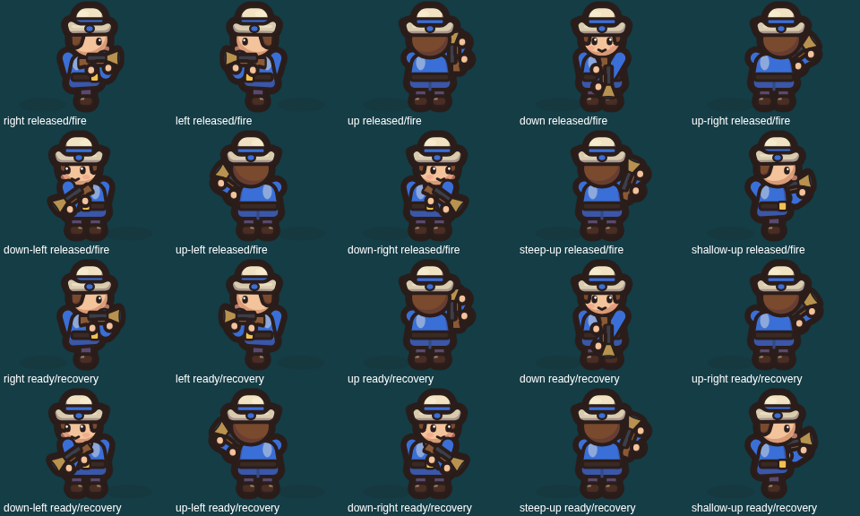
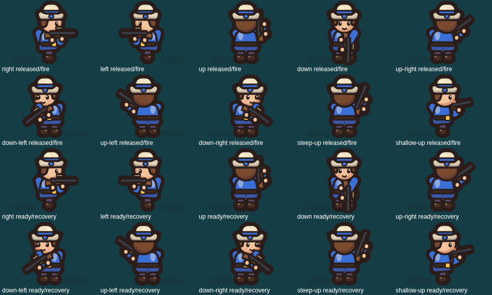
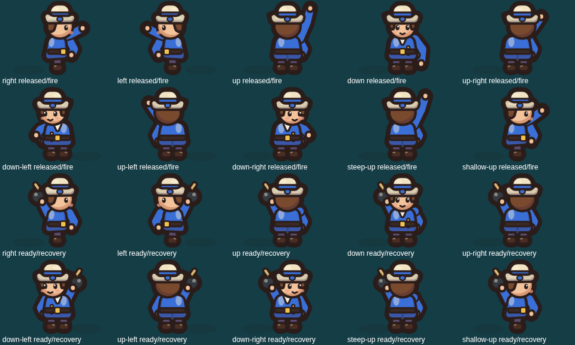

## Integrated synthetic match

The existing [capture script](../../../../frontend/scripts/capture-weapon-match.js) buys fire bombs through the fake arsenal, starts the real integrated fake wave, fires through the existing controller and waits for the visible bomb pose. Both viewport captures passed with zero browser errors and external requests; [result](match-check.json).

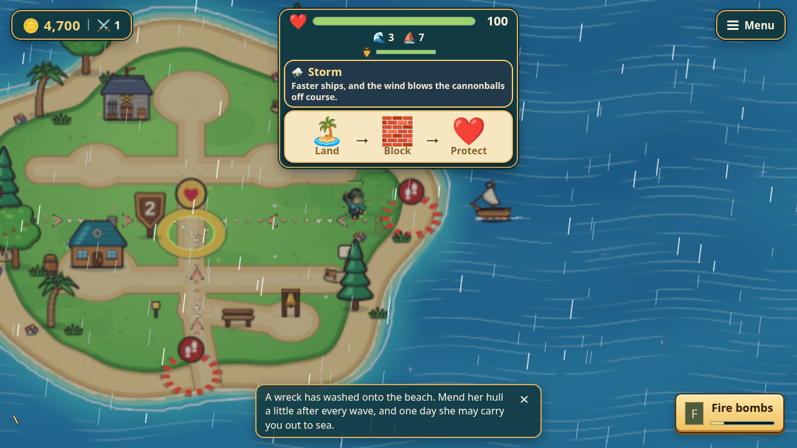
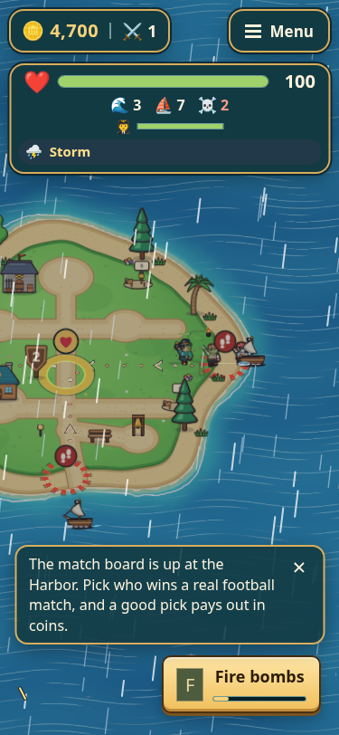

## Current verification and limits

- Focused art/pose/render checks: **6 files / 63 tests passed**.
- Full direction browser check: **passed**, five weapons × two actual pose ages × two own/teammate renderers × ten directions × two viewport sizes. Frame, exact aim/mirror, one body, expiry, distinct same-angle silhouettes and texture reuse/disposal checks passed.
- Approved musket: **220 exact RGBA matches** against the unchanged [fingerprints](../../../../frontend/tests/fixtures/cw4-musket-pixels.json) recorded from `0f6b966e`: ten colors × two phases × ten representative projected directions plus static atlas fallback, density 3, Chromium 156.0.8078.79 on Debian 13/Linux x86_64. These finite samples do not claim every continuous angle or browser rasterizer.
- Current build, spoiler guard and budget gate passed: 243 text files/12 protected lines checked; initial JavaScript **18,899 / 21,080 bytes**, CSS **9,410 / 12,000 bytes**.
- Current text lint: **4,429 candidates / 489 source files, zero errors**, eight existing report-only findings.
- The coordinator separately reports 1,448 passing joint-bound cases and an independent all-direction/two-phase visual review. This is separate from the 63 focused tests.
- Current accessibility: **33 screens, exit 1, seven findings**, identical to revision 2 and a subset of the preserved unchanged-main eight. No new findings, audit/browser errors or external requests; no focus fix claimed. [Comparison](accessibility-comparison.json).
- Current demo: **exit 1**, the same hidden-lamp click timeout at `check-demo-journey.js:63` as the preserved baseline. The current full run reported **3,848 passed / two 20-second browser timeouts**, with painter/test hashes unchanged. Unmodified quiet reruns of both files passed **2 files / 3 tests on r3** and **2 files / 3 tests on d35efd92** using the same limits. The combined full run is not claimed green; exact commands/results are in the [task handoff](../../../../specs/CW4-weapon-poses.md). Earlier revision results remain historical.

The [revision-2 evidence](../revision-2/README.md) and [first-pass evidence](../README.md) remain preserved history. Current images prove synthetic rendering and a fake wave, not production deployment, authenticated live multiplayer, physical-device use or final human approval.
