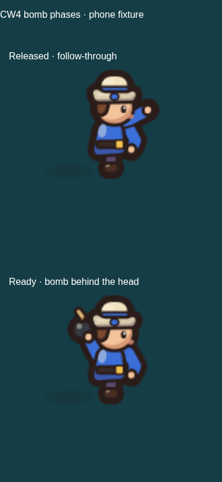
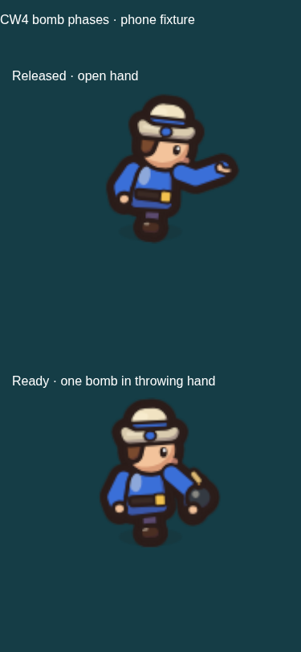
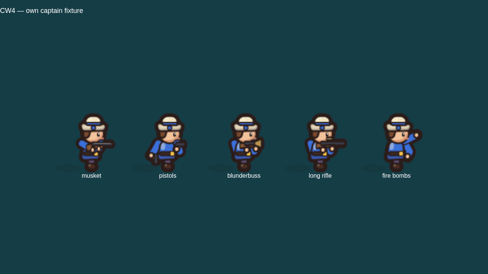
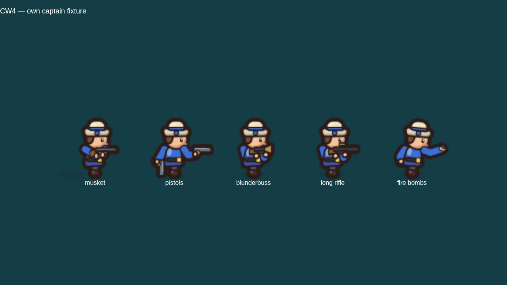
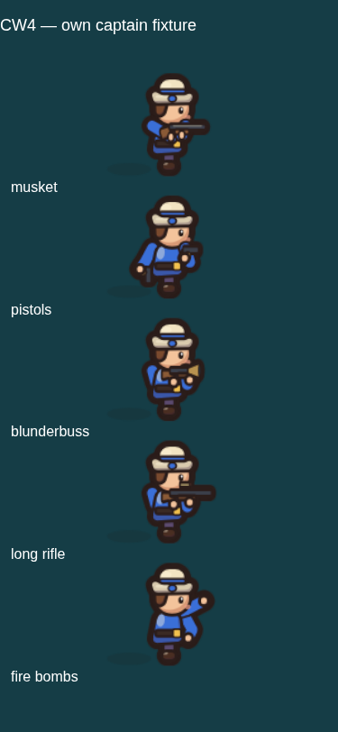
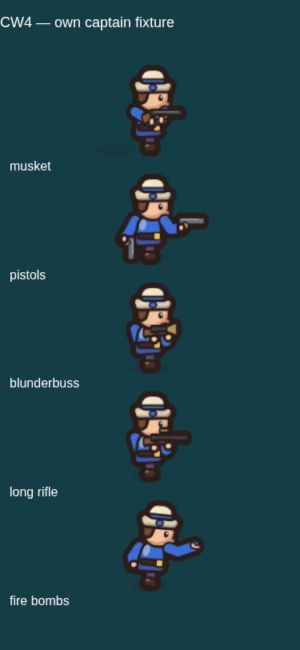
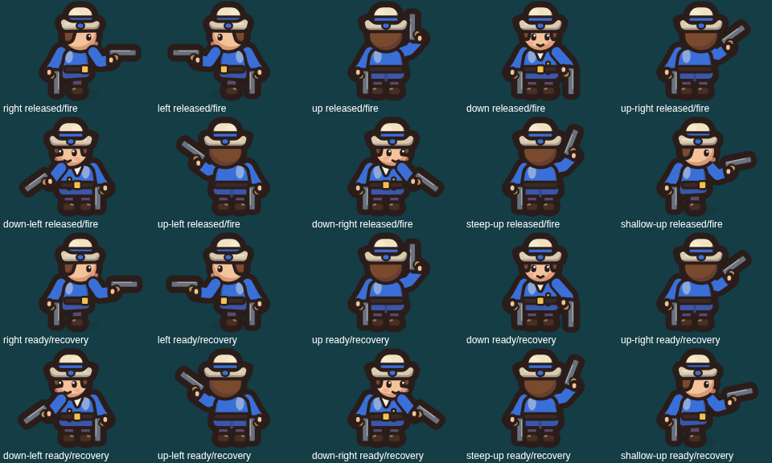
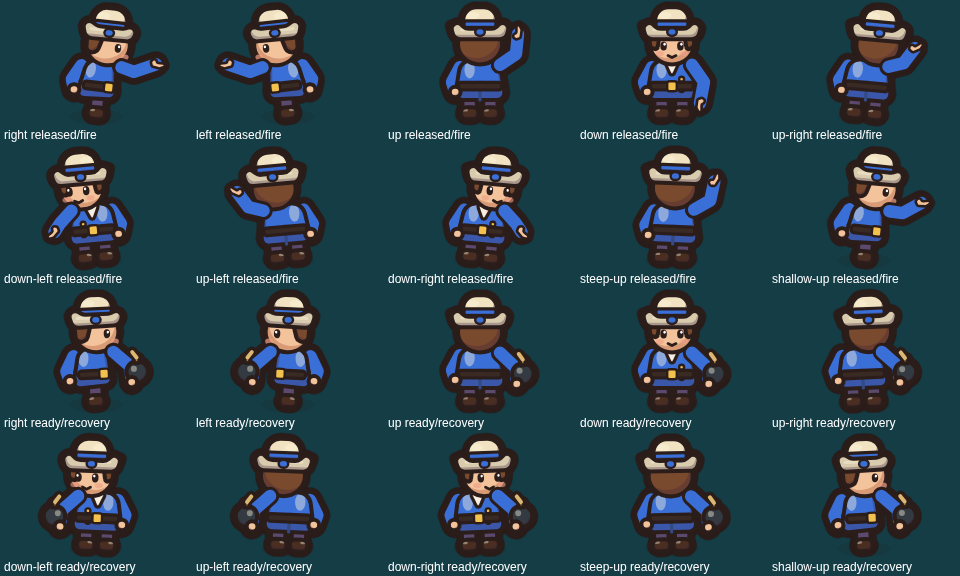
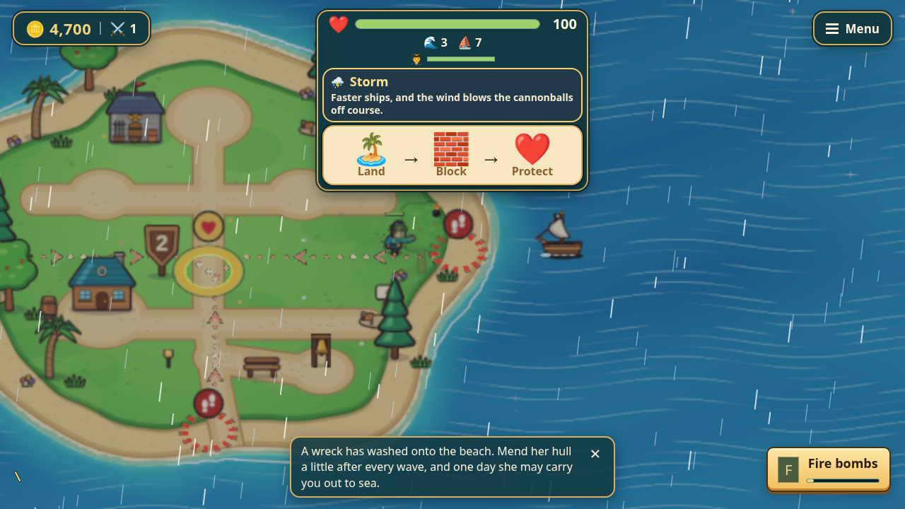
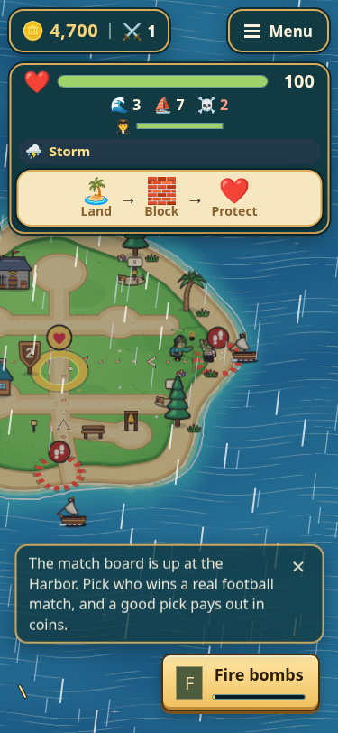

# CW4 revision 4 · Same-side underhand throw

Issue [#461](https://github.com/Nilsnova/The-Great-Plot-Twist/issues/461), draft PR [#464](https://github.com/Nilsnova/The-Great-Plot-Twist/pull/464). **Before is the published revision-3 candidate at `0706a18c`, not the live site.** Its tracked after images are copied unchanged as the before comparison. [Provenance and source hashes](comparison-source.json).

All pictures use local synthetic fixtures and the real procedural artwork. No live account or player data is shown.

## Bomb phases at phone size

The ready hand cradles the bomb beside the hip. That same hand releases it with an open palm and a small underhand follow-through/lean. The artwork no longer switches to an overhand gesture or puts the ball behind the head.

Before, revision 3 (375 × 812):

After, revision 4 (375 × 812):

## All weapons at desktop and phone sizes

The active pistol is larger and lighter; the lowered spare stays visible after the body is painted. Non-musket deferred shadows now sit under the feet. Downward pistol/rifle artwork remains inside its frame. The approved musket is unchanged.

Desktop before and after, each 1280 × 720:

Phone before and after, each 375 × 812:

## Ten directions and both existing phases

Each enlarged painter sheet covers right, mirrored left, up, down, four diagonals, steep-up and shallow-up. The first two rows show firing/released; the last two show ready/recovery. The browser check separately exercises both phases at actual `POSES` ages on local and teammate renderers at both viewport sizes.

| Weapon | Previous 0706 candidate | Revision 4 |
|---|---|---|
| Pistols | [Before](before-pistols-directions.png) | [After](after-pistols-directions.png) |
| Blunderbuss | [Before](before-blunderbuss-directions.png) | [After](after-blunderbuss-directions.png) |
| Long rifle | [Before](before-long_rifle-directions.png) | [After](after-long_rifle-directions.png) |
| Fire bombs | [Before](before-fire_bombs-directions.png) | [After](after-fire_bombs-directions.png) |
| Approved musket | [Before](before-musket-directions.png) | [After, unchanged](after-musket-directions.png) |

## Integrated synthetic match

The existing [capture script](../../../../frontend/scripts/capture-weapon-match.js) buys fire bombs through the fake arsenal, starts the actual integrated fake wave, fires through the existing controller and waits for the visible bomb pose. Both sizes passed with zero browser errors and external requests; [result](match-check.json).

## Current checks and exact commands

Run from `frontend/` unless noted. [Structured results](checks.json).

- `npm test -- tests/pirates/poses.test.js tests/pirates/render.test.js tests/pirates/art.test.js tests/cartoon-art.test.js tests/hires-art.test.js tests/pirates/captain-stats.test.js`: **6 files / 63 tests passed**, 5.71 s.
- `T27_CAPTURES=/tmp/cw4-r4-final-gallery node scripts/check-shooting-direction.js`: **passed**, 400 posed views (five weapons × two phases × two renderers × ten directions × two sizes), plus **220 exact approved-musket RGBA matches**, aim/mirror, one body, expiry and texture reuse/disposal.
- `npm run build`: **passed**, 2.39 s; spoiler guard checked 243 text files and 12 protected lines.
- `node scripts/report-budget.js --check`: **passed**, initial JavaScript **18,899 / 21,080 bytes**, CSS **9,410 / 12,000 bytes**.
- From the repository root, `node scripts/text-lint/index.mjs --json`: **4,429 candidates / 489 source files, zero errors**, eight existing report-only findings.
- `node scripts/capture-weapon-match.js /tmp/cw4-r4-match`: **passed**, both required sizes, zero browser errors/external requests.
- Coordinator joint sweep: **1,448 cases passed**, finite joints within the frame, segment lengths approximately 0.7104–8.9637: [report](joint-sweep.json).
- Coordinator padded-frame sweep: **1,448 renders**, no out-of-frame alpha above 8 at density 3/palette 2: [report](padded-sweep.json). From `frontend/`, reproduce with `node ../docs/evidence/CW4-weapon-poses/revision-4/padded-frame-sweep.mjs`; it writes `/tmp/cw4-r4-padded-sweep.json`. These finite samples are not a claim about every angle, color or rasterizer.

The functional artwork was checked at source SHA `328c234d…`. The final file `e7cddc22…` differs only by one corrected comment; reconstructing the prior comment reproduces the tested SHA exactly. Tests were not edited. [Hash proof](comparison-source.json).

## Verification limits

**The full frontend suite, accessibility audit and demo journey were not rerun for revision 4.** Their latest results are historical revision-3 evidence: the combined full run had **3,848 passes and two 20-second harness timeouts**; a quiet sequential rerun of those two files passed all three tests on both r3 and its immutable baseline. That does not make the original full run green. R3 accessibility had seven existing findings and no new findings; its demo stopped at the known hidden-lamp timeout. See the [task handoff](../../../../specs/CW4-weapon-poses.md) and [R3 record](../revision-3/README.md).

Earlier artwork and published logs remain history. No production deployment, authenticated live multiplayer, physical-phone check or final human approval is claimed. The existing three explain-back questions remain; this revision adds no new quiz.
