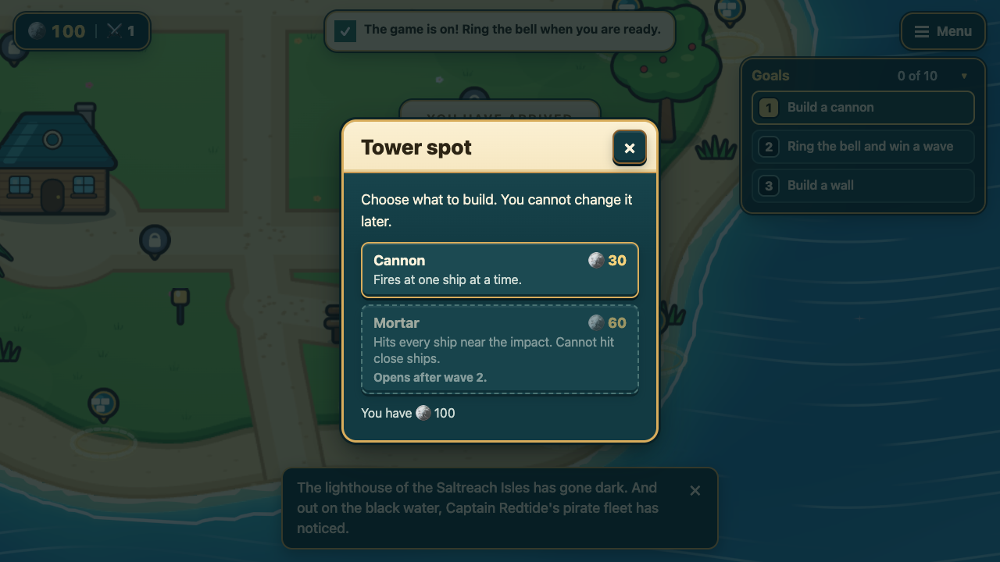
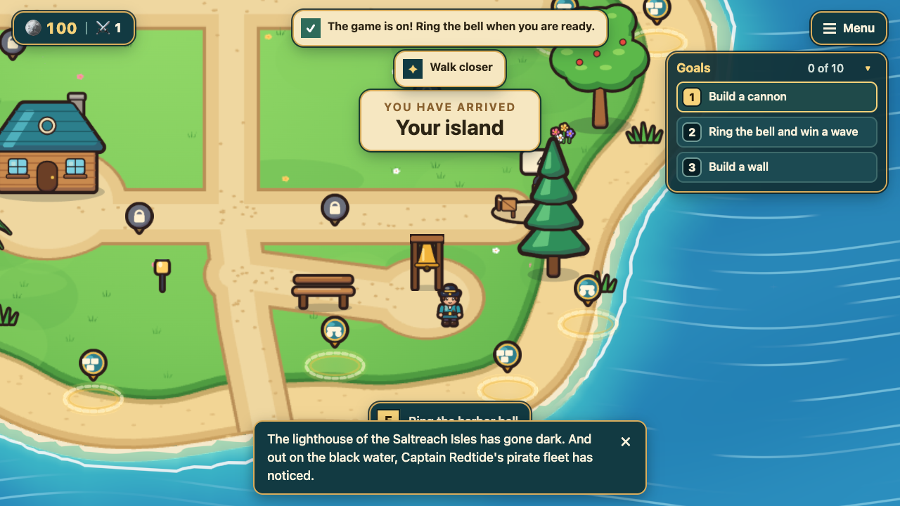
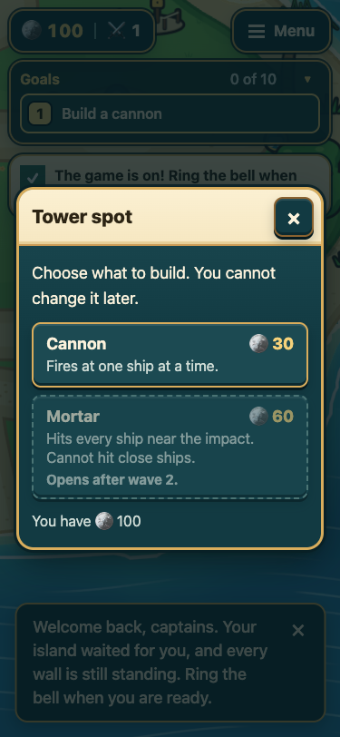
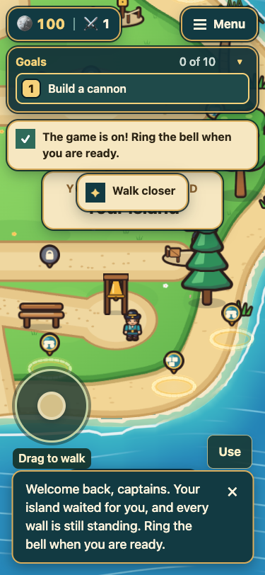

# T19 interaction evidence

These captures use the local in-memory game (`?islands=fake`), not a live account or database.
The captain stands near the bell and clicks the more distant `cannon_3` build spot. The target
and player positions are the same before and after; camera framing follows the viewport.

| Viewport | Before: distant card opens | After: card stays closed, "Walk closer" |
|---|---|---|
| 1280 x 720 |  |  |
| 375 x 812 |  |  |

The nearby positive path still works: [desktop E before](before-near-1280x720.png),
[desktop E after](after-near-1280x720.png), [phone Use before](before-near-375x812.png),
[phone Use after](after-near-375x812.png).

Chrome emulates a touch-capable phone viewport for the phone captures. This is not physical-device
or real multiplayer evidence. The committed tests reproduce pointer reach and native E/Use checks.
