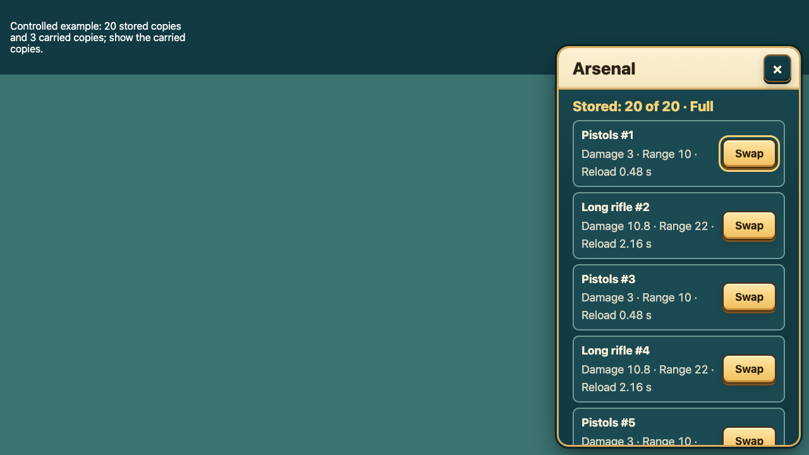
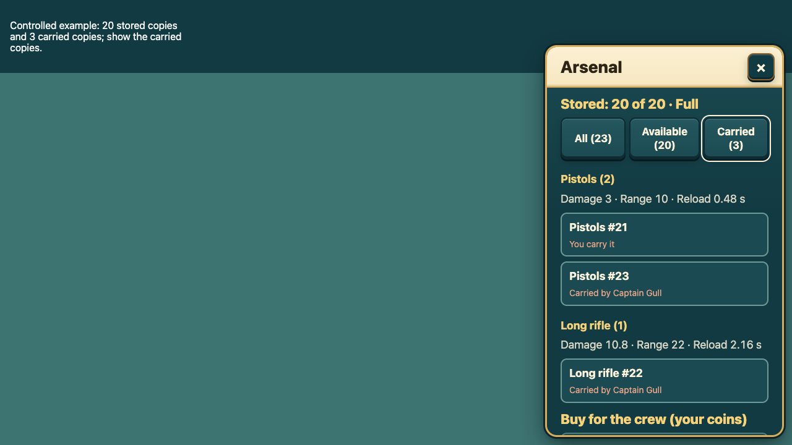
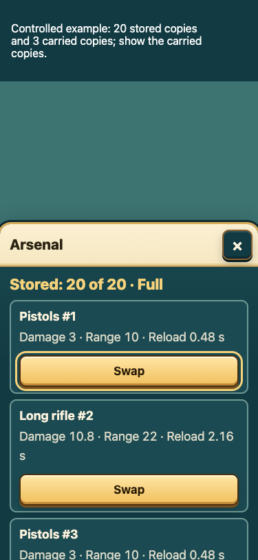
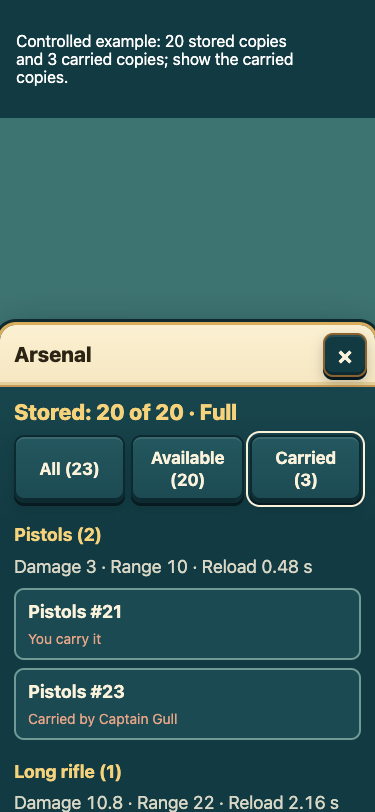

# Filtering and grouping the arsenal: visual evidence

Real production UI/controllers with synthetic snapshots, in the running game's shared stylesheet order. These are isolated component fixtures, not live-game, physical-phone or database proof. Before uses main `e8c61c6` for changed production modules/styles; after uses this branch. New fixture captions are not product text.

- Before: Twenty-three copies form one long rack list with repeated stats.
- After: Carried shows three copies grouped by type, with the full counts still visible and stats once per type.

| Viewport | Before | After |
|---|---|---|
| 1280 x 720 |  |  |
| 375 x 812 |  |  |

[Fixture traces](report.json): four captures, zero page errors, zero external requests. The Arsenal views scroll to the relevant rack/comparison section, retaining the real card header and controls.

## Reproduce and limits

`cd frontend && npx vitest run tests/island/arsenal-filters.test.js tests/island/arsenal-filters-dom.test.js` (installed Chrome; set CHROME_PATH if needed). 10 new cases: 20 stored plus carried copies, stable ordering and immutable input, all empty views, bad optional filters/input, pending/wave restrictions, retained filter on refresh, keyboard/phone controls, no request from filtering, exact copy id for intentional Take and recovery when the chosen filter becomes empty.

Filters last for this controller session, not browser storage. They do not change stock, reclaim another captain weapon or grant permission. Real multi-client races/SQL, physical phones and screen readers are not covered by these controlled UI tests.

## Shared accessibility finding

The house audit exits 1 on unchanged main at market-placed / contrast (1280, 375, 320px). [Baseline record](baseline-a11y.json); [exact feature verification](../../../specs/U-arsenal-filters.md#verification-15-nov-2026). No market styles or audit script changes are included.
