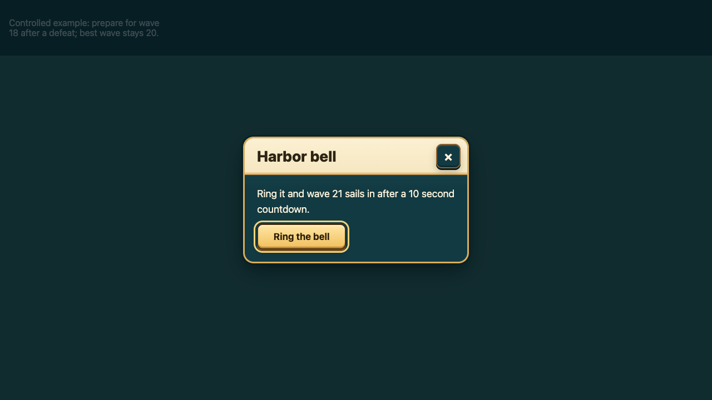
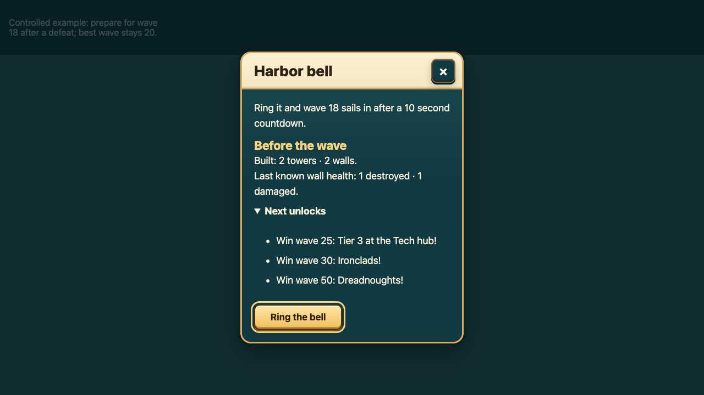
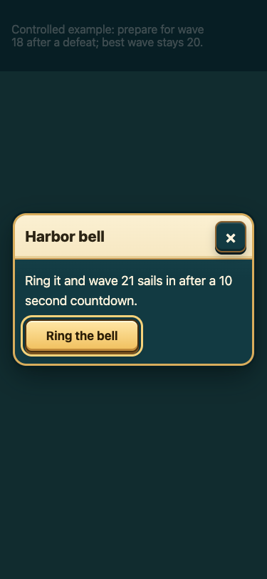
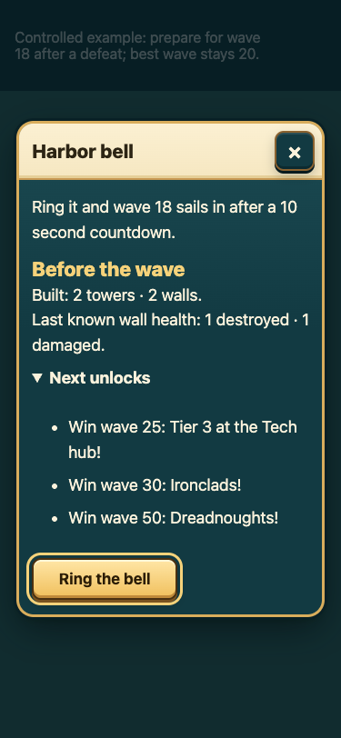

# Wave preparation at the bell: visual evidence

Real production UI/controllers with synthetic snapshots, in the running game's shared stylesheet order. These are isolated component fixtures, not live-game, physical-phone or database proof. Before uses main `e8c61c6` for changed production modules/styles; after uses this branch. New fixture captions are not product text.

- Before: The bell predicts wave 21 from best wave 20 and has no preparation/unlock section.
- After: It predicts server nextWave 18, shows the defenses and known damage, and offers the next three unlocks.

| Viewport | Before | After |
|---|---|---|
| 1280 x 720 |  |  |
| 375 x 812 |  |  |

[Fixture traces](report.json): four captures, zero page errors, zero external requests. The Arsenal views scroll to the relevant rack/comparison section, retaining the real card header and controls.

## Reproduce and limits

`cd frontend && npx vitest run tests/island/preparation.test.js tests/island/preparation-dom.test.js` (installed Chrome; set CHROME_PATH if needed). 15 new cases: nextWave after defeat, older-answer/final-wave fallback, built-only counts, campaign boundaries, partial/invalid/foreign health, running-wave behavior, native keyboard/phone disclosure and preserved focus, unchanged ring callback, and delayed wall read after an actual fake-island visit.

Wall health is the last successful read, not a live guarantee; a failed read may leave labeled last-known data. The late-repair UI guard does not undo a completed server repair. Physical phones, live Realtime and SQL are not proven by controlled fixtures or the fake-server run.
