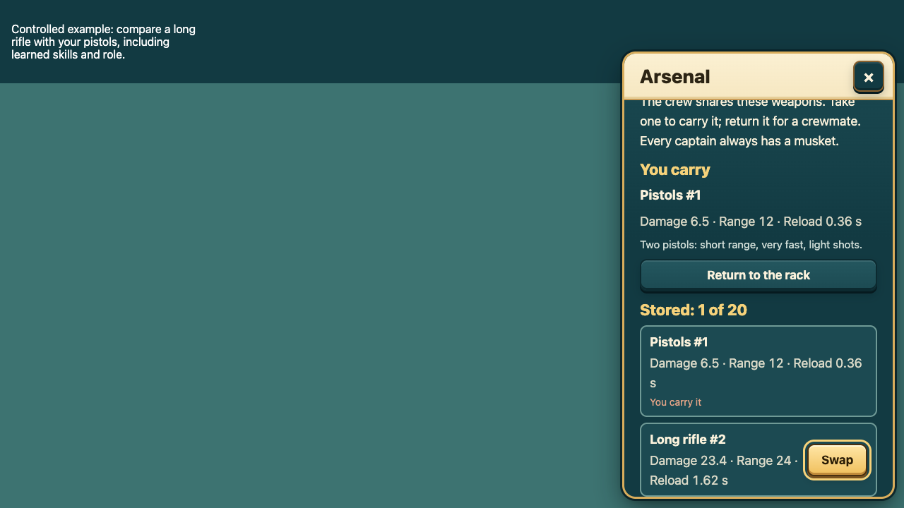
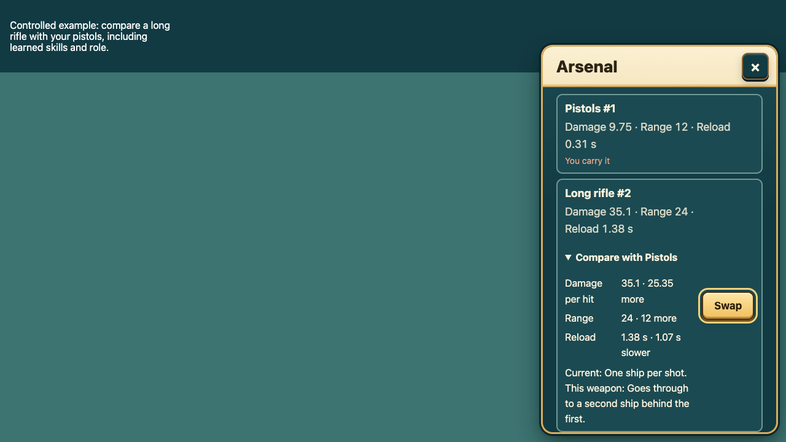
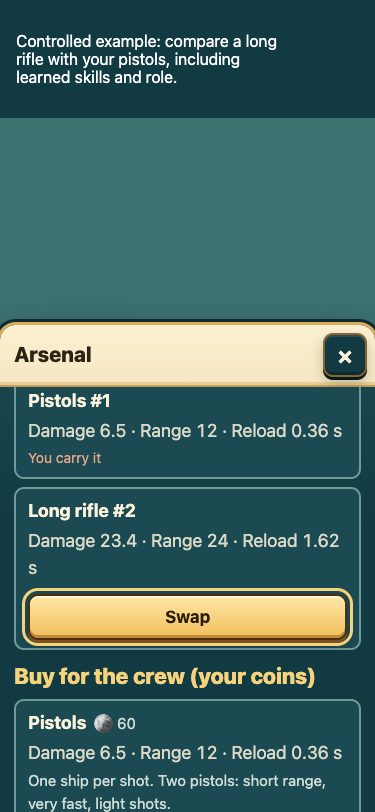
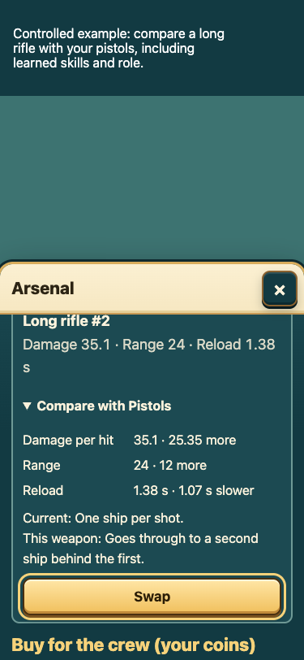

# Comparing arsenal weapons: visual evidence

Real production UI/controllers with synthetic snapshots, in the running game's shared stylesheet order. These are isolated component fixtures, not live-game, physical-phone or database proof. Before uses main `e8c61c6` for changed production modules/styles; after uses this branch. New fixture captions are not product text.

- Before: The real card shows individual base-level stats and no direct comparison.
- After: The same snapshot includes actual skill/role effects and an expanded comparison with the carried pistols.

| Viewport | Before | After |
|---|---|---|
| 1280 x 720 |  |  |
| 375 x 812 |  |  |

[Fixture traces](report.json): four captures, zero page errors, zero external requests. The Arsenal views scroll to the relevant rack/comparison section, retaining the real card header and controls.

## Reproduce and limits

`cd frontend && npx vitest run tests/island/weapon-comparison.test.js tests/island/weapon-comparison-dom.test.js` (installed Chrome; set CHROME_PATH if needed). 10 new cases: all five types, exact deltas, same type, invalid ids, learned skills/role/level, minimum reload and rounding, immutable server answer, native comparison at desktop/phone widths, actual fake-server learned skill, retained disclosure after refresh and no write from comparison.

Per-hit numbers do not predict fleet outcomes, aim, pierce alignment or total area damage. Real provider/login/database behavior, physical phones and a screen-reader session are not covered. The UI word compare was checked in the macOS word dictionary before adding it to the house list.

## Shared accessibility finding

The house audit exits 1 on unchanged main at market-placed / contrast (1280, 375, 320px). [Baseline record](baseline-a11y.json); [exact feature verification](../../../specs/U-weapon-comparison.md#verification-15-nov-2026). No market styles or audit script changes are included.
