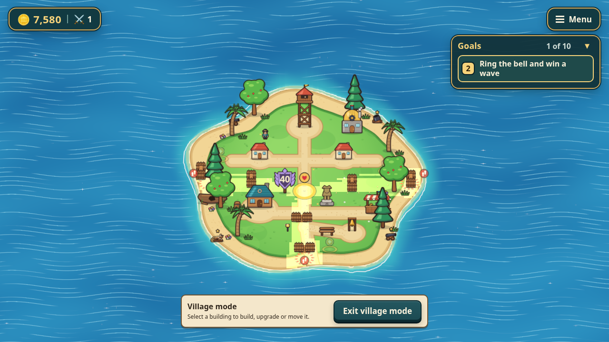
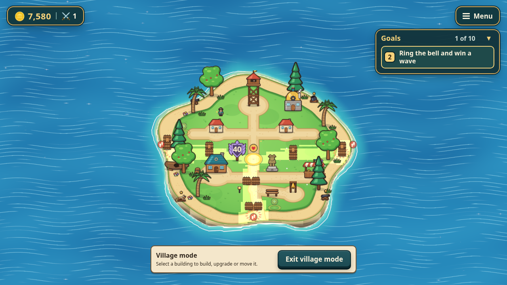
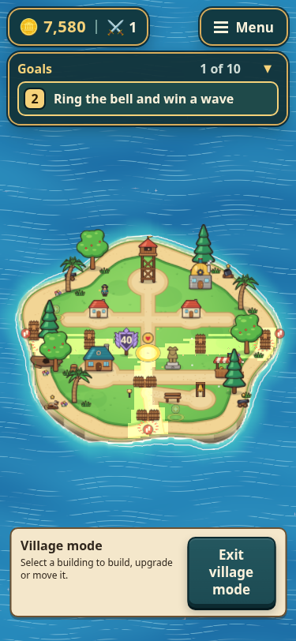
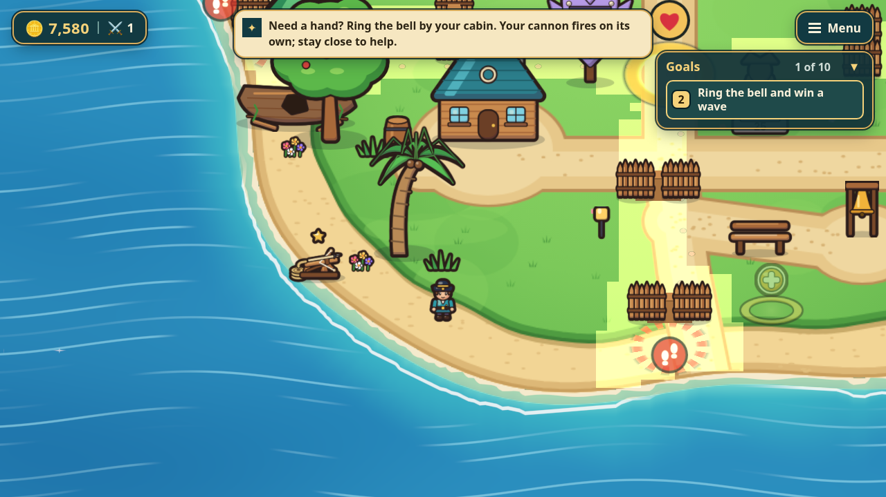
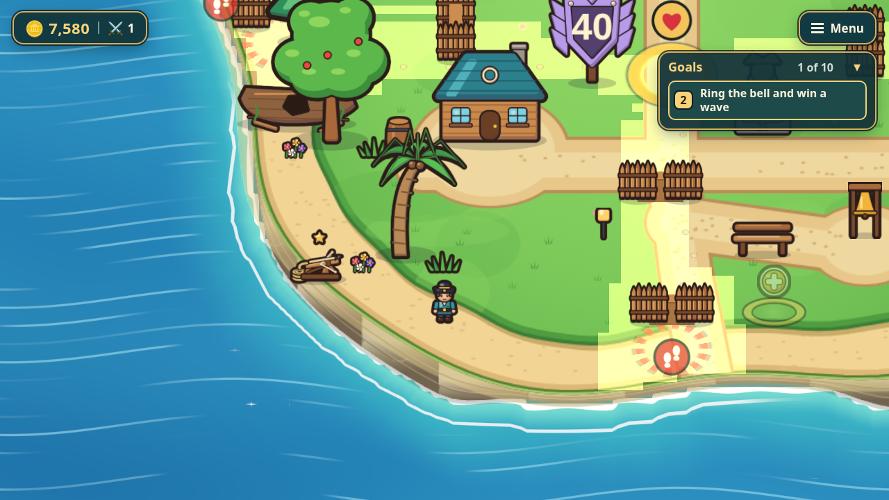
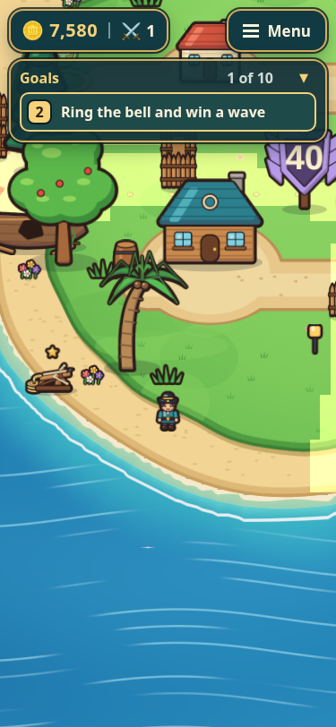
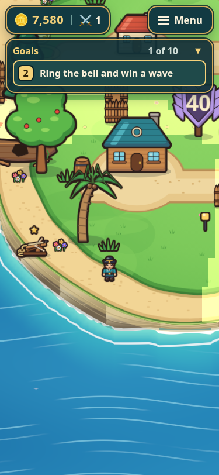

# VIS-19 actual cliff trial evidence

These are actual local Chromium game captures with the existing fake API, declared progression/builds, a fixed daytime and an explicitly positioned captain. They are not production, Safari, a physical-phone check or generated concept artwork. No screenshot pixels were edited. Existing low/high quality controls were used to capture the supported high-density rendering; exact camera/quality/resource metadata is in the reports. Transient hint timing can differ while the world fixture/camera remain the same.

Before source: `724bbc41de5754007a9bcc27a5e84758540b540b`. The trial branches from `569d8fda3474cb84af36af190853d1a0e02b7abf`; the only intervening main change is the branch-cleanup script, with identical runtime source. Corrected after source: `445a5a0694826f9f35f215a2a65d007382ca7a8f`.

| View | Before | Corrected after |
|---|---|---|
| Desktop overview, 1280×720 |  |  |
| Phone overview, 375×812 |  |  |
| Desktop shore, 1280×720 |  |  |
| Phone shore, 375×812 |  |  |

The overview uses the existing whole-island Fit; shore views use the existing exploration camera. The separate working-camera change is not included here. Cliff thickness is deliberately shallow at east/south/west naval approaches and taller between them. The source still has the original beach, island shape, buildings and composition. This demonstrates a raised edge; it does not establish acceptance of the whole illustrated target.

## Executed proof

- Actual game: both required viewports, four captures per source; **0 page errors / 0 external requests** per viewport.
- All twelve built wall centers and the captain remain on opaque canonical top pixels in both sizes.
- In the corrected after capture, 101 sampled opaque decorative points are outside analytic land and all remain unwalkable; the existing sea field recognizes all 101 at the decorative base.
- [Raster and ship-anchor check](raster-check.json): **0 opaque pixels beyond declared contour bounds**. Seventeen actual wave-8 simulation anchor events (seeds 7919/15838), plus 21 closest allowed anchor positions across all three lanes, remain in visual water. This checks anchor centers, not every hull pixel or combat interaction.
- Initial material rounding was rejected after actual screenshots exposed stray opaque rock spokes. The new raster guard reproduced 296,818 out-of-bounds opaque pixels; explicit zero-radius world-unit facets and a base clip now prevent them. A further closest-anchor check found one east approach overlap, so shallow coves now cover all three current naval lanes. No rejected screenshot is included as a successful after image.
- Focused rules/lifetime checks: **7 files / 42 tests passed**, duration 2.88s, exit 0. Exact command is in the specification.

[Before report](before-report.json) · [Corrected after report](after-report.json) · [Scope and state contract](../../../specs/VIS-19-raised-cliffs.md).

## Reproduce

From `frontend/`, with the installed Chrome binary available:

```sh
node scripts/check-cliff-raster.mjs . /tmp/cliff-raster.json
node scripts/capture-cliff-style.mjs /path/to/before/frontend /tmp/cliff-captures before
node scripts/capture-cliff-style.mjs /path/to/this/frontend /tmp/cliff-captures after
```

Use separate clean source checkouts with installed existing dependencies, and coordinate the browser lane. No `.env` is read by these fixture servers. Full build/budget/accessibility/demo, five actual browser travel cycles, production/Safari/physical-device and final human visual acceptance remain unverified in this slice. Existing place lifetime tests passed; no new mesh/material/texture owner was introduced.
