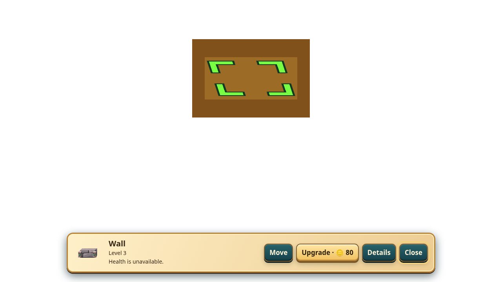
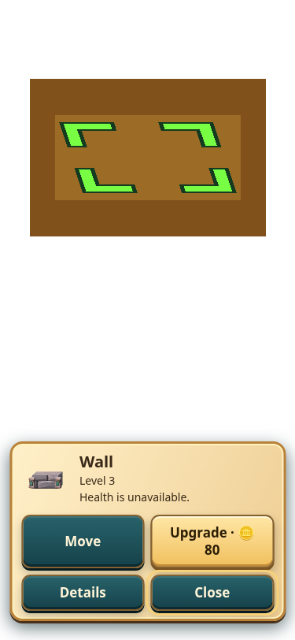

# Selected wall clarity: native component evidence

These screenshots are **native DOM/WebGL component fixtures**, not the
complete game, an edited game screenshot or final reference acceptance.
They verify runtime helpers at `0c282c04`; reproducible proof source is
`tests/island/selection-clarity-dom.test.js`, committed as `6dd2fa1e`.





The dock uses an explicitly supplied level-three wall model, 1,000 coins and
80 upgrade cost, with health unavailable. These are declared component
inputs, not a server balance or completed payment. The actual composite
portrait uses the registered level-three post and front/top/side material
patches, normalized by the existing PNG pipeline. Its four receipts match
`village/compiled/walls-4x-1-da339745c863.png` and retain their own frame IDs.

The upper canvas is a separate actual WebGL fixture: one brown base at
render order 125, followed by the two outlined corner batches. Readback
asserts visible green and dark-outline pixels over that base, with three
total draw calls. This proves portable filled corners remain visible above
that fixture; final placement in the complete game still needs root's
composed capture.

From `frontend/`:

```text
VIS38_SHOTS=/workspace/reference-village-work/selection-polish-component npx vitest run --maxWorkers=1 tests/island/selection-clarity-dom.test.js
Test Files  1 passed (1)
Tests       1 passed (1)
Duration    3.37s
```

The one case covers both 1280×720 and 375×812. It verifies four real source
receipts, more than 5,000 opaque portrait pixels and a horizontal segment
span exceeding 60% of its canvas width. GPU readback finds more than 200
green and 200 dark-outline pixels. These are passed thresholds, not exact
pixel counts; no exact counts were serialized. The test retains the
existing 20-second harness timeout. After exit 0, `/proc` showed zero live,
non-zombie Chrome processes and the coordinated browser lane was released.

[Manifest](manifest.json) records source, fixture limits, dimensions, bytes
and SHA-256 hashes of the unedited screenshots. Root owns complete-game
before/after evidence, full-suite/a11y/demo checks and final visual acceptance.
