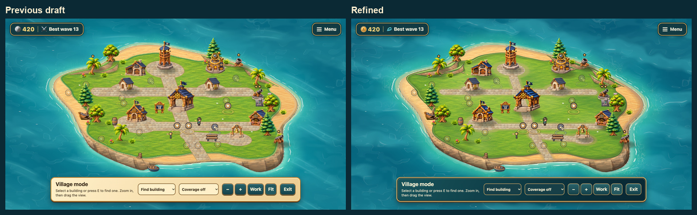
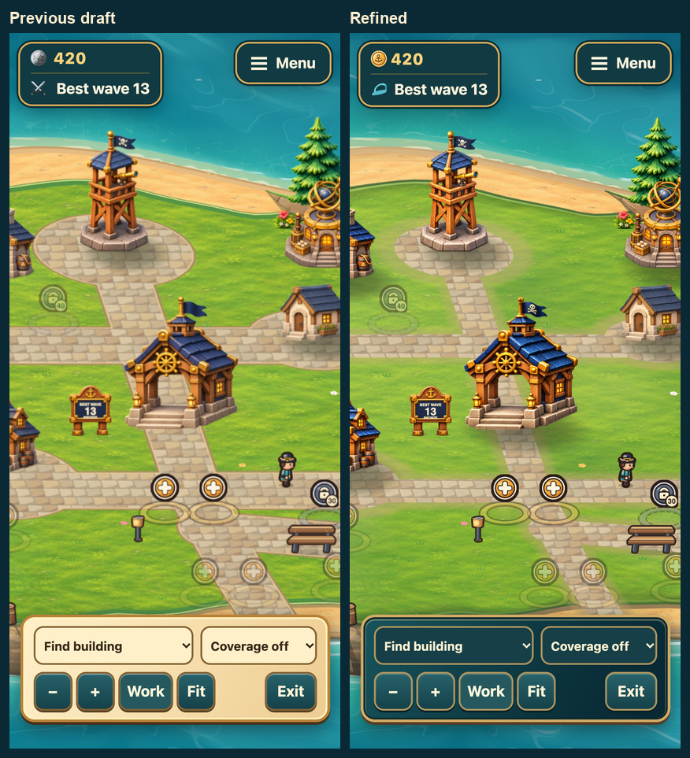

# Home Island visual finish

[Latest island stonework comparisons](stonework/README.md) · [Cliff and cannon depth pass](depth/README.md) · [Earlier coastal foundation pass](relief/README.md) · [Whole-island object details](objects/README.md) · [Aligned Heart and live island motion](motion/README.md)

The same Wave 14 save appears in both captures. The earlier draft is `1f1c62a0` and the finished renderer and art are at `5347783a`. The original coastline, camera framing, building positions, and approach routes remain in place.

The reference informed the layered limestone banks, narrower stone paths, warm metal against navy roofs, and teal-and-brass panels. The Bell, Watchtower, Heart, Cabin, and Arsenal keep their original transparent silhouettes and ground anchors. The new shore lighting and sandstone depth are visible around both flanks.

## Desktop

## Phone

[Open the unscaled 3× PNG](phone-work-native-3x.png) · [See the whole island from the regular Fit view](phone-whole-island.jpg)

## Verified drawing resolution

High uses the display's native density up to 4× and a 3840 × 2160 pixel budget. The game reduces density if sustained frame times require it. Low keeps its earlier limits. The world and UI continue to use the same logical positions as the display density changes.

| Browser viewport | Device scale | Measured High drawing buffer |
| --- | ---: | ---: |
| 375 × 812 phone | 3× | 1125 × 2436 |
| 390 × 844 phone | 3× | 1170 × 2532 |
| 390 × 844 phone | 4× | 1560 × 3376 |
| 1280 × 720 desktop | 2× | 2560 × 1440 |
| 1920 × 1080 desktop | 2× | 3840 × 2160 |

All five Chrome runs sustained their displayed buffers in seven-second samples on the review Mac. WebKit also rendered both 3× phone sizes and accepted native touch selection. Switching to Low kept each checked building in place. The denser Home ground texture measures 2496 × 1872.

The browser checks covered opening and late-game saves, night storms at 3× and UHD, direct cottage/watchtower/cannon selection, and live Wave 14 combat. Native mouse and touch both refused an occupied wall tile and saved an existing legal corner. All four Wave 11 ship spawns, anchors, and first boarder landings matched the previous draft. Mobile results are from browser emulation. Physical device acceptance and the original wall and collision follow-ups remain in [#236](https://github.com/Nilsnova/The-Great-Plot-Twist/issues/236).
