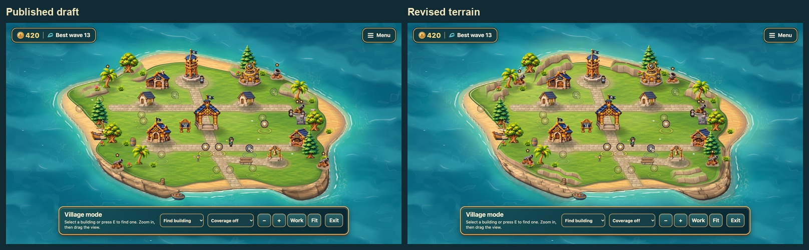
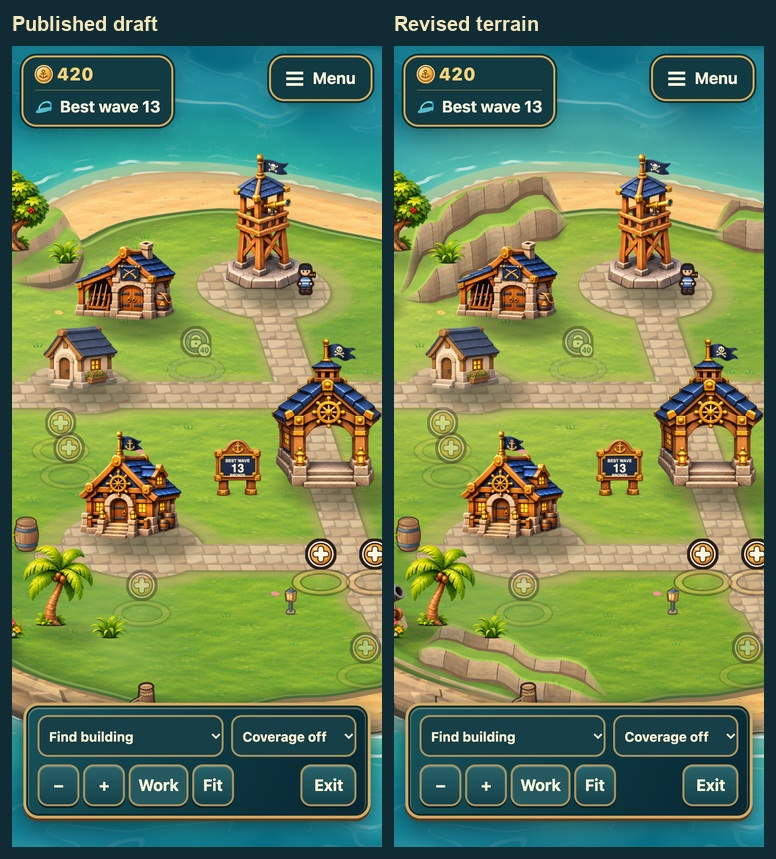
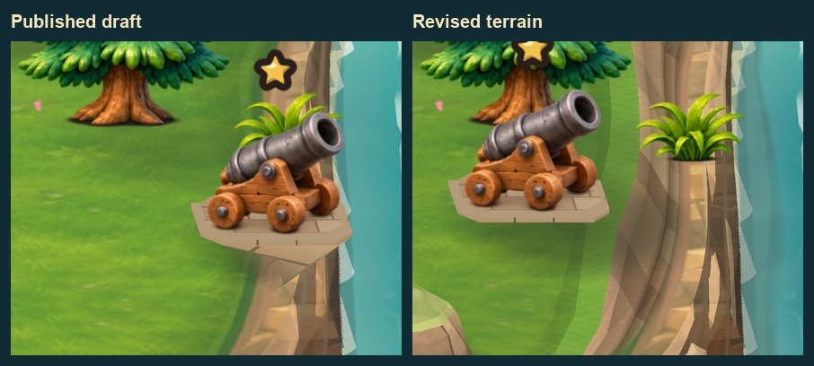

# Home Island cliff and terrace depth

The comparisons use the same Wave 14 village and matching camera framing from the previous draft at `eee45bdc` and the revised game at `4a6ede6b`.

The back now rises through two sandstone tiers. Broad grass ledges connect the lower terraces along the southern shoulders. The seaward cliff has staggered stone courses and lower rock shelves visible through the water. The original playable shore and the beach approaches retain their positions.

The southeast cannon and the other three exposed defenses in this save are drawn farther inland, with dry ground between the sandstone platforms and the cliff. The new southeast clearance is at least one world unit at the edge of the pad. The artwork, selection outline, health marker, and muzzle effects share the same visual position. Saved building locations, movement collision, firing range, and combat use the original coordinates. When a crowded layout has no clear position for offset artwork, it keeps the existing footing.

## Desktop

## Phone

[Whole island on phone before and after](phone-whole-island-before-after.jpg)

## Southeast cannon

[Desktop during Wave 14](desktop-wave-14.jpg) · [Phone during Wave 14](phone-wave-14.jpg)

The terrain height is decorative. The before-and-after checks matched the shoreline classifications, saved coordinates, wall joins, and collision shapes. The four Wave 11 pirate approaches matched the previous draft. Desktop Chrome, phone Chrome, and phone WebKit verified Wave 14 and selection of the displayed southeast cannon. The two-player placement check passed.

Desktop captures are 1280 × 720 at 2×. Phone captures are 390 × 844 at 3× in browser emulation.
