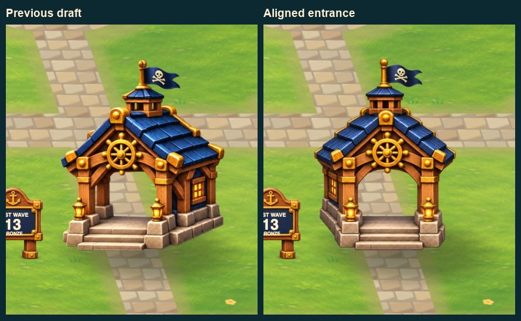

# Home Island entrance and motion review

The Heart’s steps now sit on the centerline of the existing path. The hall’s leftward return follows the path through the arch. The intact, damaged, and collapsed artwork all use the original ground pin and render scale. The camera, structures, traversal, and attack approaches use the original coordinates.

[Desktop comparison](desktop-before-after.jpg) · [Entire island in the phone Fit view](phone-full-island.jpg)

| Live game capture | What to look for |
| --- | --- |
| [Desktop village](desktop-island-motion.webm) | Wind in the foliage and flags, warm detail on buildings, surf, and a moving skiff with both rope ends attached |
| [Phone village](phone-island-motion.webm) | The aligned entrance, the Heart’s pennant, and motion along the shore |
| [Paid house upgrade on phone](phone-house-upgrade.webm) | The level 1 to level 2 purchase, coin deduction, anchored dust and glints, and confirmation |

Cabin and Watchtower pennants, windows and lanterns, Arsenal smoke, the Tech Hub’s brass highlight, and the repaired wreck’s pennant use motion in the part of the sprite that can move or light up. The ring action swings the Bell’s metal on its hinge. The captain breathes at rest. Walls and defenses respond during construction and combat, including the same opening mortar and cannon events on desktop and touch in Wave 14.

The captures use the same staged village save and actual game renderer. The previous Heart art shown in the comparison is byte-identical to the original `04d9ade3` draft. The new captures use `beba922d`. Chrome checked 1280 × 720 at 2× and 375 × 812 and 390 × 844 at 3×. WebKit passed at 390 × 844 with touch. Pause held the new scenery and landmark effects. The in-game and system Reduced Motion settings restored their resting poses. Phone checks use browser emulation.
