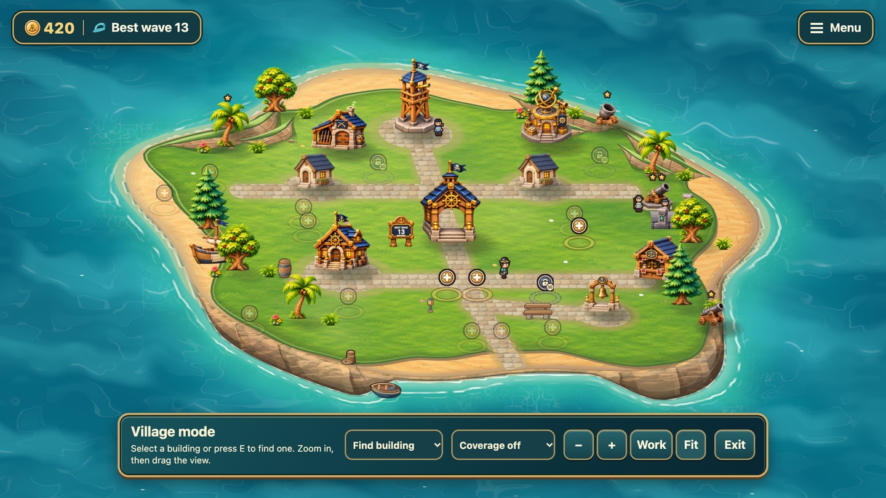

# Home Island object finish

These screenshots come from the same Wave 14 save at `97c5d5b7`. The bench uses warm timber on limestone legs, the barrel has carved staves and navy hoops, and the path lantern shares the blue roofs and amber glass of the village. The scenery uses the original footprint and anchors.

[Whole island on phone](phone-island.jpg) · [Phone working view](phone-working-view.jpg) · [Village objects up close](village-detail.jpg) · [Phone shoreline detail](phone-shore-detail.jpg)

Ripple crests stay at the waterline as the skiff rocks. The lantern light stays inside the glass. Hired crew shift their posture at the same stations, and idle co-op captains move around their planted feet. Moving highlights follow the painted metal on the intact cannon, mortar, harpoon, culverin, and swivel tiers. The top swivel tiers also flutter their pennants.

The production build and 188 targeted frontend cases passed. Chrome verified the three scenery anchors, normal motion and pause at 1280 × 720 at 2× and 390 × 844 at 3×. The shoreline and lantern checks also covered Reduced Motion. All five defense types were verified in desktop and emulated phone Chrome. Co-op idle motion was covered by the presence and combat-pose tests.
