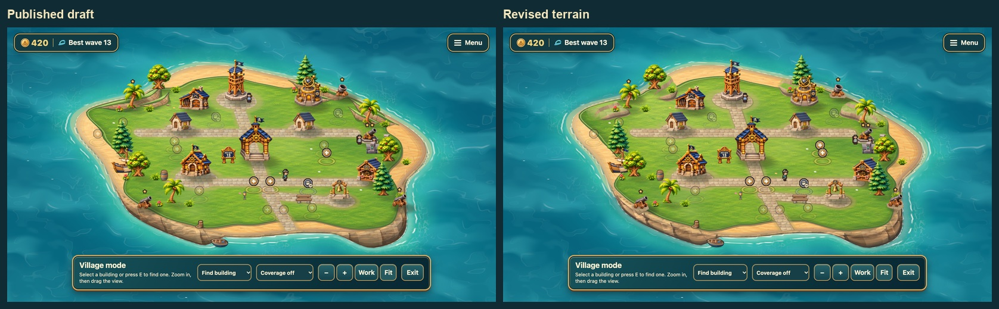
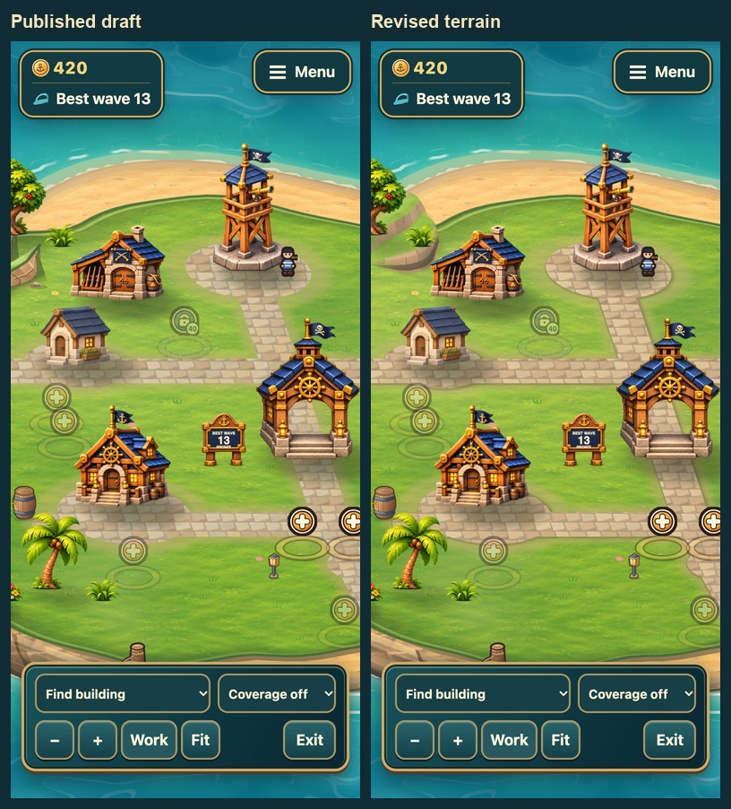
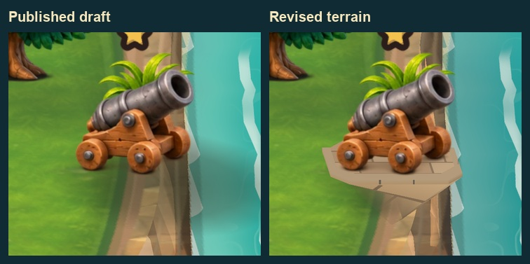

# Home Island terrain and coastal defenses

The comparisons show the same Wave 14 save before the update (`771347a0`) and with the new terrain (`247ee498`). Fit, Work, and the cannon close-up use matching camera framing and ground anchors.

The outer cliffs have recessed sandstone courses and wet rock at the waterline. The rear terraces use raised stone faces with grassy upper ledges. The paths share the warm stone palette and cast a shallow shadow along their edges. The four coastal defenses sit on paved sandstone foundations that extend into the existing cliff or inland ground.

## Desktop

## Phone

[Whole island on phone before and after](phone-whole-island-before-after.jpg)

## Cannon footing

[All four coastal defenses](four-coastal-defenses.jpg) · [Desktop during Wave 14](desktop-wave-14.jpg) · [Phone during Wave 14](phone-wave-14.jpg)

## Gameplay checks

The original terrain classifications, building coordinates, wall joins, and movement collision matched across both saves. All four coastal foundations reached dry ground. The Wave 11 ship spawns, anchors, and first landings matched on the east, south, west, and north routes. Chrome ran the Wave 14 start and combat on desktop and phone. WebKit ran the same phone scenario, including touch selection. The northwest cannon remains selectable through the palm with the existing canopy fade.

Desktop captures are 1280 × 720 at 2×. Phone captures are 390 × 844 at 3× in browser emulation. The painted shore opacity matched the published build pixel for pixel at both shipped terrain settings.

On the review Mac, Chrome averaged 60 frames per second during seven-second normal-motion samples. The drawing buffers stayed at 3840 × 2160 for desktop and 1560 × 3376 for the emulated high-density phone.
