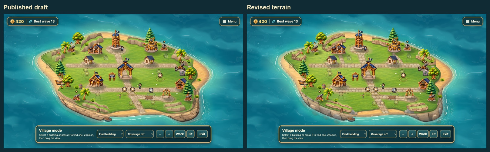
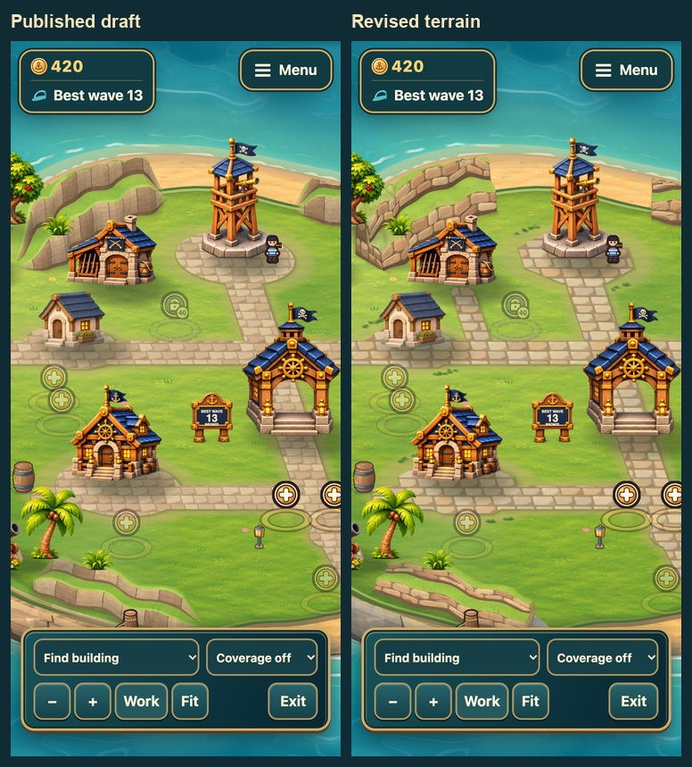

# Home Island stonework and village approaches

The comparisons show the same Wave 14 village with matching camera framing. They compare the previous draft at `46036c09` with the revised renderer at `a37b06d6`.

Irregular coastal rock columns, short turf-covered ledges, and individual gray boulders now frame the coves. The terraces use bevelled sandstone blocks in staggered courses. Thick turf rolls over the top edges and the banks end in visible stone faces. The larger path slabs, chamfered village aprons, and cannon platforms use related limestone tones. Short paved walks meet the existing Arsenal and Tech Hub entrances.

## Desktop

[Outer cliffs and cove boulders close up](outer-cliff-detail.jpg)

## Phone

[Terrace close-up](phone-terrace-detail.jpg) · [Whole island on phone](phone-whole-island-before-after.jpg) · [Southeast cannon clearance](southeast-cannon-before-after.jpg)

## Gameplay checks

The two builds matched all sampled terrain classifications, saved building coordinates, drawn cannon coordinates, collision shapes, wall joins, and camera framing. The southeast cannon's platform still has grass between it and the cliff. It remained selectable by mouse and touch. The same four pirate approaches and Wave 14 ran on the revised terrain. Two-player placement and both production checks passed.

Desktop captures are 1280 × 720 at 2×. Phone captures are 390 × 844 at 3× with emulated touch. The phone scenario ran in Chrome and WebKit.
