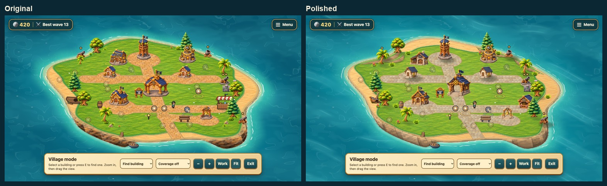
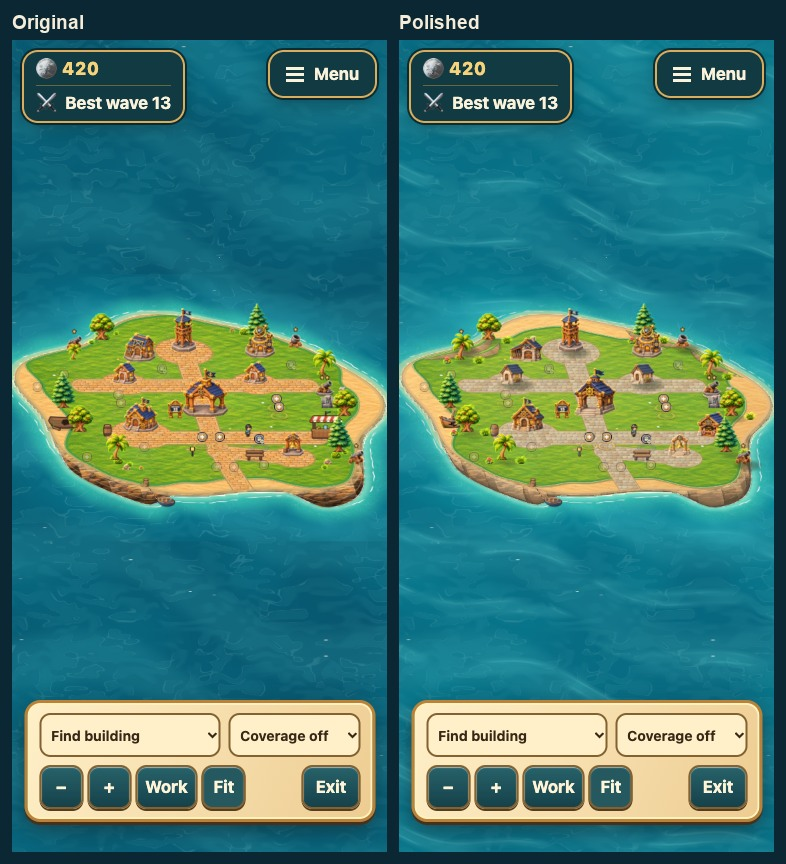
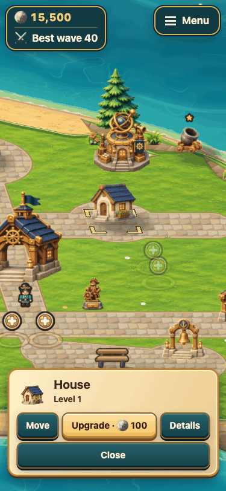

# Home Island at its original scale

The captures compare the previous draft at `cd12d3a9` and the polished game at `1a3e934c` using the same Wave 14 save and camera mode. The original two cottages, north watchtower, bell, southwest mooring, paths, and four attack approaches retain their positions. The revised depth comes from sandstone tiers, bevelled limestone paths, ground contact shadows, and matching materials across the coast, buildings, and small props.

## Desktop

## Phone

[See Working village view at the same phone size](phone-working-view.jpg).

## Live cottage upgrade

The normal touch action upgraded one cottage from level 1 to 2 and charged 100 coins once. The reduced-motion run kept the confirmation and omitted the flying glints.

## Verified in play

- Chromium ran opening, selection, and village navigation at 1280 × 720, 375 × 812, and 320 × 568. WebKit verified both phone widths. The phone viewports were emulated.
- Measured comparisons matched 40,337 terrain samples, the coast bounds, the building anchors, and the native building plane sizes through a late-game save. Both 375 px cottage planes measure 33.42 × 33.42 CSS px with the original camera.
- Desktop and phone rang the bell, played Wave 14, and received the confirmed result. In separate Wave 11 runs, the east, south, west, and north ship spawns, anchors, and first boarder landings matched the original.
- Both input modes rejected an overlapping wall move and saved a joined corner under the current placement rules.
- The exact draft passed all 41 world checks and the production smoke checks. In the matched Wave 14 village view, the new materials and ground relief add three draw calls (96 to 99). Wall-lane expansion, building collision, and physical-device acceptance remain tracked in [#236](https://github.com/Nilsnova/The-Great-Plot-Twist/issues/236).
