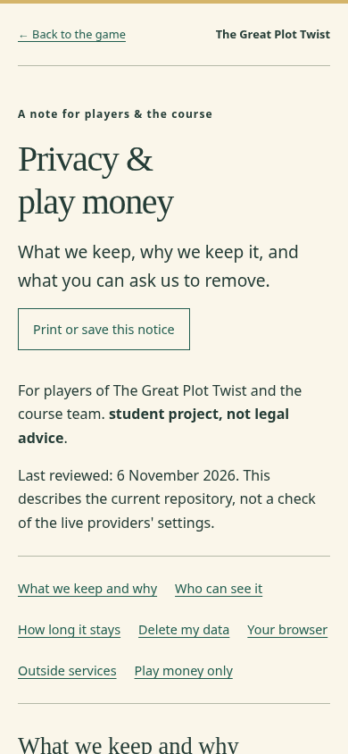

# G26 checkpoint 3 — coverage and final gates (C3)

Responsible teammate: Nils. Branch: `docs/g26-privacy`. No existing application code, migrations, `vercel.json`, `docs/STATUS.md` or `docs/DECISIONS.md` changed. G9's integration link points are in [checkpoint 2](g26-checkpoint-2.md#g9-link-handoff).

## Verified on 6 November 2026

| Check | Exact result |
|---|---|
| Root: `python3 -m unittest discover -s docs/tests -v` | 2 passed; every migration-created table has its own inventory section and every current declared/added column has a row. Coverage: 13 tables, 75 columns. |
| In-memory negative coverage checks | Removing `public.profiles` caused the table check to fail; removing `story_sha256` caused the column check to fail. No migration or inventory file was modified for this probe. |
| `cd frontend && npm test` | 33 test files, 288 tests passed. |
| `cd frontend && npm run build` | Passed; spoiler guard checked 54 built text files. |
| `cd backend && UV_CACHE_DIR=/workspace/.cache/uv uv run --locked pytest -q` | 3,100 passed in 13.27 seconds. |
| Root: `UV_CACHE_DIR=/workspace/.cache/uv uv run --directory backend --locked ruff check ../docs/tests/test_data_inventory.py` | All checks passed. |
| Relative links in the new Markdown documents | Targets exist. |
| Production packaging | `dist/privacy.html`, `.js` and `.css` exist as regular files; built HTML equals the source page. |
| Chromium 156 production-page check | Passed at 320, 390 and 1440 pixels; no horizontal overflow, broken section anchors, normal-load browser errors, cookies, browser-storage writes, third-party requests or API calls. |
| Strict CSP | Browser refused an injected inline script. This deliberate rejection was tested separately from the error-free normal load. |
| JavaScript disabled | Full notice remains readable; optional print button stays hidden. |
| Development page | Passed without Vite HMR/inline script injection into the notice. |
| Repository secret pattern scan on G26 commit range | Empty: no matches for the repository's Supabase secret/JWT/assigned-secret patterns. This is a bounded pattern scan, not a guarantee about all possible secret formats. |

Browser checks used the built site via a local preview and the existing development server. They tested the delivered page and own assets, not just a source file or an open port. The new page's script only enables printing. Temporary browser-check tooling/results were kept outside the checkout; the mobile screenshot below is review evidence.

## Review findings resolved

The initial draft confused the service-only crew-code lookup result with the public join response. The final notice distinguishes internal lookup, direct table RLS and the API response: there is no separate pre-join browser preview endpoint, and the API crew view omits player UUIDs/version. The inventory also distinguishes shared market bases from per-instance calculated current prices.

## Not verified / remaining

No hosted deployment, live OAuth, database RLS, account deletion, provider cookie settings, actual database region, log retention or backup erasure was tested or changed. Supabase's Ireland region is the documented choice; Vercel's Dublin function region is configured in the repository. CDN/log locations are not inferred from that setting.

Nils/the team still need to settle the pending D022 audit/deletion choices and a course-end retention plan; the notice explicitly reports those gaps. G9 needs to link `/privacy.html` before sign-in and from pause/settings. A different human teammate must review the branch before merge. Only `docs/g26-privacy` is to be pushed; `main` is not a push target.

## Branch / PR handover

Implementation commit: `d4677b3` (`docs: add G26 privacy notice and data inventory`). The branch was pushed successfully to `origin/docs/g26-privacy`; the working tree was clean after that push. GitHub's GraphQL PR API returned `Forbidden`, so no PR creation was attempted after that access check. Open the peer-review PR using [GitHub's branch review link](https://github.com/Nilsnova/The-Great-Plot-Twist/pull/new/docs/g26-privacy).

Suggested PR title: **docs: explain G26 privacy, stored data and play money**.

Suggested description: Players and the course can now read a source-backed privacy notice, a complete 13-table/75-column inventory and a standalone `/privacy.html` page. The page has its own script/styles and strict CSP, works at phone width and without JavaScript, and is copied into the existing Vite build without changing configuration. A new documentation test checks all migration tables and columns. G9's sign-in/pause-menu link points are in checkpoint 2.

Validation: 288 frontend tests, 3,100 backend tests, two inventory coverage tests, build/spoiler guard, documentation lint/links, production/mobile/CSP checks and an empty repository-pattern secret scan. See this checkpoint for exact commands, screenshot and limits. Hosted deletion, provider settings and deployment remain unverified. D022 and course-end retention choices still need the team's decision. No application source, migrations, STATUS.md, DECISIONS.md or vercel.json changed. Responsible teammate: Nils; Codex assisted with implementation and read-only reviews. A different human teammate must review before merge.
