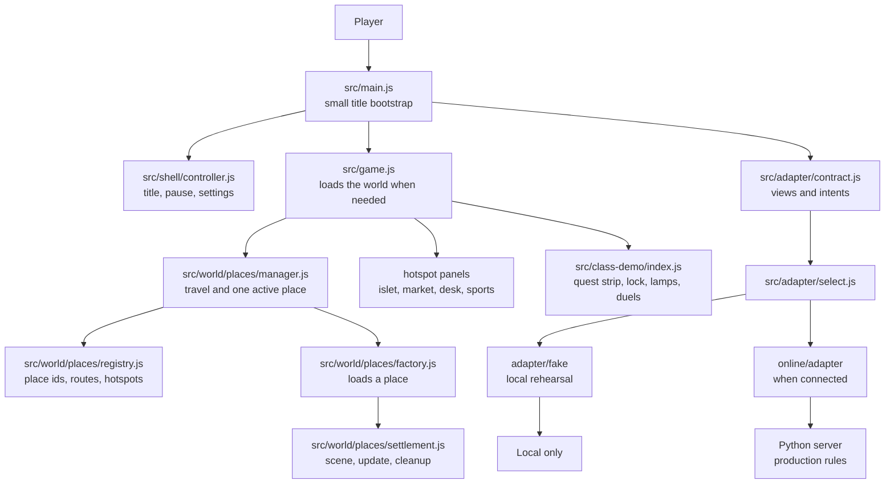

# How The Great Plot Twist works

This guide is for a classmate who knows basic JavaScript. It follows one player action from the title screen to the world and back. The code uses plain JavaScript modules, the browser DOM and Three.js.

> **10 Nov 2026: the mystery left the game** (D031 in [DECISIONS.md](../docs/DECISIONS.md), [PITCH.md](../docs/PITCH.md)). The case screens, the case bridge, the story engine, the rooms, the case cinematics, the highlights tour, the festival, the bulletin and the rewards page were removed. This guide describes what remains; sections marked *removed* are history.

## A map of the game



The boundary matters. In production, the server owns game outcomes and writes. The screen displays a view and sends an intent. `select.js` chooses the local fake only for `?adapter=local` in a dev build, the disconnected adapter for `?demo=1`, and otherwise the online adapter; every adapter follows the same contract. The fake is for local rehearsal and tests. It does not make real server writes.

## One hotspot, from walk to panel

`world.interact(id)` publishes an `interact` event with the place and hotspot id. [`game.js`](src/game.js) listens for it and opens the matching panel: `market_hall` opens the Exchange host, `prediction_kiosk` the prediction desk and `sports_pavilion` the sports pavilion. On the Home islet, a plot or the signal station emits `plot_clicked` and [`screens/islet/host.js`](src/screens/islet/host.js) opens the build panel. The class demo's own spots (the Keeper's Lock, the three lamps, a captain near you) live in [`class-demo/`](src/class-demo/index.js). A panel receives its data and callbacks; it does not decide whether an action succeeds. The case screens and their bridge (`case-spots.js`) were removed on 10 Nov.

### A small DOM detail

The UI kit's `createButton(...)` returns a component object: `{ element, update, dispose }`. Put `component.element` in the DOM, call `component.update(...)` to change it, and call `component.dispose()` to remove its listeners and element.

The helper [`screens/helpers.js`](src/screens/helpers.js) has a different `button(...)` helper. It returns the actual `<button>` element. Use that element directly and set properties such as `button.dataset.focus` on it. Do not confuse the component object with its element. Screen factories generally return component objects with an `.element`; the screen controller appends the selected screen's `.element`.

## Views in, intents out

The schema-1 contract is in [`adapter/contract.js`](src/adapter/contract.js). A view is a read-only picture of the game at one revision. It has exactly the fields listed by `viewKeys`: `schema`, `mode`, `revision`, `now`, `captain` (name and coins), `account`, `presence` and `notice`. The same key must exist when a feature is off; its status or empty value tells the screen what to show. New features add their keys here.

An intent is a request such as `signIn`, `rerollName` or `setEmote`, with arguments. A screen can ask for an intent, then display the answer. It cannot award coins, choose a name, or claim that a write worked. Those rules belong to the server. The fake can imitate them for a local rehearsal, but is not a production authority.

The islet has a small app-owned preview state in [`world/islet/state.js`](src/world/islet/state.js). It remembers valid `islet_changed` events for the world. The presenter can temporarily call `previewBuilt(...)` to show a rehearsal build, then `clearPreview()` restores the latest actual event. A rehearsal preview is not a server answer and does not write a player's live islet.


## The frame loop and the budget

[`game.js`](src/game.js) connects input, the player, current weather, audio, the chart, screens and the world. Each frame it updates those systems and then lets Three.js draw the scene. A place factory loads one island when travel needs it. The place manager disposes the previous place before attaching the next, so travel does not keep every island in memory.

Place objects own their textures, materials, geometry and event listeners. Their `dispose()` methods run when the player leaves. Ambient details reuse their geometry while the place is active; they do not create a new mesh every frame. Reduced-motion settings stop their motion and the hook's flash sequence becomes a still marker.

The published target is 60 frames per second, fewer than 150 draw calls, and fewer than 150,000 submitted triangles. The latest recorded presenter sample in `GRAPHICS.md` was 60 FPS, 107 calls and 212 triangles. That is one machine and one scene, not a promise for every laptop. The cold title bundle is budgeted at 21,080 JavaScript bytes; the latest recorded build is 21,060 bytes. Read the measurements and their setup in [`GRAPHICS.md`](GRAPHICS.md) before comparing runs.

## How the spoiler guard works

The browser bundle must not contain protected case prose or elimination data. The case screens are gone, but the guard keeps running after every build so the culprit can never reach the browser through a later change. The production build runs [`scripts/check-spoilers.js`](scripts/check-spoilers.js) after Vite builds `dist/`. The guard checks output files against committed fingerprints for protected text and looks for elimination data. It reports file and fingerprint counts without printing the protected text. The public fake uses placeholders where server-supplied story wording belongs.

Do not copy secret content into `frontend/` to make a screen easier to build. If the guard fails, treat it as a real bundle leak and fix the source or build boundary before continuing.

## Run the checks

From `frontend/`, install the locked dependencies once with `npm install`. Pure logic and component tests run with Vitest. Browser checks use Chrome already installed on the machine; set `CHROME_PATH` if it is not in a standard location. Do not download another browser. GPU-heavy browser checks run one at a time.

The standard verification is:

```sh
npm test
npm run build
```

`npm run build` also runs the spoiler guard. For the full G8 before/after comparison, the sequential driver records logs and captures under `captures/`:

```sh
node scripts/check-g8-regression.js --phase=before
node scripts/check-g8-regression.js --phase=after
```

Run an individual check when working on one area:

```sh
npm run test:browser
npm run test:production
npm run test:world
npm run test:readability
npm run test:art
npm run test:art:production
npm run test:ui
npm run test:ui:production
npm run test:weather:wiring
npm run test:demo
npm run test:loading
npm run test:spoilers
npm run test:credits
npm run test:living
npm run test:lifecycle
npm run test:csp
npm run test:islet:world
npm run test:harbor:life
npm run test:a11y
```

`test:art:production`, `test:ui:production`, `test:loading`, `test:spoilers` and `test:csp` include a production build. `test:a11y` runs the accessibility browser checks. If a check opens Chrome and no Vite server is already running, it starts its own short-lived local server. For checks that accept a custom URL, set `TEST_URL`; do not run two GPU checks at once.

## A ten-file reading path

Read these in order. Each step builds on the previous one.

1. [`src/main.js`](src/main.js) — find the title, adapter selection and the point where the game is loaded.
2. [`src/shell/controller.js`](src/shell/controller.js) — see how title, pause and settings share one shell.
3. [`src/shell/routes.js`](src/shell/routes.js) and [`src/front-door/index.js`](src/front-door/index.js) — follow Play: lore, goal card, harbor.
4. [`src/game.js`](src/game.js) — follow the world setup and per-frame update.
5. [`src/adapter/contract.js`](src/adapter/contract.js) — learn what a view and an intent look like.
6. [`src/adapter/select.js`](src/adapter/select.js) — see how the fake, disconnected or online adapter is selected.
7. [`src/online/adapter/index.js`](src/online/adapter/index.js) — the online adapter: account, sign-in, presence and the islet engine.
8. [`src/world/places/registry.js`](src/world/places/registry.js) — find stable place, route and hotspot ids.
9. [`src/world/places/manager.js`](src/world/places/manager.js) — follow travel and place cleanup.
10. [`src/class-demo/index.js`](src/class-demo/index.js) — the class harbor layer: quests, duels, the lock and the lamps.

For scene layout and resource ownership, continue into [`src/world/places/settlement.js`](src/world/places/settlement.js).

## Explain-back cards

Use these cards to practise explaining the code to a teammate. Each function name is a place to point in the file, not a claim that the whole project fits in one function.

### `src/main.js`

This file builds the title shell and loads the world only after the player starts.

- `loadGame` imports and starts the game once.
- `play` loads the world and begins in Saltreach Harbor.
- `onEscape` gives the open account or loading screen first chance to close.

**Teacher asks:** Why does `main.js` load `game.js` later? **Answer:** The title can appear without loading Three.js and the full world first.

### `src/game.js`

This is the game wiring layer. It gives each system its collaborators and owns the frame loop.

- `startGame` creates the renderer, world, player, panels and update loop.
- `travel` asks the place manager to move and shows a message if it fails.
- `handleEscape` applies the shared rule for closing the top panel or skipping a shot.

**Teacher asks:** Does `game.js` own the game rules? **Answer:** No. It connects systems; the adapter and server decide results.

### `src/shell/controller.js`

This file owns the title and pause shell, including focus return.

- `createShell` creates the shell component and its state.
- `play` closes the shell and returns focus to the game.
- `show` renders title, pause, credits or settings.

**Teacher asks:** What keeps an open screen from being replaced by Pause? **Answer:** The game reports active overlays, and Escape closes the top overlay first.

### `src/world/places/manager.js`

The manager owns which place is active and how travel succeeds or recovers.

- `createWorld` creates the manager object.
- `goTo` disposes the previous place, loads the next one, and restores the departure place if loading fails.
- `interact` checks the current place's hotspot ids and emits an event.

**Teacher asks:** Why is the current place disposed before the next one is attached? **Answer:** It keeps one place active and releases its resources during travel.

### `src/world/places/settlement.js`

This file composes a walkable place from registered art, layout data and scene effects.

- `createSettlement` loads art and creates the place group.
- `stormFlagShouldShow` checks the supplied weather state for the mast flag.

**Teacher asks:** Why is the storm flag decision a small function? **Answer:** The display rule can be tested without loading Three.js or the whole scene.

### `src/world/islet/state.js`

This module holds the last accepted islet event and a separate temporary tour preview.

- `builtFromIsletChanged` validates an event and extracts the built plot ids.
- `createIsletState` subscribes once and keeps actual and preview state.
- `previewBuilt` overlays a tour view; `clearPreview` restores the latest actual state.

**Teacher asks:** Does `previewBuilt` buy or save a building? **Answer:** No. It changes only what the local rehearsal draws.

### `src/ui/chart.js`

The chart shows route choices and display-only marks supplied by the game.

- `createChart` creates the chart dialog and its controls.
- `refresh` redraws current routes, names and marks from current data.

**Teacher asks:** Can a chart marker unlock a route? **Answer:** No. `world.canTravel` decides whether travel is allowed.

*Removed on 10 Nov 2026 (D031):* the cards for `src/screens/controller.js`, `src/adapter/bridge.js`, the case fake, `src/world/cinematics/controller.js` and `src/demo/tour.js`. The fake adapter that remains ([`src/adapter/fake/index.js`](src/adapter/fake/index.js)) holds only a local account and simulated captains.


## Host and demo console (G14)

`host.html` is a separate Vite entry using the pixel UI kit. Its strict CSP permits only same-origin external scripts, styles and requests. `src/host/auth.js` completes PKCE through our API and places the access token in the existing memory-only session; the console never writes directly to Supabase.

`src/host/controller.js` asks the server for host access before displaying anything. `view.js` and `panels.js` render explicit safe fields with text nodes. Refresh failures and sign-out remove the panels, and stale responses cannot restore them. Crew cleanup requires confirmation and reuses one action UUID after an unknown outcome.

The case clock was removed on 10 Nov 2026 (D031). `?perf=1` shows the frame-rate panel in the game.

Run `npm test` and `npm run build`; after the build, `CHROME_PATH=/usr/bin/chromium npm run test:host` checks the page at desktop and phone widths against fake same-origin API responses only. Operator guidance and backend contracts are in [HOST-CONSOLE.md](../docs/HOST-CONSOLE.md).
## G13: optional festival and sound (removed on 10 Nov 2026)

`src/screens/festival/entry.js` adds the title/pause launcher after checking the live feature flag. The screen and its transports are lazy. `adapter.js` uses the existing verified session, preserves an uncertain write's action id for retry, and clears private state on sign-out. `panel.js` displays the server timer and lamp ownership, gathers three A7 signals, and opens the existing duel view after pairing. It does not decide money, winners or whether a live claim succeeds.

`local.js` is the explicitly labelled `?demo=1&festival=1` rehearsal. It accepts no network transport or token. Its lifecycle controls, claims and pairing remain on this device. The query cannot turn on a server feature flag.

`src/audio/festival.js` loads the four original recordings only after the existing audio owner has a running, gesture-unlocked context. It connects them to the existing music/effects buses. The festival loop requires Play and stops when its panel closes; shared volume sliders include exact mute. `shell/lazy-account-summary.js` retains a stable account slot while loading its presentation after the first title paint, keeping the title within the existing JavaScript budget.


## G9: one live islet engine

The game’s [islet hook](src/online/islet-host.js) watches its exact session’s
[private panel services](src/online/panel-services.js). The factory’s
[islet lifecycle](src/online/case-adapter/islet-lifecycle.js) owns one
[L2 engine](src/screens/islet/adapter.js), so the panel and the existing finale `buildLight` intent
share server snapshots and uncertain click IDs. Screens display those views and send intents;
A2 remains the authenticated transport. A changed wallet triggers a fresh own-account read.

An uncertain build first reads the authoritative islet before an explicit repeat. The repeat keeps
the original click ID, including if a resend is refused. Only an accepted build, a confirmed built readback or an
account reset clears the uncertainty. An old account’s held controller completion cannot block or
unlock the next account’s request. Closing/reopening an ordinary panel keeps its factory engine.

The world draws accepted `islet_changed` answers and clears actual/private plots at account boundaries;
its server-free preview remains separate. Since 10 Nov 2026 the signal station hotspot opens the same
panel as the plots (the finale screen is gone).

Run `npm run test:online:islet` and `npm run test:online:islet:chaos` after the normal stream gate.
Both use production UI, generated credential placeholders and intercepted endpoints. The recordings
wait for native cloud-save acknowledgement and physically walk to the confirmed station before
capturing it. See [stream-8 evidence](captures/20261107_G9-C3/stream8-proof.json). Real services,
physical hardware and the full online case remain outside that proof.

## G29: the front door (Play, Join, lore intro, harbor start)

The title has two actions. **Play** runs the front door: the lore cutscene (once per device), one
goal-and-controls card, then the player stands outside in Saltreach Harbor
(`begin(false, {kind: 'world', place: 'saltreach_harbor', demo: true})`). **Join** opens a small page:
the class code (other codes are refused since the crews left on 10 Nov) and a hint to scan the projector QR. `?join=harbor` is remembered in session storage
for the class-harbor stage. Settings holds Account (sign-in buttons), Intro (replay the intro) and About
(build stamp). The Lighthouse prologue was removed on 10 Nov 2026.

Everything new loads after a click: `shell/routes.js`, `front-door/` and `cutscenes/`. The cold title is
20,364 of its 21,080 JavaScript bytes (was 21,066) and 11,404 of 12,000 CSS bytes.

`cutscenes/player.js` plays a script from `cutscenes/scripts.json` with shots from `cutscenes/scenes.js`
(local art only, simple parallax and fades, cuts with reduced motion). Subtitles are always shown; the
music bed is procedural Web Audio; a voice line plays `public/audio/voice/<id>.<ext>` only when
`public/audio/voice/manifest.json` lists it (`{version: 1, lines: {id: {file, seconds}}}`), so the
cutscenes stay silent until voices exist. Voices are fetched and decoded with Web Audio because the CSP
keeps `media-src 'none'`. Skip with the button, Escape or a tap.

Guest play: when `/api/config` answers `demo.open: true`, Play calls the `signIn({guest: true})` intent,
which signs in anonymously with supabase-js. Otherwise Play stays local and Settings offers one sign-in
button per OAuth provider in `auth.providers` (GitHub, also when the list is missing). When the list has
`email`, Settings > Account and the account screen show the email code form (`screens/account/email-code.js`):
`signIn({provider: 'email', email})` sends a 6-digit code (`signInWithOtp`), and
`signIn({provider: 'email', email, code})` checks it (`verifyOtp`, type `email`). A guest can keep their
progress with `signIn({provider: 'github', upgrade: true})` (Supabase `linkIdentity`) or with the same email
steps plus `upgrade: true` (`updateUser({email})`, then `verifyOtp` with type `email_change`, same user id).
Wrong or expired codes, 429s and resend after 60 s have fixed messages; no SDK text reaches the screen. A `403 demo_closed`
answer becomes the `demo_closed` reason with a plain message.

## G29: the class demo (class harbor, quest strip, duel shortcut, Keeper's Lock, three lamps)

After the front door (`HARBOR_START` carries `demo: true`), `game.js` loads `src/class-demo/index.js` in its
own chunk. Pure rules, each with a Vitest file: `quests.js` (three goals, done state per player in local
storage), `lamp-sync.js` (20 s window, ages instead of clocks, idempotent merges, suppressed ticks, NPC
fill), `duel-shortcut.js` (menu, invitation and reveal as a state machine), `lock-state.js` (the lock
screen, one action id per answer, plain messages for `demo_closed`, `too_many_tries` and 429) and
`harbor.js` (presence place, joined toast, spots, projector words). The DOM parts are `quest-strip.js`,
`lock-screen.js`, `duel-overlay.js` (the arena's own picker and reveal in a spotlight dialog), `lamps.js`,
`projector.js` and `world-objects.js` (lock, lamp posts and sparks drawn in code). Calls go through
`api.js`: `lock-api.js` and `duel-api.js`.

A player who came with `?join=harbor`, typed `HARBOR` or pressed "Join the class harbor" announces the
presence place `class_harbor` while standing in Saltreach Harbor, so ~30 phones share
`live:place:class_harbor:1` with 40 drawn captains and bigger emote bubbles. Lamp states and duel
invitations travel in that room only (`src/net/live-extras.js`, docs/INTERFACES.md section 7); no table,
no `world_state`. The host (GET `/api/host/demo` answers 200) or `?present=1` gets J and a pause-menu
entry for the projector panel. `?demo=1` rehearses all of it alone: simulated captains
(`&captains=40` for a load check), a practice rival and a fixture lock; nothing is sent to a server.
`npm run test:demo` walks the journey in Chrome (`-- --perf` adds frame numbers).
