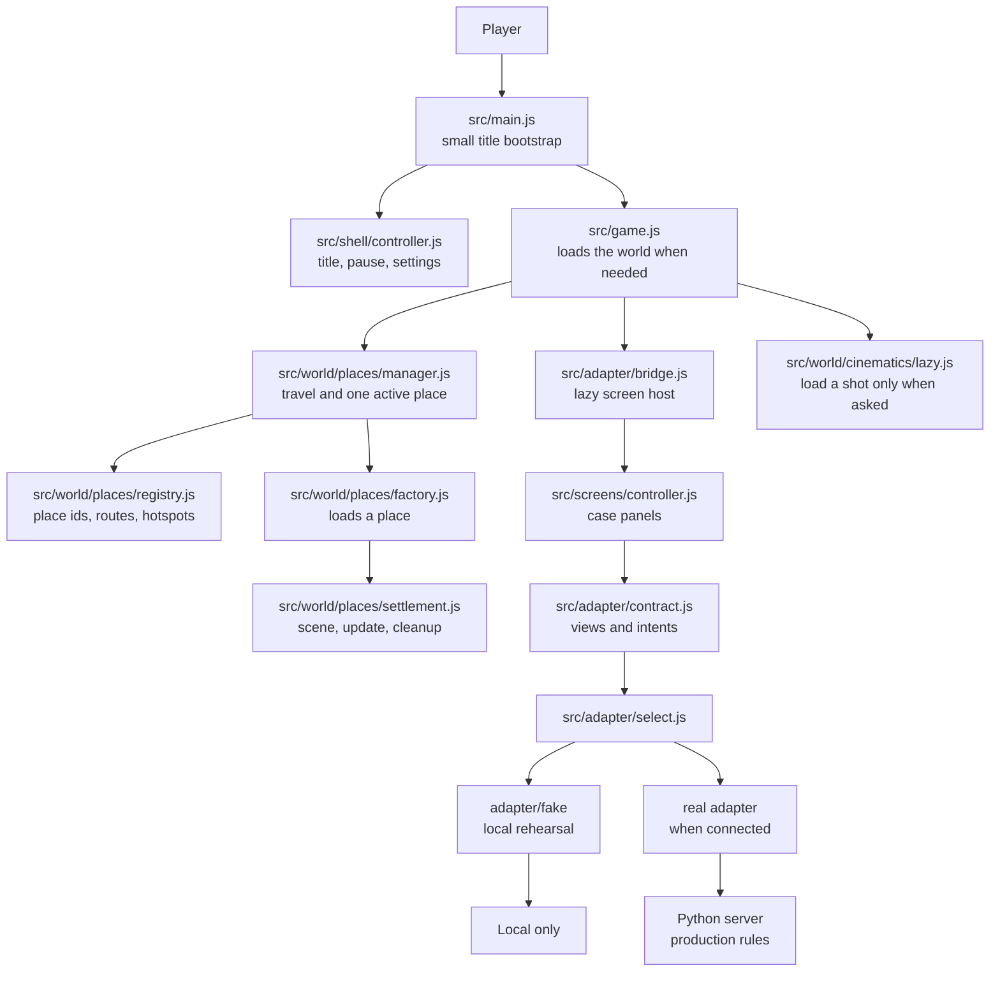
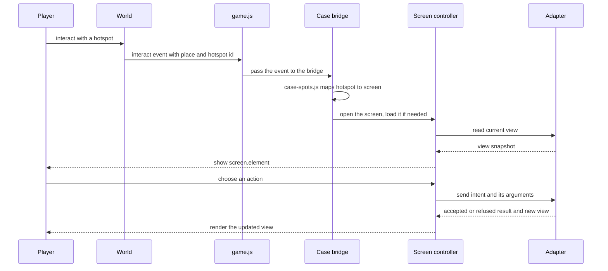

# How The Great Plot Twist works

This guide is for a classmate who knows basic JavaScript. It follows one player action from the title screen to the world and back. The code uses plain JavaScript modules, the browser DOM and Three.js.

## A map of the game



The boundary matters. In production, the server owns game outcomes and writes. The screen displays a view and sends an intent. On this branch, `select.js` chooses the local fake only for its allowed rehearsal query and otherwise returns the disconnected adapter; the future real adapter must follow the same contract. The fake is for testing and the class tour. It does not make real server writes.

## One hotspot, from walk to panel



`world.interact(id)` publishes an `interact` event. The game forwards it to `caseUi.interact`. The bridge uses [`case-spots.js`](src/world/places/case-spots.js) to map the hotspot id to a screen name and asks [`screens/controller.js`](src/screens/controller.js) to open that screen. The screen receives the view and callbacks. It does not call `fetch`, import the network code, or decide whether an action succeeds.

When the screen asks the adapter to do something, the adapter returns an answer and an updated view. The screen redraws from that view. A refused action follows the same path, so the player sees the server's reason without the screen inventing a rule.

### A small DOM detail

The UI kit's `createButton(...)` returns a component object: `{ element, update, dispose }`. Put `component.element` in the DOM, call `component.update(...)` to change it, and call `component.dispose()` to remove its listeners and element.

The helper [`screens/helpers.js`](src/screens/helpers.js) has a different `button(...)` helper. It returns the actual `<button>` element. Use that element directly and set properties such as `button.dataset.focus` on it. Do not confuse the component object with its element. Screen factories generally return component objects with an `.element`; the screen controller appends the selected screen's `.element`.

## Views in, intents out

The schema-1 contract is in [`adapter/contract.js`](src/adapter/contract.js). A view is a read-only picture of the game at one revision. It includes the fields listed by `caseViewKeys`, such as the crew, board, world, account and bulletin. The same key must exist when a feature is off; its status or empty value tells the screen what to show.

An intent is a request such as `pin`, `search`, or `buildLight`, with arguments. A screen can ask for an intent, then display the answer. It cannot award coins, decide that a clue is sufficient, choose a name, or claim that a save worked. Those rules belong to the server. The fake can imitate them for a local rehearsal, but is not a production authority.

The islet has a small app-owned preview state in [`world/islet/state.js`](src/world/islet/state.js). It remembers valid `islet_changed` events for the world. The presenter can temporarily call `previewBuilt(...)` to show a rehearsal build, then `clearPreview()` restores the latest actual event. A rehearsal preview is not a server answer and does not write a player's live islet.

The tour's [`createVisibleClock`](src/core/visible-clock.js) measures elapsed time only while the page is visible. The tour resets that clock while paused or changing steps, so time spent in another tab does not silently skip ahead. Its `dispose()` removes the visibility listener.

## The frame loop and the budget

[`game.js`](src/game.js) connects input, the player, current weather, audio, the chart, screens and the world. Each frame it updates those systems and then lets Three.js draw the scene. A place factory loads one island when travel needs it. The place manager disposes the previous place before attaching the next, so travel does not keep every island in memory.

Place objects own their textures, materials, geometry and event listeners. Their `dispose()` methods run when the player leaves. Ambient details reuse their geometry while the place is active; they do not create a new mesh every frame. Reduced-motion settings stop their motion and the hook's flash sequence becomes a still marker.

The published target is 60 frames per second, fewer than 150 draw calls, and fewer than 150,000 submitted triangles. The latest recorded presenter sample in `GRAPHICS.md` was 60 FPS, 107 calls and 212 triangles. That is one machine and one scene, not a promise for every laptop. The cold title bundle is budgeted at 21,080 JavaScript bytes; the latest recorded build is 21,060 bytes. Read the measurements and their setup in [`GRAPHICS.md`](GRAPHICS.md) before comparing runs.

## How the spoiler guard works

The browser bundle must not contain protected case prose or elimination data. The production build runs [`scripts/check-spoilers.js`](scripts/check-spoilers.js) after Vite builds `dist/`. The guard checks output files against committed fingerprints for protected text and looks for elimination data. It reports file and fingerprint counts without printing the protected text. The public fake uses placeholders where server-supplied story wording belongs.

Do not copy secret content into `frontend/` to make a screen easier to build. If the guard fails, treat it as a real bundle leak and fix the source or build boundary before continuing.

## Run the checks

From `frontend/`, install the locked dependencies once with `npm install`. Pure logic and component tests run with Vitest. Browser checks use Chrome already installed on the machine; set `CHROME_PATH` if it is not in a standard location. Do not download another browser. GPU-heavy browser checks run one at a time.

The standard verification is:

```sh
npm test
npm run build
```

`npm run build` also runs the spoiler guard. For the full G8 before/after comparison, the sequential driver records logs and captures under `captures/`:

```sh
node scripts/check-g8-regression.js --phase=before
node scripts/check-g8-regression.js --phase=after
```

Run an individual check when working on one area:

```sh
npm run test:browser
npm run test:production
npm run test:world
npm run test:readability
npm run test:art
npm run test:art:production
npm run test:ui
npm run test:ui:production
npm run test:cinematics
npm run test:intro
npm run test:weather:wiring
npm run test:experience
npm run test:demo
npm run test:loading
npm run test:spoilers
npm run test:case
npm run test:credits
npm run test:living
npm run test:life
npm run test:lifecycle
npm run test:golden
npm run test:chaos
npm run test:g7
npm run test:csp
npm run test:islet:world
npm run test:bulletin
npm run test:hook
npm run test:harbor:life
npm run test:presenter
npm run test:a11y
npm run test:g8
```

`test:art:production`, `test:ui:production`, `test:loading`, `test:spoilers`, `test:csp` and `test:presenter` include a production build. `test:a11y` runs the accessibility browser checks. `test:g8` runs the sequential G8 regression driver. If a check opens Chrome and no Vite server is already running, it starts its own short-lived local server. For checks that accept a custom URL, set `TEST_URL`; do not run two GPU checks at once.

## A ten-file reading path

Read these in order. Each step builds on the previous one.

1. [`src/main.js`](src/main.js) — find the title, adapter selection and the point where the game is loaded.
2. [`src/shell/controller.js`](src/shell/controller.js) — see how title, pause and settings share one shell.
3. [`src/game.js`](src/game.js) — follow the world setup and per-frame update.
4. [`src/adapter/contract.js`](src/adapter/contract.js) — learn what a view and an intent look like.
5. [`src/adapter/select.js`](src/adapter/select.js) — see how the fake or disconnected adapter is selected.
6. [`src/adapter/bridge.js`](src/adapter/bridge.js) — see how a view reaches a lazily loaded panel.
7. [`src/screens/controller.js`](src/screens/controller.js) — follow panel creation, updates and disposal.
8. [`src/world/places/registry.js`](src/world/places/registry.js) — find stable place, route and hotspot ids.
9. [`src/world/places/manager.js`](src/world/places/manager.js) — follow travel and place cleanup.
10. [`src/world/cinematics/lazy.js`](src/world/cinematics/lazy.js) — see how visual shots load only when requested.

Keep [`src/world/places/case-spots.js`](src/world/places/case-spots.js) nearby while following the hotspot example. For scene layout and resource ownership, continue into [`src/world/places/settlement.js`](src/world/places/settlement.js).

## Explain-back cards

Use these cards to practise explaining the code to a teammate. Each function name is a place to point in the file, not a claim that the whole project fits in one function.

### `src/main.js`

This file builds the title shell and loads the world only after the player starts.

- `loadGame` imports and starts the game once.
- `play` resumes or starts, then hands off to the runtime.
- `onEscape` gives the open account or loading screen first chance to close.

**Teacher asks:** Why does `main.js` load `game.js` later? **Answer:** The title can appear without loading Three.js and the full world first.

### `src/game.js`

This is the game wiring layer. It gives each system its collaborators and owns the frame loop.

- `startGame` creates the renderer, world, player, screens and update loop.
- `travel` asks the place manager to move and shows a message if it fails.
- `handleEscape` applies the shared rule for closing the top panel or skipping a shot.

**Teacher asks:** Does `game.js` own the game rules? **Answer:** No. It connects systems; the adapter and server decide results.

### `src/shell/controller.js`

This file owns the title and pause shell, including focus return.

- `createShell` creates the shell component and its state.
- `play` closes the shell and returns focus to the game.
- `show` renders title, pause, credits or settings.

**Teacher asks:** What keeps an open screen from being replaced by Pause? **Answer:** The game reports active overlays, and Escape closes the top overlay first.

### `src/world/places/manager.js`

The manager owns which place is active and how travel succeeds or recovers.

- `createWorld` creates the manager object.
- `goTo` disposes the previous place, loads the next one, and restores the departure place if loading fails.
- `interact` checks the current place's hotspot ids and emits an event.

**Teacher asks:** Why is the current place disposed before the next one is attached? **Answer:** It keeps one place active and releases its resources during travel.

### `src/world/places/settlement.js`

This file composes a walkable place from registered art, layout data and scene effects.

- `createSettlement` loads art and creates the place group.
- `teaserShouldShow` chooses whether the coast's supplied fog-night state warrants the teaser.
- `stormFlagShouldShow` checks the supplied weather state for the mast flag.

**Teacher asks:** Why is the storm flag decision a small function? **Answer:** The display rule can be tested without loading Three.js or the whole scene.

### `src/world/islet/state.js`

This module holds the last accepted islet event and a separate temporary tour preview.

- `builtFromIsletChanged` validates an event and extracts the built plot ids.
- `createIsletState` subscribes once and keeps actual and preview state.
- `previewBuilt` overlays a tour view; `clearPreview` restores the latest actual state.

**Teacher asks:** Does `previewBuilt` buy or save a building? **Answer:** No. It changes only what the local rehearsal draws.

### `src/ui/chart.js`

The chart shows route choices and display-only marks supplied by the game.

- `createChart` creates the chart dialog and its controls.
- `refresh` redraws current routes, names and marks from current data.
- `drawPartners` draws supplied partner paths on the chart.

**Teacher asks:** Can a chart marker unlock a route? **Answer:** No. `world.canTravel` decides whether travel is allowed.

### `src/screens/controller.js`

This file hosts case screens and passes them a view and intent callbacks.

- `createCaseScreens` creates the modal and the lazy screen map.
- `open` selects, loads and displays a screen's `.element`.
- `send` forwards an intent through the adapter and renders its returned view.

**Teacher asks:** What does a screen receive? **Answer:** A view, callbacks and DOM component elements, not the network transport.

### `src/adapter/bridge.js`

The bridge connects adapter updates to the panel host and maps hotspot interactions to screen names.

- `createCaseBridge` creates the bridge and decides whether it owns its adapter.
- `ensure` loads the screen host on demand.
- `onView` forwards new views and handles queued cinematic effects.

**Teacher asks:** Why is `ensure` lazy? **Answer:** Most panels are not needed at title load, so they stay out of the first chunk until opened.

### `src/adapter/fake/index.js`

The fake adapter is an in-memory service for local rehearsal and browser checks.

- `createFakeCaseAdapter` creates the simulated service.
- `read` returns a cloned view snapshot.
- `dispatch` runs the selected fake handler and publishes the result.

**Teacher asks:** Can the fake grant real game progress? **Answer:** No. It has no live server connection and exists only to rehearse the interface.

### `src/world/cinematics/controller.js`

This controller owns the canvas, image loading, timing and cleanup for one cinematic.

- `createCinematics` creates the controller and its dialog.
- `play` validates a shot request and loads its local art.
- `finish` settles the shot as completed, skipped or cancelled and emits the matching event.

**Teacher asks:** How does Escape skip a shot? **Answer:** The dialog calls `finish('skipped')`, which stops timing and resolves the request.

### `src/demo/tour.js`

The tour runs a short class rehearsal with a fake adapter and temporary display state.

- `createTour` creates the step machine, fake screens and a visible-page clock.
- `enter` sets up the current highlight.
- `stop` closes views and restores the saved place, weather, time and case view.

**Teacher asks:** Why does the tour use an islet preview? **Answer:** It can show a build without changing the player's actual islet state.


## Host and demo console (G14)

`host.html` is a separate Vite entry using the pixel UI kit. Its strict CSP permits only same-origin external scripts, styles and requests. `src/host/auth.js` completes PKCE through our API and places the access token in the existing memory-only session; the console never writes directly to Supabase.

`src/host/controller.js` asks the server for host access before displaying anything. `view.js` and `panels.js` render explicit safe fields with text nodes. Refresh failures and sign-out remove the panels, and stale responses cannot restore them. Crew cleanup requires confirmation and reuses one action UUID after an unknown outcome.

The clock is hidden unless `/api/config` confirms G10 is installed and `case` is on. Its input and quick buttons send `{seconds, actionUid}` with 1–3600 whole seconds. Only the outcome message/time is displayed; the returned case view is ignored. `?perf=1` is linked for the demo rehearsal; G14 does not change the game's production performance display.

Run `npm test` and `npm run build`; after the build, `CHROME_PATH=/usr/bin/chromium npm run test:host` checks the page at desktop and phone widths against fake same-origin API responses only. Operator guidance and backend contracts are in [HOST-CONSOLE.md](../docs/HOST-CONSOLE.md).
## G13: optional festival and sound

`src/screens/festival/entry.js` adds the title/pause launcher after checking the live feature flag. The screen and its transports are lazy. `adapter.js` uses the existing verified session, preserves an uncertain write's action id for retry, and clears private state on sign-out. `panel.js` displays the server timer and lamp ownership, gathers three A7 signals, and opens the existing duel view after pairing. It does not decide money, winners or whether a live claim succeeds.

`local.js` is the explicitly labelled `?demo=1&festival=1` rehearsal. It accepts no network transport or token. Its lifecycle controls, claims and pairing remain on this device. The query cannot turn on a server feature flag.

`src/audio/festival.js` loads the four original recordings only after the existing audio owner has a running, gesture-unlocked context. It connects them to the existing music/effects buses. The festival loop requires Play and stops when its panel closes; shared volume sliders include exact mute. `shell/lazy-account-summary.js` retains a stable account slot while loading its presentation after the first title paint, keeping the title within the existing JavaScript budget.


## G9: one live islet engine

The game’s [islet hook](src/online/islet-host.js) watches its exact session’s
[private panel services](src/online/panel-services.js). The factory’s
[islet lifecycle](src/online/case-adapter/islet-lifecycle.js) owns one
[L2 engine](src/screens/islet/adapter.js), so the panel and the existing finale `buildLight` intent
share server snapshots and uncertain click IDs. Screens display those views and send intents;
A2 remains the authenticated transport. A changed wallet triggers fresh own-account/ledger reads.

An uncertain build first reads the authoritative islet before an explicit repeat. The repeat keeps
the original click ID, including if a resend is refused. Only an accepted build, a confirmed built readback or an
account reset clears the uncertainty. An old account’s held controller completion cannot block or
unlock the next account’s request. Closing/reopening an ordinary panel keeps its factory engine.

The world draws accepted `islet_changed` answers and clears actual/private plots at account boundaries;
its server-free tour preview remains separate. The muster reminder and finale’s Open your islet
control open the same panel. Live case projection/post-build refresh remains deferred to streams
12–15 pending R11. The local full-case rehearsal proves the panel-to-world-to-third-light path.

Run `npm run test:online:islet` and `npm run test:online:islet:chaos` after the normal stream gate.
Both use production UI, generated credential placeholders and intercepted endpoints. The recordings
wait for native cloud-save acknowledgement and physically walk to the confirmed station before
capturing it. See [stream-8 evidence](captures/20261107_G9-C3/stream8-proof.json). Real services,
physical hardware and the full online case remain outside that proof.
