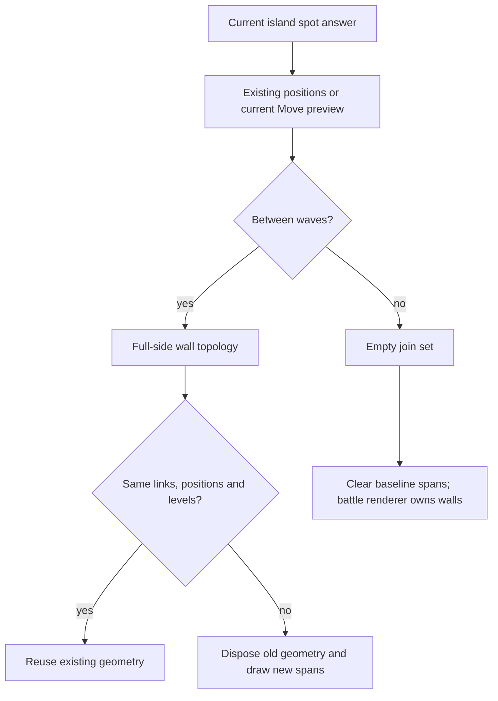

# COC-13: visible wall connections between waves

Responsible teammate: Johannes Franz Lang (@frcola). Issue: [#154](https://github.com/Nilsnova/The-Great-Plot-Twist/issues/154).

This is the first implementation slice of COC-13. It changes the existing between-wave island drawing. The combat renderer remains responsible for battle walls, damage and ruins. The broad task stays open for a separately coordinated combat-art slice; this document does not claim that the whole feature is finished.

## Result and player benefit

Built walls that share an entire side now look connected. Straight lines, L corners and T junctions follow actual saved positions. The original wall art remains as the end/corner/junction posts, including its existing level appearance and banners. A small join fills the span between posts. Two isolated walls, a real gap, a diagonal touch or a partial side contact remain visually separate.

The same drawing is used in the normal island view and during an accepted Move preview. An invalid preview is not allowed to manufacture a connection. Cancelling the move returns to the real layout. No new placement freedom, purchase, upgrade or repair is introduced.

## Existing behavior and why this is a small slice

`frontend/src/island/world.js` already displays the authoritative spot positions between waves, moves the selected sprite during preview, and hides its walls while the battle renderer takes over. Before this change each wall used its own broad standalone sprite, without a relation to its neighbors.

`frontend/src/island/placement.js` already defines a 0.5-unit grid and a wall footprint of 2 units. A shared full side therefore requires exactly 2 units between centers on one axis and identical coordinates on the other. One grid step is not the length of one wall segment.

The existing D056 lane restriction and all placement/collision predicates stay in their existing modules. COC-10/50 own any future change to allowed wall layouts. Ianno's T55–T59 work owns persistent health, combat integration and recovery feedback. This slice neither duplicates nor rewrites those systems.

## Code map

| File | Responsibility |
|---|---|
| `frontend/src/island/wall-connections.js` — `wallTopology` | Pure full-side neighbor detection from built wall positions; no mutation of input |
| Same file — `makeWallConnections` | Owns a small Three.js group, its connection geometry and one shared vertex-color material |
| `frontend/src/island/world.js` — `apply` | Supplies the current drawn positions, suppresses invalid-preview joins and passes an empty set during battle |
| Same file — `showSpot` | Keeps original level art as narrower connection posts; isolated walls retain their previous width |
| `frontend/tests/island/wall-connections.test.js` | Geometric boundaries, mixed levels, nonmutation, cache invalidation and disposal |
| `frontend/scripts/capture-wall-connections.js` | Actual browser evidence using normal fake-API builds and accepted Move operations |

## Geometry contract

The renderer reads built wall rows with an ID, finite X/Z coordinates and optional level. It ignores unbuilt and non-wall rows. If an explicit `hp: 0`, `health: 0` or `broken: true` is present, that row cannot join. This optional guard is not a new health API.

Two rows connect exactly when:

```text
abs(a.x - b.x) == FOOTPRINTS.wall and a.z == b.z
or
abs(a.z - b.z) == FOOTPRINTS.wall and a.x == b.x
```

| Relation | Example center offset | Join? |
|---|---|---|
| Full horizontal side | `(2, 0)` | Yes |
| Full vertical side | `(0, 2)` | Yes |
| Half-unit gap | `(2.5, 0)` | No |
| Partial side contact | `(2, 0.5)` | No |
| Diagonal point | `(2, 2)` | No |
| Overlapping footprints | `(1.5, 0)` | No; drawing does not authorize this layout |

Input order does not affect the result: wall IDs are sorted before pairs are considered. An L or T is simply two or three independently valid pair contacts. A connection never changes the identity of either wall.

For mixed levels, the span uses the lower neighbor level. Both original post sprites keep their real level art. This avoids drawing a gold span that suggests the lower wall was upgraded. Existing flags, pips and banner artwork remain recognizable.

## State flow and phase handoff



The cache key includes endpoint IDs, positions and span level. A move that opens a gap, a level change or a phase change invalidates the drawing. Repeated `apply` calls with unchanged data reuse geometry. The connection group is attached below the island drawing's root; `dispose` releases its geometry and shared material and removes the group. It creates no event listeners, timers, requests or storage.

## Health and combat limits

The existing between-wave spot response does not provide this layer a complete live canonical health vector. This PR retains that existing base-art convention; it does not claim that a new join is proof of full health. Explicit broken-state metadata is honored when present, but no missing HP is inferred or synthesized.

All connection meshes disappear when `battle` becomes true. The original combat renderer continues to display its existing wall sprites and damage states. This prevents stale between-wave spans from hiding a battle breach. Shared battle connection art requires a separate slice with Ianno after his HP/state contract settles.

This deliberate phase limit is why issue #154 must not be closed as wholly complete by this PR.

## Checks and evidence

Focused command from `frontend/`:

```sh
npm test -- --maxWorkers=1 tests/island/wall-connections.test.js tests/island/world-art.test.js
```

Actual result for this branch: **2 test files passed; 17 tests passed**. Cases include line/L/T contacts, gap/partial/diagonal/overlap exclusions, unbuilt/broken/non-wall neighbors, unchanged input, mixed levels, unchanged-cache reuse, disappearing joins and idempotent disposal. Existing building-art/crew cases are included in that total.

The [evidence README](../docs/evidence/COC-13/README.md) records real browser captures, viewport sizes and boundaries. The before image comes from the actual main commit `a09787c0` in a separate clone. Both sides use the same normal fake-API build and Move operations to form a valid T around the inner wall pair. They are rendered gameplay, not generated concepts.

Full frontend, build, budget, accessibility and demo checks are coordinated centrally with the orchestrator and are not claimed as passed here until actual results are attached. No production services, Safari or physical phone behavior is established by the Chromium fake-API evidence.

## Explain-back

1. I made neighboring walls visibly connect while I am arranging the island between waves.
2. I use the real two-unit wall footprint, so a diagonal touch or a small gap cannot look like a solid barrier.
3. I kept each wall's own level art and used the lower level for the span between different levels.
4. This only draws the current layout; it does not build, move, heal or upgrade anything.
5. Battle connections are still a separate follow-up because that renderer must follow the new combat-health rules.

Questions before marking this ready for review:

- Why do adjacent wall centers differ by two world units even though the grid step is 0.5?
- What happens to the cached geometry when a move opens a gap or a wave begins?
- Why would it be misleading to claim that this PR completes persistent damage-aware battle walls?
