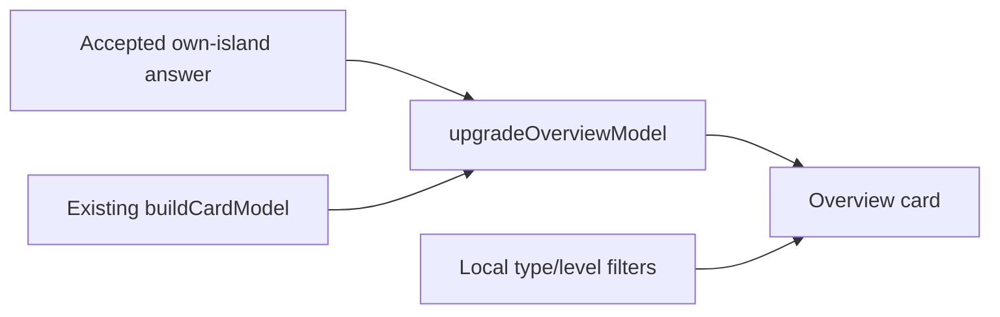

# COC-31: read-only base upgrade overview

Responsible teammate: Johannes Franz Lang (`frcola`). Related issue: [#172](https://github.com/Nilsnova/The-Great-Plot-Twist/issues/172).

## Result and scope

Menu → **Base overview** shows all built buildings from the player's last accepted island answer. Each row identifies its plot, building level, next building-level price or wave lock, selected house/tower skill when available, and bought tower-path steps. Local filters show one building type or affordable, blocked and top-building-level plans.

This is the first independently useful COC-31 slice. It is read-only: there are no purchase callbacks and no new API endpoint. It does not select distant buildings, move the camera, apply a layout, recommend a mathematically best purchase, or replace the detail card's tower tree. That later selection handoff belongs with the reviewed village mode. COC-31 remains open.

The overview describes current building levels, not effective combat damage or range. It intentionally does not repeat house-loot statistics while their separate UI/server discrepancy is unresolved. `Highest building level` means the normal level trunk is complete; tower paths and house roles can still exist.

`Within budget` is a planning comparison of the known wallet, quoted level price and existing wave unlocks. This slice does not read structure-health endpoints or prove repair eligibility. A damaged wall can require its normal repair action before an upgrade; the actual building card and server remain the authority. The overview therefore labels its purpose as building-level planning and never offers an Upgrade button.

## Data flow and authority



`upgradeOverviewModel` reads built spots rather than enumerating the original seven tower plots. D060 extra towers therefore appear when offered. Duplicate plot IDs and unknown building kinds are omitted defensively. Rows sort by building name, level and numeric plot ID; no sort pretends to optimize strategy.

The model reuses `buildCardModel`, `readUnlocks`, `campaignOf`, the island's prices and a spot's server-sent `upgradeCost`. A server quote such as 53 coins wins over the ordinary catalogue price of 60. Unknown coins produce the existing loading reason and never an affordable result. A wave-locked next level keeps its existing unlock explanation. No client calculation can grant a purchase: the normal building action still reaches the existing API and database checks.

The controller supplies only its own accepted island answer. The menu entry is hidden during a visit; this slice does not add remote management permissions. Opening while own data is absent uses the same guarded `freshOwn()` read as other cards. Accepted reloads redraw an open overview. If a type disappears, its filter returns to all types. A running wave changes the explanatory note; opening the overview does not pause a canonical reservation or mutate combat.

## UI lifecycle

The existing island modal owns focus, Escape, input blocking and cleanup. `overviewCard` keeps local filter values, and the standard card redraw restores the focused filter using `data-focus`. Rows use safe DOM text helpers, not HTML assembled from server strings. Status reasons and filter names carry meaning in text as well as border color. Selects are at least 44 pixels tall and stack on narrow screens.

Closing, disposing the island, or opening another island card uses the existing modal lifecycle. There is no new global event listener, polling timer or cache.

## Verification and reproducible examples

Focused command from `frontend/`:

```bash
npm test -- --maxWorkers=1 tests/island/upgrade-overview.test.js tests/island/upgrade-overview-dom.test.js tests/island/card-model.test.js tests/island/tower-tree.test.js
```

Final focused result: **4 passed files; 40 passed tests**, 3.64 seconds. Model cases cover extra plots, duplicate IDs, unbuilt/unknown entries, server prices, exact affordability boundary, unknown coins, wave locks, top levels, roles/paths and source immutability. Real Chromium DOM cases use the actual menu provider, confirm zero POST writes during overview use, retain filters/focus across accepted updates and wave state, and check 375-pixel overflow plus an empty filter result.

The central full-suite run exposed an older exact menu-list assertion in `tests/island/dom.test.js`. Its expectation now includes `Base overview` in the actual menu order; the assertion remains a complete `toEqual` list and all other checks are unchanged. Root coordinates the targeted and final full reruns; this follow-up did not launch a competing test or browser process.

Text lint: **4322 candidate strings in 472 source files; 0 errors, 8 report-only findings**. The four added ordinary words (`approach`, `base`, `filters`, `plan`) were manually checked for spelling. Existing report-only findings are unrelated.

`node scripts/capture-base-overview.js ../docs/evidence/COC-31-base-overview` captures the real integrated game with local fake island data. The old single-building detail card is the before comparison; the new read-only aggregate is the after comparison. Seven buildings at the same fixture state are used at 1280 × 720 and 375 × 812. Final result: **4 screenshots passed; overview rows: 7; browser errors: 0; horizontal overflow: 0**. The returning-player fixture sets the existing arrival-seen key, and asserts there is no open arrival cutscene before capturing. The earlier cutscene-backdrop assertion failure was fixed in the fixture; it was not removed. See the [evidence report](../docs/evidence/COC-31-base-overview/README.md).

Full frontend suite, production build/budget and broad accessibility/demo journeys are coordinated by the parent integration agent and are not claimed here. Live authentication, a production database, Safari and physical phones were not checked. The fake transport proves the component workflow and absence of overview writes, not production service availability.

## Explain-back preparation

I take the buildings that the island answer already says I own and turn them into a readable list. I ask the same model used by a normal building card what the next level costs and why it might be unavailable. The filters only change which list rows I see, so selecting a filter cannot spend coins. A server update replaces the list model while the modal keeps the focused filter. This version helps me compare the base, but selecting or changing a distant building is still a separate village-mode feature.

Questions for Johannes before marking the PR ready:

1. If the normal price is 60 but the island answer says `upgradeCost: 53`, what does the overview show, and why?
2. Which test demonstrates that filtering cannot spend coins or upgrade a building?
3. Why does a level-five cannon still show tower-path progress instead of claiming all progression is complete?

Explain-back and independent human review remain pending. No merge or deployment is authorized by this document.
