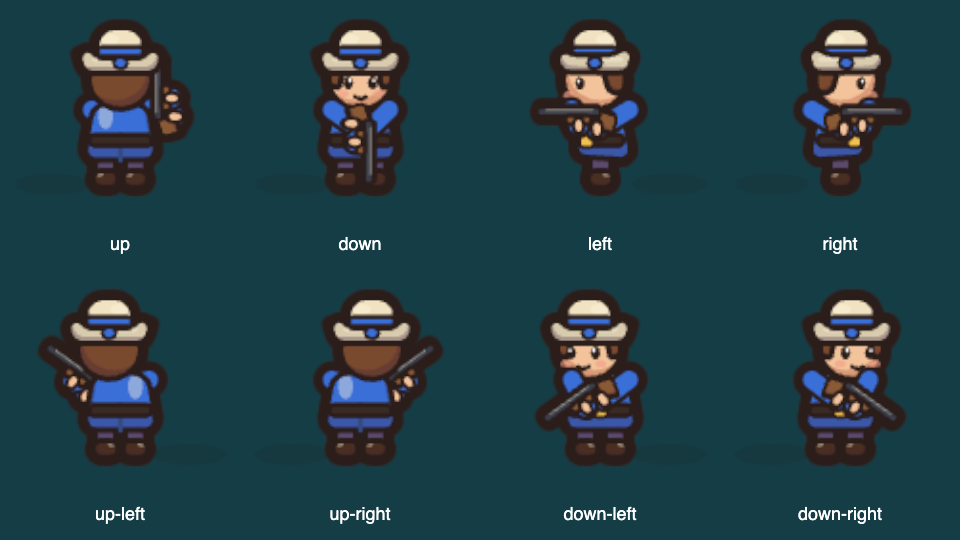

# T27: Captain shooting direction

Responsible teammate: Ianno Hollensteiner (`Iannomh123456`).
Task: [#16](https://github.com/Nilsnova/The-Great-Plot-Twist/issues/16).

## Agreed scope

Local and remote captains face the target during a shot, including diagonal
and intermediate angles: the musket uses the exact projected angle, and the
upright body uses directional views with appropriate body/gun overlap. Keep each captain’s lobby color and one visible body,
then resume walking or idle. Reuse the existing pose lifetime and room events;
no simulation, network contract, database or dependency changes.

## Acceptance evidence

- Exact projected aim, body/gun overlap, pose expiry, color and one visible body.
- Two-browser check using the shared fake island and room.
- Before/after screenshots at 1280 × 720 and 375 × 812.
- Frontend tests, build, budget, text lint, accessibility and demo checks.
- Walkthrough and test-map updates; explain-back and independent human review.

Implementation is in [PR #17](https://github.com/Nilsnova/The-Great-Plot-Twist/pull/17).
The implementation changes only shooting orientation and its visual overlap.
The musket rotates by `atan2(dz * .72, abs(dx))`, with mirroring for left shots.
The body stays upright in front/back/side/diagonal views; aiming away paints
the body in front of the gun. Idle arms are omitted during firing, leaving only
two sleeves and grip hands. Downward shots hold the grip centrally to avoid
crossing an arm unnaturally. A per-captain texture is reused and disposed. Cutlass artwork,
shots, damage, room payloads, pose duration and walking rules are unchanged.

## Checks on 14 Nov 2026

Run from `frontend/` unless stated otherwise. This machine used a temporary,
checksum-verified official Node 24 runtime and installed Google Chrome.

| Command | Exact result / evidence |
|---|---|
| `npm install` | `added 47 packages in 785ms`; existing dependency set, no manifest changes |
| `npm test -- tests/pirates/poses.test.js tests/pirates/figures.test.js tests/cartoon-art.test.js` | `Test Files 3 passed (3)`; `Tests 25 passed (25)` |
| `CHROME_PATH="/Applications/Google Chrome.app/Contents/MacOS/Google Chrome" npm test` | `Test Files 236 passed (236)`; `Tests 2980 passed (2980)` |
| `npm run build` | `436 modules transformed`; `built in 389ms`; `Spoiler guard: 226 text files, 12 protected lines, no suspect elimination data.` |
| `node scripts/report-budget.js --check` | Exit 0; initial JavaScript 18,174 bytes / limit 21,080; CSS 8,550 / 12,000 |
| `node scripts/text-lint/index.mjs` (repository root) | `Text lint: 3744 candidate strings in 412 source files; 0 errors, 8 report-only findings.` |
| `npm run test:a11y` | `"screens": 33, "failures": [], "errors": []` |
| `SHOTS_DIR=/tmp/plot-twist-t27-demo npm run test:demo` | 33 checks, `"errors": [], "external": []` |
| `node scripts/check-shooting-direction.js` | `check-shooting-direction: OK (2 pages, 10 shot angles, 2 viewports; direction assertions)` |
| `npm run test:mp -- /tmp/plot-twist-t27-multiplayer-complete` | `check-multiplayer: OK (4 pages)`; same ships/boarders and boss outcome across pages |
| Documentation and diff | Local link targets all present; `git diff --check` clean |

The initial full-suite attempts failed on sandbox loopback access and then the
Linux-default Chromium path. Both were resolved for the passing run above; no
tests were skipped or weakened. An earlier multiplayer run was invalidated by
source hot reload; the final run disables HMR. A baseline multiplayer run was
stopped after the focused before screenshots were captured.

## Screenshots and limits

Ianno reviewed and accepted these eight compass poses on 14 Nov, after the
idle arms were removed and the downward grip was corrected. This is a montage
of browser screenshots, not generated reference art.

[All ten captain palettes at eight angles](../frontend/captures/T27/after/all-colors-contact.png).

[Before](../frontend/captures/T27/before/) and
[after](../frontend/captures/T27/after/) show cardinal, diagonal and intermediate targets on local and
teammate renderers at 1280 × 720 and 375 × 812. These are isolated real-renderer
fixtures using controlled shot events; they are not deployed game screenshots
or proof of Supabase delivery. The browser check verifies one visible body and
return to idle, fixed texture dimensions across viewport changes, texture reuse
and disposal. The legacy local-pose unit test checks restoration of the normal
body; the game’s existing movement rules then choose idle or walking.

No backend or SQL changed, so backend/SQL checks were not run. Physical phones,
live Supabase Realtime, other browsers and continuous body rotation are not proven.
The gun aims continuously while the body uses directional drawings. The aiming
gun is shortened to fit the existing box; the palette and feet anchor stay fixed.

## Handover

Responsible teammate: Ianno Hollensteiner. Agent assistance: Codex drafted code,
tests and documentation. Three explain-back questions were discussed with coaching: the first two
answers needed correction and the third was explained. Independent rehearsal
is still needed; no mastery is claimed. Ask Johannes Franz Lang (`frcola`)
for independent human review after final verification; never merge without a different human’s
current approval.
