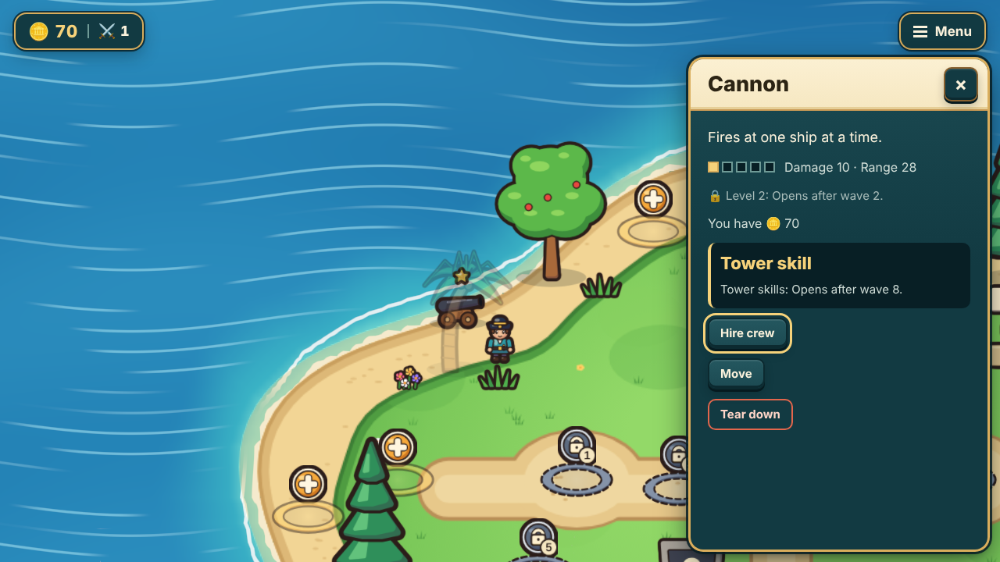
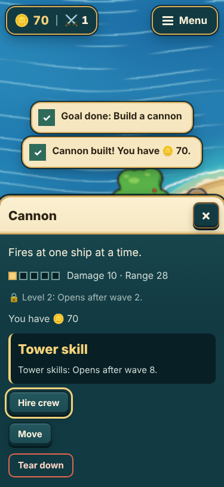
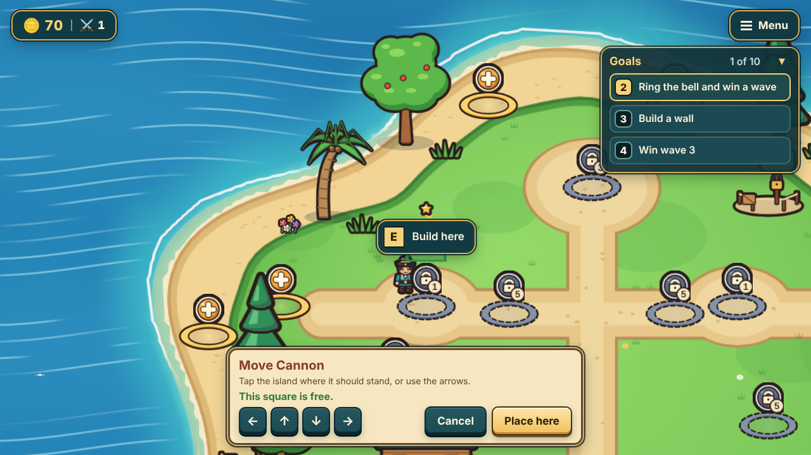
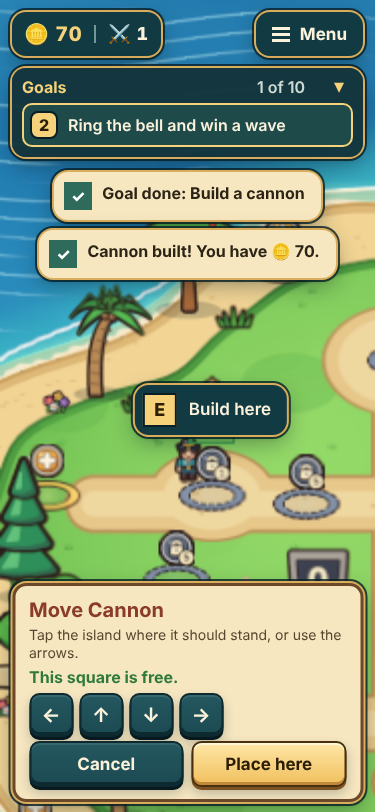
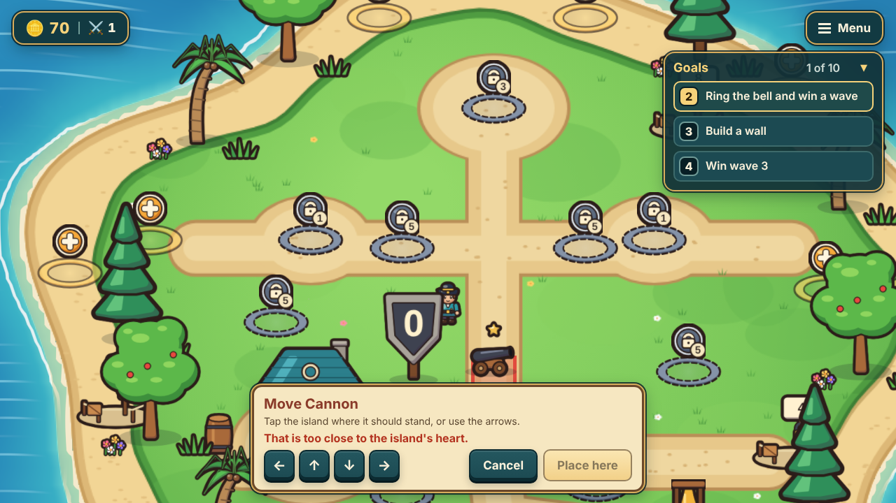
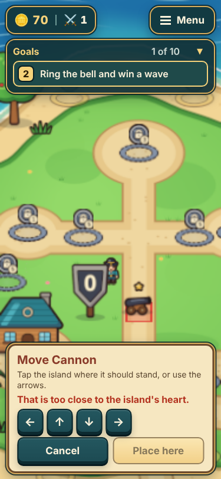
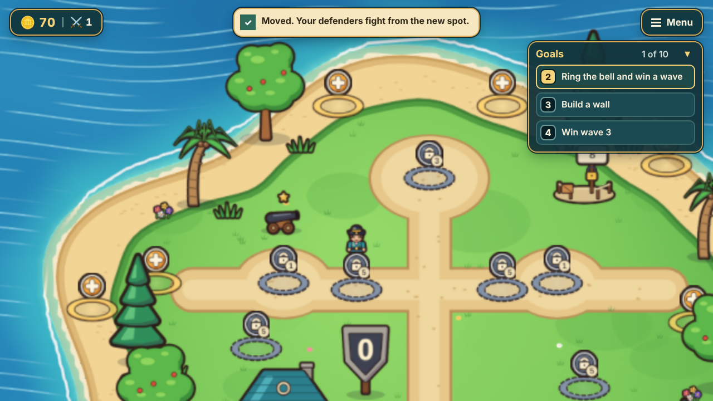
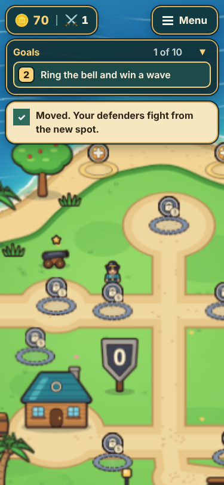

# T36 Flexible placement

> **What this is:** walls, towers, the watchtower and the houses of your island can be moved to any free square of a build grid, with a live preview and server-checked rules, while old saves keep their buildings exactly where they stood.
>
> **Who uses it:** every island player (owner and game members); the wave simulation, which now fights the island where its buildings stand; T35 (walls, gaps and rerouting) and T41 (the arsenal's footprint), which build on this layout.

- **Status:** in review (code done; decision D041 proposed; migration applied live 14 Nov 2026; flag `placement` on in production)
- **Branch:** `feat/t36-flexible-placement`
- **Issue and pull request:** T36 of [OPEN-TODOS §9](../docs/OPEN-TODOS.md#9-defense-and-shared-island-expansion-proposal-14-nov); PR opened by the coordinator

## Why

The island had 22 fixed build spots: a player could only fill them, never shape a defense. Clash of Clans and Boom Beach make the layout the game: you decide where the walls run and which tower covers which beach. The roadmap says that keeping only the fixed spots does not fulfil T36. We keep everything else that works (spot ids, levels, prices, tear-down, co-op, the sim) and make the spots movable.

## What

The model (decision [D041](../docs/DECISIONS.md#d041--flexible-building-placement-on-a-build-grid-t36--2026-11-14)):

- **Movable slots on a half-unit grid.** Each of the 22 spots keeps its id, its slot (wall, tower, watchtower, house) and what stands on it; only its position changes. The slots stay the build allowance (6 + 6 walls, 7 towers, 1 watchtower, 2 houses), like a Town Hall's building count. Empty spots move too, so you can plan before you build.
- **Footprints:** squares of 2 × 2 units for walls and towers, 3 × 3 for the watchtower and houses. Touching edges are allowed, so walls connect into lines.
- **Legal squares** (checked by the server, `backend/server/island/layout.py`; the browser repeats them only for the preview, `frontend/src/island/placement.js`): on the grid; on land (beach or grass, the same coastline formula as the renderer); not overlapping the heart, cabin, bell, Harbor, Tech hub, wreck or another spot; and towers, houses and the watchtower may not close every way from the heart to the beach (a breadth-first walk over the grid). Walls never block that route, because boarders hack through walls (sim.js behaviour, unchanged; T35 decides breach versus detour).
- **Cost and timing:** free, between waves only (`409 wave_running`, checked under the island lock in the database).
- **Permission:** whoever may build on the island may move (owner, or a member of its game); T37 may narrow this later.
- **Concurrency:** compare-and-swap. The server sends the stored rows it checked; the database refuses `busy` if they changed; the server re-reads and re-checks once.
- **Old saves:** a spot with no stored row stands on its fixed spot, which is already a grid cell, so nothing is converted or lost. Answers carry `layout.version` 1 (fixed spots) or 2 (something moved).
- **Two clients agree:** positions come only from the server's island answer; after a move the browser emits `island_spots_changed`, so the room re-reads the island exactly as after a build, and every client feeds the same `{id, kind, level, x, z}` defenses to the sim.
- **Interaction:** the build card gets a secondary **Move** button. It closes the card and opens a parchment bar at the bottom: a tap (or click) on the island picks the square, arrow buttons (44 px, for thumbs) or arrow keys move one square, **Place here** sends, **Cancel** or Escape ends. A green or red footprint and the building itself follow the chosen square; a refused square says why in plain words.
- **Feature flag `placement`** (off by default): while it is off the layout table is never read, every answer shows the fixed spots with `layout.movable: false`, the browser hides Move, and `POST /api/island/move` answers `404 feature_off`. Turn it on only after the migration is applied.

**Files:**

- `backend/content/island_layout.json`: grid, footprints, fixed spots, keep-out boxes (new)
- `backend/server/island/layout.py` (rules), `layout_store.py` (database), `placement.py` (the move flow) (new)
- `backend/server/routes/island_layout.py`: `POST /api/island/move` (new); `routes/island.py`: `x`, `z`, `layout` in answers
- `backend/server/island/service.py`, `rules.py`, `catalogue.py`, `app.py`, `flags.py`: small additive changes (positions in answers, the flag)
- `supabase/migrations/20261114110000_island_layout.sql`: `island_layout`, `island_move()` (new; applied live 14 Nov 2026)
- `frontend/src/island/placement.js`, `move-mode.js`, `move-bar.js`, `move-preview.js` (new); `spots.js`, `world.js`, `card-model.js`, `ui.js`, `api.js`, `index.js`, `island.css`, `src/pirates/fake-api.js` (wiring)
- `frontend/scripts/capture-placement.js`: the screenshots below

**sim.js:** not edited. `spots.js` `defenses()` now passes the answer's `x`/`z` (or the fixed spot) in the shape sim.js already reads.

## Mockup and screenshots

Captured with `node scripts/capture-placement.js ../specs/T36-flexible-placement` (fake server, `?islands=fake`), desktop 1280 × 720 and phone 375 × 812:

| | Desktop | Phone |
|---|---|---|
| The build card with Move |  |  |
| A free square (green) |  |  |
| A refused square (red, with the reason) |  |  |
| Placed |  |  |

## Out of scope

- Pirate Point's ten shared spots stay fixed (a shared island for everyone; no layout owner).
- Breach versus detour, gaps and rerouting of boarders: T35 (its route contract can reuse `layout.py`'s grid).
- Defense health, repair and recovery: T30–T33. A move keeps level and tower skill and never repairs anything.
- Who may move in a game (votes, host only): T37. Today: anyone who may build.
- The arsenal's footprint: T41 adds one slot and one footprint entry.
- ~~`scripts/admin/fresh_start.sql` does not clear `island_layout`.~~ Since branch `fix/fresh-start-new-tables` (15 Nov) it does: a fresh start removes the moved spots with the buildings, so every spot stands on its fixed place again.
- Rotated walls (a 2 × 1 wall) and wall art that joins neighbours visually: a later art pass.

## Done when (acceptance checks)

- [x] `cd backend && uv run pytest -q`: passes (exact count in the PR).
- [x] `cd backend && uv run ruff check .`: All checks passed.
- [x] `cd frontend && npm test && npm run build`: pass.
- [x] Old saves: `test_the_fixed_layout_passes_every_rule_so_old_saves_stay_legal`, `test_an_old_save_shows_its_fixed_spots_as_grid_cells_and_may_move`.
- [x] Illegal and overlapping squares refused on the server before the database is asked (`test_an_illegal_move_is_refused_before_the_database_is_asked`).
- [x] The flag off changes nothing: no layout read, `404 feature_off` on move, no Move button.
- [ ] Opt-in SQL checks (`CASE_PG_SCRATCH=1 … pytest -q server/tests/island_sql/test_island_layout_sql.py`) on a machine where pgserver can start PostgreSQL (not as root).
- [x] Migration applied live 14 Nov 2026, then the flag `placement` switched on in production (release check PR #49: two browsers see the same layout after a move).
- [ ] No secrets, private data or generated caches are in the diff.
- [ ] A different human teammate has reviewed and approved the current change (D047 allows merge first, review after).

## Tests to write first

| Test file | Test name | What it proves |
|---|---|---|
| `backend/server/tests/test_island_layout_rules.py` | `test_the_fixed_layout_passes_every_rule_so_old_saves_stay_legal` | old saves need no conversion |
| same | `test_towers_and_houses_may_not_cut_the_heart_off_from_the_beach` | the route rule; walls never block |
| `backend/server/tests/test_island_move_routes.py` | `test_with_the_flag_off_a_move_is_404_feature_off_and_nothing_is_stored` | the live app is unchanged without the flag |
| same | `test_one_busy_answer_is_tried_again_and_two_are_409_busy` | compare-and-swap retries once |
| `backend/server/tests/island_sql/test_island_layout_sql.py` | `test_a_move_against_rows_that_changed_is_refused_busy_and_changes_nothing` | the database guards concurrent moves |
| `frontend/tests/island/placement.test.js` | `has the fixed spots of island_layout.json, in order` | browser and server rules cannot drift |
| same | `reach the wave simulation through defenses()` | sim.js gets the moved positions unchanged in shape |
| `frontend/tests/island/move-mode.test.js` | `places the building on the server and the answer carries the new square` | the whole Move flow against the fake server |

## Contracts touched

- [x] API endpoints: `POST /api/island/move` (new); `x`, `z` on every spot and `layout` on island and visit answers (additive). Documented in `routes/island_layout.py`, `routes/island.py` and [INTERFACES.md](../docs/INTERFACES.md#your-island-and-the-pirate-waves-lane-0-tasks-02-and-03).
- [x] Browser events: none new; a move emits the existing `island_spots_changed`.
- [x] Database tables, policies or functions: `island_layout`, `island_move()`; matrix in [supabase/README.md](../supabase/README.md#the-island-layout-migration-t36).
- [x] Shared lists: the feature flag `placement` (`FLAG_NAMES`, `.env.example`, INTERFACES §8).
- [x] Content format: `backend/content/island_layout.json` (section in `backend/content/README.md`).
- [x] Decisions: D041 (proposed).

## Explain-back

- *Why movable slots and not a free shop?* The 22 ids are already the keys of every database row, ledger ref, demolish refund and tower skill. Moving a slot changes one new table and nothing else; a free shop would need new building ids and a migration of every existing row.
- *Why half units?* Every fixed spot already sits on a multiple of 0.5, so an old save is a legal grid layout without any conversion.
- *Why can walls close the heart in?* The boarders already break walls (sim.js); refusing closed rings would forbid the basic Clash-of-Clans wall ring. Towers and houses cannot be broken, so they must leave a way.

## Owner and reviewer

- **Responsible teammate:** Nils (`Nilsnova`); plan author Ianno (`Iannomh123456`)
- **Coding agent used, if any:** a coding agent. The teammate stays responsible for its output.
- **Reviewer (a different human teammate):** to be named in the PR
- **Last updated:** 2026-11-14
