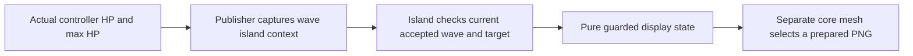

# VIS-35: existing core and progress landmarks

For Johannes Franz Lang (`frcola`), assisted by the building-art writer. Tracks
[issue #364](https://github.com/Nilsnova/The-Great-Plot-Twist/issues/364), starting
from material checkpoint `cd6dc2e77218762ba512d147a860f9228aed85d6`.

## Approved scope

The actual desktop/phone stage-one images show that an empty central heart,
oversized flat record/statue symbols and bright planning strips still prevent the
approved village composition. Restyle those existing displays. No headquarters
entity, purchase, progression, price, resource, collider or target is added.

The existing heart remains at `HEART={x:0,z:2}`, with unchanged 4×4 placement
keep-out and existing passability. Its visible landmark is an open-front navy and
gold pavilion, so the artwork does not imply a closed wall across a walkable
target. Core frames use approved presentation 128×128/anchor12 and common native
fit bounds across intact/damaged/ruin looks. The ordinary cabin remains separate.

## State and ownership plan

1. Claim Draft before source changes and retain separate clones/branches.
2. Generate original core and smaller progress-landmark assets; measure complete
   native rectangles, feet, transparency and shared state-scale bounds.
3. Implement a separate core decoration with `setHealth`, context reset,
   `retryArt` and idempotent disposal. The shared VIS-32 provider supplies art.
4. Read actual controller `islandHp/maxIslandHp`, immediately after island event
   batches and on the existing 250ms display poll. The narrator's threshold-only
   `heart_changed` event is not a complete health source.
5. Bind snapshots to the accepted wave and captured island context/epoch; ignore
   late old-wave/context/tick state. Accepted zero remains rubble until a new
   accepted wave or genuine reset/context change. Never write HP to the sim.
6. Keep real best-wave/rank and milestone stages in smaller wood/brass/nautical
   displays; draw actual numbers, never bake a concept's score into the asset.
7. Hide obsolete D056 strips for trusted perimeter policy1 and redundant large
   idle heart/planning graphics while managing, retaining live guidance/settings.
8. Run actual state/lifetime checks and obtain new complete desktop/phone game
   captures before any visual-acceptance claim.

VIS-34 owns projection conversions in `island/decorations.js` and
`pirates/battle-guide.js`; this writer changes artwork/size and presentation only.
New decoration feet use the existing `world/art.js` projection compatibility
alias. VIS-18 owns `island/world.js` loading/retry; the core uses a separate task
channel and no static fixed-frame tracker. Root reserves the small core-context
and health-forwarding hunks in `island/index.js` and `pirates/game-wiring.js`.

## Acceptance boundaries

- All real target coordinates, AI/pathing, paid layout, collision and player
  passability remain unchanged.
- Valid partial and zero HP select truthful art; missing/malformed/late snapshots
  cannot invent healing or show another island's damage.
- Registered asset failure is explicit/retryable; disposal ignores late work and
  releases owned textures/materials without a stale scene write.
- Record numbers/ranks and statue thresholds stay authoritative, including reset.
- Generated sources are supplementary; actual 1280×720 and 375×812 scenes decide
  the next quality checkpoint. No Chrome/full suite until coordinator allocation.

No dependency, account/service, environment edit, backend/migration, production
activation, main/force push, deployment or merge is authorized. Keep Draft for
Johannes's explain-back and independent human review.

## Implemented source and authority boundary

`pirates/game-wiring.js` forwards a readonly snapshot immediately after each
island event batch, and also on the existing 250ms recovery-display poll. The
controller updates its state before that callback, and finishes afterward. A
real seeded loss test proves the final zero reaches the model before
`finishWave`; polling alone could miss that state after the flow clears.



`core-display.js` captures the island context once for each controller wave
object. Traveling later cannot relabel that old wave as the new island.
`core-state.js` requires matching accepted wave/context/epoch, nondecreasing
ticks, finite HP in `[0,max]` and positive max. It stores a frozen copy. Same-wave
HP0 cannot revive from a later stale snapshot. A new accepted wave may begin
with its own health. Genuine reset, travel or target/epoch change clears the
display context; ordinary rereads of the same island do not clear damage.

The visual state is broken at zero, damaged below half health, and intact at or
above half health. Unknown state has a neutral intact presentation with no
numeric health claim. The existing combat HUD remains the precise health UI.
No new health is persisted or written to the simulation/server.

`core-world.js` owns one 128×128/anchor12 mesh at the existing heart foot and
three prepared materials. It waits until all three frames are ready, adopts
the latest accepted state after async preparation, coalesces retries and releases
partial/late work. Disposal is idempotent. Core artwork never adds a collider
or interaction zone. Its open-front/source-floor appearance reflects the
existing player-passable target rather than inventing a closed headquarters.

Progress landmarks retain their original world positions and saved-wave/stage
rules. The board is 40×48/anchor4, and statues are 40×56/anchor4. The actual
wave/rank and existing milestone threshold are drawn over blank native plaques.
Statue textures change only when the reached stage changes. Tree scaling and
restoration retain their previous rules. The leaderboard's existing painters
and rank/threshold definitions remain unchanged.

Management preview suppresses the redundant large battle-guide graphics; live
combat still draws its routes and health marks. Trusted perimeter policy1 never
draws obsolete D056 wall-lane rows. The legacy policy retains its old lanes
outside management. Route construction, movement, combat and settings are not
changed. VIS-34's coordinate-only hunks remain separate.

## Shared integration boundary

This component depends on the serialized VIS-18 loading/status slice. Its index
calls `deco.runArtTask('core', operation)`; the existing visible Retry must also
call `ctx.retryAdditionalArt`. `decorateProgress.retryArt()` must run as the
`progress` task initially and on both Retry entry points. A small exact patch
against VIS-18 was handed to the coordinator. The coordinator owns those
`world.js` hunks and the central `village-families.js` imports of `core.js` and
`progress.js`, beside the selected-dock and shared-projection integration.

Both sheets use the shared local VIS-32 decoder/normalizer. No image requests
occur at metadata import time. Registered preparation failure is explicit and
retryable through the shared status channel. The core's changing frame is not
tracked by the static fixed-frame helper. Related-state native fit bounds
retain rubble and statue progression scale without source-image edits.

## Verification recorded on November 17

The focused source run used:

```sh
cd frontend
npm test -- --maxWorkers=1 tests/island/progress-art-lifecycle.test.js tests/island/core-progress-art.test.js tests/island/core-world.test.js tests/island/core-state.test.js tests/pirates/core-display.test.js tests/pirates/core-controller.test.js tests/island/decorations.test.js tests/pirates/battle-guide.test.js tests/pirates/controller.test.js
```

Exact result: `Test Files 9 passed (9)`, `Tests 74 passed (74)`, `Duration 3.32s`.
These exercise real controller/sim health timing, the pure model and actual
Three.js geometry/material/texture disposal; Canvas preparation is mocked in
the Node renderer tests. PNG headers/hash checks and read-only alpha inspection
verify shipped source bytes/metadata, not real GPU appearance.

`cd frontend && npm run build && node scripts/report-budget.js --check` exited
0. The build includes the production spoiler guard. Text lint:
`Text lint: 4515 candidate strings in 519 source files; 0 errors, 8 report-only findings.`
The eight report-only findings are in existing protected/adapter fixture copy;
this task does not edit that copy or the reviewed vocabulary.

Not run here: full suite, Chrome, a11y/demo checks, live backend/account checks,
combined static-retry/projection/dock runtime, or final visual acceptance.
The coordinator reserves Chrome and must attach actual before/after 1280×720
and 375×812 scenes plus intact/partial/zero, retry and reset/context evidence.
Source PNGs or a passing Node/build check do not establish mockup fidelity.

## Explain-back rehearsal prompts

These are agent-drafted topics for Johannes's own explanation, not a claimed
human rehearsal or exam answer:

1. Why can a threshold-only narrator event or a 250ms poll miss the final core
   health, and where does the real controller test prove the immediate path?
2. Trace an old wave's snapshot after visiting another island. Which captured
   key, accepted-wave check and epoch/tick guard prevent it from changing art?
3. Why do intact and rubble sprites share native fit bounds, and which resources
   must a failed or disposed asynchronous preparation release?
